# Велика буква та лапки у власних назвах

1.2. Орфографія · 25 завдань · [джерело](https://zno.osvita.ua/ukrmova/tag-velika_bukva_ta_lapki_u_vlasnih_nazvah/)

## Завдання 1

**Прочитайте текст і виконайте завдання**

(1) Веселка, виграваючи розмаїттям кольорів, завжди викликала радість і захоплення в усіх народів. (2) Її називали дугою, аркою та обожнювали, як сонце, і ***(З,з)емлю***, і трави. (3) Древні ***(І,і)ндійці*** вважали райдугу величним луком ***(Б,б)ога*** Індри за допомогою якого він пускав стріли, уражаючи злих **демонів**, що ховалися в чорні хмари. (4) За давнім повір’ям, ця дуга піднімає вгору воду з озер, рік, а потім повертає її у вигляді дощу. (5) У народі кажуть: «Веселка воду бере». (6) Українці вірили: райдуга – це труба, що сягає одним кінцем неба, а інший опускає в криницю, з якої п’є ***(Б,б)огородиця***.

З великої літери в тексті треба писати слово

- **А** (З,з)емлю
- **Б** (І,і)ндійці
- **В** (Б,б)ога
- **Г** (Б,б)огородиця

**Відповідь: Г**

Пояснення

**ТЕМА: Орфографія. Велика літера у власних назвах**

Завдання перевіряє ваші вміння розпізнавати вивчені орфограми й пояснювати їх за допомогою правил, правильно писати слова з вивченими орфограмами.

Уважно перегляньте весь мікротекст, оскільки розуміння тексту, його стилю дозволить вам правильно дібрати відповідне за змістом слово.

Проаналізуймо лексичні значення запропонованих слів:

*індійці –* слово, на позначення національності, потрібно писати з малої;

*земля –* у тексті вживається на позначення поняття «ґрунт», потрібно писати з малої;

*бог* – у тексті вказує на міфологічного героя, потрібно писати з малої літери;

*Богородиця –* найвищий релігійний термін, потрібно писати з великої літери.

**Відповідь – Г.**

## Завдання 2

Правил уживання великої літери дотримано в усіх рядках, ОКРІМ

- **А** Данило Галицький, Ярослав Мудрий, Нестор Літописець
- **Б** Західна Європа, Республіка Польща, Південне Полісся
- **В** Біла Церква, Мала Олександрівка, Холодний Яр
- **Г** Київська Русь, Золота Орда, Чортомлицька Січ
- **Д** Чумацький Шлях, Великий Віз, Комета Галлея

**Відповідь: Д**

Пояснення

**ТЕМА: Орфографія. Правопис великої літери.**

Це завдання перевіряє ваше вміння **розпізнавати** вивчені орфограми (уживання великої літери у власних назвах) й **пояснювати** їх за допомогою правил; правильно *писати* слова з вивченими орфограмами, **знаходити** й **виправляти** орфографічні помилки на вивчені правила.

З великої літери потрібно писати всі слова в астрономічних назвах, крім загальних (*планета, астероїд, сузір**’**я, галактика, туманність* тощо). Отже, астрономічну назву, запропоновану в тесті, потрібно написати так: ***к**омета Галлея.*

**Відповідь – Д.**

## Завдання 3

Позначте рядок, у якому виділене слово слід писати з малої літери:

- **А** Йшли ми до *(Ш, ш)евченкового* генія духу золотого зачерпнуть! (Ю. Сердюк).
- **Б** Щороку в березні в усіх навчальних закладах України відбуваються*(Ш, ш)евченківські* читання (З газети).
- **В** Оригінальні *(Ш, ш)евченкові* твори дають щедру інформацію про те, як він жив (Г. Грабович).
- **Г** Озветься знов діброва темнолиста, коли до тебе, хлопче, край села, немов дарунок теплого дитинства, *(Ш, ш)евченкова* калина зацвіла(М. Сингаївський).
- **Д** Живе й не вмирає *(Ш, ш)евченківська* мати, колгоспна кріпачка, забута не раз (П. Скунць).

**Відповідь: Д**

Пояснення

**ТЕМА: Орфографія. Велика літера**

Завдання перевіряє вміння правильно писати слова з вивченими орфограмами.

Присвійні прикметники, утворені від власних особових імен за допомогою суфіксів ***-івськ-/-ївськ-, -евськ-/-євськ-, -инськ-/-інськ-/-їнськ-***, пишемо з малої букви: *шевченківська* *мати*.

Зауважмо, що присвійні прикметники, утворені від іменників – власних назв і входять до складу назв, що мають значення **«імені когось»**, **«пам’яті когось»**, пишемо з великої букви: *Шевченківські* *читання*.

**Відповідь – Д.**

## Завдання 4

Прикладки слід писати в лапках у всіх словосполученнях рядка

- **А** озеро Світязь, цукерки Ведмедик, село Веселе
- **Б** квітка тюльпан, напій Фанта, пес Пірат
- **В** місто Прилуки, фірма Оріон, роман Московіада
- **Г** готель Харків, печиво Сюрприз, комедія Мина Мазайло
- **Д** фільм Сяяння, дівчина Марійка, холодильник Норд

**Відповідь: Г**

Пояснення

**ТЕМА: Синтаксис. Розділові знаки при непоширених прикладках**

Це завдання перевіряє ваше вміння добирати потрібний правильний розділовий знак, оформлюючи прикладку.

Зауважмо, що в лапки потрібно брати прикладки, які означають умовні індивідуальні назви заводів, організацій, кораблів, установ, спортивних команд, газет, журналів, творів тощо.

Отже, прикладки слід писати в лапках у всіх словосполученнях рядка ***Г***: *готель «Харків», печиво «Сюрприз», комедія «Мина Мазайло».*

**Відповідь – Г.**

## Завдання 5

Велику літеру вжито правильно в усіх словосполученнях рядка

- **А** поет Василь Стус, князь Данило галицький
- **Б** Петро Гулак-Артемовський, Президент України
- **В** шекспірівський сонет, Франкове «зів\'яле листя»
- **Г** «Слово про Похід Ігорів», спорткомплекс «Олімпійський»
- **Д** Луганський національний університет, Бахчисарайський Район

**Відповідь: Б**

Пояснення

**ТЕМА: Орфографія. Правопис великої літери**

Завдання перевіряє рівень ваших навичок розпізнавати вивчені орфограми й пояснювати їх за допомогою правил, правильно *писати* слова з вивченими орфограмами.

Проаналізуймо запропоновані слова.

У рядках ***А, В, Г, Д*** є помилки.

З великої літери пишемо:

- імена людей, по батькові, прізвища, псевдоніми, прізвиська: *Данило Галицький;*

- назви художніх, музичних творів тощо, наукових праць, газет, журналів: *Франкове «Зів'яле листя»*.

Зверніть увагу, що в назві твору «Слово про похід Ігорів» слово *«похід»* треба писати з малої літери.

Назви вулиць (бульварів, провулків, проспектів), шляхів (залізничних, морських тощо), каналів, течій (морських), а також майданів (площ), парків тощо пишуться з великої літери, а їхні родові позначення – з малої: *Бахчисарайський район*.

Правильно вжито велику літеру в усіх словосполученнях рядка ***Б***: *Петро Гулак-Артемовський* (ім’я, прізвище), *Президент України* (назва найвищої державної посади України).

**Відповідь – Б.**

## Завдання 6

Правила вживання великої літери дотримані в уривку з афіші

- **А** 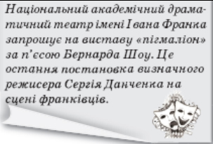
- **Б** 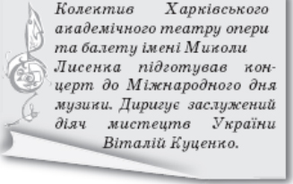
- **В** 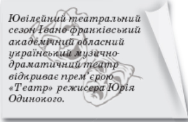
- **Г** 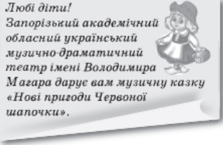
- **Д** 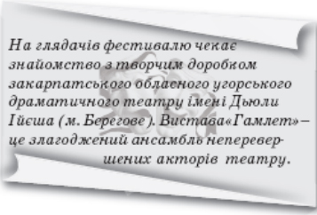

**Відповідь: Б**

Пояснення

**ТЕМА: Орфографія. Правопис великої літери**

Завдання перевіряє рівень ваших навичок розпізнавати вивчені орфограми й пояснювати їх за допомогою правил, правильно писати слова з вивченими орфограмами.

Проаналізуймо запропоновані уривки з афіш.

Правила вживання великої літери дотримані у варіанті ***Б***.

В афішах, позначених літерами ***А, В, Г, Д*,** є помилки.

З великої літери пишемо імена дійових осіб у байках, казках, драматичних творах: *Червона Шапочка*; назви художніх, музичних творів: *вистава «Пігмаліон».*

Назви театрів треба писати з великої літери: *Івано-Франківський академічний музично-драматичний театр, Закарпатський обласний угорський драматичний театр.*

**Відповідь – Б.**

## Завдання 7

Прочитайте фрагмент тексту.

Було всього — і звад, і згод,

І перша слава (1)Ж/жовтих (2)В/вод,

І (3)К/корсуня звитяжний клич,

І (4)Б/берестечка чорна ніч,

І сонце Золотих (5)В/воріт –

Всього було за плином літ.

Малу літеру треба писати після цифри

- **А** 1
- **Б** 2
- **В** 3
- **Г** 4
- **Д** 5

**Відповідь: Д**

Пояснення

**ТЕМА:** **Орфографія. Правопис великої літери**

Завдання перевіряє рівень ваших навичок розпізнавати вивчені орфограми й пояснювати їх за допомогою правил, правильно писати слова з вивченими орфограмами.

Проаналізуймо запропоновані слова.

З великої літери пишуться:

Географічні й топографічні власні назви, крім службових слів і родових означень: *Корсунь, Берестечко*; коли означуване слово, що входить до географічної назви, не виражає родового поняття, то воно пишеться з великої літери: *Жовті Води*.

У назві пам'ятки архітектури пишемо з великої літери лише перше слово: *Золоті ворота.*

**Відповідь: Д.**

## Завдання 8

Правила вживання лапок дотримані в уривку з афіші

- **А** 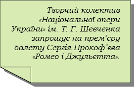
- **Б** 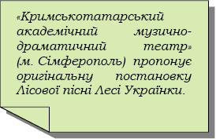
- **В** 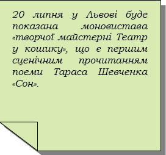
- **Г** 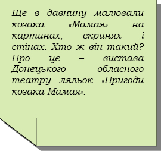
- **Д** 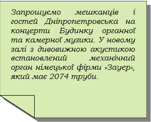

**Відповідь: Д**

Пояснення

**ТЕМА:** **Орфографія. Лапки у власних назвах**

Завдання перевіряє ваше вміння розпізнавати вивчені орфограми (лапки у власних назвах) та пояснювати їх за допомогою правил.

Згадаймо, що **лапки́** **–** розділовий знак, що використовується задля вирізнення прямої мови, цитат, заголовків, а також слів, ужитих у непрямому, найчастіше іронічному значенні.

**У лапки́ беруть:**

- **індивідуальні назви заводів, фабрик, клубів, пароплавів, організацій, підприємств, наукових праць, літературних творів, газет, журналів, кінофільмів тощо**.

Отже, у рядку **Б** помилка, оскільки назву постановки треба взяти в лапки́: *постановка «Лісової пісні».* У рядку **В** у лапки́ треба взяти лише назву творчої майстерні: *моновистава творчої майстерні «Театр у кошику».*

**У лапки́ не беруть:**

- імена, прізвища людей; **власні назви неумовного характеру**.

Отже, у рядках **А, Б, Г** потрібно виправити помилки, без лапок пишемо: *колектив Національної опери України, Кримськотатарський академічний музично-драматичний театр, козак Мамай*.

**Відповідь: Д.**

## Завдання 9

Правил уживання великої літери дотримано у варіанті

- **А** 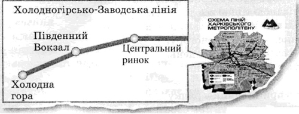
- **Б** 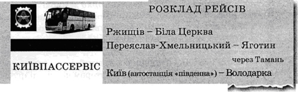
- **В** 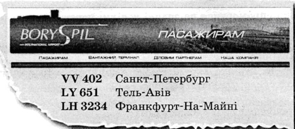
- **Г** 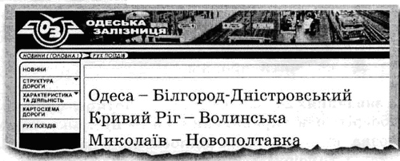

**Відповідь: Г**

Пояснення

**ТЕМА:** **Орфографія. Правопис великої літери**

Завдання перевіряє рівень ваших навичок розпізнавати вивчені орфограми й пояснювати їх за допомогою правил, правильно писати слова з вивченими орфограмами.

Проаналізуймо запропоновані фрагменти.

У рядках **А, Б** є помилки, оскільки назви вокзалів, станцій, портів, пристаней пишемо з великої букви, а родове поняття з малої: *Південний вокзал, автостанція «Південна»*.

У рядку **В** правильно писати назву міста так: *Франкфурт-на-Майні* (географічні назви, що складаються з іменників, які поєднуються українськими або іншомовними прийменниками, сполучниками чи мають при собі частку, артикль, а також утворені від них прикметники).

Помилка є також у рядку **Д**: назву площі пишемо з великої літери: *площа Князя* *Ярослава Осмомисла**.*

**Відповідь: Г.**

## Завдання 10

Правил уживання великої літери дотримано в рядку

- **А** острів Нова Гвінея, Івано-франківська область
- **Б** сузір’я Великого Пса, Балканський півострів
- **В** Друга Світова Війна, Європейський Союз
- **Г** Іван Нечуй-Левицький, Сполучені штати Америки
- **Д** Конституція України, балет «Лісова Пісня»

**Відповідь: Б**

Пояснення

**ТЕМА:** **Орфографія. Правопис великої літери**

Завдання перевіряє рівень ваших навичок розпізнавати вивчені орфограми й пояснювати їх за допомогою правил, правильно писати слова з вивченими орфограмами.

Проаналізуймо запропоновані слова. У рядках **А** і **Г** є помилки, оскільки **велику літеру пишемо в географічних, топографічних, астрономічних назвах; назвах найвищих державних установ і міжнародних організацій, держав і автономних адміністративних одиниць:** *острів Нова Гвінея, **Івано-Франківська** область, сузір’я Великого Пса, Балканський півострів, Європейський Союз, **Сполучені Штати Америки**.*

З великої букви пишемо **прізвища, імена, по батькові** людей: *Іван Нечуй-Левицький.*

Велику літеру пишемо в **назвах найважливіших документів**: *Конституція України.*

Помилка є також у рядку **Д**: назву балету треба **брати в лапки**, але з великої літери пишемо лише **перше** **слово**: *балет «Лісова пісня».*

**Відповідь: Б.**

## Завдання 11

**Прочитайте фрагмент тексту.**

Уперше ступаючи на стародавню бруківку (1)*В/вічного* міста навесні 1837 року, Гоголь стає обожнювачем (2)*Р/рима*, його чудовим знавцем. Працюючи над (3)«*М/мертвими* душами», він часто полишає перо на своєму вузенькому пюпітрі й відвідує пам’ятки минувшини, розкішні (4)*Р/римські* палаци, а до улюбленого друга й порадника (5)*К/колізею* йде з мольбертом і фарбами.

З малої букви треба писати слово після цифри

- **А** 1
- **Б** 2
- **В** 3
- **Г** 4
- **Д** 5

**Відповідь: Г**

Пояснення

**ТЕМА: Орфографія. Правопис великої літери**

Завдання перевіряє ваше вміння правильно писати слова з вивченими орфограмами, зокрема велику літеру у власних назвах.

З великої літери потрібно писати назви населених пунктів, територій, вулиць, будівель *(Вічне місто, Рим, Колізей).*

З великої літери пишемо перше слово в назвах художніх творів, такі назви також беремо в лапки (*«Мертві душі»*).

Прикметники з суфіксом ***-ськ-*** на позначення великої кількості однотипних предметів пишемо з малої літери (*римські палаци*).

**Відповідь – Г.**

## Завдання 12

**Прочитайте текст** **і виконайте завдання**

***(1)*** Дуб здавна постає як символ незламної сили, могутності та переможного довголіття. ***(2)*** У селі *(В,в)*ерхня Хортиця, яке нині перетворилося на передмістя Запоріжжя, височить дуб-велетень, вік якого понад вісімсот років. ***(3)*** Ще за часів *(К,к)*иївської Русі з брунатного жолудя проклюнувся паросток і, набираючи сили, згодом перетворився на розлоге дерево. ***(4)*** Під ним проходили мешканці *(П,п)*івденних степів, у його затінку вони відпочивали, ховалися від дощу або палючого сонця. ***(5)*** Нині над дубом-велетнем мчать реактивні лайнери, пролітають штучні супутники *(З,з)*емлі, а він, як і колись, живе, зеленіє, задумливо шумить серед безкраїх рідних обширів.

З маленької букви в тексті треба писати слово

- **А** (В,в)ерхня
- **Б** (К,к)иївської
- **В** (П,п)івденних
- **Г** (3,з)емлі

**Відповідь: В**

Пояснення

**ТЕМА: Орфографія. Правопис великої літери.**

Це завдання перевіряє ваше вміння розпізнавати вивчені орфограми (вживання великої літери у власних назвах) й пояснювати їх за допомогою правил; правильно писати слова з вивченими орфограмами, знаходити й виправляти орфографічні помилки на вивчені правила.

Виконуючи це завдання, обов’язково звертайтеся до мікротексту.

Слова *Київська Русь* та *Верхня* Хортиця – це власні назви. Слово *Земля* в запропонованому мікротексті вживається на позначення назви планети. Отже, теж є власною назвою. А от слово *південні* не позначає індивідуальну назву одного з ряду однотипних предметів чи одного в природі. Це слово лише вказує на територіальну ознаку предмета. Отже, це не власна, а загальна назва, тому її потрібно писати з малої букви.

**Відповідь – В.**

## Завдання 13

Правил уживання великої літери дотримано в усіх рядках, ОКРІМ

- **А** езопова мова, бульвар Академіка Вернадського
- **Б** Декларація прав людини, сузір\'я Великий Віз
- **В** Національна опера України, Нобелівська премія
- **Г** гора Ай-Петрі, кінофільм «Поводир»
- **Д** День соборності, Шекспірівський стиль

**Відповідь: Д**

Пояснення

**ТЕМА: Орфографія. Правопис великої літери**

Це завдання перевіряє ваше вміння розпізнавати вивчені орфограми (уживання великої літери у власних назвах) й пояснювати їх за допомогою правил; правильно писати слова з вивченими орфограмами, знаходити й виправляти орфографічні помилки на вивчені правила.

Усі слова, крім службових, потрібно писати з великої літери в астрономічних назвах, географічних, назвах вулиць, площ, бульварів тощо. Отже, власні назви *бульвар Академіка Вернадського, сузір’я Великий Віз, гора Ай-Петрі* написано правильно.

У назвах документів і свят з великої літери треба писати лише перше слово (*Декларація прав людини, День соборності).*

У назвах державних установ з великої літери теж пишемо лише перше слово *(Національна опера України).*

Назви книг, кінофільмів, вистав беремо в лапки *(кінофільм «Поводир»).*

Прикметники з суфіксами ***-ов-, **-ев-**, **-ів-**, **-ін-**, **-ин-*** треба писати з великої літери (*Петрове подвір’я, Франкові вірші*). Але фразеологізми та терміни з такими суфіксами пишемо з малої *(езопова мова).* А прикметники з суфіксом *-ськ-* потрібно писати з малої літери (*шекспірівський стиль),* окрім сполучень на позначення *імені чогось, пам’яті чогось (Нобелівська премія).*

**Відповідь – Д.**

## Завдання 14

Помилку в написанні власної назви допущено в рядку

- **А** Картина Леонардо да Вінчі «Залізний птах» наштовхнула киянина Ігоря Сікорського на винахід гвинтокрила.
- **Б** Небесний тихохід відомого конструктора вперше здійнявся над землею напередодні Першої світової війни.
- **В** Чотиримоторний аероплан «Ілля Муромець» київського інженера згодом став справжньою легендою.
- **Г** Ще один цікавий факт: літак названо на честь славного воїна Іллі з Моровійська на Чернігівщині.
- **Д** Це цілком реальна людина, мощі якої нині покояться в Києво-Печерській Лаврі.

**Відповідь: Д**

Пояснення

**ТЕМА: Орфографія. Правопис великої літери.**

Це завдання перевіряє ваше вміння розпізнавати вивчені орфограми (уживання великої літери у власних назвах) й пояснювати їх за допомогою правил; правильно писати слова з вивченими орфограмами, знаходити й виправляти орфографічні помилки на вивчені правила.

У власних назвах на позначення культових споруд з великої літери пишемо лише перше слово. Слово ***лавра*** потрібно писати з малої, адже це загальна назва (як *монастир*, *собор, церква*).

**Відповідь – Д.**

## Завдання 15

Правил уживання великої літери дотримано в усіх словосполученнях рядка, ОКРІМ

- **А** Берингова протока, сміх Мефістофеля
- **Б** математична олімпіада, острів Хортиця
- **В** Маріїнський Палац, езопівська мова
- **Г** Бабин Яр, Палац урочистих подій
- **Д** Савур-могила, європейські країни

**Відповідь: В**

Пояснення

**ТЕМА: Орфографія. Правопис великої літери.**

Це завдання перевіряє ваше вміння розпізнавати вивчені орфограми (уживання **великої літери** у власних назвах) й пояснювати їх за допомогою правил; **правильно писати** слова з вивченими орфограмами, знаходити й виправляти **орфографічні помилки** на вивчені правила.

З **малої літери** пишемо прикметники з суфіксом *–ськ- (езопівська мова, європейські країни),* а також загальні назви, що визначають тип події (*математична олімпіада).*

З **великої літери** потрібно писати всі слова в географічних назвах, крім загальних (*протока, острів, могила* тощо). *Бабин Яр* – це урочище в північно-західній частині Києва (між районами Лук’янівка й Сирець), що всесвітньо відоме як місце масових страт цивільного населення в роки Другої світової війни. Слово *яр* тут втратило своє загальне значення, а стало частиною єдиної власної назви.

Також з **великої літери** пишемо імена літературних персонажів (*Мефістофель);* лише перше слово в назвах держаних установ (*Палац урочистих подій),* історичних пам’яток (*Маріїнський палац,* а не *Маріїнський Палац).*

**Відповідь – В.**

## Завдання 16

Правил уживання великої букви дотримано в реченні

- **А** На Майдані Свободи в Харкові на Новий Рік зазвичай установлюють велику штучну ялинку.
- **Б** Наша Сонячна система – частина галактики Чумацький Шлях, яка є лише піщинкою у Всесвіті.
- **В** У серпні 1991 року Верховна рада України ухвалила Акт проголошення Незалежності України.
- **Г** За міфами, гора Парнас – це місцеперебування Бога Аполлона та його супутниць – дев\'яти Муз.

**Відповідь: Б**

Пояснення

**ТЕМА: Орфографія. Правопис великої літери.**

Це завдання перевіряє ваше вміння розпізнавати вивчені орфограми (уживання великої літери у власних назвах) й пояснювати їх за допомогою правил; правильно писати слова з вивченими орфограмами, знаходити й виправляти орфографічні помилки на вивчені правила.

З великої літери потрібно писати всі слова в астрономічних назвах, крім загальних (*планета, астероїд, сузір**’**я, галактика, туманність, система* тощо). Отже, астрономічні назви, запропоновані в тесті, написано правильно.

Слово *бог* потрібно написати з малої літери, адже тут воно має значення типу міфологічного персонажа. *Новий рік* – це назва свята, тому з великої літери потрібно писати лише перше слово. *Верховна Рада України* – назва найвищого державного органу, тому з великої літери потрібно писати всі слова.

**Відповідь – Б.**

## Завдання 17

НЕ ДОТРИМАНО правил уживання великої букви в рядку

- **А** Коліївщина, Верховна Рада України, трипільська культура
- **Б** сузір’я Великий Віз, країни Близького Сходу, бог Перун
- **В** хрестові походи, Ріо-де-Жанейро, Олімпійські Ігри
- **Г** доба неоліту, Андріївський узвіз, День будівельника

**Відповідь: В**

Пояснення

**ТЕМА: Орфографія. Правопис великої літери**

Завдання перевіряє рівень ваших навичок розпізнавати вивчені орфограми й пояснювати їх за допомогою правил, правильно писати слова з вивченими орфограмами.

НЕ ДОТРИМАНО правил уживання великої букви в рядку **В**.

Зверніть увагу, що з великої літери пишемо початкові слова офіційної назви внутрішніх та міжнародних фестивалів, конкурсів, змагань: *Олімпійські ігри.*

**Відповідь: В.**

## Завдання 18

Правил уживання великої букви у власних назвах дотримано в усіх рядках, ОКРІМ

- **А** езопова мова, бульвар Академіка Вернадського
- **Б** День соборності, Шекспірівський стиль
- **В** Національна опера України, Нобелівська премія
- **Г** гора Ай-Петрі, кінофільм «Поводир»

**Відповідь: Б**

Пояснення

**ТЕМА:** **Орфографія. Правопис великої літери**

Завдання перевіряє рівень ваших навичок розпізнавати вивчені орфограми й пояснювати їх за допомогою правил, правильно писати слова з вивченими орфограмами.

НЕ ДОТРИМАНО правил уживання великої букви в рядку **Б.**

Зверніть увагу, що прикметники з суфіксом ***-ськ-*** потрібно писати з малої літери *(шекспірівський стиль)*, окрім назв на позначення імені чогось, пам'яті чогось *(Нобелівська премія)*.

**Відповідь: Б.**

## Завдання 19

НЕМАЄ орфографічних помилок у варіанті

- **А** Перлиною архітектурної спадщини України є Підгорецький Замок, що вражає уяву відвідувачів французькою лаконічністю та італійською розкішю.
- **Б** Спроєктував палац відомий венеційський архітектор Андреа дель Аква, тож недивно, що за вишуканістю памятка не поступається Версалю.
- **В** Пишно оздоблена споруда була задумана як ризиденція з обороними функціями, а заклали її на місці старовинної фортеці в XVII столітті.
- **Г** Про призначення замку дізнавалися з напису латиною на мармуровій таблиці: «Вінець ратних трудів – перемога, перемога – тріумф, тріумф – відпочинок».

**Відповідь: Г**

Пояснення

**ТЕМА: Орфографія. Велика літера у власних назвах. Апостроф. Правопис частки НЕ. Подвоєння і подовження**

Завдання перевіряє ваше вміння розпізнавати різні вивчені орфограми та пояснювати їх за допомогою правил.

У варіанті ***А*** слово *замок* потрібно написати з малої літери, адже це загальна назва. Також у слові *розкішшю* є подовження (це іменник ІІІ відміни, орудний відмінок, позиція між двома голосними).

У варіанті ***Б*** потрібно окремо написати *не дивно* (це присудок), а слово *пам’ятка* написати з апострофом.

У варіанті ***В*** помилки у слові *оборонними* (подвоєння на межі кореня та суфікса) та в іншомовному слові *резиденція* (правопис необхідно запам’ятати).

**Відповідь – Г.**

## Завдання 20

Дотримано правил уживання великої букви в рядку

- **А** журнал «Автосвіт», Середземне море, Музей Історії Києва
- **Б** орден Держави, День авіації, бульвар Тараса Шевченка
- **В** Хотинський Замок, комета Галлея, Північна Америка
- **Г** Антарктида, сузір’я Великого пса, станція метро «Почайна»

**Відповідь: Б**

Пояснення

**ТЕМА: Орфографія. Правопис великої літери.**

Завдання перевіряє вміння розпізнавати правильне й неправильне вживання великої літери.

Проаналізуймо запропоновані слова. Дотримано правил уживання великої букви в рядку **Б**.

У решті рядків допущено такі помилки:

- **астрономічна назва:** обидва слова пишуть з великої літери – *сузір’я* ***Великого* ***Пса*.

- **загальні назви у складі власних:** слова ***історії*** (*Музей історії Києва*) і ***замок*** (*Хотинський замок*) треба писати з малої літери.

**Відповідь: Б.**

## Завдання 21

Правил уживання великої букви у власних назвах дотримано в усіх рядках, ОКРІМ

- **А** Західна Європа, Республіка Польща, Південне Полісся
- **Б** Київська Русь, Золота Орда, Чортомлицька Січ
- **В** Данило Галицький, Ярослав Мудрий, Нестор Літописець
- **Г** Чумацький Шлях, Великий Віз, Комета Галлея

**Відповідь: Г**

Пояснення

**ТЕМА: Орфографія. Правопис великої літери.**

Завдання перевіряє вміння розрізняти випадки вживання великої і малої літери у назвах.

НЕ ДОТРИМАНО правил уживання великої букви у словах із рядка **Г**. Зверніть увагу, що родові означення при астрономічних назвах пишемо з малої літери: *комета Галлея.*

**З великої літери** пишемо:

- усі слова астрономічних назв, а також народних назв сузір’їв і галактик: *Чумацький Шлях*, *Великий Віз*;

- усі слова власних назв: *Данило Галицький*, *Ярослав Мудрий*, *Нестор Літописець*;

- назви держав, регіонів та адміністративних одиниць: *Західна Європа*, *Республіка Польща*, *Південне Полісся*;

- назви держав і територій (історичні назви): *Київська Русь*, *Золота Орда*, *Чортомлицька Січ*.

**Правильна відповідь: Г.**

## Завдання 22

НЕ ДОТРИМАНО правил уживання великої букви в рядку

- **А** Коліївщина, Верховна Рада України, трипільська культура
- **Б** сузір’я Великий Віз, країни Близького Сходу, бог Перун
- **В** хрестові походи, Ріо-де-Жанейро, Олімпійські Ігри
- **Г** доба неоліту, Андріївський узвіз, День будівельника

**Відповідь: В**

Пояснення

**ТЕМА: Орфографія. Правопис великої літери.**

Завдання перевіряє вміння розпізнавати випадки вживання великої літери в різних власних назвах і загальних поняттях.

НЕ ДОТРИМАНО правил уживання великої букви в рядку **В.** З великої літери пишемо лише початкові слова офіційної назви внутрішніх і міжнародних фестивалів, конкурсів, змагань: *Олімпійські ігри.*

З **великої** літери пишемо:

- імена персонажів казок, байок, легенд, міфів: *бог Перун*;

- назви сторін світу, які вжито на означення країн, народів: *країни Близького Сходу*;

- географічні назви: *Ріо-де-Жанейро*;

- назви історичних подій, епох, війн, повстань, знаменних дат: *Коліївщина*;

- усі слова астрономічних назв, а також народних назв сузір’їв і галактик: *сузір’я Великий Віз*;

- назви пам’яток архітектури, замків, храмів: *Андріївський узвіз*.

У назвах історичних і календарних дат або свят із великої літери пишемо перше (або єдине) слово: *День будівельника.*

Усі слова з великої літери пишемо в назвах органів влади, державних, міжнародних установ: *Верховна Рада України*.

З **малої** літери пишемо назви історичних подій, епох, війн, геологічних періодів тощо, які стали загальними: *доба неоліту*, *хрестові походи*, *трипільська культура.*

**Відповідь: В.**

## Завдання 23

Правил уживання великої букви у власних назвах дотримано в усіх словах рядка

- **А** село Великі Береги, Академія Наук України
- **Б** Свято-Успенський Собор, Чумацький Шлях
- **В** Королівство Бельгія, Вербна неділя
- **Г** Південний Полюс, замок Потоцьких

**Відповідь: В**

Пояснення

**ТЕМА: Орфографія. Правопис великої літери.**

Дотримано правил уживання великої букви в рядку **В**. У назвах держав та автономних адміністративно-територіальних одиниць усі слова пишемо з великої букви: *Королівство Бельгія*. У назвах свят пишемо з великої букви перше слово: *Вербна неділя*.

В інших варіантах маємо **помилки**:

- у назвах установ, організацій і товариств **з** **великої літери** пишуть перше слово та власні назви, що входять до складу: *Академія* *Н**аук України* (правильно – *Академія наук України*);

- **велику літеру** пишемо в назвах монастирів, церков, храмів, **крім родових найменувань**: *Свято-Успенський* *С**обор* (правильно – *Свято-Успенський собор*);

- **з великої букви** пишемо географічні власні назви (незалежно від кількості їхніх складників), **крім службових слів і родових назв**: *Південний* *П**олюс* (правильно – *Південний полюс*).

**Правильна відповідь: В.**

## Завдання 24

НЕМАЄ помилки в правописі власних назв у рядку

- **А** Франкове «Зів’яле Листя», Петро Гулак-Артемовський
- **Б** Бахчисарайський Палац, король Данило галицький
- **В** Шекспірівський сонет, спорткомплекс «Олімпійський»
- **Г** художник Олекса Новаківський, Президент України

**Відповідь: Г**

Пояснення

**ТЕМА: Орфографія. Правопис великої літери.**

Завдання перевіряє навичку розпізнавати та пояснювати за допомогою правил вивчені орфограми, правильно писати слова з ними.

ДОТРИМАНО правил уживання великої букви в рядку **Г.** Зверніть увагу, що з **великої** літери пишемо назви **найвищих державних посад**: *Президент України.*

В інших варіантах треба виправити помилки: пишемо з великої літери лише перше слово в назві **збірки** *«Зів’яле листя»*, у назвах **архітектурних пам’яток** (храмів, палаців тощо): *Бахчисарайський палац*.

Обидва слова треба писати з великої літери у **власній** назві *Данило Галицький*.

З **малої** літери пишемо **відносні прикметники**, утворені від **власних** назв за допомогою *-ськ-*, якщо вони не входять до назв імені когось чи пам'яті когось: *шекспірівський сонет*.

**Правильна відповідь: Г.**

## Завдання 25

Правил уживання великої літери дотримано в усіх словосполученнях, ОКРІМ

- **А** Жанна д’Арк, Леонардо да Вінчі, Лююдвіг ван Бетховен
- **Б** День Конституції України, День Незалежності України, День Соборності України
- **В** Північний Льодовитий океан, Балканський півострів, Гора Говерла
- **Г** Львівська площа, майдан Незалежності, Стрийський парк

**Відповідь: В**

Пояснення

**ТЕМА: Орфографія. Правопис великої літери.**

Завдання перевіряє вміння розпізнавати вивчені орфограми й пояснювати їх за допомогою правил, правильно писати слова з вивченими орфограмами.

Правил уживання великої літери дотримано в усіх словосполученнях, ОКРІМ **В**: слово *гора* пишемо з малої літери, бо це родова назва. Назви морів, озер, річок, гір тощо, крім родових назв, які вживають у прямому значенні, пишемо з великої літери: *Північний Льодовитий океан*, *Балканський півострів*, *гора Говерла*.

Зверніть увагу, що з великої букви пишуть індивідуальні імена, по батькові, прізвища, псевдоніми, прізвиська людей, назви дійових осіб байок, казок, драматичних творів. У романських і германських прізвищах й іменах артиклі, прийменники, частки *ван*, *да*, *дас*, *де*, *даль*, *дер*, *дю*, *ла*, *ле*, *фон* тощо пишуть з малої букви й окремо від інших складових частин: *Жанна д’Арк*, *Леонардо да Вінчі*, *Людвіг ван Бетховен*.

У назвах вулиць, площ, парків, гаїв їхні родові означення пишуть із малої літери: *Львівська площа*, *майдан Незалежності*, *Стрийський парк*.

У назвах історичних і календарних дат або свят із великої літери пишемо перше (або єдине) слово, але: *День Конституції України*, *День Незалежності України*, *День Соборності України*.

**Правильна відповідь: В.**

