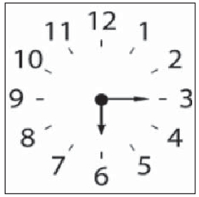
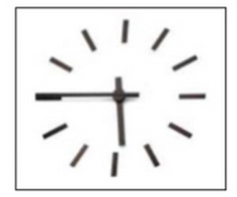

# Числівник

1.5. Морфологія · 85 завдань · [джерело](https://zno.osvita.ua/ukrmova/tag-chislivnik_1/)

## Завдання 1

Прочитайте речення.

***Медичний безпілотник набирає швидкість близько … кілометрів за годину й підвищує шанси на виживання під час серцевого нападу … відсотків.***

Правильним є варіант послідовного заповнення пропусків

- **А** сто, від восьми до вісімдесяти
- **Б** ста, від вісьми до восьмидесяти
- **В** ста, від восьми до восьмидесятьох
- **Г** сто, від вісьми до вісімдесяти
- **Д** ста, від восьми до вісімдесяти

**Відповідь: Д**

Пояснення

**ТЕМА: Морфологія. Типи відмінювання кількісних числівників. Поєднання числівника з іменником.**

Завдання перевіряє ваше вміння правильно відмінювати іменники, визначати відмінки іменників, правильно поєднувати числівники з іменниками.

Виконуючи це завдання, обов’язково звертайтеся до речення.

Під час виконання такого завдання необхідно визначити, у якому відмінку вжите те чи інше слово в реченні.

У запропонованому реченні числівники вжито в **родовому** та **знахідному** відмінках. Отже, *ста, від восьми до вісімдесяти.*

**Відповідь – Д.**

## Завдання 2

Прочитайте речення, у якому пропущено окремі слова.

*… Тетяна з Андрієм … від екскурсовода, що Тарасові … встановлено тисячу двісті п’ятдесят шість … в Україні й сто двадцять вісім за кордоном.*

Правильним є варіант послідовного заповнення пропусків

- **А** Вперше, дізналися, Шевченку, пам’ятники
- **Б** Уперше, дізналися, Шевченку, пам’ятників
- **В** Уперше, дізналася, Шевченко, пам’ятників
- **Г** Вперше, дізналася, Шевченко, пам’ятників
- **Д** Уперше, дізналися, Шевченку, пам’ятники

**Відповідь: Б**

Пояснення

**ТЕМА: Морфологія. Відмінювання іменників. Поєднання числівника з іменником.**

Завдання перевіряє ваше вміння правильно відмінювати іменники, визначати відмінки іменників, правильно поєднувати числівники з іменниками.

Виконуючи це завдання, обов’язково звертайтеся до речення.

Під час виконання такого завдання необхідно визначити, у якому відмінку вжите те чи інше слово в реченні.

Отже, пропуски потрібно заповнити так: на початку речення обираємо *уперше;* тут складений підмет (поєднання іменників у називному та орудному відмінках *Тетяна з Андрієм),* тому далі обираємо *дізналися;* чоловічі прізвища на -*ко* відмінюємо, тому *Шевченку*; складений числівник 256 поєднується з іменником у родовому відмінку множини, тому *пам’ятників.*

**Відповідь – Б.**

## Завдання 3

Помилково утворено форму числівника в реченні

- **А** Прогнозують, що до кінця наступного року довжина велосипедних шляхів у місті Лева сягатиме близько ***ста шістдесяти*** кілометрів.
- **Б** В Івано-Франківську майданчики біля магазинів радять облаштувати велотримачами з ***п‘ятьма - десятьма*** місцями.
- **В** В Одесі довжина велодоріжки з асфальтовим покриттям становить близько ***трьохсот*** метрів.
- **Г** Київська влада планує впродовж наступних років потішити містян ***шестистами*** кілометрами доріжок для велосипедистів.
- **Д** У Новій Зеландії є кінотеатр просто неба для охочих «спалити» близько ***п’ятисот*** калорій за годину: хочеш подивитися фільм - крути педалі на велотренажері.

**Відповідь: Г**

Пояснення

**ТЕМА: Морфологія. Відмінювання числівників**

Завдання перевіряє ваше вміння правильно відмінювати кількісні числівники.

Речення необхідно читати дуже уважно, щоб правильно визначити відмінок, у якому стоїть числівник.

Числівник *100* в усіх відмінках, крім називного й знахідного, має закінчення ***-а***: *ста*. Числівники *5**, 60* у родовому, давальному, орудному та місцевому відмінках мають паралельні форми (*п**’**ятьма, п**’**ятьома, десятьма, десятьома, шістдесяти, шістдесятьох).*

Числівники на позначення сотень за будовою є складними. У таких числівниках відмінюють першу й другу частини. Першу частину відмінюють так, як простий числівник. Отже, форми *трьохсот, п**’**ятисот* є правильними. А в орудному відмінку числівник *шістсот* матиме форми *шістьмастами, шістьомастами.* Форма *шестистами* є хибною. Решта числівників мають правильні відмінкові форми.

**Відповідь – Г.**

## Завдання 4

Розгляньте рисунок. Правильними відповідями на запитання «Котра година?» будуть усі, ОКРІМ

- **А** шоста година п’ятнадцять хвилин
- **Б** п’ятнадцять хвилин сьомої
- **В** п’ятнадцять хвилин по шостій
- **Г** чверть на сьому
- **Д** чверть по шостій

**Відповідь: Б**

Пояснення

**ТЕМА: Морфологія. Числівник**

Завдання перевіряє ваше вміння добирати правильні відмінкові форми числівників, правильно використовувати числівники на позначення часу.

В українській мові для позначення часу використовуються порядкові числівники. Вони вживаються в поєднанні з певними прийменниками, а саме: *на, по, до, за.*

Конструкція на позначення часу *п**’**ятнадцять хвилин сьомої* є хибною. Правильним відповідником буде: *«П’ятнадцять хвилин **на** сьому».*

**Відповідь – Б.**

## Завдання 5

Розгляньте малюнок. Правильними відповідями на запитання «Котра година?» будуть усі, ОКРІМ

- **А** п’ята година сорок п’ять хвилин
- **Б** за чверть шоста
- **В** п’ятнадцять хвилин до шостої
- **Г** за п’ятнадцять хвилин шоста
- **Д** п’ять годин сорок п’ять хвилин

**Відповідь: Д**

Пояснення

**ТЕМА: Морфологія. Числівник.**

Завдання перевіряє ваше вміння добирати правильні відмінкові форми числівників, правильно використовувати числівники на позначення часу.

В українській мові для позначення часу використовують **порядкові** числівники. Їх уживають у поєднанні з певними прийменниками, а саме: *на, по, до, за.* Конструкція на позначення часу *п**’**ять годин сорок п**’**ять хвилин* є хибною.

**Відповідь – Д.**

## Завдання 6

Прочитайте фрагмент тексту, у якому пропущено окремі слова.

***Керівника туристичного гуртка Олексія … повідомили про те, що за півтора … занять група учнів … орієнтуватися …***

Правильним є варіант послідовного заповнення пропусків

- **А** Пономаренко, місяці, навчилась, по зірках
- **Б** Пономаренка, місяця, навчилась, за зірками
- **В** Пономаренка, місяці, навчились, по зіркам
- **Г** Пономаренко, місяця, навчились, за зірками
- **Д** Пономаренка, місяця, навчились, по зіркам

**Відповідь: Б**

Пояснення

**ТЕМА. Морфологія. Синтаксис. Відмінювання іменників. Узгодження числівника з іменником. Узгодження присудка з підметом.**

Чоловічі прізвища на ***-ко*** в українській мові відмінюють. Тому правильний варіант *Пономаренка.*

Числівник *півтора* узгоджується з іменником в родовому відмінку однини (*місяця*).

При підметах, виражених словосполученнями з іменниками *більшість, меншість, частина,* *група* тощо, дієслово-присудок ставимо в однині і в тому ж роді, що і підмет. Отже, *навчилась.*

У місцевому відмінку множини іменники першої відміни мають закінчення *-ами, -ями.*

Прийменник *по* в українській мові вживається дуже рідко.

Застосуємо ці правила до речення.

**Відповідь – Б.**

## Завдання 7

НЕПРАВИЛЬНО утворено відмінкову форму числівника в реченні

- **А** Деякі представники лускатих плазунів мають хребет із ***чотирьохсот*** однакових хребців.
- **Б** Відомо близько ***двохсот двадцяти*** видів черепах із кістковим панциром, у якому міститься тулуб.
- **В** Досліджено, що швидкість польоту бабки може сягати ***ста п’ятдесяти*** кілометрів за годину.
- **Г** Динозаври були панівною групою тварин близько ***шестидесяти*** мільйонів років тому.

**Відповідь: Г**

Пояснення

**ТЕМА: Морфологія. Відмінювання числівників.**

Завдання перевіряє ваше вміння правильно відмінювати кількісні числівники. Речення необхідно читати дуже уважно, щоб правильно визначити відмінок, у якому стоїть числівник.

Проаналізуймо запропоновані числівники. Усі вони стоять у родовому відмінку.

Числівники на позначення десятків за будовою є складними. У таких числівниках змінюють лише другу частину. Отже, у родовому відмінку числівник *шістдесят* матиме дві правильні форми – *шістдесяти, шістдесятьох.*

Форма *шестидесяти* є хибною. Решта числівників мають правильні відмінкові форми.

**Відповідь – Г.**

## Завдання 8

НЕПРАВИЛЬНО утворено відмінкову форму числівника в реченні

- **А** Українці дуже талановиті: до дев’яносто відсотків з них музикальні, здатні до музикування.
- **Б** Понад двісті років тому на території Лівобережної України з’явилося це мальовниче село.
- **В** Місяць мчить навколо Землі зі швидкістю три тисячі шістсот вісімдесят один кілометр за годину.
- **Г** Молоко містить близько ста різних речовин, має високі споживні властивості, зумовлені його хімічним складом.
- **Д** Деревоподібні кактуси виростають розгалуженими або зімкнутими і в діаметрі сягають двадцяти п’яти сантиметрів.

**Відповідь: А**

Пояснення

**ТЕМА: Морфологія. Відмінювання числівників.**

Завдання перевіряє ваше вміння правильно відмінювати кількісні числівники.

Проаналізуймо запропоновані числівники.

Числівник *дев’яносто* в усіх відмінках, крім називного та знахідного, має закінчення ***-а**.* Отже, у родовому відмінку правильна форма *дев’яноста відсотків.*

У решті форм числівників помилок немає.

**Відповідь – А.**

## Завдання 9

Позначте рядок, у якому в усіх числівниках відмінюється тільки друга частина:

- **А** триста, п’ятсот, шістсот, вісімсот
- **Б** двісті, шістдесят, сімсот, тридцять
- **В** п’ятдесят, шістдесят, сімдесят, вісімдесят
- **Г** чотириста, дев’яносто, вісімдесят, сімсот
- **Д** п’ятсот, шістдесят, вісімсот, вісімдесят

**Відповідь: В**

Пояснення

**ТЕМА: Морфологія. Числівник**

Це завдання перевіряє ваше вміння правильно відмінювати числівники**.**

Згадайте, що в складних числівниках на ***-десят*** змінюється тільки друга частина: *шістдесят, шістдесяти, шістдесятьма* тощо.

**Відповідь – В.**

## Завдання 10

Позначте словосполучення, у якому порушено граматичну норму на позначення часу:

- **А** рівно о першій;
- **Б** десять хвилин по шостій;
- **В** пів на десяту;
- **Г** сім годин двадцять хвилин;
- **Д** за двадцять п’ята.

**Відповідь: Г**

Пояснення

**ТЕМА: Морфологія. Числівник**

Це завдання перевіряє ваше вміння правильно утворювати й записувати числівники на позначення часу.

Зверніть увагу, що **години** завжди вказуємо **порядковим числівником**, який відповідає на питання ***котра?***.

Отже, порушено граматичну норму на позначення часу у словосполученні: *сім годин двадцять хвилин (*правильно: *сьома година двадцять хвилин; двадцять хвилин на восьму; двадцять хвилин по сьомій тощо).*

**Відповідь – Г.**

## Завдання 11

Позначте рядок, у якому порушено норму при відмінюванні числівників:

- **А** трьохсот, трьомстам, на трьохстах;
- **Б** п’ятисот, п’ятистам, п’ятистами;
- **В** семисот, сімомастами, на семистах;
- **Г** дев’ятисот, дев’ятистам, дев’ятьмастами;
- **Д** двохсот, двомастами, на двохстах.

**Відповідь: Б**

Пояснення

**ТЕМА: Морфологія. Числівник**

Завдання перевіряє ваше вміння розпізнавати правильні форми слів від помилкових.

Норму при відмінюванні числівників порушено в рядку ***Б***: у складних числівниках *п'ятсот – дев'ятсот* із двох паралельних відмінкових форм, які мають перші їхні частини – числівники *п'ять, шість, сім, вісім, дев'ять*, закріпилася лише форма на ***-и*** в усіх непрямих відмінках, крім форми О. в., яка має такі паралельні форми: *п’ятьмастами / п’ятьомастами.*

**Відповідь – Б.**

## Завдання 12

Числівник є в реченні

- **А** Тричі крига замерзала, тричі розтавала.
- **Б** Козацький полк ділився на сотні.
- **В** На репетицію прийшло п’ятеро хлопців.
- **Г** Раптово вдарив двадцятиградусний мороз.

**Відповідь: В**

Пояснення

**ТЕМА: Морфологія. Числівник**

Завдання перевіряє ваше вміння правильно визначати частини мови.

Згадаймо, що **числівник** – це частина мови, що позначає кількість предметів або їх порядок при лічбі і відповідає на питання ***скільки? котрий*?**

У реченні рядка ***В*** є збірний числівник *п’ятеро*.

Не плутайте числівники з іншими частинами мови, наприклад: *тричі* – це прислівник, *сотні* – іменник, *двадцятиградусний* – прикметник.

**Відповідь – В.**

## Завдання 13

Допущено помилку у відмінюванні числівника

- **А** шестистам чотирнадцятьом
- **Б** семидесятьох п’ятьох
- **В** на вісімдесяти дев’яти
- **Г** сорока чотирма
- **Д** чотирьомстам трьом

**Відповідь: Б**

Пояснення

**ТЕМА: Морфологія. Числівник. Відмінювання числівників**

Завдання перевіряє ваше вміння розпізнавати правильні форми слів і відрізняти їх від помилкових.

Помилку в утворенні відмінкової форми числівника допущено в рядку ***Б***. Зауважмо, що в числівниках на *-десят* відмінюємо тільки другу частину: *сімдесятьох*.

**Відповідь – Б.**

## Завдання 14

Правильно поєднано іменники з числівниками в рядку

- **А** п’ять з половиною кілограм
- **Б** три стола
- **В** півтора сантиметри
- **Г** чотири художники
- **Д** п’ять цілих і сім десятих тонн

**Відповідь: Г**

Пояснення

**ТЕМА: Морфологія. Числівник**

Завдання перевіряє ваше вміння розпізнавати правильні форми слів від помилкових.

Правильно поєднано іменники з числівниками в рядку ***Г***, адже числівники *два (обидва), три, чотири* узгоджуються з іменником у називному відмінку множини: *чотири художники*, *три столи*; дробові числівники узгоджуються з іменниками в родовому відмінку однини: *сім цілих і вісім десятих тонни*; числівник *півтори* узгоджується з іменником жіночого роду, а числівник *півтора* – з іменником чоловічого роду в родовому відмінку однини: *півтора сантиметра*; після числівників *п’ять і більше* іменник уживається в родовому відмінку множини*: п’ять з половиною кілограмів*.

**Відповідь – Г.**

## Завдання 15

Числівник є в реченні

- **А** Лінивий двічі ходить, скупий двічі платить.
- **Б** Майнули в повітрі десятки крил – і голубина зграя знялась у блакить.
- **В** Дуб уже ріс кількадесят років.
- **Г** Стокілометрову відстань подолали дуже швидко.

**Відповідь: В**

Пояснення

**ТЕМА: Морфологія. Числівник**

Завдання перевіряє ваше вміння правильно визначати частини мови.

Згадаймо, що **числівник** – це частина мови, що позначає кількість предметів або їх порядок при лічбі і відповідає на питання ***скільки? котрий*?**.

У реченні рядка ***В*** є неозначено-кількісний числівник *кількадесят*.

Не плутайте числівники з іншими частинами мови, наприклад: *двічі* – це прислівник, *десятки* – іменник, *стокілометровий* – прикметник.

**Відповідь – В.**

## Завдання 16

Правильно поєднано іменники з числівниками в рядку

- **А** двадцять два футболісти
- **Б** три з половиною сантиметрів
- **В** двадцять чотири учня
- **Г** півтори літри
- **Д** сім цілих і вісім десятих відсотків

**Відповідь: А**

Пояснення

**ТЕМА: Морфологія. Числівник. Відмінювання числівників**

Завдання перевіряє ваше вміння відрізняти правильні форми слів від помилкових.

Правильно поєднано іменники з числівниками в рядку ***А***, адже числівники *два (обидва), три, чотири* узгоджуються з іменником у називному відмінку множини: *двадцять два футболісти*, *три з половиною сантиметри*, *двадцять чотири учні*; дробові числівники узгоджуються з іменниками в родовому відмінку однини: *сім цілих і вісім десятих відсотка*; числівник *півтори* узгоджується з іменником жіночого роду, а числівник *півтора* – з іменником чоловічого або середнього роду в родовому відмінку однини: *півтора літра*.

**Відповідь – А.**

## Завдання 17

Помилку в утворенні відмінкової форми числівника допущено в рядку

- **А** шість, шести, шістьом, шістьома
- **Б** п'ятнадцять, п'ятнадцяти, п'ятнадцятьом, п'ятнадцятьма
- **В** шістдесят, шестидесяти, шістдесятьом, шістдесятьма
- **Г** сімсот, семисот, семистам, сімомастами
- **Д** вісім тисяч, восьми тисяч, вісьмом тисячам, вісьмома тисячами

**Відповідь: В**

Пояснення

**ТЕМА: Морфологія. Числівник. Відмінювання числівників**

Завдання перевіряє ваше вміння відрізняти правильні форми слів від помилкових.

Помилку в утворенні відмінкової форми числівника допущено в рядку ***В***. Запам’ятайте: у всіх складних числівниках на ***-десят*** відмінюється тільки друга частина: *шістдесяти*.

**Відповідь – В.**

## Завдання 18

Правильно узгоджений числівник з іменником у реченні

- **А** Квартет утворюють чотири виконавці.
- **Б** До редакції надійшло два сценарія.
- **В** Концерт тривав майже півтора години.
- **Г** Для вистави слід використати чотирьох прожекторів.
- **Д** Батальні сцени фільму знімали два з половиною місяців.

**Відповідь: А**

Пояснення

**ТЕМА: Морфологія. Поєднання іменників з числівниками**

Завдання перевіряє ваше вміння правильно поєднувати числівники з іменниками.

Зверніть увагу, що власне кількісні числівники *два, три, чотири* поєднуються з іменниками у формі **називного відмінка множини.** Отже, правильно узгоджений числівник з іменником у реченні *«Квартет утворюють чотири виконавці»*.

Виправмо помилки в рядках ***Б**, **Г, Д***: *два сценарії, чотири прожектори, два з половиною місяці.*

Дробовий числівник *півтори* вимагає форми **родового відмінка ж. р. однини**, а числівник *півтора* – **родового відмінка ч. р.** або **с. р. однини**, тому правильною формою в рядку ***В*** є *півтори години.*

**Відповідь – А.**

## Завдання 19

Неправильно побудовано словосполучення

- **А** десять (хвилин) на шосту
- **Б** чверть на шосту
- **В** без п’ятнадцяти шість
- **Г** пів на шосту
- **Д** за десять (хвилин) шоста

**Відповідь: В**

Пояснення

**ТЕМА: Морфологія. Числівник**

Це завдання перевіряє ваше вміння правильно утворювати числівники на позначення часу.

Пригадаймо, що в українській мові **години** завжди вказуємо **порядковим числівником**, який відповідає на питання ***котра?***

Отже, неправильно побудовано словосполучення в рядку ***В***. Правильна форма – *за чверть шоста*.

**Відповідь – В.**

## Завдання 20

Правильну відмінкову форму числівника *шістсот дев’яносто вісім* наведено в рядку

- **А** Р. в. шестиста дев’яноста восьми
- **Б** Д. в. шестисот дев’яноста вісьмом
- **В** Зн. в. шістсот дев’яноста вісім
- **Г** Ор. в. шестистами дев’яноста вісьмома
- **Д** М. в. (на) шестистах дев’яноста вісьмох

**Відповідь: Д**

Пояснення

**ТЕМА: Морфологія. Числівник. Відмінювання числівників**

Завдання перевіряє ваше вміння відрізняти правильні форми слів від помилкових.

Правильну відмінкову форму числівника *сімсот дев’яносто вісім* наведено в рядку ***Г***.

Зверніть увагу, як правильно відмінювати числівник *сімсот дев’яносто вісім:*

- **Н.** *шістсот дев’яносто вісім*

- **Р.** *шестисот дев’яноста* *восьми (вісьмох)*

- **Д.** *шестистам дев’яноста* *восьми (вісьмом)*

- **З.** *шістсот дев’яносто вісім*

- **О.** *шістьмастами дев’яноста* *вісьма (вісьмома)*

- **М.** *(на) шестистах дев’яноста* *восьми (вісьмох)*

**Відповідь – Д.**

## Завдання 21

Граматично правильна відповідь на запитання «Котра година?»

- **А** дванадцять тридцять
- **Б** половина дев’ятої
- **В** десять хвилин першої
- **Г** без двадцяти десять
- **Д** за п’ять одинадцята

**Відповідь: Д**

Пояснення

**ТЕМА: Морфологія. Числівник**

Це завдання перевіряє ваше вміння правильно утворювати числівники на позначення часу.

Пригадаймо, що в українській мові години завжди вказуємо **порядковим числівником**, який відповідає на питання *котра?*

Отже, правильно побудовано словосполучення в рядку Д**.**

**Відповідь: Д.**

## Завдання 22

Правильну відмінкову форму числівника *сімсот дев’яносто вісім* наведено в рядку

- **А** *Р. в.* семи сотень дев’яноста восьми
- **Б** *Д. в.* сімсот дев’яноста вісьмом
- **В** *Зн. в.* семисот дев’яноста вісім
- **Г** *Ор. в.* сьомастами дев’яноста вісьма
- **Д** *М. в.* (на) семисот дев’яноста вісьмох

**Відповідь: Г**

Пояснення

**ТЕМА: Морфологія. Числівник. Відмінювання числівників**

Завдання перевіряє ваше вміння *розпізнавати* правильні форми слів від помилкових.

Правильну відмінкову форму числівника *сімсот дев’яносто вісім* наведено в рядку **Г**.

Зверніть увагу, як правильно відмінювати числівник *сімсот дев’яносто вісім:*

**Н.** *сімсот дев’яносто вісім*

**Р.** *семисот дев’яноста* *восьми (вісьмох)*

**Д.** *семистам дев’яноста* *восьми (вісьмом)*

**З.** *сімсот дев’яносто вісім*

**О.** *сьомастами (сімомастами) дев’яноста* **вісьма** *(вісьмома)*

**М.** *(на) семистах дев’яноста* *восьми (вісьмох)*

**Відповідь: Г.**

## Завдання 23

У реченні *«Зміни до Конституції ухвалюються голосами … народних депутатів»* замість пропуску має бути слово

- **А** триста
- **Б** трьохста
- **В** трьохсот
- **Г** трьохстох
- **Д** трьомастами

**Відповідь: В**

Пояснення

**ТЕМА: Морфологія. Числівник. Відмінювання числівників**

Завдання перевіряє ваше вміння *розпізнавати* правильні форми слів від помилкових.

У реченні *«Зміни до Конституції ухвалюються голосами … народних депутатів»* замість пропуску має бути числівник у родовому відмінку. Згадаймо, що в числівнику *триста* відмінюються обидві складові частини:

**Н.** *триста*

**Р.** *трьохсот*

**Д.** *трьомстам*

**З.** *триста (трьохсот)*

**О.** *трьомастами*

**М.** *(на) трьохстах*

**Відповідь: В.**

## Завдання 24

Неправильно побудовано словосполучення на позначення часу

- **А** десять (хвилин) на десяту
- **Б** чверть на одинадцяту
- **В** без п’ятнадцяти десять
- **Г** пів на дванадцяту
- **Д** за п’ять (хвилин) шоста

**Відповідь: В**

Пояснення

**ТЕМА: Морфологія. Числівник**

Це завдання перевіряє ваше вміння **правильно утворювати числівники на позначення часу.**

Пригадаймо, що в українській мові години завжди вказуємо **порядковим числівником**, який відповідає на питання ***котра?***

Отже, неправильно побудовано словосполучення в рядку ***В.***

**Відповідь: В.**

## Завдання 25

Правильну відмінкову форму числівника *сто вісімдесят сім* наведено в рядку

- **А** *Р. в.* ста вісімдесяти семи
- **Б** *Д. в.* сто вісімдесяти семи
- **В** *З. в.* ста вісімдесят сім
- **Г** *О. в.* ста вісімдесятьма сіма
- **Д** *М. в.* (у) сто вісімдесяти семи

**Відповідь: А**

Пояснення

**ТЕМА: Морфологія. Відмінювання числівників.**

Завдання перевіряє ваше вміння правильно відмінювати кількісні числівники.

Числівник ***100*** в усіх відмінках, крім називного й знахідного, має закінчення ***-а***: *ста*.

Числівники ***7*** та ***80*** у родовому, давальному, орудному та місцевому відмінках мають паралельні форми (*семи, сімох, семи, сімом, сьома, сімома,* *на семи, на сімох, вісімдесятьма, вісімдесятьома, вісімдесяти, вісімдесятьох* тощо). Зауважмо, що в десятках (а це складні числівники) ми відмінюємо лише другу частину.

Отже, хибними є такі відмінкові форми числівників: *сто* в Д. в. та М. в. (потрібно ***ста***), *ста* в З. в (потрібно ***сто***), а також форма *сіма* в Ор. в.(потрібно ***сьома*** або ***сімома***).

Решта числівників мають правильні відмінкові форми.

**Відповідь – А.**

## Завдання 26

Правильно поєднано іменник із числівником у рядку

- **А** півтори центнера
- **Б** два з половиною року
- **В** одна десята кілометрів
- **Г** кількадесят учасників
- **Д** двадцять чотири відсотка

**Відповідь: Г**

Пояснення

**ТЕМА: Морфологія.** **Поєднання іменників з числівниками**

Завдання перевіряє ваше вміння правильно поєднувати числівники з іменниками.

Зверніть увагу, що власне кількісні числівники **два, три, чотири** поєднуються з іменниками у формі *називного відмінка множини*. Отже, у варіанті **Б** помилка, правильна форма – *два з половиною роки.* Правильно поєднано іменник із числівником у рядку **Д**: *двадцять чотири відсотки.*

Неозначено-кількісні числівники **кілька, декілька, кільканадцять, кількадесят, кількасот** поєднуються з іменниками у формі *родового відмінка множини*, тому правильним варіантом у рядку **Г** є форма *кількадесят учасників*.

Відмінювані дробові числівники поєднуються з іменниками у формі родового відмінка однини. Отже, помилково поєднано числівник з іменником у рядку **В**, правильно – *одна десята кілометра*.

Дробовий числівник **півтори** вимагає форми родового відмінка ж. р. однини, а числівник **півтора** – родового відмінка ч. р. або с. р. однини, тому правильною формою в рядку **А** є *півтора центнера.*

**Відповідь: Г.**

## Завдання 27

Неправильно утворено форму слова у варіанті

- **А** їздити по понеділкам
- **Б** вісім десятих кілограма
- **В** виголосить промову
- **Г** задля спільної вигоди

**Відповідь: А**

Пояснення

**ТЕМА: Морфологія. Іменник. Прийменник**

Завдання перевіряє ваше вміння *розпізнавати* правильні форми слів від помилкових.

Сполука слів *«їздити по понеділкам»* є помилковою, замість неї потрібно вживати *щопонеділка*.

Зверніть увагу, що іменники ІІ відміни множини в місцевому відмінку мають закінчення ***-ах:*** *понеділках*.

**Відповідь: А.**

## Завдання 28

Граматично правильна відповідь на запитання *«Котра година?»*

- **А** дванадцять тридцять
- **Б** половина дев’ятої
- **В** десять хвилин першої
- **Г** без двадцяти десять
- **Д** за п’ять одинадцята

**Відповідь: Д**

Пояснення

**ТЕМА: Морфологія. Числівник**

Це завдання перевіряє ваше вміння правильно утворювати **числівники на позначення часу.**

Пригадаймо, що в українській мові години завжди вказуємо **порядковим числівником,** який відповідає на питання *котра?*

Отже, правильно побудовано словосполучення в рядку **Д.**

**Відповідь: Д.**

## Завдання 29

Неправильно утворено форму слова у варіанті

- **А** два студенти
- **Б** самий головний
- **В** сімома голосами
- **Г** віддаси потім

**Відповідь: Б**

Пояснення

**ТЕМА: Морфологія. Прикметник**

Завдання перевіряє вміння відрізняти правильні форми ступенів порівняння прикметників від неправильних. Проаналізуймо запропоновані варіанти.

У рядках **А** і **В** правильно узгоджено числівники з іменниками. Числівники *два (обидва), три, чотири* узгоджуються з іменником у називному відмінку множини: *два студенти*. Числівник сім в О. в. має дві форми: *сьома й сімома*.

Дієслово *віддати* в 2 особі однини майбутнього часу має форму *віддаси*.

Зверніть увагу, що **неправильно** утворювати найвищий ступінь прикметника, уживаючи слова *«самий, сама, саме, самі»* замість префікса **най-:** *самий головний*.

**Відповідь: Б.**

## Завдання 30

Неправильно побудовано словосполучення

- **А** п’ятнадцять хвилин десятого
- **Б** зараз одинадцята
- **В** за п’ять хвилин сьома
- **Г** пів на першу
- **Д** буду після дев’ятої

**Відповідь: А**

Пояснення

**ТЕМА: Морфологія. Числівник**

Це завдання перевіряє ваше вміння **правильно утворювати числівники на позначення часу.**

Пригадаймо, що в українській мові години завжди вказуємо порядковим числівником, який відповідає на питання ***котра?***

Отже, неправильно побудовано словосполучення в рядку **А.** Правильна форма – *п’ятнадцять хвилин на десяту*.

**Відповідь: А.**

## Завдання 31

Відмінкову форму числівника вжито правильно в реченні

- **А** Певніші й докладніші відомості про козаків ми знаходимо коло року *тисяча п’ятисот п’ятидесятого*.
- **Б** Якось у *тисячу шістсот сорок сьомому* році Чаплинський напав зі своїми гайдуками на Суботів.
- **В** Найперші відомості про козаків записані в хроніках і літописах уже в *тисяча чотирьохсот дев’яносто другому* році.
- **Г** Г. Богун виявив талант полководця під час Берестецької битви в червні *тисяча шістсот п’ятдесят першого* року.
- **Д** Запорозька Січ до останніх днів свого існування, тобто до *тисячу семисот сімдесят п’ятого* року, залишалася острівцем волі.

**Відповідь: Г**

Пояснення

**ТЕМА: Морфологія. Відмінювання числівників.**

Завдання перевіряє ваше вміння правильно відмінювати порядкові числівники.

Проаналізуймо запропоновані числівники.

При відмінюванні **складних порядкових числівників** потрібно змінювати тільки останнє слово.

Отже, правильною буде форма *тисяча шістсот п**’ятдесят першого.*

**Відповідь – Г.**

## Завдання 32

Неправильною є відмінкова форма числівника в рядку

- **А** *Р. в.* трьохсот п’ятдесяти шести
- **Б** *Д. в.* трьомстам п’ятдесяти шести
- **В** *Зн. в.* триста п’ятдесят шість
- **Г** *Ор. в.* трьомастами п’ятдесятьма шістьма
- **Д** *М. в.* (на) трьохсот п’ятдесяти шести

**Відповідь: Д**

Пояснення

**ТЕМА: Морфологія. Відмінювання числівників.**

Завдання перевіряє ваше вміння правильно відмінювати кількісні числівники.

Проаналізуймо запропоновані числівники.

У числівниках від *двохсот* до *дев**’**ятисот* змінюються обидві частини: перша, як простий числівник (від 2 до 9), а друга – однакова для всіх цих числівників. У місцевому відмінку числівник *триста* матиме відмінкову форму *в (на) трьохстах.*

Решта числівників мають правильні відмінкові форми.

**Відповідь – Д.**

## Завдання 33

Правильно поєднано іменник з числівником у рядку

- **А** обидва хлопця
- **Б** чотири поверха
- **В** три десятих метри
- **Г** два випускники
- **Д** сто два клена

**Відповідь: Г**

Пояснення

**ТЕМА: Морфологія. Поєднання іменника з числівником**

Завдання перевіряє ваше вміння правильно відмінювати іменники, визначати відмінки іменників, правильно поєднувати числівники з іменниками.

Числівники *два, три, чотири,* а також ті, які закінчуються на *два, три і чотири* поєднуються з іменниками в називному відмінку множини. Отже, потрібно так поєднати іменник з числівником: *чотири поверхи, два випускники, сто два клени.* Збірний числівник *обидва* теж вимагає називного відмінка – *обидва хлопці.* А дробові числівники поєднуються з іменником у родовому відмінку однини – *три десятих метра.*

**Відповідь – Г.**

## Завдання 34

Неправильно утворено форму слова у варіанті

- **А** пане Костянтине
- **Б** для всіх дослідників
- **В** восьмидесяти років
- **Г** візьмімо участь

**Відповідь: В**

Пояснення

**ТЕМА: Морфологія. Відмінювання іменників, займенників, числівників, творення наказового способу дієслів**

Завдання перевіряє ваше вміння відмінювати займенники, правильно утворювати форму кличного відмінка іменників, відмінювати числівники, утворювати наказовий спосіб дієслів.

Проаналізуймо запропоновані слова.

У складних числівниках *п**’**ятдесят – вісімдесят* потрібно відмінювати тільки другу частину. Отже, правильна форма запропонованого числівника *вісімдесяти (вісімдесятьох).* Решта словосполучень утворено правильно.

**Відповідь – В.**

## Завдання 35

Правильну відмінкову форму числівника *сто вісімдесят сім* наведено у рядку

- **А** ***Р.в.*** ста вісімдесяти семи
- **Б** ***Д.в.*** сто вісімдесяти семи
- **В** ***З.в.*** ста вісімдесят сім
- **Г** ***О.в.*** ста вісімдесятьма сіма
- **Д** ***М.в.*** (у) сто вісімдесяти семи

**Відповідь: А**

Пояснення

**ТЕМА: Морфологія. Відмінювання числівників**

Завдання перевіряє ваше вміння правильно відмінювати кількісні числівники.

Проаналізуймо запропоновані числівники.

Числівник *сто* в усіх відмінках, крім називного та знахідного, має закінчення *-а.* Отже, за першим числом можна зробити висновок, що варіанти **Б, В** та **Д** не правильні. Числівник *сім* в орудному відмінку має форми *сімома* та *сьома.* Отже, форма *сіма* не є правильною.

**Відповідь – А.**

## Завдання 36

Порушено норму відмінювання числівника в рядку

- **А** На змаганнях директор нагородив п’ятьох учнів.
- **Б** Швидкість бігу гепарда — від сто двадцяти до сто сорока кілометрів за годину.
- **В** Серед восьмисот сорока семи приток Дніпра є велика річка Прип’ять.
- **Г** Прийшовши на спортмайданчик, він зустрів там сімох однокласників.
- **Д** Запорозька чайка вміщала від п’ятдесяти до сімдесяти козаків.

**Відповідь: Б**

Пояснення

**ТЕМА: Морфологія. Відмінювання числівників.**

Завдання перевіряє ваше вміння правильно відмінювати порядкові числівники.

Проаналізуймо запропоновані речення.

Числівник *сто* в усіх відмінках, крім називного і знахідного, має закінчення **-*а**.* У рядку **Б** цей числівник ужитий у формі родового відмінка. Отже, потрібно вжити форму ***ста.***

**Відповідь – Б.**

## Завдання 37

Граматично правильно утворено словосполучення

- **А** розпочнеться в четвертій годині
- **Б** зустрінемося за чверть дев\'ята
- **В** тренувалися до пів сьомої години
- **Г** прибігти без десяти хвилин третя
- **Д** зателефонуйте після дев\'яти

**Відповідь: Б**

Пояснення

**ТЕМА: Морфологія. Числівник.**

Завдання перевіряє ваше вміння добирати правильні відмінкові форми числівників, правильно використовувати числівники на позначення часу.

У рядку **А** в словосполученні на позначення часу використано прийменник ***в*.** Уживання цього прийменника в таких конструкціях є ненормативним. Правильною буде форма *розпочнеться **о** четвертій годині.*

У рядку **В** правильною буде форма *тренувалися до пів **на** сьому годину.* В українській мові, коли йдеться про час, після слова ***пів*** традиційно використовують прийменник ***на*.**

В українській мові прийменник ***без*** на позначення часу не вживається. Правильна форма – *прибігти **за** десять хвилин третя* (рядок **Г**).

Словосполучення *зателефонуйте після дев’яти* теж помилкове, оскільки в українській мові на позначення часу вживаються тільки порядкові числівники. Отже, *зателефонуйте після дев’ятої* (рядок **Д**).

У рядку **Б** помилок немає.

**Відповідь – Б.**

## Завдання 38

Відмінкову форму числівника вжито правильно в реченні

- **А** Певніші й докладніші відомості про козаків ми знаходимо коло року *тисяча п\'ятисот п\'ятидесятого*.
- **Б** Якось, у *тисячу шістсот сорок сьомому* році, Чаплинський напав зі своїми гайдуками на Суботів.
- **В** Найперші відомості про козаків записані в хроніках і літописах уже в *тисяча чотирьохсот дев\'яносто другому* році.
- **Г** Богун виявив талант полководця під час Берестецької битви в червні *тисяча шістсот п\'ятдесят першого* року.
- **Д** Запорозька Січ до останніх днів свого існування, тобто до *тисячу семисот сімдесят п\'ятого* року, залишалася острівцем волі.

**Відповідь: Г**

Пояснення

**ТЕМА: Морфологія. Відмінювання числівників.**

Завдання перевіряє ваше вміння правильно відмінювати порядкові числівники.

Порядкові числівники змінюються за відмінками, як прикметники.

У складених порядкових числівниках відмінюється лише останнє слово. Тому в рядку **А** необхідно вживати форму *п’ятсот*, у рядку **Б** – форму *тисяча*, у рядку **В** *–* форму *чотириста*, а в рядку **Д** – форми *тисяча сімсот.***

**Відповідь – Г.**

## Завдання 39

Правильно поєднано іменник з числівником у рядку

- **А** два кошеня
- **Б** три мільйона
- **В** вісім кілограм
- **Г** чотири лимони

**Відповідь: Г**

Пояснення

**ТЕМА:** **Морфологія. Числівник**

Виконуючи це завдання, пам’ятайте, що після числівників *два, три, чотири* вживаємо іменники у формі називного відмінка множини, а після числівників *п’ять, шість* і т. д. – у формі родового відмінка множини. З іменниками ІV відміни (*теля, лоша, кошеня*) сполучаються збірні числівники (*двоє, троє* і т. д.).

Отже, правильними є такі словосполучення: *«двоє кошенят»; «три мільйони»* (числівник «*мільйон*» відмінюємо, як іменник другої відміни твердої групи); «*вісім кілограмів*»; «*чотири лимони*».

**Відповідь – Г.**

## Завдання 40

Закінчення *-і* має іменник у рядку

- **А** обидві дівчин..
- **Б** півтора тижн..
- **В** три лікар..
- **Г** два муляр..
- **Д** чотири секунд..

**Відповідь: В**

Пояснення

**ТЕМА: Морфологія. Іменник. Особливості вживання та написання відмінкових форм. Числівник**

З’ясовуючи закінчення в поданих іменниках, зважайте на те, що їхні форми залежать від попередніх числівників. Також пам’ятайте про тверду та м’яку групи іменників першої та другої відмін.

Отже, говоримо й пишемо:*, «обидві дівчини», «півтора тижня», «три лікарі», «два муляри»*, *«чотири секунди».*

**Відповідь – В.**

## Завдання 41

Граматично правильне речення утвориться, якщо до частини ***«Вітаємо зі святом …»*** додати частину, наведену в рядку

- **А** Першим вереснем
- **Б** Першим вересням
- **В** Першого вересня
- **Г** Першим вересня

**Відповідь: В**

Пояснення

**ТЕМА:** **Морфологія. Числівник.**

Завдання скероване на перевірку дотримання норм відмінювання іменника й числівника та узгодження числівника з іменником.

У словосполученні *Перше вересня* є іменник вересень і порядковий числівник перший. Словосполучення на позначення дат утворюються за зразком: ***перше*** *(число)* (чого?) *(місяця) **вересня**; **друге** (число) (місяця) **грудня*** тощо. Тобто числівник змінюється, а іменник-назва місяця лишається незмінним.

Узгоджуємо це словосполучення зі словом *свято* в наведеному реченні:

*«Вітаємо зі святом **Першого вересня**»: Першого (числа) (місяця) вересня.*

**Відповідь – В.**

## Завдання 42

Неправильно поєднано числівник з іменником у рядку

- **А** чотири вікна
- **Б** півтора гектара
- **В** сто два кілометра
- **Г** одна друга центнера
- **Д** п’ять десятих мікрона

**Відповідь: В**

Пояснення

**ТЕМА:** **Морфологія. Числівник.**

Тестове завдання скероване на перевірку вміння правильно узгоджувати числівники з іменниками.

Розгляньмо запропоновані словосполучення.

*Чотири вікна, півтора гектара, сто два кілометра* (помилка, має бути *сто два кілометри,* оскільки після числівників *два, три, чотири, двадцять два, двадцять три, двадцять чотири* і так далі має стояти іменник у формі називного відмінка множини), *одна друга центнера, п’ять десятих мікрона*.

**Відповідь – В.**

## Завдання 43

Прочитайте речення.

***Демонстрація … нової колекції … відбудеться через …*** Граматично правильним є варіант послідовного заповнення пропусків

- **А** пальт, Віктора Ткаченка, півтора місяця
- **Б** пальто, Віктора Ткаченка, півтора місяця
- **В** пальт, Віктора Ткаченко, півтора місяця
- **Г** пальт, Віктора Ткаченка, півтора місяці
- **Д** пальт, Віктора Ткаченка, півтори місяця

**Відповідь: А**

Пояснення

**ТЕМА: Морфологія. Відмінювання іменників. Поєднання іменника з числівником.**

Завдання перевіряє ваше вміння правильно відмінювати іменники, визначати відмінки іменників, правильно поєднувати числівники з іменниками.

Виконуючи це завдання, обов’язково звертайтеся до речення.

Проаналізуймо його.

Іменник середнього роду *пальто* належить до ІІ відміни. У родовому відмінку множини цей іменник має нульове закінчення – *пальт*.

Чоловічі прізвища на **-*ко*** відмінюються. Отже, *Віктора Ткаченка.*

Числівник *півтора* поєднується з іменником у родовому відмінку однини. Отже, *півтора місяця.*

Послідовно заповнюємо пропуски в реченні: *Демонстрація пальт нової колекції Віктора Ткаченка відбудеться через півтора місяця.*

**Відповідь – А.**

## Завдання 44

Прочитайте фрагмент учнівського твору, у якому пропущено окремі слова.

*Невдовзі Сергій з … виїхали на заміську трасу. До … залишалося два … . Хлопці провели в дорозі майже добу, але це аж ніяк не робило менш … їхню подорож.*

Граматично правильним є варіант послідовного заповнення пропусків

- **А** Ігором, Львову, кілометра, цікавою
- **Б** Ігорем, Львова, кілометри, цікавою
- **В** Ігорем, Львова, кілометри, цікавішою
- **Г** Ігорем, Львову, кілометра, цікавою
- **Д** Ігором, Львову, кілометри, цікавішою

**Відповідь: Б**

Пояснення

**ТЕМА. Морфологія. Відмінювання іменників, поєднання іменників з числівниками, творення ступенів порівняння прикметників.**

Завдання перевіряє ваше вміння правильно відмінювати іменники, визначати відмінки іменників, правильно поєднувати числівники з іменниками, правильно утворювати ступені порівняння прикметників.

Виконуючи це завдання, обов’язково звертайтеся до речення.

Проаналізуймо його.

Іменник *Ігор –* це іменник чоловічого роду м’якої групи ІІ відміни. Отже, в орудному відмінку правильна форма – *Ігорем.* У родовому відмінку іменники чоловічого роду ІІ відміни на позначення назв населених пунктів мають закінчення -*а.* Отже, *Львова.* Числівник *два* поєднується з іменником у називному відмінку множини. Отже, *два кілометри.* А складена форма вищого ступеня порівняння прикметників утворюється додаванням до слів *більш, менш* звичайної форми прикметника *– менш цікавою.*

**Відповідь – Б.**

## Завдання 45

Прочитайте речення.

***У теплицях … вирощують близько … сортів … помідорів.***

Граматично правильним є варіант послідовного заповнення пропусків

- **А** Дмитра Білоусько, двадцяти, щонайбільш смачних
- **Б** Дмитра Білоуська, двадцять, найбільш смачних
- **В** Дмитра Білоуська, двадцяти, найбільш смачніших
- **Г** Дмитра Білоусько, двадцять, якнайсмачніших
- **Д** Дмитра Білоуська, двадцяти, найсмачніших

**Відповідь: Д**

Пояснення

**ТЕМА. Морфологія. Відмінювання іменників, поєднання іменників з числівниками, творення ступенів порівняння прикметників**

Завдання перевіряє ваше вміння правильно відмінювати іменники, визначати відмінки іменників, правильно поєднувати числівники з іменниками, правильно утворювати ступені порівняння прикметників.

Виконуючи це завдання, обов’язково звертайтеся до речення.

Проаналізуймо його.

Чоловічі прізвища на ***-ко*** в українській мові відмінюються. Отже, *Дмитра Білоуська.*

Числівник *двадцять* у знахідному відмінку має форму *двадцяти, двадцятьох*.

Складена форма найвищого ступеня порівняння прикметників утворюється додаванням слів *найбільш, найменш до* звичайної форми прикметника *– найбільш смачних,* проста форма найвищого ступеня – *найсмачніших.*

Застосуємо це до запропонованого речення: *У теплицях Дмитра Білоуська вирощують близько двадцяти сортів найсмачніших помідорів.*

**Відповідь – Д.**

## Завдання 46

НЕПРАВИЛЬНО побудовано словосполучення на позначення часу

- **А** десять (хвилин) на десяту
- **Б** чверть по одинадцятій
- **В** третя година десять хвилин
- **Г** за п’ять (хвилин) шоста
- **Д** без п’ятнадцяти десять

**Відповідь: Д**

Пояснення

**ТЕМА: Морфологія. Числівник**

Завдання перевіряє ваше вміння добирати правильні відмінкові форми числівників, правильно використовувати числівники на позначення часу.

В українській мові конструкції з прийменником ***без*** на позначення часу не вживають. Правильна форма – ***за** чверть десята, п’ятнадцять хвилин **до** десятої, **за** п’ятнадцять десята.*

Решта словосполучень правильні.

**Відповідь – Д.**

## Завдання 47

**Проаналізуйте текст і виконайте завдання до нього.**

(1) У 1924 році на радіо вперше пролунали звуки точного часу: із Гринвіцької обсерваторії, заснованої ще в XVII столітті, їх передала британська компанія BBC. (2) А вже 1925 було запроваджено Всесвітній **час**, тож людство почало йти в ногу, тобто «в секунду». (3) От тільки для одного подружжя цей **сигнал** означав **початок** […]. (4) Виявляється діяла в Лондоні одна парочка, яка продавала час! (5) Сімейство Белвілів щодня їздило до Гринвіча, аби звіряти свій **хронометр**, а потім ці спритники збували інформацію понад **200** клієнтам, зокрема й годинникарям.

Числівник 200 (*речення 5*) можна записати словом

- **А** двісті
- **Б** двостам
- **В** двомстам
- **Г** двохстам

**Відповідь: В**

Пояснення

**ТЕМА: Морфологія. Відмінювання числівників.**

Завдання перевіряє ваше вміння правильно відмінювати кількісні числівники. Речення необхідно читати дуже уважно, щоб правильно визначити відмінок, у якому стоїть числівник.

Проаналізуймо запропонований числівник. Він стоять у формі **давального** відмінка.

Числівники на позначення сотень за будовою є **складними**. У таких числівниках змінюємо дві частини. Отже, у давальному відмінку числівник *двісті* матиме форму *двомстам*.

**Відповідь – В.**

## Завдання 48

НЕПРАВИЛЬНО поєднано числівник з іменником у рядку

- **А** п’ять десятих відсотків
- **Б** двадцять два комп’ютери
- **В** чотири з половиною роки
- **Г** шістдесят п’ять гривень
- **Д** тисяча три абітурієнти

**Відповідь: А**

Пояснення

**ТЕМА. Морфологія. Поєднання іменників з числівниками**

Завдання перевіряє ваше вміння правильно відмінювати іменники, визначати відмінки іменників, правильно поєднувати числівники з іменниками.

Дробові числівники поєднують з іменником у родовому відмінку однини – ***п**’**ять десятих відсотка**.*

**Відповідь – А.**

## Завдання 49

Прочитайте речення, у якому пропущено окремі слова.

***Старшокласники подякували ... за хорошу новину й розбіглися по ..., лише ... залишилися й розпочали планувати майбутню поїздку.***

Правильним є варіант послідовного заповнення пропусків

- **А** Людмилі Володимирівні, класах, троє учениць
- **Б** Людмилу Володимирівну, класах, три учениці
- **В** Людмилі Володимирівній, класам, троє учениць
- **Г** Людмилі Володимирівні, класах, три учениці
- **Д** Людмилі Володимирівні, класам, три учениці

**Відповідь: Г**

Пояснення

**ТЕМА. Морфологія. Відмінювання іменників, поєднання іменників з числівниками.**

Завдання перевіряє ваше вміння правильно відмінювати іменники, визначати відмінки іменників, правильно поєднувати числівники з іменниками.

Завдання також перевіряє знання лексичних норм української мови та правильне слововживання.

Виконуючи це завдання, обов’язково звертайтеся до речення.

Проаналізуймо його.

Дієслова *подякувати, дякувати* поєднують з іменниками у формі давального відмінка. Отже, ***подякували Людмилі Володимирівні**.*

У місцевому відмінку іменники чоловічого роду ІІ відміни в множині мають закінчення *-ах.* Отже, ***розбіглися по класах***.

Збірні числівники в українській мові НЕ поєднують з іменниками жіночого роду. Отже, ***три учениці***.

**Відповідь – Г.**

## Завдання 50

Укажіть правильний варіант послідовного заповнення пропусків.

*За час російсько-української війни цей славетний козацький край мобілізував більше __________ воїнів, прийняв тисячі поранених і налічує понад __________ волонтерів.*

- **А** двадцять тисяч, двохста тисяч
- **Б** двадцяти тисячі, двохсот тисяч
- **В** двадцятьох тисяч, двухсот тисяч
- **Г** двадцятьох тисяч, двохстах тисяч
- **Д** двадцяти тисяч, двісті тисяч

**Відповідь: Д**

Пояснення

**ТЕМА: Морфологія. Відмінювання числівників.**

Завдання перевіряє ваше вміння правильно відмінювати кількісні числівники.

Потрібно визначити, у якому відмінку вжито запропоновані числівники в реченні.

Перший числівник стоїть у родовому відмінку. Отже, *двадцяти тисяч*. А другий – у знахідному. Отже, *двісті тисяч*.

**Відповідь – Д.**

## Завдання 51

Укажіть правильний варіант послідовного заповнення пропусків.

*Старшокласники подякували __________ за таку чудову новину й розбіглися по __________, і лише __________ залишилися й розпочали планувати майбутню поїздку.*

- **А** Людмилі Володимирівні, кабінетах, троє учениць
- **Б** Людмилу Володимирівну, кабінетах, три учениці
- **В** Людмилі Володимирівній, кабінетам, троє учениць
- **Г** Людмилу Володимирівну, кабінетам, три учениці
- **Д** Людмилі Володимирівні, кабінетах, три учениці

**Відповідь: Д**

Пояснення

**ТЕМА. Морфологія. Відмінювання іменників, поєднання іменників з числівниками.**

Завдання перевіряє ваше вміння правильно відмінювати іменники, визначати відмінки іменників, правильно поєднувати числівники з іменниками.

Завдання також перевіряє знання лексичних норм української мови та правильне слововживання.

Виконуючи це завдання, обов’язково звертайтеся до речення.

Проаналізуймо його.

Дієслова *подякувати*, *дякувати* поєднують з іменниками у формі давального відмінка. Отже, *подякували Людмилі Володимирівні.*

У місцевому відмінку іменники чоловічого роду ІІ відміни в множині мають закінчення ***-ах***. Отже, *розбіглися по класах.* Збірні числівники в українській мові НЕ поєднують з іменниками жіночого роду. Отже, *три учениці*.

**Відповідь – Д.**

## Завдання 52

△ Саме завдяки такому всеохопному підходу жодна українська дитина не відчуватиме себе вилученою із соціуму - і це головне завдання реалізації інклюзивної освітньої політики на державному рівні.

○ В Україні найчастіше відповідне навчання розуміють вузько, а саме як такий спосіб здобуття освіти, коли учні або студенти з особливими потребами перебувають у загальному освітньому просторі за місцем свого проживання, що є альтернативою інтернатній системі або домашньому чи індивідуальному навчанню.

◇ ЮНЕСКО визначає інклюзивне навчання як «процес звернення і відповіді на різноманітні потреби учнів, щоб забезпечити їхню участь в освітньому процесі, культурних заходах і житті громади».

□ Іншими словами, утвердження в Україні принципів дійсно інклюзивної освіти передбачає створення однакових можливостей щодо всіх категорій дітей зокрема й для 18 546 школярів з особливими потребами (станом на 2018 рік).

⏢ Питання інклюзії, безсумнівно, варто розглядати ширше, а не лише як створення доступного освітнього простору для дітей з особливими потребами.

Число *18 546* з речення, позначеного **,** правильно записано словами в рядку

- **А** вісімнадцятьох тисяч п’ятиста сорока шести
- **Б** вісімнадцяти тисяч п’ятисот сорока шести
- **В** вісімнадцятьох тисяч п’ятьохсот сорока шістьох
- **Г** вісімнадцяти тисяч п’ятиста сороках шістьох
- **Д** вісімнадцяти тисяч п’ятистах сорока шістьох

**Відповідь: Б**

Пояснення

**ТЕМА: Морфологія. Відмінювання числівників.**

Завдання перевіряє ваше вміння правильно відмінювати кількісні числівники.

Речення необхідно читати дуже уважно, щоб правильно визначити відмінок, у якому стоїть числівник.

Запропонований числівник має форму **родового відмінка**.

Числівник 18 у родовому відмінку може мати форми *вісімнадцяти*, *вісімнадцятьох*.

У числівниках на позначення сотень відмінюємо першу й другу частини. У родовому відмінку числівник *п’ятсот* матиме форму *п**’**ятисот*.

Числівник 40 у всіх відмінках, крім називного й знахідного, має форму *сорока*.

Числівник 6 у цьому відмінку може мати форми *шести* й *шістьох*.

Тепер поєднаємо ці форми. Отже, правильна відповідь – *вісімнадцяти тисяч* *п**’**ятисот сорока шести.*

**Відповідь – Б.**

## Завдання 53

Правильно побудовано словосполучення на позначення часу в рядку

- **А** сім годин п’ять хвилин
- **Б** без десяти дванадцята
- **В** п’ять хвилин десятої
- **Г** дванадцять тридцять
- **Д** чверть на одинадцяту

**Відповідь: Д**

Пояснення

**ТЕМА: Морфологія. Числівник.**

Завдання перевіряє ваше вміння добирати правильні відмінкові форми числівників, правильно використовувати числівники на позначення часу.

На позначення часу використовують **порядкові числівники**. Їх уживають у поєднанні з певними прийменниками, а саме: *на, по, до, за.* Прийменник *без* в українській мові в цьому випадку не використовують. Отже, на позначення часу правильною є конструкція *чверть на одинадцяту*.

**Відповідь – Д.**

## Завдання 54

Прочитайте речення, у якому пропущено окремі слова.

***Згідно із заповітом Альфреда Нобеля було створено фонд для преміювання тих, хто зробив … внесок у науку, і за 118 … існування премії її отримало близько … осіб.***

Правильним є варіант послідовного заповнення пропусків

- **А** найбільший, років, дев’ятиста
- **Б** більш великий, роки, дев’ятисот
- **В** самий більший, років, дев’ятиста
- **Г** найбільший, років, дев’ятисот
- **Д** більший, роки, дев’ятисот

**Відповідь: Г**

Пояснення

**ТЕМА: Морфологія. Ступені порівняння прикметника. Поєднання іменника з числівником. Відмінювання числівників.**

Завдання перевіряє ваше вміння правильно відмінювати числівники, поєднувати числівники з іменниками; правильно утворювати ступені порівняння прикметників.

Виконуючи це завдання, обов’язково звертайтеся до речення.

Проаналізуймо його.

У реченні йдеться про лауреатів премії імені Нобеля, тобто тих, хто зробив *найбільший* внесок у науку. Саме це слово буде доречним у реченні.

Числівники 5 і більше, а також ті, які закінчуються на ці числа, поєднують з іменниками в родовому відмінку. Отже, потрібно обрати варіант *років*.

У числівниках на позначення сотень (це складні числівники) відмінюємо дві частини. Першу – як простий числівник, а друга частина матиме в родовому відмінку форму *сот.*

**Відповідь – Г.**

## Завдання 55

Прочитайте речення.

***Вага головного мозку дорослої людини близько 1,3 кг, але для функціонування йому необхідно до 20 % кисню від загальної потреби організму за добу, тобто до 38 мл за хвилину. А ще з 500 г вуглеводів, необхідних організму на добу, більше ніж 110 г теж припадає на частку органа мислення.***

НЕПРАВИЛЬНО цифровий запис із тексту передано відмінковою формою числівника в рядку

- **А** одна ціла й три десятих
- **Б** двадцяти
- **В** тридцяти восьми
- **Г** п’ятисот
- **Д** сто десять

**Відповідь: А**

Пояснення

**ТЕМА: Морфологія. Відмінювання числівників.**

Завдання перевіряє ваше вміння правильно **відмінювати кількісні числівники**.

Речення необхідно читати дуже уважно, щоб правильно визначити відмінок, у якому стоїть числівник.

Числівник *1,3* у реченні має форму родового відмінка.

У дробових числівниках чисельник відмінюємо так, як кількісний числівник, а знаменник – як порядковий. Отже, у родовому відмінку повинно бути *однієї цілої трьох десятих.*

Решта числівників мають правильні відмінкові форми.

**Відповідь – А.**

## Завдання 56

Укажіть правильний варіант послідовного заповнення пропусків.

*Емігрантські поневіряння Євгена Маланюка розпочалися з Польщі ще ________ року, потім були Чехословаччина, Німеччина, а у віці ________ років письменник залишає Європу й упродовж останніх ________ живе в США*

- **А** тисяча дев’ятсот двадцятого, п’ятдесяти двох, дев’ятнадцяти
- **Б** тисячу дев’ятсот двадцятого, п’ятидесяти двох, дев’ятнадцятьох
- **В** тисяча дев’ятисот двадцятого, п’ятидесяти двух, дев’ятнадцятьох
- **Г** тисячу дев’ятисот двадцятого, п’ятдесятьох двох, дев’ятнадцяти
- **Д** тисяча дев’ятсот двадцятого, п’ятдесяти двух, дев’ятнадцяти

**Відповідь: А**

Пояснення

**ТЕМА: Морфологія. Відмінювання числівників.**

Завдання перевіряє ваше вміння правильно відмінювати порядкові та кількісні числівники.

Проаналізуймо запропоновані варіанти.

У складених порядкових числівниках відмінюємо лише останнє слово. Отже, необхідно обрати форму *тисяча дев’ятсот двадцятого*.

У кількісному числівнику *п’ятдесят два* відмінюємо два слова: у складному числівнику п’ятдесят потрібно відмінювати лише другу частину. Отже, потрібний варіант – *п’ятдесяти двох.* Форма *двух* є скалькованою з російської мови. Останній запропонований числівник ужитий у родовому відмінку. Отже, правильними є форми *дев’ятнадцяти, дев’ятнадцятьох.*

Тепер потрібно застосувати це до запропонованого речення.

**Відповідь – А.**

## Завдання 57

Укажіть правильний варіант послідовного заповнення пропусків.

*__________, близько __________ відсотків персоналу нашої установи виконують до* *__________ відсотків усієї роботи.*

- **А** Згідно моїх спостережень, двадцяти, восьмидесяти
- **Б** По моїм спостереженням, двадцять, вісімдесят
- **В** Згідно моїм спостереженням, двадцятьох, вісьмидесятьох
- **Г** За моїми спостереженнями, двадцяти, вісімдесяти
- **Д** По моїх спостереженнях, двадцятьох, вісьмохдесятьох

**Відповідь: Г**

Пояснення

**ТЕМА: Морфологія. Відмінювання числівників. Прийменник**

Завдання перевіряє ваше вміння правильно відмінювати кількісні числівники та правильно вживати прийменники.

Проаналізуймо запропоновані варіанти.

Прийменник *згідно* не є нормативним. Потрібно вживати прийменник *згідно з.*

Використання слів *по моїм* чи *по моїх* теж є не нормативним, адже це калька з російської мови. Правильною є конструкція ***за моїми** спостереженнями.*

Необхідно визначити, у якому відмінку потрібно вжити числівник.

У складних числівниках *двадцять* і *вісімдесят* потрібно відмінювати лише другу частину. Вони в реченні стоять у родовому відмінку. Отже, потрібний варіант – *двадцяти, двадцятьох,* *вісімдесяти, вісімдесятьох.*

Тепер потрібно застосувати це до запропонованого речення.

**Відповідь – Г.**

## Завдання 58

Укажіть правильний варіант послідовного заповнення пропусків.

*Зустрінемось __________ біля пам'ятника __________.*

- **А** у пів сьомої, Лесі Українки
- **Б** о пів на сьому, Лесі Українці
- **В** о пів по шостій, Лесі Українки
- **Г** у шість тридцять, Лесі Українки
- **Д** у пів до сьомої, Лесі Українці

**Відповідь: Б**

Пояснення

**ТЕМА. Морфологія. Відмінювання іменників, позначення часу.**

Завдання перевіряє ваше вміння правильно відмінювати іменники, визначати відмінки іменників, правильно вживати числівники на позначення часу.

Указуючи час, використовуємо прийменники *о, на*. Вживання прийменника *у* в конструкціях на позначення часу не є нормативним. Отже, *о пів на сьому*.

Пам’ятник встановлено кому? *Лесі Українці.*

Тепер потрібно застосувати це до запропонованого речення.

**Відповідь – Б.**

## Завдання 59

Укажіть правильний варіант послідовного заповнення пропусків.

*Господарі виставкового павільйону добре підготувалися до прийому більш ніж __________ гостей із __________ міст України.*

- **А** дев\'ятиста, сімдесятьох
- **Б** дев\'ятисот, сімдесяти
- **В** дев\'ятьохсот, семидесяти
- **Г** дев\'ятсот, сімидесяти
- **Д** дев\'ятиста, семидесятьох

**Відповідь: Б**

Пояснення

**ТЕМА: Морфологія. Відмінювання числівників.**

Завдання перевіряє ваше вміння правильно відмінювати порядкові та кількісні числівники.

Проаналізуймо запропоновані варіанти. Необхідно визначити, у якому відмінку має вживатися числівник

У складному кількісному числівнику *дев’ятсот* відмінюємо дві частини. Нам потрібна форма родового відмінка. Отже, *дев’ятисот*.

У складному числівнику *сімдесят* потрібно відмінювати лише другу частину. Отже, потрібний варіант – *сімдесяти.*

Тепер потрібно застосувати це до запропонованого речення.

**Відповідь – Б.**

## Завдання 60

*До початку матчу залишається __________, але вже понад __________ уклали* *контракти з __________.*

- **А** півтора місяці, ста телеканалів, тисячею двісті рекламодавців
- **Б** півтора місяця, сто телеканалів, тисячею двомастами рекламодавцями
- **В** півтора місяця, ста телеканалів, тисячею двомастами рекламодавців
- **Г** півтора місяців, сто телеканалів, тисяча двостами рекламодавцями
- **Д** півтори місяці, сто телеканалів, тисяча двісті рекламодавців

**Відповідь: Б**

Пояснення

**ТЕМА: Морфологія**

Завдання перевіряє ваше вміння відрізняти правильні форми слів від помилкових.

Числівник *півтора* поєднується з іменником чоловічого або середнього роду, а числівник *півтори* – з іменником жіночого роду. Треба пам’ятати, що після числівників *півтора* й *півтори* в називному, родовому та знахідному відмінках іменник виступає у формі Р. в. однини: ***півтора місяця***.

Конструкція *більше* з числівником у родовому відмінку, що вказує на перевищення якоїсь кількості (*більше ста*), не характерна для української мови, варто використовувати один з нормативних варіантів: *більш ніж, більш як, понад:* ***понад сто телеканалів*.**

Правильна форма числівника *тисяча двісті* в орудному відмінку – ***тисячею двомастами рекламодавцями.***

**Відповідь: Б.**

## Завдання 61

*Витрати на проєкт «БібліоХаб», за оцінками експертів, становлять від* *______ до ______ тисяч ______.*

- **А** триста шістдесяти, п’ятисот п’ятдесяти, гривень
- **Б** трьохсот шістдесяти, п’ятисот п’ятидесяти, гривнів
- **В** трьохсот шестидесяти, п’ятсот п’ятдесяти, гривнів
- **Г** трьохсот шістдесяти, п’ятисот п’ятдесяти, гривень
- **Д** трьохста шістдесятьох, п’ятиста п’ятдесяти, гривень

**Відповідь: Г**

Пояснення

**ТЕМА: Морфологія**

Завдання перевіряє ваше вміння відмінювати числівники і відрізняти правильні форми слів від помилкових.

Зауважмо, що в складних числівниках *п’ятдесят – вісімдесят* відмінюється тільки друга частина; у числівниках від *двохсот* до *дев’ятисот* змінюються обидві частини; слово *гривня* (грошова одиниця України) відмінюється як іменник першої відміни м’якої групи: *гривень*.

**Відповідь: Г.**

## Завдання 62

*Невдовзі мама з ______ виїхали на заміську трасу, до ______ залишалося п’ятдесят чотири ______ .*

- **А** Ігором, Житомиру, кілометрів
- **Б** Ігорем, Житомира, кілометри
- **В** Ігорєм, Житомиру, кілометра
- **Г** Ігорьом, Житомира, кілометра
- **Д** Ігорем, Житомиру, кілометри

**Відповідь: Б**

Пояснення

**ТЕМА. Морфологія. Відмінювання іменників, поєднання іменників з числівниками**

Завдання перевіряє ваше вміння правильно відмінювати іменники, визначати відмінки іменників, правильно поєднувати числівники з іменниками.

Виконуючи це завдання, обов’язково звертайтеся до речення.

Проаналізуймо його.

Іменник *Ігор –* це іменник чоловічого роду м’якої групи ІІ відміни. Отже, в орудному відмінку правильна форма – ***Ігорем**.*

У родовому відмінку іменники чоловічого роду ІІ відміни на позначення назв населених пунктів мають закінчення **-*а**.* Отже, ***Житомира**.*

Числівники *два, три, чотири* поєднуються з іменниками в називному відмінку множини. Отже, ***п’ятдесят чотири кілометри**.*

**Відповідь: Б.**

## Завдання 63

*Трембіта – ___________ музичний інструмент у світі: її розмір може сягати від двох з половиною до ___________.*

- **А** найбільш довгий, восьми метри
- **Б** самий довший, восьмох метрів
- **В** найдовший, восьми метрів
- **Г** самий довгий, вісьми метра
- **Д** довгіший, восьмох метра

**Відповідь: В**

Пояснення

**ТЕМА: Морфологія. Ступені порівняння прикметника. Відмінювання числівників.**

Завдання перевіряє ваше вміння правильно відмінювати числівники та утворювати ступені порівняння прикметників.

Виконуючи це завдання, обов’язково звертайтеся до речення.

Серед запропонованих варіантів прикметників необхідно обрати слово *найдовший*. Під час творення ступенів порівняння прикметників простої форми найвищого ступеня додаємо до прикметника простої форми вищого ступеня (*довший*) префікс ***най-***.

Числівник *вісім* у родовому відмінку однини має форму *восьми*.

**Відповідь: В.**

## Завдання 64

*Медичний безпілотник набирає швидкість близько ___________ кілометрів за годину й підвищує шанси на виживання під час серцевого нападу ___________ відсотків.*

- **А** дев’яносто, від восьми до вісімдесяти
- **Б** дев’яноста, від вісьми до восьмидесяти
- **В** дев’яноста, від восьми до восьмидесятьох
- **Г** дев’яносто, від вісьми до вісімдесяти
- **Д** дев’яноста, від восьми до вісімдесяти

**Відповідь: Д**

Пояснення

**ТЕМА. Морфологія. Відмінювання числівників**

Завдання перевіряє ваше вміння правильно відмінювати числівники.

Аналізуючи форми числівників, треба правильно визначити, у якому відмінку вони вжиті в реченні.

Числівник *дев’яносто* у формі родового відмінка – *дев’яноста*, числівники *вісім* і *вісімдесят* – *восьми*, *вісімдесяти* (це складний числівник, змінюємо лише другу частину).

Тепер потрібно застосувати це до запропонованого речення.

**Відповідь – Д.**

## Завдання 65

*Демонстрація модних ______ нової колекції ______ відбудеться через ______.*

- **А** пальт, Тараса Демиденка, півтори місяці
- **Б** пальто, Тараса Демиденко, півтора місяця
- **В** пальто, Тараса Демиденка, півтора місяців
- **Г** пальт, Тараса Демиденко, півтора місяці
- **Д** пальт, Тараса Демиденка, півтора місяця

**Відповідь: Д**

Пояснення

**ТЕМА: Морфологія. Відмінювання іменників. Поєднання іменника з числівником.**

Завдання перевіряє ваше вміння правильно відмінювати іменники, визначати відмінки іменників, правильно поєднувати числівники з іменниками.

Виконуючи це завдання, обов’язково звертайтеся до речення.

Проаналізуймо його.

Іменник середнього роду *пальто* належить до ІІ відміни. У родовому відмінку множини цей іменник має нульове закінчення – *пальт*.

В українській мові чоловічі прізвища на *-о* відмінюємо. Отже, *Тараса Демиденка.*

Числівник *півтора* поєднують з іменником у родовому відмінку однини. Отже, *півтора місяця.*

Послідовно заповнюємо пропуски в реченні: *Демонстрація модних **пальт** нової колекції **Тараса** **Демиденка** відбудеться через **півтора** **місяця**.*

**Відповідь – Д.**

## Завдання 66

*На будівництво стратегічно важливих _______ планують витратити до________ мільярдів гривень.*

- **А** автомагістралей, ста вісімдесяти сіми
- **Б** автомагістралів, ста вісімдесяти семи
- **В** автомагістралей, ста восьмидесяти семи
- **Г** автомагістралів, ста вісімдесятьох сімох
- **Д** автомагістралей, ста вісімдесяти семи

**Відповідь: Д**

Пояснення

**ТЕМА. Морфологія. Відмінювання іменників та числівників**

Завдання перевіряє ваше вміння правильно відмінювати іменники та складені числівники.

Аналізуючи відмінкові форми іменників та числівників, треба правильно визначити, у якому відмінку вони вжиті в реченні.

У родовому відмінку множини маємо форму *автомагістралей.*

Числівник *сто* у формі родового відмінка – *ста*, вісімдесят – *вісімдесяти* (це складний числівник, змінюємо лише другу частину), сім – *семи*. Отже, *ста вісімдесяти семи.*

Тепер потрібно застосувати це до запропонованого речення.

**Відповідь – Д.**

## Завдання 67

*______ на величні хрести Андріївської церкви: ______ вони від дня заснування ______ року захищають місто від блискавок.*

- **А** Поглянім, по легенді, тисячі семисот п'ятидесятому четвертому
- **Б** Погляньмо, відповідно легенді, тисяча сімсот п'ятдесят четвертого
- **В** Погляньмо, за легендою, тисячу семисот п'ятидесяти четвертому
- **Г** Погляньмо, за легендою, тисяча сімсот п'ятдесят четвертого
- **Д** Поглянім, по легенді, тисячу семисот п'ятдесят четвертому

**Відповідь: Г**

Пояснення

**ТЕМА: Морфологія.**

Завдання перевіряє знання морфологічних норм (наказовий спосіб дієслова, відмінювання числівників) і синтаксису (вживання прийменників).

Правильна форма наказового способу дієслова *поглянути* в першій особі множини – ***погляньмо***.

Правильно: ***за*** *легендою*. Уживання прийменника *по* для позначення джерела інформації, причини або відповідності є калькою.

У складних порядкових числівниках відмінюємо лише останнє слово: *тисяча вісімсот сорок* ***другого*** *року*.

**Правильна відповідь: Г.**

## Завдання 68

*Андріївський узвіз – одна з ______ вулиць ______, її довжина сягає ______ метрів.*

- **А** найулюблених, Київа, семиста п'ятдесяти
- **Б** найбільш улюблених, Києва, сімсот п'ятидесяти
- **В** найулюбленіших, Києва, семисот п'ятдесяти
- **Г** найулюбленіших, Київа, сімсот п'ятидесяти
- **Д** самих улюблених, Києву, семисот п'ятдесяти

**Відповідь: В**

Пояснення

**ТЕМА: Морфологія.**

Завдання перевіряє вміння відрізняти правильні форми слів від помилкових.

**Проста форма** **найвищого ступеня** порівняння прикметника утворюється за допомогою додавання до прикметника вищого ступеня порівняння префікса ***най-***: ***найулюбленіших*. У творенні ступенів порівняння слово *самий* **не вживають**.

Правильний варіант родового відмінка для назви *Київ* **–** ***Києва***. Зауважмо, що в цьому слові відбувається чергування ***ї*** (у відкритому складі) і ***є*** (у закритому складі).

Запам’ятайте, що в **складених** кількісних **числівниках** відмінюємо **всі** складники.

Правильна форма числівника *сімсот* у родовому відмінку – ***семисот***; у числівниках *п’ятдесят – вісімдесят* відмінюємо лише другу частину: ***п'ятдесяти***.

**Правильна відповідь: В.**

## Завдання 69

Прочитайте фрагмент тексту, у якому пропущено окремі слова.

*Очільниця Інституту книги сподівається, що __________ року з Державного бюджету на потреби установи виділять близько __________ мільйонів гривень.*

Правильним є варіант послідовного заповнення пропусків

- **А** дві тисячі двадцять третього, вісімдесяти шести
- **Б** дві тисячі двадцять третього, восьмидесяти шестьох
- **В** двох тисяч двадцять третього, вісімдесяти шістьох
- **Г** двох тисяч двадцяти третього, восьмидесяти шести
- **Д** дві тисячі двадцяти третього, вісьмидесятьох шістьох

**Відповідь: А**

Пояснення

**ТЕМА: Морфологія.**

Завдання перевіряє вміння відрізняти правильні форми слів від помилкових.

У складених порядкових числівниках відмінюємо лише останнє слово: *дві тисячі двадцять* ***третього*** *року*.

У числівниках *п’ятдесят* *–* *вісімдесят* відмінюємо **лише другу** частину: *вісімдесяти*; правильна форма числівника *шість* у родовому відмінку – *шести*.

**Відповідь: А.**

## Завдання 70

*Витрати на реалізацію проєкту «БібліоХаб», за оцінками експертів, становитимуть від __________ до __________ тисяч __________* *.*

- **А** триста семидесяти, п’ятисот п’ятдесяти, гривен
- **Б** трьохсот сімдесяти, п’ятисот п’ятидесяти, гривнів
- **В** трьохсот сімдесяти, п’ятисот п’ятдесяти, гривень
- **Г** трьохсот семидесяти, п’ятсот п’ятдесяти, гривнів
- **Д** трьохста сімдесятьох, п’ятиста п’ятдесяти, гривень

**Відповідь: В**

Пояснення

**ТЕМА: Морфологія.**

Завдання перевіряє вміння відрізняти правильні форми слів від помилкових.

**У числівниках** *п’ятдесят – вісімдесят* відмінюємо лише другу частину: *сімдесяти*, *п’ятдесяти*; правильні форми числівників *триста*, *п’ятсот* у родовому відмінку – *трьохсот, п’ятисот*. Назву української валюти ***гривня*** відмінюють як іменник першої відміни м'якої групи ***вишня:*** *гривень.*

**Правильна відповідь: В.**

## Завдання 71

У якому рядку надано правильну відповідь на запитання ***«Коли прибуває потяг Харків – Чоп»*?**

- **А** У десять тридцять.
- **Б** Пів одинадцятої ранку.
- **В** О десятій тридцять.
- **Г** За тридцять одинадцята.
- **Д** У пів одинадцятого.

**Відповідь: В**

Пояснення

**ТЕМА: Морфологія. Числівник.**

Завдання перевіряє вміння правильно добирати числівникові конструкції для позначення часу відповідно до норм української мови.

Для відповіді на питання *Котра година? О котрій годині? До котрої години? На котру годину?* тощо використовують і кількісні, і порядкові числівники.

**Позначення годин** – лише порядкові числівники.

**Позначення хвилин** – лише означено-кількісні числівники й дробовий числівник *пів.*

За вказівки на неповну годину, тобто на хвилини, використовуємо:

- або прийменникові конструкції з ***на*** та ***по*** (найчастіше до 30-ї хвилини); ***за*** та ***до*** (після 30-ї хвилини),

- або безприйменникові конструкції.

Отже, надано правильну відповідь на запитання *Коли прибуває потяг Харків – Чоп*? у варіанті **В**: *о десятій тридцять.*

**Правильна відповідь: В.**

## Завдання 72

*До початку матчу залишається __________, але вже понад __________ уклали* *контракти з __________.*

- **А** півтора місяці, ста телеканалів, тисячею двісті рекламодавців
- **Б** півтора місяця, сто телеканалів, тисячею двомастами рекламодавцями
- **В** півтора місяця, ста телеканалів, тисячею двомастами рекламодавців
- **Г** півтора місяців, сто телеканалів, тисяча двостами рекламодавцями
- **Д** півтори місяці, сто телеканалів, тисяча двісті рекламодавців

**Відповідь: Б**

Пояснення

**ТЕМА: Морфологія.**

Завдання перевіряє вміння правильно вживати кількісні числівники в різних відмінках та узгоджувати їх з іменниками відповідно до норм української мови.

Числівник *півтора* поєднується з іменником **чоловічого** або **середнього** роду, а числівник *півтори* – з іменником **жіночого** роду. Після числівників *півтора* й *півтори* в називному, родовому та знахідному відмінках іменник має форму Р. в. однини: ***півтора місяця***.

Конструкція ***більше*** із числівником у родовому відмінку, що вказує на перевищення якоїсь кількості (*більше ста*), не характерна для української мови, варто використовувати один із нормативних варіантів: ***більш ніж, більш як, понад:*** ***понад сто телеканалів***.

Правильна форма числівника *тисяча двісті* в орудному відмінку – ***тисячею двомастами рекламодавцями***.

**Відповідь: Б.**

## Завдання 73

*Витрати на проєкт «БібліоХаб», за оцінками експертів, становлять від* *______ до ______ тисяч ______.*

- **А** триста шістдесяти, п’ятисот п’ятдесяти, гривень
- **Б** трьохсот шістдесяти, п’ятисот п’ятидесяти, гривнів
- **В** трьохсот шестидесяти, п’ятсот п’ятдесяти, гривнів
- **Г** трьохсот шістдесяти, п’ятисот п’ятдесяти, гривень
- **Д** трьохста шістдесятьох, п’ятиста п’ятдесяти, гривень

**Відповідь: Г**

Пояснення

**ТЕМА: Морфологія.**

Завдання перевіряє вміння відрізняти правильні форми слів від помилкових.

У числівниках *п’ятдесят – вісімдесят* відмінюємо лише другу частину: *сімдесяти*, *п’ятдесяти*.

Правильні форми числівників *триста*, *п’ятсот* у родовому відмінку – *трьохсот*, *п’ятисот*.

Назву української валюти ***гривня*** відмінюють, як іменник першої відміни м'якої групи ***вишня***: *гривень.*

**Правильна відповідь: Г.**

## Завдання 74

Визначте правильний варіант послідовного заповнення пропусків у реченні.

*________ рішенню уряду Великої Британії шостого лютого* *________* *року Україні* *передано антарктичну станцію «Фарадей», яка отримала нову назву «Академік Вернадський».*

- **А** Завдяки, тисяча дев'ятисот дев'яноста шостого
- **Б** Дякуючи, тисячу дев'ятсот дев'яносто шостого
- **В** Завдяки, тисячу дев'ятисот дев'яносто шостого
- **Г** Дякуючи, тисяча дев'ятсот дев'яноста шостого
- **Д** Завдяки, тисяча дев'ятсот дев'яносто шостого

**Відповідь: Д**

Пояснення

**ТЕМА. Морфологія. Відмінювання числівників. Уживання прийменників**

Завдання перевіряє ваше вміння правильно вживати прийменники та відмінювати складені числівники.

Слово *завдяки* вживаємо, коли потрібно вказати на те, що сприяло позитивному результату. Натомість дієприслівник *дякуючи* означає «висловлювати комусь подяку».

Числівник *тисяча дев’ятсот дев’яносто шостий* є порядковим. У таких числівниках відмінюємо тільки останнє слово так, як прикметник. Числівник у реченні вжито в родовому відмінку. Отже, *тисяча дев’ятсот дев’яносто шостого*.

Тепер потрібно застосувати це до запропонованого речення:

*Завдяки рішенню уряду Великої Британії шостого лютого тисяча дев’ятсот дев’яносто шостого року Україні передано арктичну станцію «Фарадей», яка отримала назву «Академік Вернадський».*

**Відповідь – Д.**

## Завдання 75

Визначте правильний варіант послідовного заповнення пропусків у реченні.

*________, упродовж року в антарктичних водах з'являється понад* *________* *тисяч айсбергів, що дрейфують зі швидкістю до* *________* *кілометрів за добу.*

- **А** Відповідно даним експертів, двохсот, тридцяти
- **Б** По даних експертів, двоста, тридцяти
- **В** Згідно з даними експертів, двохста, тридцятьох
- **Г** За даними експертів, двісті, тридцяти
- **Д** Згідно даних експертів, двісті, тридцять

**Відповідь: Г**

Пояснення

**ТЕМА: Морфологія. Відмінювання іменників та числівників, уживання прийменників.**

Прийменник *по* в українській літературній мові вживаємо досить рідко. Із місцевим відмінком він переважно виражає місце або час, стосунок до іншого предмета, спосіб дії.

Нормативними є конструкції *відповідно до* та *згідно з, за ...*

У реченні вжито вставну конструкцію *за даними експертів* (джерело повідомлення)*.*

Аналізуючи числівники, треба правильно визначити, у якому відмінку вони вжиті в реченні.

Числівник *двісті* потрібно вжити в знахідному відмінку, отже, *двісті*, а числівник *тридцять* – у родовому, отже, *тридцяти* (це складний числівник, змінюємо лише другу частину).

Тепер потрібно застосувати це до запропонованого речення:

*За даними експертів, упродовж року в антарктичних водах з’являється понад двісті тисяч айсбергів, що дрейфують зі швидкістю до тридцяти кілометрів на добу.*

**Відповідь – Г.**

## Завдання 76

Визначте правильний варіант послідовного заповнення пропусків у реченні.

*Наша команда підготувала річний звіт на ________* *сторінках, і він проілюстрований* *________* *таблицями й діаграмами.*

- **А** двісті сімдесяти восьми, сорока шести
- **Б** двостах семидесяти восьми, сороками шістьма
- **В** двохстах семидесяти восьми, сорока шестьома
- **Г** двохстах сімдесяти восьми, сорока шістьома
- **Д** двісті сімдесят восьми, сорока шістьма

**Відповідь: Г**

Пояснення

**ТЕМА: Морфологія. Відмінювання числівників.**

Проаналізуймо запропоновані варіанти. Необхідно визначити, у якому відмінку потрібно вжити числівник.

У складеному кількісному числівнику ***278*** відмінюємо кожне слово: у числівнику *двісті* відмінюємо дві частини. Нам потрібна форма місцевого відмінка. Отже, *двохстах*.

У складному числівнику *сімдесят* потрібно відмінювати лише другу частину. Отже, потрібний варіант – *сімдесяти.*

Відповідно форма простого числівника *вісім – восьми (вісьмох).*

Отже, *двохстах сімдесяти восьми.*

Числівник ***46*** потрібно поставити в орудний відмінок. Отже, *сорока шістьома (шістьма)*.

Тепер потрібно застосувати це до запропонованого речення.

*Наша команда підготувала річний звіт на двохстах сімдесяти восьми сторінках, і він проілюстрований сорока шістьома таблицями й діаграмами.*

**Відповідь – Г.**

## Завдання 77

Правильно поєднано числівник з іменником у всіх словосполученнях рядка

- **А** чотири лікарі, шестеро штанів, три гектара
- **Б** троє колег, обидві футболісти, пʼять зірок
- **В** четверо вікон, три кошенят, два гігабайти
- **Г** семеро коней, двоє продавчинь, півтора року
- **Д** пʼятеро програмістів, чотири учні, двоє воріт

**Відповідь: Д**

Пояснення

**ТЕМА: Морфологія. Числівник.**

Завдання перевіряє вміння правильно поєднувати числівники з іменниками відповідно до граматичних норм української мови.

Числівник **один (одна, одно, одне)** узгоджується з іменником **у роді, числі і відмінку**.

Числівники **обидва** (чоловічий / середній рід) та **обидві** (жіночий рід) у називному відмінку вимагають від іменника форми **називного відмінка множини:** *обидва футболісти*.

Числівники **два**, **три**, **чотири** узгоджуються з іменниками в **називному відмінку множини:** *чотири лікарі*, *три гектари*, *три кошеняти (або троє кошенят), два гігабайти, чотири учні*.

Числівники **п'ять** і **більші** в називному та знахідному відмінках вимагають від іменника форми **родового відмінка множини:** *п’ять зірок*.

Правила узгодження числівників **півтора / півтори** з іменниками:

**Півтора** + іменник чоловічого/середнього роду (родовий відмінок однини): *півтора року*.

**Півтори** + іменник жіночого роду (родовий відмінок однини): *півтори тисячі*.

Збірні числівники поєднують з іменниками у формі **родового відмінка множини**. Їх уживають з іменниками чоловічого роду (істоти), середнього роду, назвами малят тварин та іменниками, що мають лише форму множини: *шестеро штанів*, *троє колег*, *четверо вікон*, *пʼятеро програмістів, семеро коней, двоє воріт* (варіант *двоє продавчинь* є помилковим, правильно – *дві продавчині*).

**Правильна відповідь: Д.**

## Завдання 78

*Емігрантські поневіряння Євгена Маланюка розпочалися з Польщі ще _______ року, потім були Чехословаччина, Німеччина, а у віці _______ років письменник залишає Європу й упродовж останніх _______ живе в США*

- **А** тисяча дев’ятсот двадцятого, п’ятдесяти двох, дев’ятнадцяти
- **Б** тисячу дев’ятсот двадцятого, п’ятидесяти двох, дев’ятнадцятьох
- **В** тисяча дев’ятисот двадцятого, п’ятидесяти двух, дев’ятнадцятьох
- **Г** тисячу дев’ятисот двадцятого, п’ятдесятьох двох, дев’ятнадцяти
- **Д** тисяча дев’ятсот двадцятого, п’ятдесяти двух, дев’ятнадцяти

**Відповідь: А**

Пояснення

**ТЕМА: Морфологія.**

Завдання перевіряє вміння відрізняти правильні форми слів від помилкових.

У складних порядкових числівниках відмінюємо лише останнє слово: *тисяча дев’ятсот двадцятого року*.

**У числівниках** *п’ятдесят – вісімдесят* відмінюємо лише другу частину: *п’ятдесяти*; правильні форми числівників *два*, *дев’ятнадцять* у родовому відмінку – *двох*, *дев’ятнадцяти / дев’ятнадцятьох* відповідно.

**Правильна відповідь: А.**

## Завдання 79

Документальний фільм про історію Харкова триває трохи більше ________, і за цей час глядачі можуть відкрити для ________ чимало маловідомих фактів.

- **А** вісьмидесяти хвилин, самих
- **Б** ніж вісімдесят хвилин, їх
- **В** ніж вісімдесят хвилин, себе
- **Г** восьмидесяти хвилин, них
- **Д** вісімдесят хвилин, самого

**Відповідь: В**

Пояснення

**ТЕМА: Морфологія.**

Завдання перевіряє вміння відрізняти правильні форми слів від помилкових.

У числівниках *п’ятдесят – вісімдесят* відмінюємо лише другу частину: *вісімдесяти.* Нормативним є варіант *більше ніж вісімдесят*.

Тут доцільно вжити зворотний займенник ***себе***, який вказує на те, що дія, яку виконує особа, спрямована на неї ж саму.

**Правильна відповідь: В.**

## Завдання 80

На годиннику ***10:40***. Правильну відповідь на запитання ***Котра година?*** наведено в рядку

- **А** десять годин сорок хвилин
- **Б** без двадцяти одинадцята
- **В** за двадцять одинадцята
- **Г** сорок хвилин по десятій
- **Д** двадцять до одинадцяти

**Відповідь: В**

Пояснення

**ТЕМА: Морфологія. Числівник.**

Завдання перевіряє вміння правильно утворювати словосполучення на позначення часу.

Зверніть увагу, що на позначення годин використовуємо лише порядкові числівники, а на позначення хвилин – означено-кількісні числівники й дробовий числівник *пів*.

За вказівки на неповну годину, тобто на хвилини, використовуємо або прийменникові конструкції з ***на*** та ***по*** (найчастіше до 30-ї хвилини), ***за*** та ***до*** (після 30-ї хвилини); або безприйменникові конструкції.

Отже, на запитання *«Котра година?»* правильною є відповідь, наведена в рядку **В**: *за двадцять одинадцята.*

**Правильна відповідь: В.**

## Завдання 81

НЕПРАВИЛЬНО узгоджено числівник з іменником у словосполученні

- **А** триста грам
- **Б** обидва учасники
- **В** два з половиною роки
- **Г** троє переможців
- **Д** півтора тижня

**Відповідь: А**

Пояснення

**ТЕМА: Морфологія. Числівник.**

Завдання перевіряє вміння правильно узгоджувати числівники різних розрядів з іменниками, добирати нормативні форми іменників у потрібному відмінку, розрізняти особливі моделі узгодження й застосовувати винятки.

Згадаймо основні правила узгодження числівників з іменниками.

Числівник **один** (**одна**, **одно**, **одне**) узгоджується з іменником у **роді**, **числі** й **відмінку**.

Числівники **обидва** (чоловічий / середній рід) та **обидві** (жіночий рід) у називному відмінку вимагають від іменника форми **називного відмінка множини**: *обидва учасники*.

Числівники **два**, **три**, **чотири** узгоджуються з іменниками в **називному відмінку множини**: *два з половиною роки*.

Числівник **п'ять** та інші кількісні числівники від **5 і більше** в називному та знахідному відмінках вимагають від іменника форми **родового відмінка множини**.

Правила узгодження числівників **півтора / півтори** з іменниками:

- **півтора** + іменник чоловічого/середнього роду (родовий відмінок однини): *півтора тижня*;

- **півтори** + іменник жіночого роду (родовий відмінок однини).

Збірні числівники поєднуються з іменниками у формі **родового відмінка множини**. Їх уживають з іменниками чоловічого роду (істоти), середнього роду, назвами малят тварин й іменниками, що мають лише форму множини: *троє переможців*.

**Зауважмо**, іменники чоловічого роду, що означають міру ваги, у поєднанні із числами, більшими за чотири, завжди набувають закінчення ***-ів***: *триста грамів*.

**Правильна відповідь: А.**

## Завдання 82

Форму числівника в орудному відмінку правильно зазначено в рядку

- **А** сьомастами п’ятидесятьома чотирьома
- **Б** семистами п’ятдесятьма чотирма
- **В** сьомастами п’ятдесятьма чотирьома
- **Г** семистами п’ятидесятьма чотирма
- **Д** сімомастами п’ятдесятьома чотирма

**Відповідь: Д**

Пояснення

**ТЕМА: Морфологія. Числівник.**

Завдання перевіряє вміння відрізняти правильні форми слів від помилкових.

**У числівниках** *п’ятдесят* – *вісімдесят* відмінюємо лише другу частину: *п’ятдесятьма*, *п’ятдесятьома*; правильна форма числівника *чотири* в орудному відмінку – *чотирма*. Числівник *сімсот* в орудному відмінку має **дві правильні паралельні форми**: *сьомастами* або *сімомастами.*

**Відповідь – Д.**

## Завдання 83

Правильну відповідь на запитання ***Коли починається наступна лекція?*** наведено в рядку

- **А** о десятій сорок
- **Б** в десять сорок
- **В** без двадцяти одинадцята
- **Г** сорок хвилин по десятій
- **Д** двадцять хвилин десятої

**Відповідь: А**

Пояснення

**ТЕМА: Морфологія. Числівник**

Завдання перевіряє вміння правильно добирати числівникові конструкції для позначення часу, розрізняючи порядкові та кількісні числівники й моделі вираження неповної години.

Для відповіді на питання *Котра година? О котрій годині? До котрої години? На котру годину?* тощо використовують і кількісні, і порядкові числівники.

**Позначення годин** – лише порядкові числівники.

**Позначення хвилин** – лише означено-кількісні числівники й дробовий числівник ***пів.*

За вказівки на неповну годину, тобто на хвилини, використовуємо:

- або прийменникові конструкції з ***на*** та ***по*** (найчастіше до 30-ї хвилини); ***за*** та ***до*** (після 30-ї хвилини);

- або безприйменникові конструкції.

Отже, надано правильну відповідь на запитання *Коли починається наступна лекція?* у рядку **А**: *о десятій сорок.*

**Правильна відповідь: А.**

## Завдання 84

Правильно узгоджено числівник з іменником у реченні

- **А** Для приготування смачного серпневого салату помийте ***½ кілограмів*** стиглих помідорів і наріжте їх кружальцями на тарілку.
- **Б** Зверху потрібно викласти нарізані тонкими кільцями ***100 грам*** солодкого перцю.
- **В** Наступний шар – почищена, помита, теж нарізана півкільцями цибуля (***до 120 грамів***).
- **Г** Насиченим смак салату зроблять ***2 пакетика*** маслин і дрібно посічена зелень петрушки.
- **Д** Для заправки візьміть ***¼ склянок*** олії, вимішаної з оцтом, перцем, сіллю й цукром до смаку.

**Відповідь: В**

Пояснення

**ТЕМА: Морфологія. Числівник.**

Завдання перевіряє вміння правильно узгоджувати кількісні та дробові числівники з іменниками, добираючи нормативні форми називного чи родового відмінка множини й родового відмінка однини після дробових числівників.

Пригадаймо основні правила узгодження числівників з іменниками.

Числівники **два**, **три**, **чотири** узгоджуються з іменниками в **називному відмінку множини**: *два пакетики*.

Числівник **п'ять** та інші кількісні числівники від **5 й більше** в називному та знахідному відмінках вимагають від іменника форми **родового відмінка множини**: *сто грамів*.

Після дробових числівників іменник незмінно стоїть у родовому відмінку однини: *одна друга кілограма, одна четверта склянки.*

**Правильна відповідь: В.**

## Завдання 85

Правильною відповіддю на запитання *«Котра година?»* буде

- **А** без п’ятнадцяти сьома
- **Б** половина шостої
- **В** три години дві хвилини
- **Г** двадцять сорок
- **Д** за п’ять хвилин друга

**Відповідь: Д**

Пояснення

**ТЕМА: Морфологія. Числівник.**

Завдання перевіряє вміння правильно добирати числівникові конструкції для позначення часу, розрізняючи порядкові й кількісні числівники та моделі вираження неповної години.

Для відповіді на запитання *Котра година? О котрій годині? До котрої години? На котру годину?* тощо використовують і кількісні, і порядкові числівники:

- **позначення годин** – лише порядкові числівники;

- **позначення хвилин** – лише означено-кількісні числівники й дробовий числівник *пів.*

За вказівки на неповну годину, тобто на хвилини, використовуємо:

- або прийменникові конструкції з ***на*** й ***до*** (найчастіше до 30-ї хвилини); ***за*** й ***до*** (після 30-ї хвилини);

- або безприйменникові конструкції.

Отже, правильна відповідь на запитання *Котра година*? – *за п’ять хвилин друга.*

**Правильна відповідь: Д.**

