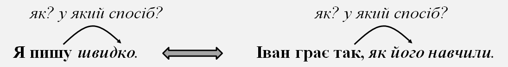

# Класифікація речень

1.6. Синтаксис. Пунктуація · 79 завдань · [джерело](https://zno.osvita.ua/ukrmova/tag-klasifikaciya_rechen_1/)

## Завдання 1

Речення з однорідними членами можна утворити, якщо до частини ***«Я обожнюю теплі травневі вечори…»*** додати

- **А** але недолюблюю холодні листопадові.
- **Б** зі щебетанням птахів у нашому саду.
- **В** тоді так мріється про щось небуденне.
- **Г** напоєні пахощами яблуневого цвіту.
- **Д** хоча й червневі мають свої принади.

**Відповідь: А**

Пояснення

**ТЕМА: Синтаксис. Однорідні члени речення.**

Завдання перевіряє ваше вміння знаходити в реченні однорідні члени речення.

Проаналізуймо запропоновані речення. Потрібно підкреслити в них граматичні основи.

Однорідні присудки є в утвореному реченні *Я **обожнюю** теплі травневі вечори, але **недолюблюю** холодні листопадові.*

**Відповідь – А.**

## Завдання 2

Прочитайте речення *(цифра позначає попередній розділовий знак)*. ***Уважалося,(1) що рондель,(2) традиційна форма французької літератури,(3) придатний лише для пейзажної чи інтимної лірики,(4) однак Павло Тичина створив свій різновид цього жанру,(5) що увійшов у поетичний світ революційним фанфарним маршем,(6) сповненим самобутніх рефренів.***

НЕПРАВИЛЬНИМ є обґрунтування вживання розділових знаків, запропоноване в рядку

- **А** кома 1 – при вставному слові
- **Б** коми 2, 3 – при відокремленій прикладці
- **В** кома 4 – перед сурядною частиною складного речення
- **Г** кома 5 – перед підрядною частиною складного речення
- **Д** кома 6 – при відокремленому означенні

**Відповідь: А**

Пояснення

**ТЕМА: Синтаксис. Складне речення. Розділові знаки в складному реченні.**

Це завдання перевіряє ваше вміння правильно розставляти розділові знаки, пояснювати їх.

Кома ***(1)*** обґрунтована як кома при вставному слові. Але від слова *уважалося* можна поставити питання *що?*. Отже, це не вставне слово, а **частина складного речення з різними видами зв’язку**, а саме головна частина, до якої приєднано підрядне з’ясувальне речення.

Решта обґрунтувань правильні.

**Відповідь – А.**

## Завдання 3

Доберіть приклад до кожної умови вживання тире.

*Умова вживання тире*

- **1** тире між підметом і присудком
- **2** тире на місці пропущеного члена речення
- **3** тире при відокремленій прикладці
- **4** тире в безсполучниковому складному реченні

*Приклад речення*

- **А** Краще кепсько виконати свій обов’язок, аніж добре – чужий.
- **Б** Бути особистістю – це бути самостійним джерелом дії.
- **В** Звільнишся від зла – у тебе залишиться лише добро.
- **Г** Любов, щирість, милосердя – такі риси має виховувати в собі кожен.
- **Д** Я знаю лише одного тирана – тихий голос мого сумління.

**Відповідь: 1 – Б, 2 – А, 3 – Д, 4 – В**

Пояснення

**ТЕМА: Синтаксис. Тире в різних видахречень.**

Завдання перевіряє ваші знання з пунктуації та вміння правильно розставляти розділові знаки в різних видахречень.

Проаналізуймо запропоновані речення.

У реченні **А** тире стоїть на місці **пропущеного** **присудка**.

Речення в рядку **Б** – це просте речення,у якому **підмет** **виражений інфінітивом**, а перед присудком, окрім цього, ще й стоїть частка *це*, тому тире між ними обов’язкове.

Речення в рядку **В –** це **складне безсполучникове речення**, частини якого пов’язані причиново-наслідковим зв’язком.

Речення в рядку **Г** – це речення, ускладнене **однорідними** **членами** **речення** з **узагальнювальним** **словом**. Оскільки узагальнювальне слово стоїть після однорідних членів речення, необхідно поставити тире.

Речення в рядку **Д** ускладнене **відокремленою прикладкою** *тихий голос мого сумління*, яка стоїть у кінці речення й виділена тире.

**Відповідь: БАДВ.**

## Завдання 4

Приєднайте до фрагмента «*Візьміть за правило щодня читати кілька сторінок книжки…»* запропоновані варіанти його продовження та з’ясуйте тип кожного з утворених речень.

*Фрагмент речення*

- **1** і ви помітно збільшите свій словниковий запас.
- **2** щоб отримати справжню насолоду від занурення у світ образів.
- **3** обираючи її з-поміж запропонованих для позакласного читання.
- **4** зокрема твори сучасної літератури.

*Тип речення*

- **А** просте речення з відокремленим означенням
- **Б** просте речення з відокремленим додатком
- **В** просте речення з відокремленою обставиною
- **Г** складносурядне речення
- **Д** складнопідрядне речення

**Відповідь: 1 – Г, 2 – Д, 3 – В, 4 – Б**

Пояснення

**ТЕМА: Синтаксис. Просте речення та складне речення.**

Завдання перевіряє ваше вміння розрізняти прості ускладнені речення та складні речення різних типів.

Якщо до фрагмента речення *Візьміть за правило щодня читати кілька сторінок книжок* приєднати варіант *і ви помітно збільшите свій словниковий запас,* то утвориться **складносурядне** речення, адже воно матиме дві частини, поєднані єднальним сполучником сурядності та змістом.

Якщо до цього фрагмента додати варіант *обираючи її з-поміж запропонованих для позакласного читання,* то утвориться **просте речення, ускладнене відокремленою обставиною**.

Якщо додати варіант *щоб отримати справжню насолоду від занурення у світ образів,* утвориться **складнопідрядне** речення з підрядним обставинним мети.

А в останньому варіанті утвориться **речення з відокремленим додатком.**

**Відповідь – ГДВБ.**

## Завдання 5

***Прочитайте текст і виконайте завдання***

(1) Надворі було ***по/особливому*** тихо. (2) ***По/зимовому*** небу пропливав, загортаючись у діряву ковдру з хмар надломлений місяць, схожий на тріснуту крижинку. (3). А поруч з ним поблискували зорі, вимальовувалися непевні перші промені. (4) Неохоче вставало заспане сонце і, мабуть, хотіло якось ***по/своєму*** розпочати цей день. (5) Але зима, відвойовуючи останні холодні дні, вирішила ***по/іншому*** і все сипала білі сніжинки, закриваючи сонне світило. (6) Усе, окрім тонесенької смуги над ***(…),*** уже перетворилося на щільну білу завісу, що огортала землю, не давала їй прокинутися.

Складним є речення

- **А** друге
- **Б** третє
- **В** четверте
- **Г** п’яте

**Відповідь: Б**

Пояснення

**ТЕМА: Синтаксис. Види речень у сучасній українській мові**

Завдання перевіряє ваше вміння розпізнавати прості та складні речення.

Просте речення – це речення, що має одну граматичну основу або її частину.

Щоб правильно виконати запропоноване завдання, необхідно підкреслити в реченнях граматичні основи.

**Друге** речення має одну граматичну основу (*місяць пропливав).* Це просте речення.

**Четверте** речення має одну граматичну основу *(сонце вставало, хотіло розпочати).* Це просте речення, ускладнене однорідними присудками.

**П’яте** речення має одну граматичну основу (*зима вирішила, сипала*). Це просте речення, ускладнене однорідними присудками.

А от **третє** речення має дві граматичні основи (*зорі поблискували, промені вимальовувалися).* Частини речення пов’язані між собою за змістом (одночасність подій). Це безсполучникове складне речення.

**Відповідь – Б.**

## Завдання 6

З’ясуйте тип складного речення.

*Тип складного речення*

- **1** складносурядне
- **2** складнопідрядне
- **3** безсполучникове
- **4** з різними видами зв‘язку

*Приклад речення*

- **А** Найвідоміша телефонна служба порятунку «911» з’явилася в американському місті Хейлівілі: 16 лютого 1988 року місцевий конгресмен зробив для перевірки «тривожний» дзвінок, лише привітавшись.
- **Б** Першість цього винаходу належить лондонцям, адже їхня служба почала діяти ще 1937 року, отримавши лише за тиждень 1336 дзвінків!
- **В** Для швидкого реагування в разі пожежі чи нападу, погіршення здоров‘я чи стихійного лиха більшість країн нині має спеціальну службу порятунку з єдиним номером телефону.
- **Г** Це диспетчерська, що з‘єднана з усіма екстреними службами, її номер завжди має три цифри, які легко запам’ятати.
- **Д** У світі завдяки Голлівуду найбільше знають саме номер «911», а в Україні та інших країнах Європи викликати таку службу можна за телефоном «112».

**Відповідь: 1 – Д, 2 – Б, 3 – А, 4 – Г**

Пояснення

**ТЕМА: Синтаксис. Просте речення та складне речення**

Завдання перевіряє ваше вміння розрізняти прості ускладнені речення та складні речення різних типів.

Речення *Найвідоміша телефонна служба порятунку «911» з’явилася в американському місті Хейлівілі: 16 лютого 1968 року місцевий конгресмен зробив для перевірки «тривожний» дзвінок, лише привітавшись* має дві граматичні основи, утворене з двох частин, що пов’язані лише змістом та інтонацією. Друга частина пояснює першу. Отже, це складне безсполучникове речення.

Речення *Першість цього винаходу належить лондонцям, адже їхня служба почала діяти ще з 1937 року, отримавши лише за тиждень 1336 дзвінків!* має дві граматичні основи, утворене з двох частин, але вони не рівноправні та пов’язані сполучником підрядності *адже.* Від першої до другої частини можна поставити питання *з якої причини?* Отже, це складнопідрядне речення.

Речення *У світі завдяки Голлівуду найбільше знають саме номер «911», а в Україні та інших країнах Європи викликати таку службу можна за телефоном «112»* має дві граматичні основи, утворене з двох частин, що пов’язані протиставним сполучником сурядності *а.* Отже, це складносурядне речення.

Речення *Це диспетчерська служба, що з’єднана з усіма екстреними службами, її номер завжди має три цифри, які легко запам’ятати* має чотири граматичні основи, утворене з чотирьох частин, перші дві пов’язані сполучним словом *що,* друга й третя *–* за змістом та інтонацією, а третя й четверта – сполучним словом *які.* Отже, у цьому реченні є безсполучниковий і сполучниковий підрядний зв’язки. Це складне речення з різними видами зв’язку.

Речення *Для швидкого реагування в разі пожежі чи нападу, погіршення здоров’я чи стихійного лиха більшість країн нині має спеціальну службу порятунку з єдиним номером телефону* має лише одну граматичну основу. Це просте речення, ускладнене однорідними членами речення.

**Відповідь: 1 – Д, 2 – Б, 3 – А, 4 – Г.**

## Завдання 7

Приєднайте до частини речення «Сучасні пристрої мають допомагати користувачеві…» запропоновані фрагменти та з’ясуйте тип кожного з утворених речень.

*Фрагмент речення*

- **1** оскільки були створені власне для цього.
- **2** й полегшувати життя в інформаційному світі.
- **3** але надмірна залежність від них є небезпечною.
- **4** їхня важлива функція – пошук інформації.

*Тип речення*

- **А** просте з однорідними членами
- **Б** просте з відокремленими членами
- **В** складнопідрядне
- **Г** складносурядне
- **Д** складне безсполучникове

**Відповідь: 1 – В, 2 – А, 3 – Г, 4 – Д**

Пояснення

**ТЕМА: Синтаксис. Просте речення та складне речення**

Завдання перевіряє ваше вміння розрізняти прості ускладнені речення та складні речення різних типів.

Якщо до фрагмента речення *Сучасні пристрої мають допомагати користувачеві* приєднати варіант *їхня важлива функція – пошук інформації,* то утвориться складне безсполучникове речення. Адже це речення матиме дві частини, поєднані лише інтонацією та змістом.

Якщо до цього фрагмента додати варіант *й полегшувати життя в інформаційному світі,* то утвориться просте речення, ускладнене однорідними членами (присудками).

Якщо додати варіант *оскільки були створені власне для цього,* утвориться складнопідрядне речення з підрядним обставинним причини.

А в останньому реченні утвориться складносурядне речення *Сучасні пристрої мають допомагати користувачеві, але надмірна залежність від них є небезпечною.* У цьому реченні дві граматичні основи, частини поєднані протиставним сполучником сурядності.

**Відповідь: ВАГД.**

## Завдання 8

**Прочитайте текст і виконайте завдання**

(1) Незважаючи на ***не/щастя***, розчарування, насмішки односельців, брак освіти, роботи цієї ***не/пересічної*** художниці стали справжніми зразками декоративно-прикладного мистецтва. (2) Узявши на озброєння тексти пісень, казок і легенд та ***не/повторну*** природу рідної України, Катерина Білокур відтворила досі ***не/бачений*** ніким світ, що був частиною її […]. (3) Коли вона малювала ніщо не заважало їй фантазувати: жовтогарячий колір перетікав у коричневий, змішувався з усіма відтінками зеленого, синього, червоного, фіолетового… (4) На полотні художниці вдавалося поєднувати рослини у фантастичні композиції, у яких одна квітка могла бути весняною, а інша – геть літньою…

Простим є речення

- **А** перше
- **Б** друге
- **В** третє
- **Г** четверте

**Відповідь: А**

Пояснення

**ТЕМА: Синтаксис. Види речень у сучасній українській мові.**

Завдання перевіряє ваше вміння розпізнавати прості та складні речення.

**Просте речення** – це речення, що має одну граматичну основу або її частину.

Щоб правильно виконати запропоноване завдання, необхідно підкреслити в реченнях граматичні основи.

Перше речення має одну граматичну основу *(роботи стали зразками).* Це **просте** речення.

Друге речення має дві граматичні основи*.* Це **складнопідрядне** речення.

Третє речення має три граматичні основи. Це **складне речення з різними видами зв’язку**.

Четверте речення має три граматичні основи . Це **складне речення з різними видами зв’язку**.

**Відповідь – А.**

## Завдання 9

Доберіть приклад до кожного типу складного речення.

*Тип складного речення*

- **1** складносурядне
- **2** складнопідрядне
- **3** безсполучникове
- **4** складне з різними видами зв’язку

*Приклад речення*

- **А** Людський мозок утворюють дві півкулі, кожна з цих половин має свої функції.
- **Б** Ліва півкуля відповідає за логіку й мову (думає), а права пов’язана з інтуїцією та творчою уявою.
- **В** Саме уява є джерелом нескінченного потоку ідей та óбразів, що потім розвиваються.
- **Г** Уява оперує óбразами, і саме цей дар люди не використовують, а ті, які навчилися це робити, сприймають світ творчо.
- **Д** Отже, використайте уяву, цей дар природи, для досягнення успіху, для зміни світу на краще, для позитивного погляду на життя.

**Відповідь: 1 – Б, 2 – В, 3 – А, 4 – Г**

Пояснення

**ТЕМА: Синтаксис. Просте речення та складне речення.**

Завдання перевіряє ваше вміння розрізняти прості ускладнені речення та складні речення різних типів.

Речення *Саме уява є джерелом нескінченного потоку ідей та образів, що потім розвиваються* має дві граматичні основи, складається з двох нерівноправних частин, що пов’язані сполучним словом ***що**.* Отже, це складнопідрядне речення.

Речення *Ліва куля відповідає за логіку й мову(думає), а права пов’язана з інтуїцією та творчою уявою* теж має дві граматичні основи, складається з двох частин, але вони рівноправні та пов’язані протиставним сполучником сурядності ***а**.* Отже, це складносурядне речення.

Речення *Людський мозок утворюють дві півкулі, кожна х цих половин має свої функції* має дві граматичні основи, складається з двох частин, що пов’язані лише змістом та інтонацією. Отже, це складне безсполучникове речення.

Речення *Уява оперує образами, і саме цей дар люди не використовують, а ті, які навчилися це робити, сприймають світ творчо* має вже чотири граматичні основи, складається з чотирьох частин. Перша та друга частини пов’язані єднальним сполучником сурядності ***і***, а друга й третя – протиставним сполучником сурядності ***а.*** У третій частині знаходиться четверта, що є залежною та приєднана сполучним словом ***які**.* Отже, у цьому реченні є підрядний та сурядні зв’язки. Це складне речення з різними видами зв’язку.

Речення *Отже, використовуйте уяву, цей дар природи, для досягнення успіху, для зміни світу на краще, для позитивного погляду на життя* має лише одну граматичну основу. Це просте речення, ускладнене вставним словом, відокремленою прикладкою та однорідними обставинами.

**Відповідь – БВАГ.**

## Завдання 10

**Прочитайте текст і виконайте завдання.**

(1) Людина загубила кому й почала боятися складних речень, шукаючи простенькі ***фрази***. (2) За примітивними репліками прийшли елементарні думки. (3) Потім вона проґавила знак оклику й стала говорити монотонно, з однаковою інтонацією. (4) Пізніше людина десь «посіяла» знак питання й припинила запитувати: жодні ***події*** не цікавили її, де б вони не відбувалися: у космосі, на землі чи навіть у власній квартирі. (5) Ще через кілька років наша роззява загубила […] і перестала пояснювати іншим свої ***вчинки***. (6) Бідолаха не могла висловити жодної ідеї, увесь час когось цитувала користуючись лише лапками, а згодом не стало і їх, у неї залишилася тільки крапка. (7) Бережіть розділові ***знаки***…

Спонукальним є речення

- **А** друге
- **Б** п’яте
- **В** шосте
- **Г** сьоме

**Відповідь: Г**

Пояснення

**ТЕМА:** **Синтаксис.** **Види речень за метою висловлювання.**

Виконуючи це завдання, обов’язково звертайтеся до мікротексту.

Вам потрібно продемонструвати свої знання про речення як найменшу одиницю спілкування і вираження думки, адже саме воно формує та передає інформацію про явища дійсності, ставлення до них.

Спонукальне речення – це речення, що містить у собі наказ, вимогу, заклик, побажання, пораду, прохання тощо. У такому реченні дієслово, як правило, стоїть у наказовому способі, також часто бувають звертання.

**Відповідь – Г.**

## Завдання 11

Неповним є речення

- **А** Вишукано говорити – значить красиво думати.
- **Б** Наша мова – одна з найбагатших у світі.
- **В** Слово – ось дивний витвір розумної людини.
- **Г** Джерело красномовства – у нашому серці.
- **Д** Прекрасна справа – влучно володіти словом.

**Відповідь: Г**

Пояснення

**ТЕМА: Синтаксис.** **Повне і неповне речення.**

Завдання перевіряє ваше вміння визначати повні та неповні речення, пояснювати тире в простому реченні.

Неповними називають речення, у яких пропущений один або кілька членів речення, що їх можна відтворити за змістом. Неповними можуть бути двоскладні та односкладні речення. Пропущені в неповних реченнях члени можна відтворити з попереднього або наступного речення, змісту самого речення, ситуації спілкування. Найчастіше неповні речення вживають у висловлюваннях розмовно-побутового та художнього стилів (поетичних текстах).

У реченнях **А**, **Б**, **В, Г** тире стоїть між підметом і присудком на місці пропущеної дієслівної зв’язки ***є***, що у формі теперішнього часу зазвичай випускається. Це двоскладні повні речення.

У реченні **Г** маємо підмет *джерело* та обставину *у нашому серці.* Присудок відсутній, але є обставина, що завжди є групою присудка. Отже, це двоскладне неповне речення.

**Відповідь – Г.**

## Завдання 12

Доберіть приклад до кожного виду складного речення.

*Вид речення*

- **1** складносурядне
- **2** складнопідрядне
- **3** безсполучникове
- **4** складне з різними видами зв’язку

*Приклад речення*

- **А** Значна частина птахів видає своєрідні мелодійні звуки, які ми традиційно називаємо співом.
- **Б** Для кожного виду характерна особлива пісня, і за допомогою цих звуків птахи спілкуються між собою.
- **В** Учені з’ясували: для певних ситуацій той самий птах використовує різні звукові сигнали.
- **Г** Звуками птах повідомляє, що шукає пару, попереджає про небезпеку, і, навіть ізольований від свого виду, він усе одно співатиме, як і його родичі.
- **Д** Деякі пернаті навчилися наслідувати окремі штучні звуки, пісні інших видів птахів, а іноді й звуки людської мови.

**Відповідь: 1 – Б, 2 – А, 3 – В, 4 – Г**

Пояснення

**ТЕМА: Синтаксис. Просте речення та складне речення.**

Завдання перевіряє ваше вміння розрізняти прості ускладнені речення та складні речення різних типів.

Речення *Значна частина птахів видає своєрідні мелодійні звуки, які ми* *традиційно називаємо співом* має дві граматичні основи, складається з двох нерівноправних частин, що пов’язані сполучним словом *які.* Отже, це **складнопідрядне** речення.

Речення *Для кожного виду характерна особлива пісня, і за допомогою цих звуків птахи спілкуються між собою* теж має дві граматичні основи, складається з двох частин, але вони рівноправні та пов’язані єднальним сполучником сурядності *і.* Отже, це **складносурядне** речення.

Речення *Учені з’ясували: для певних ситуацій той самий птах використовує різні звукові сигнали* має дві граматичні основи, складається з двох частин, що пов’язані лише змістом та інтонацією. Отже, це складне **безсполучникове** речення.

Речення *Звуками птах повідомляє, що шукає пару, попереджає про небезпеку, і, навіть ізольований від свого виду, він усе одно співатиме, як і його родичі* має вже три граматичні основи, складається з трьох частин. Перша та друга частини пов’язані сполучником підрядності *що*, а друга й третя – єднальним сполучником сурядності *і.* Отже, у цьому реченні є підрядний та сурядний зв’язки. Це складне речення **з різними видами зв’язку**.

Речення *Деякі пернаті навчилися наслідувати окремі штучні звуки, пісні* *інших видів птахів, а іноді й звуки людської мови* має лише одну граматичну основу. Це просте речення, **ускладнене однорідними додатками**.

**Відповідь: БАВГ.**

## Завдання 13

Позначте речення, що відповідає такій характеристиці: *складне речення з різними типами синтаксичного зв’язку (сполучниковим і безсполучниковим)*:

- **А** Демократія тим і добра, що при ній не держава руйнує людину, а людина будує державу і саму себе (Ліна Костенко).
- **Б** Пігмей бажа високим буть на зріст, порядним хоче виглядати злодій, завжди злочинець – на ділах добродій (Д. Павличко).
- **В** Преславне українське слово звучить у серці у моїм, бо мова – хліб, а не полова: я чув її із уст батьків (Г. Позняк).
- **Г** Шануймося, бо одна у нас усіх Україна й життя у кожного одне! (Б. Гірський).
- **Д** Ніколи я не знав, як тяжко жить без солов’я, що в пісні аж тремтить тільцем своїм маленьким (М. Рильський).

**Відповідь: В**

Пояснення

**ТЕМА: Синтаксис. Види складних речень**

Завдання перевіряє ваше вміння визначати види складних речень.

**Складним з різними типами синтаксичного зв’язку** є речення *«Преславне українське* *слово* *звучить* *у серці у моїм, бо* *мова* *–* *хліб**, а* *не полова**:* *я* *чув* *її із уст батьків»*.

Зверніть увагу, що це речення має три граматичні основи, отже, складається з трьох частин, з’єднаних як інтонаційно, так і за допомогою підрядного сполучника *бо*.

**Відповідь – В.**

## Завдання 14

Позначте речення, що відповідає такій характеристиці: *складнопідрядне речення з однорідною підрядністю*:

- **А** Усіх, хто живе в Україні, має об’єднувати в суспільство українська мова, котру треба знати (Б. Олійник).
- **Б** Скажи мені, всесильна мово, з якого джерела буття тече струмок, що зветься Слово, в ріку несмертного життя? (С. Марченко).
- **В** Повінь добрих почуттів затоплює вчителя, коли він чує, як довірливо тулиться до нього дитина (М. Стельмах).
- **Г** Велике діло, коли людина має чисте сумління, коли ніякі тіні не каламутять, не забруднюють душу (М. Стельмах).
- **Д** Хоч проживи сто і двісті років, Київ пізнати повністю неможливо, бо в кожного він свій, особливий, самобутній, неповторний (П. Загребельний).

**Відповідь: Г**

Пояснення

**ТЕМА: Синтаксис. Складнопідрядне речення. Види підрядних речень**

Завдання перевіряє ваше вміння визначати види складнопідрядних речень.

Згадаймо, що серед частин складнопідрядного речення виділяють незалежну, її називають головною частиною (головним реченням), і залежну – підрядну частину (підрядне речення).

**Головною** називають **частину** складнопідрядного речення, яка підпорядковує одну чи кілька підрядних частин.

**Підрядною** називають **частину** складнопідрядного речення, яка залежить від головної або іншої підрядної частини.

Зверніть увагу, що **однорідна підрядність** – це таке підпорядкування, за яким усі підрядні речення залежать від того самого слова головного речення і відповідають на те саме питання.

У реченні *«Велике діло, коли людина має чисте сумління, коли ніякі тіні не каламутять, не забруднюють душу»* всі частини залежать від головної *«Велике діло…»* і відповідають на запитання *яке?.*

**Відповідь – Г.**

## Завдання 15

Позначте речення, що відповідає такій характеристиці: *складне речення з різними типами синтаксичного зв’язку (сполучниковим і безсполучниковим)*:

- **А** Ріка налітала на камінні зубці, поміж яких застряв дуб-велет, а потік спадав униз, де також стриміли камені.
- **Б** Не зневірся, не впади у відчай: вир не вкрутить, хвиля не знесе.
- **В** Вже вечір тіні склав у стоси, за обрій котиться курай, і дальні пахнуть сінокоси, і дальній пахне рідний край.
- **Г** Якщо не можна вітер змалювати, прозорий вітер на ясному тлі, змалюй дуби, могутні і крислаті, котрі од вітру гнуться до землі.
- **Д** Іду, дивлюсь: мій край, моя земля, сміються в небі золотому річки, і села, і поля.

**Відповідь: В**

Пояснення

**ТЕМА: Синтаксис. Види складних речень**

Завдання перевіряє ваше вміння визначати види складних речень.

**Складним з різними типами синтаксичного зв’язку** є речення *«Вже* *вечір* *тіні* *склав* *у стоси, за обрій* *котиться* *курай**, і дальні* *пахнуть* *сінокоси**, і дальній* *пахне* *рідний* *край**»*. Зверніть увагу, що це речення має чотири граматичні основи, отже, складається з чотирьох частин, з’єднаних як інтонаційно, так і за допомогою сурядних сполучників.

**Відповідь – В.**

## Завдання 16

Простим є речення

- **А** Далеко чути звуки, гучно линуть голоси.
- **Б** Ясної тихої днини кружляє над землею, сідає на обличчя павутиння.
- **В** Пташині зграї злітають високо в небо, і від того здіймається вітер.
- **Г** Осінь не забарилася, бо закони природи невблаганні.

**Відповідь: Б**

Пояснення

**ТЕМА: Синтаксис. Просте речення**

Завдання перевіряє вміння відрізняти прості речення від складних.

Виконуючи це завдання, визначте граматичні основи речень.

Одну граматичну основу має речення в рядку ***Б***. Зверніть увагу, що в це речення ускладнене однорідними присудками: «*Ясної тихої днини* *кружляє* *над землею,* *сідає* *на обличчя павутиння»*.

**Відповідь – Б.**

## Завдання 17

Поширеним є речення

- **А** Кілька покупців почали сперечатися.
- **Б** Мільярди людей прагнуть жити в злагоді.
- **В** Хлопчаки били байдики.
- **Г** Вистава була надзвичайна.
- **Д** Трава не скошена.

**Відповідь: Б**

Пояснення

**ТЕМА: Синтаксис. Просте речення**

Завдання перевіряє вміння розпізнавати види речень за наявністю другорядних членів.

Поширеним є речення, що має хоча б один другорядний член: *Мільярди людей* *прагнуть жити* (як?) *в злагоді**.*

**Відповідь – Б.**

## Завдання 18

Простим є речення

- **А** Не доля вирішує – людина творить свою долю.
- **Б** Було, мабуть, гарно: вночі випав сніг.
- **В** Світло хлюпнуло по верхівках дерев, замиготіло, застрибало по кущах.
- **Г** Ліс іще дрімає, а з синім небом уже щось діється.

**Відповідь: В**

Пояснення

**ТЕМА: Синтаксис. Просте речення**

Завдання перевіряє вміння відрізняти прості речення від складних.

Виконуючи це завдання, визначте **граматичні** **основи** речень.

Одну граматичну основу має речення в рядку ***В***. Зверніть увагу, що це речення ускладнене однорідними присудками: «*Світло* *хлюпнуло* *по верхівках дерев,* *замиготіло**,* *застрибало* *по кущах»*.

**Відповідь – В.**

## Завдання 19

Поширеним є речення

- **А** Три верби схилилися.
- **Б** Сіно було свіже, зелене, пахуче.
- **В** Сонце трудиться в поті чола.
- **Г** Час минає.
- **Д** Хлопці накивали п’ятами.

**Відповідь: В**

Пояснення

**ТЕМА: Синтаксис. Просте речення**

Завдання перевіряє вміння розпізнавати види речень за наявністю другорядних членів.

Поширеним є речення, що має хоча б один другорядний член: *Сонце трудиться (як?)* *в поті чола*.

**Відповідь – В.**

## Завдання 20

Простим є речення

- **А** По діброві вітер виє, гуляє по полю, край дороги гне тополю до самого долу.
- **Б** На узліссі і галявині зеленіє перший ряст і цвітуть проліски та сон-трава.
- **В** Шелестить пожовкле листя, по діброві гуляють хмари.
- **Г** Пам’ять могла б убити нас, коли б не мала рятівної властивості забувати.

**Відповідь: А**

Пояснення

**ТЕМА: Синтаксис. Просте речення**

Завдання перевіряє вміння відрізняти **прості** речення від **складних**.

Виконуючи це завдання, визначте граматичні основи речень.

Одну граматичну основу має речення в рядку ***А***. Зверніть увагу, що в це речення ускладнене однорідними присудками: «*По діброві* *вітер* *виє**,* *гуляє* *по полю, край дороги* *гне* *тополю до самого долу»*.

**Відповідь – А.**

## Завдання 21

Поширеним є речення

- **А** Хай кожен із вас заспіває.
- **Б** Гостям весело.
- **В** Дідусь буде відпочивати.
- **Г** Хлопець виявився не ликом шитий.
- **Д** Край неба жеврів.

**Відповідь: Б**

Пояснення

**ТЕМА: Синтаксис. Просте речення**

Завдання перевіряє вміння розпізнавати види речень за наявністю другорядних членів.

**Поширеним** є речення, що має хоча б один другорядний член: *Гостям* *(кому?)* *весело*.

**Відповідь – Б.**

## Завдання 22

Складним є речення

- **А** Досвітній вогонь запали, поки ще зоря не заграла.
- **Б** Сідають на озера уночі натомлені в дорозі дикі гуси.
- **В** Вітер загуляв, заблудив у полі та й пита дороги у сестри-тополі.
- **Г** І від щастя, а може, від горя промінь сонячний серце пропік.

**Відповідь: А**

Пояснення

**ТЕМА: Синтаксис. Види складних речень**

Завдання перевіряє вміння розпізнавати види складних речень.

Виконуючи це завдання, визначте граматичні основи речень. Пригадайте, що **складне** **речення** має у своєму складі дві і більше граматичних основ. Саме таким є речення в рядку **А**.

Зверніть увагу, що в цьому реченні дві граматичні основи: *Досвітній вогонь* *запали**, поки ще* *зоря* *не заграла*. Речення є складним з підрядним часу.

**Відповідь – А.**

## Завдання 23

Поширеним є речення

- **А** Дід був ковалем.
- **Б** Минула тривожна ніч.
- **В** Хай він чекає.
- **Г** Осінь буде ясніти.
- **Д** Дві верби говорили-балакали.

**Відповідь: Б**

Пояснення

**ТЕМА: Синтаксис. Просте речення**

Завдання перевіряє вміння розпізнавати різні види речень. За наявністю другорядних членів речення бувають поширені й непоширені.

Проаналізуймо запропоновані речення.

У рядку ***А*** речення непоширене: підмет виражений іменником *дід*, присудок *був ковалем* є складеним іменним.

Речення в рядку ***Б*** є **поширеним**, бо має означення *(яка?)* *тривожна**.*

У рядку ***В*** речення теж непоширене: підметом є займенник *він*, а присудок виражений дієсловом у наказовому способі *хай чекає*

Речення в рядку ***Г*** є непоширеним, бо має підмет *осінь* і простий дієслівний присудок *буде ясніти* (складена форма майбутнього часу дієслова).

У рядку ***Д*** речення є непоширеним: підмет виражений неподільним словосполученням *дві верби*, присудок *говорили-балакали* є простим дієслівним.

**Відповідь – Б.**

## Завдання 24

Складним є речення

- **А** Верби, схилившись над тихим Дінцем, розчісують коси зелені.
- **Б** На заході ще жевріло небо, а в степу вже заходила ніч.
- **В** Липневий день мандрує пішки, казки нашіптує малечі.
- **Г** Пішла дорога то маленькими сосновими лісками, то болотами, то полями.

**Відповідь: Б**

Пояснення

**ТЕМА:** **Синтаксис. Види складних речень**

Завдання перевіряє вміння розпізнавати види складних речень.

Виконуючи це завдання, визначте граматичні основи речень.

Пригадайте, що **складне** **речення** має у своєму складі дві і більше граматичних основ.

Саме таким є речення в рядку ***Б***. Зверніть увагу, що в цьому реченні дві граматичні основи: *На заході ще* *жевріло* *небо**, а в степу вже* *заходила* *ніч*. Речення є складносурядним, частини об’єднуються в одне ціле за допомогою протиставного сполучника *а*.

**Відповідь – Б.**

## Завдання 25

Складносурядне речення утвориться, якщо серед варіантів продовження речення *«Зранку ми почали непокоїтися…»* обрати

- **А** так що настрій зіпсувався на цілий день.
- **Б** бо кожен з нас почувався досить невпевнено.
- **В** проте погода посприяла нам і цього разу.
- **Г** й обговорювати можливі перешкоди.
- **Д** передчуваючи серйозні ускладнення.

**Відповідь: В**

Пояснення

**ТЕМА:** **Синтаксис. Складносурядне речення**

Завдання перевіряє ваше вміння утворювати складносурядні речення, визначати їх види.

**Складносурядне речення** – це складне речення, яке має щонайменше дві граматичні основи, частини цього речення пов’язані сполучниками сурядності.

Складносурядне речення утвориться, якщо серед варіантів продовження речення *«Зранку ми почали непокоїтися…»* вибрати *«проте погода посприяла нам і цього разу»* (речення має дві граматичні основи, частини поєднані протиставним сполучником сурядності ***проте***).

**Відповідь** **–** **В.**

## Завдання 26

Поширеним є речення

- **А** Двоє музик продовжували грати.
- **Б** Комплімент повинен бути щирим.
- **В** А Максим вийшов сухим із води.
- **Г** Григорію закортіло скупатися.
- **Д** Холод стає помітнішим і помітнішим.

**Відповідь: Г**

Пояснення

**ТЕМА: Синтаксис. Просте речення**

Завдання перевіряє вміння розпізнавати поширені й непоширені речення.

За наявністю другорядних членів речення бувають поширені й непоширені.

Проаналізуймо запропоновані речення.

У рядку ***А*** речення непоширене: підмет виражений неподільним словосполученням *двоє музик*, присудок *продовжували грати* є складеним дієслівним.

Речення в рядку ***Б*** має тільки підмет *комплімент* і складений іменний присудок *повинен бути щирим*.

У рядку ***В*** речення теж непоширене: підметом є іменник *Максим*, а присудком – фразеологізм *вийшов сухим із води* (зверніть увагу, що фразеологізм завжди виступає одним членом речення).

Речення в рядку ***Г*** є односкладним, оскільки граматична основа складається лише з присудка *закортіло скупатися* (складений дієслівний), і **поширеним**, бо має додаток *(кому?)* *Григорію**.*

У рядку ***Д*** речення є непоширеним, бо має підмет *холод* і складений іменний присудок *стає помітнішим і помітнішим*.

**Відповідь – Г.**

## Завдання 27

Складносурядне речення утвориться, якщо серед варіантів продовження речення *«Ще виблискують кришталеві роси...»* обрати

- **А** і випромінюють веселковий розмай.
- **Б** милуючи око веселим сяйвом.
- **В** але сонце вже осяяло виднокрай.
- **Г** бо тільки займається на день.
- **Д** ранок холодить оксамитові трави.

**Відповідь: В**

Пояснення

**ТЕМА: Синтаксис. Складносурядне речення**

Завдання перевіряє ваше вміння утворювати складносурядні речення, визначати їх види.

**Складносурядне** **речення** – це складне речення, яке має щонайменше дві граматичні основи, частини цього речення пов’язані сполучниками сурядності.

Складносурядне речення утвориться, якщо серед варіантів продовження речення *«Ще виблискують кришталеві роси...»* вибрати *«але сонце вже осяяло виднокрай»* (речення має дві граматичні основи, частини поєднані протиставним сполучником сурядності ***але***).

**Відповідь – В.**

## Завдання 28

**Прочитайте текст і виконайте завдання**

(1) Стояла тиха травнева ніч у буянні зела й кипінні садів. (2) Шаленіли в лузі солов’ї, кумкали жаби, кричали горлиці. (3) І носила в ту *не/ймовірну* весняну молоду ніч із срібної криниці срібним цеберцем срібну воду зозуля і (…) її по землі. (4) Вилила добрий ківш і на Андрія. (5) *Від/того* прокинувся, та побрів під розчахнуту липу. (6) На душі було срібно й високо. (7) Дослухався тихої й радісної музики небес, удивлявся в ту *не/звідану* глибінь. (8) *Від/нині* знав, що там живе вічна й свята таїна.

Безособовим є речення

- **А** четверте
- **Б** п’яте
- **В** шосте
- **Г** сьоме

**Відповідь: В**

Пояснення

**ТЕМА: Синтаксис. Види односкладних речень**

Завдання перевіряє вміння розпізнавати типи односкладних речень.

**Односкладними** називають речення з одним головним членом.

Пригадайте, що **безособовими** називають односкладні речення з головним членом у формі присудка, який означає процес, дію, стан, що не мають виконавця або відбуваються незалежно від нього. У таких реченнях не може бути підмета.

Безособовим є шосте речення, *«**На душі <u>було срібно</u> й <u>високо</u>**»*, однорідні присудки в цьому реченні виражені прислівниками (зі зв'язкою).

**Відповідь: В.**

## Завдання 29

**Прочитайте текст і виконайте завдання**

(1) Стояла тиха травнева ніч у буянні зела й кипінні садів. (2) Шаленіли в лузі солов’ї, кумкали жаби, кричали горлиці. (3) І носила в ту *не/ймовірну* весняну молоду ніч із срібної криниці срібним цеберцем срібну воду зозуля і (…) її по землі. (4) Вилила добрий ківш і на Андрія. (5) *Від/того* прокинувся, та побрів під розчахнуту липу. (6) На душі було срібно й високо. (7) Дослухався тихої й радісної музики небес, удивлявся в ту *не/звідану* глибінь. (8) *Від/нині* знав, що там живе вічна й свята таїна.

Складнопідрядним є речення

- **А** третє
- **Б** четверте
- **В** шосте
- **Г** восьме

**Відповідь: Г**

Пояснення

**ТЕМА: Синтаксис.** **Складнопідрядне речення, його будова**

Виконуючи це завдання, визначте граматичні основи третього, четвертого, шостого й восьмого речень.

Пригадайте, що **складне речення** має у своєму складі дві і більше граматичних основ.

**Складнопідрядне речення** – це складне речення, у якому одне просте речення є головним, а інше (підрядне) граматично залежить від головного і з'єднується з ним за допомогою підрядного сполучника або сполучного слова.

Саме таким є **восьме речення.** Зверніть увагу, що в цьому реченні дві граматичні основи: *Віднині* *<u>знав</u>**, що там <u>живе</u> вічна й свята <u>таїна</u>***.** Речення є **складнопідрядним з підрядним з’ясувальним,** частини об’єднуються в одне ціле за допомогою сполучника *що*.

**Відповідь: Г.**

## Завдання 30

Складнопідрядне речення утвориться, якщо серед варіантів продовження речення «Спадала безмісячна ніч...» обрати

- **А** якось журливо ставало на душі.
- **Б** неначе занурюючи все в темряву.
- **В** однак на ґанку ще точилася розмова.
- **Г** так що все птаство затихло.
- **Д** насувався лячний присмерк.

**Відповідь: Г**

Пояснення

**ТЕМА:** **Синтаксис. Складнопідрядне речення, його будова**

Завдання перевіряє вміння розпізнавати види складнопідрядних речень.

**Складнопідрядне речення** – це складне речення, у якому одне просте речення є головним, а інше (підрядне) граматично залежить від головного і з'єднується з ним за допомогою підрядного сполучника або сполучного слова.

Складнопідрядне речення з **підрядним наслідку** утвориться, якщо серед варіантів продовження речення *«**Спадала безмісячна ніч...**»* вибрати *«**так що все птаство затихло**»* (речення має дві граматичні основи, частини поєднані сполучником ***так що***).

**Відповідь: Г.**

## Завдання 31

**Прочитайте текст і виконайте завдання**

(1) Усе починається з дитинства, з колискової, з голосу материнської душі над колискою. (2) Уже в/перше звучання почутої мелодії на/вічно вплітається для маленької дитини багатоголосся душі та світу. (3) Від/тепер відкривається шлях її радощам, смуткові й веселості, тривогам, і сподіванням. (4) І, на/певно, головному — взаємності з життям, зі світом. (5) Колискова — це не/наче душа, яка ходить навшпиньках.

Складним є речення

- **А** перше
- **Б** друге
- **В** третє
- **Г** п’яте

**Відповідь: Г**

Пояснення

**ТЕМА: Синтаксис. Види складних речень**

Виконуючи це завдання, визначте граматичні основи першого, другого, третього й п’ятого речень.

Пригадайте, що **складне речення** має у своєму складі **дві і більше граматичних основ.**

Саме таким є п’яте речення. Зверніть увагу, що в цьому реченні дві граматичні основи:

*<u>Колискова</u> – <u>це неначе душа</u>*, *<u>яка</u> <u>ходить навшпиньках</u>*.

Речення є складнопідрядним означальним, частини об’єднуються в одне ціле за допомогою сполучного слова *яка*.

**Відповідь: Г.**

## Завдання 32

Складносурядне речення утвориться, якщо серед варіантів продовження речення *«Опівдні насунулися хмари...»* обрати

- **А** заступивши темрявою небо.
- **Б** і зависли над молодими садами.
- **В** які змусили все живе зачаїтися.
- **Г** і ринула стоголоса злива.
- **Д** пішов густий літній дощ.

**Відповідь: Г**

Пояснення

**ТЕМА:** **Синтаксис. Складносурядне речення**

Завдання перевіряє ваше вміння утворювати складносурядні речення, визначати їх види.

**Складносурядне речення** – це складне речення, яке має щонайменше дві граматичні основи, частини цього речення пов’язані сполучниками сурядності.

Складносурядне речення утвориться, якщо серед варіантів продовження речення *«Опівдні насунулися хмари...»* вибрати *«і ринула стоголоса злива»* (речення має дві граматичні основи, частини поєднані єднальним сполучником сурядності ***і***).

**Відповідь: Г.**

## Завдання 33

Спонукальним є речення

- **А** Жінки втомились бути непрекрасними.
- **Б** За правду, браття, єднаймось щиро.
- **В** Весна прийшла, та якось несподівано!
- **Г** Шматок землі, ти звешся Україною.
- **Д** Дрібнота буть не годна ворогами.

**Відповідь: Б**

Пояснення

**ТЕМА:** **Синтаксис. Просте речення**

Завдання перевіряє вміння розпізнавати види речень за метою висловлювання (розповідні, питальні й спонукальні).

**Спонукальними** називають речення, що у формі наказу, застереження, запрошення, заклику виражають волю мовця з метою вплинути на інших або намір до дії самого мовця.

Спонукання найчастіше виражається дієсловами наказового способу і неозначеною формою. Отже, спонукальним є речення: *«**За правду, браття, єднаймось щиро».*

**Відповідь: Б.**

## Завдання 34

**Прочитайте текст і виконайте завдання**

(1) Гордий птах змахнув крильми і злетів *на/зустріч* новим пригодам. (2) Він уважно приглядався до всього, що було внизу. (3) Птах мав (…) зір і добре бачив, як люди збивалися з ніг, поралися по городах, згрібаючи на купи сухе картоплиння та спалюючи його разом із зів’ялим листям. (4) Дим від вогнищ тягнуло в долину, але він не стелився пасмами, а зразу ж піднімався *до/гори* підфарбовуючи все *не/баченою* досі прозоро-блакитною аквареллю. (5) А небо, навпаки, залишалося високим і чистим, і в тій височині розкошланими клаптями вати плавали *не/великі* хмарки.

Простим є речення

- **А** перше
- **Б** друге
- **В** третє
- **Г** п’яте

**Відповідь: А**

Пояснення

**ТЕМА: Синтаксис. Просте речення**

Виконуючи це завдання, визначте граматичні основи першого, другого, третього й п’ятого речень.

Пригадайте, що просте речення має у своєму складі **одну граматичну основу**. Саме таким є **перше** речення. Зверніть увагу, що воно ускладнене однорідними присудками.

**Відповідь: А.**

## Завдання 35

Приєднайте до частини *«Лелеки повернулися до рідного гнізда…»* запропоновані варіанти та з’ясуйте тип кожного з утворених речень.

*Варіант завершення речення*

- **1** … як заструменіли весняні ручаї.
- **2** … і заходилися його лагодити.
- **3** … і враз ожила простора садиба.
- **4** … перелетівши сині моря.

*Тип речення*

- **А** просте з відокремленими членами
- **Б** просте з однорідними членами
- **В** складнопідрядне
- **Г** складносурядне
- **Д** складне безсполучникове

**Відповідь: 1 – В, 2 – Б, 3 – Г, 4 – А**

Пояснення

**ТЕМА: Синтаксис.** **Види речень**

Це завдання перевіряє ваше вміння визначати типи речень.

Якщо до запропонованої частини приєднати перший варіант завершення, то утвориться **складнопідрядне речення** з підрядним часу. *Лелеки повернулися **(коли?)**, як заструменіли весняні ручаї.*

Другий варіант завершення утворить **просте** **речення з** **однорідними присудками** *повернулися і заходилися*.

**Складносурядне** речення утвориться, якщо до запропонованої частини додати третій варіант. Зверніть увагу, що це речення має дві граматичні основи, поєднані сурядним єднальним сполучником.

Четвертий варіант завершення утворить **просте речення з відокремленим членом,** а саме відокремленою обставиною, вираженою дієприслівниковим зворотом.

**Відповідь: 1**–**В, 2**–**Б, 3**–**Г, 4**–**А.**

## Завдання 36

**Прочитайте текст і виконайте завдання**

(1) Навколо аеродрому лежали пшеничні поля, *розбавлен..і* яскраво-ядучими квітами, над якими тягуче нависали оси. (2) Зранку сонце прогрівало асфальт і сушило траву, що пробивалася крізь *бетон..і* плити. (3) Біля злітної смуги рвалися на вітрі полотнища прапорів, тяглися дерева, *обплетен..і* павутиною й *запален..і* гострим ранковим світлом. (4) Над аеродромом безмежно нависало небо раннього червня, воно розгорталося під вітром, лунко підіймалося, й опадало вниз. (5) Оглушуючи ранок своїм допотопним дуднінням, [...] розвертався над сонним містечком, будячи його з легкого та примарного сну.

Простим є речення

- **А** друге
- **Б** третє
- **В** четверте
- **Г** п’яте

**Відповідь: Г**

Пояснення

**ТЕМА: Синтаксис. Прості та складні речення.**

Виконуючи це завдання, обов’язково звертайтеся до мікротексту.

**Просте речення** – це речення, у якому наявна одна граматична основа (або її частина).

**Складне речення** – це речення, у якому є дві або більше граматичних основ, що об’єднані в одне ціле за змістом та інтонацією.

Проаналізуймо запропоновані речення.

**Друге** речення має дві граматичні основи – *сонце пригрівало, сушило* і *що пробивалася.*

**Третє** речення теж має дві граматичні основи – *полотнища рвалися* та *дерева тяглися.*

**Четверте** речення теж має дві граматичні основи – *небо нависало* і *воно розгорталося, підіймалося, опадало.*

Отже, ці речення є складними.

**П’яте** речення – має лише одну граматичну основу – *літак розвертався*. Це просте речення.

**Відповідь – Г.**

## Завдання 37

Приєднайте до частини *«Хмари вкрили весь небосхил…»* запропоновані варіанти та з’ясуйте тип кожного з утворених речень.

*Варіант завершення речення*

- **1** … і рясна злива не забарилася.
- **2** … та й зависли над принишклим містом.
- **3** … навіть клаптика світлого не лишилося.
- **4** … дарма що недавно вигрівало сонце.

*Тип речення*

- **А** просте з відокремленими членами
- **Б** просте з однорідними членами
- **В** складнопідрядне
- **Г** складносурядне
- **Д** складне безсполучникове

**Відповідь: 1 – Г, 2 – Б, 3 – Д, 4 – В**

Пояснення

**ТЕМА: Синтаксис. Просте речення та складне речення.**

Завдання перевіряє ваше вміння розрізняти прості ускладнені речення та складні речення різних типів.

У ***1*** варіанті утворимо **складносурядне** речення *Хмари вкрили весь небосхил – і рясна злива не забарилася.* У цьому реченні дві граматичні основи, частини поєднані єднальним сполучником сурядності.

Якщо до цього ж фрагмента додати варіант *та й зависли над принишклим містом,* то утворимо **просте** речення, **ускладнене однорідними членами речення** (присудками).

Якщо до фрагмента речення *Хмари вкрили весь небосхил* приєднати варіант *навіть клаптика світлого не залишилося*, то утворимо **складне безсполучникове** речення. Це речення матиме дві частини, поєднані лише інтонацією та змістом.

Якщо додати варіант *дарма що недавно вигрівало сонце*, утворимо **складнопідрядне** речення з **підрядним обставинним допустовим**.

**Відповідь: ГБДВ.**

## Завдання 38

Поширеним є речення

- **А** Ранок був свіжим.
- **Б** Тиша ніби скло.
- **В** Запахло медом.
- **Г** Став накрапати дощ.
- **Д** Три тополі обнялися.

**Відповідь: В**

Пояснення

**ТЕМА:** **Синтаксис. Просте речення**

Це завдання перевіряє ваше вміння розрізняти речення за наявністю другорядних членів.

Поширеним є речення, яке має хоча б один другорядний член.

Саме таким є речення в рядку **В**: присудок *запахло* **чим?** *медом* (**додаток**).

**Відповідь: В.**

## Завдання 39

**Прочитайте текст і виконайте завдання**

(1) Навесні ми часто блукали сонячними пагорбами поміж торішнім листям визбируючи перші *не/сміливі* фіалки, вдихали міцний і п’янкий дух землі. (2) А коли забуяв зеленню травень, заквітчав широкі, *не/приховані* від людського ока луги ромашками, усе наче потонуло в білому морі, якому *не/ має* кінця-краю. (3) Ковтаєш трепетний запах квітів, і тебе вабить кудись у *не/звідане*. (4) А згори ніжно припікає сонечко, у чистому прозорому небі — ні хмаринки, тільки лине […] пісня жайворонка.

Простим є речення

- **А** перше
- **Б** друге
- **В** третє
- **Г** четверте

**Відповідь: А**

Пояснення

**ТЕМА: Синтаксис. Просте речення**

Виконуючи це завдання, визначте граматичні основи першого, другого, третього й четвертого речень.

Пригадайте, що **просте речення** має у своєму складі одну граматичну основу.

Саме таким є перше речення. Зверніть увагу, що воно ускладнене однорідними присудками й дієприслівниковим зворотом.

**Відповідь: А.**

## Завдання 40

**Прочитайте текст і виконайте завдання**

(1) Поза хатами стежка розширювалась і прямувала попід кам’яною горою до самісінького ліска. (2) Між деревами ховався невеличкий струмок, у ньому — завжди холодна й різка джерельна водиця. (3) Трохи віддалік дорога круто забирала праворуч, і опускалася *в/низ* до річки, блакитний відблиск якої було […] видно *з/верху* дерева. (4) *На/весні* річка в цьому місці широко розливалася, затоплюючи собою велику ділянку землі, а влітку, коли вода спадала, на лузі селилося безліч усякої дрібної звірини, і великий птах там полював. (5) Аж ген від отого лісочка, що *не/виразно* синів удалині, і до високого пагорба був його луг.

Простим є речення

- **А** перше
- **Б** друге
- **В** третє
- **Г** п’яте

**Відповідь: А**

Пояснення

**ТЕМА: Синтаксис. Просте речення**

Виконуючи це завдання, визначте граматичні основи першого, другого, третього й п’ятого речень.

Пригадайте, що просте речення має у своєму складі **одну граматичну основу**. Саме таким є **перше** речення. Зверніть увагу, що воно ускладнене **однорідними присудками**.

**Відповідь: А.**

## Завдання 41

Неповним є речення

- **А** Згаяного часу і конем не доженеш.
- **Б** По блакитному степу вороний вітер.
- **В** Пахло колосом, стернями і волошками.
- **Г** На прощання, милий брате. що сказать тобі?

**Відповідь: Б**

Пояснення

**ТЕМА: Синтаксис. Повні й неповні речення.**

Завдання перевіряє ваше вміння розрізняти повні й неповні речення, використовувати в мовленні різноманітні синтаксичні конструкції.

**Повне** речення зрозуміле поза контекстом, а в **неповному** реченні бракує одного або більше потрібних членів речення, які встановлюють з попереднього контексту чи мовленнєвої ситуації.

Речення *Згаяного часу і конем не доженеш* є повним. Це односкладне узагальнено-особове речення, у якому підмет легко встановлюється.

Речення *Пахло колосом, стернями і волошками* теж повне. Це односкладне безособове речення, зміст якого повністю зрозумілий. Дія тут мислиться без діяча (підмета).

Речення *На прощання, милий брате, що сказать тобі?* Теж повне, односкладне, ускладнене поширеним звертанням.

У реченні *По блакитному степу вороний вітер* синтаксичний центр виражено лише підметом. Але також тут є обставина *по блакитному степу,* а обставина – це завжди група присудка. Отже, це двоскладне неповне речення.

**Відповідь – Б.**

## Завдання 42

Спонукальним є речення

- **А** Жінки втомились бути непрекрасними.
- **Б** За правду, браття, єднаймось щиро.
- **В** Весна прийшла, та якось несподівано!
- **Г** Шматок землі, ти звешся Україною.

**Відповідь: Б**

Пояснення

**ТЕМА: Синтаксис. Речення з однорідними членами**

Це завдання перевіряє ваше вміння правильно визначати вид речення за метою висловлювання.

Спонукальне речення – це речення, яке містить у собі наказ, вимогу, заклик, побажання, пораду, прохання тощо. У спонукальному речення дієслово зазвичай стоїть у наказовому способі, у таких реченнях часто бувають звертання.

Саме такі ознаки має речення *За правду, браття, єднаймося щиро.*

**Відповідь – Б.**

## Завдання 43

Установіть відповідність між характеристикою речення та прикладом.

- **1** складнопідрядне реченню
- **2** складносурядне речення
- **3** складне безсполучникове речення
- **4** складне речення з різними видами зв’язку

- **А** Сонце блищить і горить, гаї зеленіють, садки зацвітають.
- **Б** Ти до мене прийшла не із казки чи сну, і здалося мені, що стрічаю весну.
- **В** Погода стояла тепла й сонячна, так що шибки на вікнах аж миготіли.
- **Г** Небо вже геть розмерзлося, і тепер його було видно наскрізь.
- **Д** Тонуть у золоті принадні простори і закликають усе в степу до спокою.

**Відповідь: 1 – В, 2 – Г, 3 – А, 4 – Б**

Пояснення

**ТЕМА:** **Синтаксис. Складне речення.**

Це завдання перевіряє ваше вміння з’ясовувати типи складного речення.

Проаналізуймо структуру кожного запропонованого речення.

У першому реченні *Сонце блищить і горить, гаї зеленіють, садки зацвітають* три граматичні основи, частини речення з’єднані без сполучника. Отже, це складне безсполучникове речення.

У другому реченні *Ти до мене прийшла не із казки чи сну, і здалося мені, що стрічаю весну* теж три граматичні основи, але перша та друга частини поєднані сполучником сурядності ***і***, а друга і третя – сполучником підрядності ***що**.* Отже, це складне речення з різними видами зв’язку.

У третьому реченні *Погода стояла тепла й сонячна, так що шибки на вікнах аж миготіли* дві граматичні основи, частини поєднані сполучником підрядності ***так що**.* Отже, це складнопідрядне речення з підрядним наслідку.

У четвертому реченні *Небо вже геть розмерзлося, і тепер його було видно наскрізь* дві граматичні основи, частини пов’язані сполучником сурядності ***і**.*

Отже, це складносурядне речення.

А от у п’ятому реченні *Тонуть у золоті принадні простори і закликають усе в* *степу до спокою* граматична основа одна. Отже, це просте ускладнене речення.

**Відповідь – ВГАБ.**

## Завдання 44

**Прочитайте текст і виконайте завдання**

(1) *За/багато* століть люди звикли охороняти та прикрашати джерела наділяючи їх цілющими і магічними властивостями. (2) Особливо відзначилися в цьому італійці. (3) *У/загалі* Італія справедливо заслуговує називатися країною криниць і водограїв. (4) *Чи/мало* з них має багатовікову історію, а тому їх уважають національними пам'ятками, яких не оминають увагою туристи. (5) Це тому, що навіть ті з них, які призначені для суто побутових потреб, зроблені вигадливо та майстерно. (6) *На/приклад*, у Венеції криниці були споруджені в готичному стилі, а в Римі доба бароко залишила нам славнозвісний фонтан Треві. (7) Таке ж шанобливе ставлення до джерел виплекали покоління у Вірменії, Середній Азії, де криниці в буквальному розумінні «давали» життя людським поселенням, сприяли нормальному функціонуванню господарства.

Складносурядним є речення

- **А** перше
- **Б** п\'яте
- **В** шосте
- **Г** сьоме

**Відповідь: В**

Пояснення

**ТЕМА: Синтаксис. Складне речення. Складносурядне речення.**

Завдання перевіряє ваше вміння розпізнавати складні речення різних типів, зокрема складносурядні речення, визначати їхню структуру.

Перше речення – це просте речення, ускладнене відокремленою обставиною.

П’яте речення – це складнопідрядне речення (частини не рівноправні, пов’язані сполучниками підрядності та сполучними словами).

Шосте речення – це складне речення, частини якого пов’язані сполучником сурядності ***а*** (протиставним). Отже, це правильна відповідь.

Сьоме речення – це складнопідрядне речення (частини не рівноправні, пов’язані сполучним словом).

**Відповідь – В.**

## Завдання 45

**Прочитайте текст і виконайте завдання**

(1) Після не/довгої темної ночі починало світати. (2) Край неба вже горів не/рожевим огнем, а ясно-червоним полум’ям. (3) Промайнула хвилина, друга – і пучок жовтогарячого світла заіскрився, розливаючись по горах і лісах. (4) Повітря було кришталево чисте, ***прозоре***. (5) Сонце обливало землю яскравим світлом, гріло, пестило теплом свого ***проміння***. (6) Обізвалася трава не/впевненими голосами ***тисячі*** тендітних мешканців: коників, джмелів, комариків. (7) У повітрі бриніла не/перевершена жайворонкова пісня. (8) Прокинулось ***усе***.

**Складним є речення**

- **А** друге
- **Б** третє
- **В** п’яте
- **Г** шосте

**Відповідь: Б**

Пояснення

**ТЕМА: Синтаксис. Складне речення.**

Завдання перевіряє ваше вміння розпізнавати просте ускладнене речення та складне речення.

Складне речення – це речення, яке складається з двох або кількох простих, має щонайменше дві граматичні основи чи їхні частини.

Проаналізуймо запропоновані речення.

У реченні *Край неба вже горів не рожевим, а ясно-червоним полум**’**ям* одна граматична основа – *край неба горів.* Отже, це просте ускладнене речення.

У реченні *Промайнула хвилина, друга – і пучок жовтогарячого світла заіскрився, розливаючись по горах і лісах* граматичних основ дві: *промайнула хвилина* та *пучок заіскрився.* Отже, це речення складне.

У п’ятому реченні граматична основа одна: *сонце обливало, пестило.*

У шостому реченні теж одна граматична основа: *трава обізвалася.*

**Відповідь – Б.**

## Завдання 46

Доберіть приклад до кожного виду складного речення.

*Вид складного речення*

- **1** складносурядне
- **2** складнопідрядне
- **3** безсполучникове
- **4** з різними видами зв’язку

*Приклад речення*

- **А** Стояла ніч, красива, мов Кармен, червоні й чорні міряла троянди.
- **Б** Іронія – це блискавка ума, яка освітить всі глибини смислу.
- **В** Візьми від життя все, що зможеш, і воно засяє всіма барвами.
- **Г** Зіграй мені мелодію любові і обернеться хай на щастя розпач!
- **Д** Завалились мости кам’яні – подорожні шукають веселку.

**Відповідь: 1 – Г, 2 – Б, 3 – Д, 4 – В**

Пояснення

**ТЕМА:** **Синтаксис. Складне речення**

Це завдання перевіряє ваше вміння з’ясовувати типи складного речення.

Проаналізуймо структуру кожного запропонованого речення.

У реченні *Стояла ніч, красива, мов Кармен, червоні й чорні міряла троянди* граматична основа одна (*ніч стояла, сипала)*. Отже, це просте ускладнене речення.

У реченні *Іронія – це блискавка ума, яка освітить всі глибини смислу –* дві граматичні основи, частини поєднані сполучним словом ***яка**.* Від головної до підрядної частини можна поставити питання. Отже, це складнопідрядне речення.

У реченні *Візьми від життя все, що зможеш, і воно засяє всіма барвами* три граматичні основи, але перша та друга частини поєднані сполучним словом ***що***, а друга і третя – сполучником сурядності ***і**.* Отже, це складне речення з різними видами зв’язку.

У реченні *Зіграй мені мелодію любові і обернеться хай на щастя розпач!* є дві граматичні основи, частини пов’язані сполучником сурядності ***і** (єднальним).* Отже, це складносурядне речення.

У реченні *Завалились мости кам’яні – подорожні шукають веселку.* дві граматичні основи, частини речення з’єднані за змістом та інтонацією, без сполучника. Отже, це складне безсполучникове речення.

**Відповідь: 1Г 2Б 3Д 4В.**

## Завдання 47

З’ясуйте тип кожного речення в тексті (*цифра позначає наступне речення*).

***(1)*** Японія традиційно була сільськогосподарською країною:

самé існування її мешканців і їхній добробут залежали від довкілля.

**(2)** Японці вирішили не боротися з природою, а любити її, гармонізувати

з нею своє життя, навчитися пильно спостерігати за найменшими змінами.

**(3)** Народження й умирання людини поєдналися з пробудженням і згасанням

природи, так що істота й усе навколо стали рівними перед вічними небесами.

**(4)** Пори року проникли й у звичайне спілкування: навіть у сучасному листуванні

японці обов’язково мають згадати поточний сезон, щоб показати свою ґречність.

*Речення*

- **1** Японія традиційно була сільськогосподарською країною: самé існування її мешканців і їхній добробут залежали від довкілля.
- **2** Японці вирішили не боротися з природою, а любити її, гармонізувати з нею своє життя, навчитися пильно спостерігати за найменшими змінами.
- **3** Народження й умирання людини поєдналися з пробудженням і згасанням природи, так що істота й усе навколо стали рівними перед вічними небесами.
- **4** Пори року проникли й у звичайне спілкування: навіть у сучасному листуванні японці обов’язково мають згадати поточний сезон, щоб показати свою ґречність.

*Тип речення*

- **А** просте ускладнене
- **Б** складносурядне
- **В** складнопідрядне
- **Г** складне безсполучникове
- **Д** складне з різними видами зв’язку

**Відповідь: 1 – Г, 2 – А, 3 – В, 4 – Д**

Пояснення

**ТЕМА: Синтаксис. Просте речення та складне речення.**

Завдання перевіряє ваше вміння розрізняти прості ускладнені речення та складні речення різних типів.

Речення *Японія традиційно була сільськогосподарською країною: самé існування її мешканців і їхній добробут залежали від довкілля* має дві граматичні основи, складається з двох частин, що пов’язані лише змістом та інтонацією, друга частина пояснює першу. Отже, це **складне безсполучникове** речення.

Речення *Японці вирішили не боротися з природою, а любити її, гармонізувати з нею своє життя, навчитися пильно спостерігати за найменшими змінами* має лише одну граматичну основу. Це **просте** речення, **ускладнене однорідними присудками**.

Речення *Народження й умирання людини поєдналися з пробудженням і згасанням природи, так що істота й усе навколо стали рівними перед вічними небесами* має дві граматичні основи, складається з двох нерівноправних частин, що пов’язані сполучником так що. Друга частина вказує на наслідок дії в першій частині. Отже, це **складнопідрядне** речення з підрядним обставинним наслідку.

Речення *Пори року проникли й у звичайне спілкування: навіть у сучасному листуванні японці обов’язково мають згадати поточний сезон, щоб показати свою ґречність* має вже три граматичні основи, складається з трьох частин. Перша та друга частини поєднані безсполучниковим зв’язком, друга частина пояснює першу, а друга й третя – сполучником підрядності щоб. Отже, у цьому реченні є безсполучниковий та підрядний зв’язки. Це **складне** речення з **різними видами зв’язку**.

**Відповідь – ГАВД.**

## Завдання 48

Складним є речення

- **А** Від усього на цьому світі є ліки, немає їх лише від людської глупоти.
- **Б** Суворість учителя, як кажуть, корисніша за поблажливість батьків.
- **В** У житті кожен може робити добрі справи, не чекаючи на похвалу.
- **Г** Навіть поважні люди, освічені й досвідчені, не завжди перші мудреці.

**Відповідь: А**

Пояснення

**ТЕМА: Синтаксис. Складне речення.**

Завдання перевіряє ваше вміння розпізнавати просте ускладнене речення та складне речення.

**Складне речення** – це синтаксична одиниця, що утворена з двох або кількох простих речень, має щонайменше дві граматичні основи чи їхні частини.

Проаналізуймо запропоновані речення.

У реченні *Суворість учителя, як кажуть, корисніша за поблажливість батьків* одна граматична основа – *суворість корисніша*. Отже, це **просте** речення, ускладнене вставною конструкцією.

У реченні *У житті кожен може робити добрі справи, не чекаючи на похвалу* граматична основа одна (*кожен може робити добрі справи*).Отже, це **просте** речення, ускладнене відокремленою обставиною.

У реченні *Навіть поважні люди, освічені й досвідчені, не завжди перші мудреці* теж одна граматична основа. Це **просте** речення, ускладнене відокремленими означеннями.

У реченні *Від усього на цьому світі є ліки, немає їх лише від людської глупоти* граматичних основ дві: *ліки є* та *немає*. Отже, це речення **складне**.

**Відповідь – А.**

## Завдання 49

Прочитайте діалог.

— Марічко, роздрукуй нарешті пакет потрібних документів, – укотре емоційно нагадав тато.

— На жаль, сьогодні не зможу: треба замінити картридж, а новий привезуть лише завтра, – відповіла донька.

Точно передає зміст діалогу речення

- **А** Марічка поскаржилася, мовляв, фарба в картриджі швидко закінчується, через те що тато постійно просить щось роздрукувати.
- **Б** Татові не сподобалося, що через використаний картридж Марічка ніяк не може роздрукувати пакет потрібних документів.
- **В** Тато емоційно нагадав Марічці роздрукувати пакет потрібних документів, але донька сказала, що не зможе через використаний картридж.
- **Г** Тато не вважає використаний картридж вагомою причиною, тому просить Марічку таки роздрукувати пакет документів.
- **Д** Марічка знову відмовилася роздрукувати пакет документів, хоча тато емоційно вчергове нагадав про те, що треба було замінити картридж.

**Відповідь: В**

Пояснення

**ТЕМА: Синтаксис. Складне речення. Синонімія речень.**

Завдання перевіряє ваше вміння читати, усвідомлювати й запам’ятовувати зміст прочитаного, диференціюючи в ньому головне та другорядне.

Діалогу, запропонованому в завданні, відповідає за змістом речення *Тато емоційно нагадав Марічці роздрукувати пакет потрібних документів, але донька сказала, що не зможе через використаний картридж.*

Саме тут змальовано ситуацію із запропонованого діалогу.

У реченні **А** йдеться про скарги Марічки на тата, у реченні **Б** – про образу тата на Марічку, у реченні **Г** – про ставлення тата до вагомих, на думку Марічки, причин, а в речення **Д** – про повторну відмову Марічки.

**Відповідь – В.**

## Завдання 50

З’ясуйте тип кожного речення.

***Речення***

- **1** До кожного лікарського засобу додано інструкцію; спочатку може здатися, що інформація в ній призначена лише для фахівців, але це не так.
- **2** Насамперед потрібно впевнитися, чи назва препарату на упакуванні збігається з назвою в інструкції, що містить надзвичайно важливі для пацієнта розділи.
- **3** У частині «Показання до застосування» має бути зазначено захворювання чи стан, проте в будь-якому разі треба з’ясувати в лікаря доцільність уживання цього засобу.
- **4** Ліки, як і продукти харчування, мають властивість псуватися: за неправильного зберігання їх ефективність істотно знизиться, застосування ж може завдати більше шкоди, ніж користі.

***Тип речення***

- **А** просте ускладнене
- **Б** складносурядне
- **В** складнопідрядне
- **Г** складне безсполучникове
- **Д** складне з різними видами зв’язку

**Відповідь: 1 – Д, 2 – В, 3 – Б, 4 – Г**

Пояснення

**ТЕМА: Синтаксис. Просте речення та складне речення.**

Завдання перевіряє ваше вміння розрізняти прості ускладнені речення та складні речення різних типів.

Речення *До кожного лікарського засобу додано інструкцію; спочатку може здатися, що інформація в ній призначена лише для фахівців, але це не так* має **чотири** **граматичні** **основи**, складається з чотирьох частин. Перша та друга частини поєднані безсполучниковим зв’язком; друга й третя – сполучником підрядності *що*. Це підрядний зв’язок. А третя й четверта поєднані сполучником сурядності *але*. Отже, у цьому реченні є безсполучниковий та сполучникові сурядний та підрядний зв’язки. Це **складне речення з різними видами зв’язку**.

Речення *Насамперед потрібно впевнитися, чи назва препарату на упакуванні збігається з назвою в інструкції, що містить надзвичайно важливі для пацієнта розділи* має **три** **граматичні** **основи**, складається з трьох нерівноправних частин, що пов’язані сполучником *чи* та сполучним словом *що*. Від одного речення до іншого можна поставити питання (*у чому?, якої?)* Отже, це **складнопідрядне речення з послідовною підрядністю**.

Речення *У частині «Показання до застосування» має бути зазначено захворювання чи стан, проте в будь-якому разі треба з’ясувати в лікаря доцільність уживання цього засобу* має лише **дві** **граматичні** **основи**. Воно має дві частини, що пов’язані сполучником сурядності *проте*. Отже, це **складносурядне речення**.

Речення *Ліки, як і продукти харчування, мають властивість псуватися: за неправильного зберігання їх ефективність істотно знизиться, застосування ж може завдати більше шкоди, ніж користі* має **три** **граматичні** **основи**, складається з трьох частин, що пов’язані лише змістом та інтонацією, друга й третя частини пояснюють першу. Отже, це **складне безсполучникове речення**.

**Відповідь – ДВБГ.**

## Завдання 51

**Завдання стосується речень, що первісно, в іншій послідовності, становили зв'язний текст. Прочитайте речення й виконайте завдання до них.**

△ Кожен охочий може взяти собі такий пакетик і посіяти його вміст біля своєї домівки, а завдяки цьому вдасться виростити 36 000 польових рослин, які, приваблюючи метеликів, сприятимуть збереженню популяції.

○ Навіть такий незвичний спосіб підтримки комах має насправді величезне значення, оскільки від диких запилювачів залежить як сільське господарство Великої Британії, так й екосистема Британських островів загалом.

◇ Ці постери, кожен з яких має 3 000 відривних пакетиків з насінням польових рослин, розмістили в різних районах Лондона.

□ Щоб хоч якось зарадити цій небезпеці, один з косметичних брендів, як повідомляє видання «The Drum», створив оригінальні рекламні постери з насінням.

⏢ Після потужних весняних штормів, у Великій Британії майже двадцять відсотків видів метеликів опинилися під загрозою зникнення.

Простим є речення, позначене

- **А** 
- **Б** 
- **В** 
- **Г** 
- **Д** 

**Відповідь: Д**

Пояснення

***ТЕ*МА: Синтаксис. Просте і складне речення**

Завдання перевіряє ваше вміння правильно визначати граматичні основи, розрізняти просте і складне речення.

Одну граматичну основу знаходимо в реченні, позначеному символом-трапецією (*двадцять відсотків видів опинилися*)*.* Отже, це просте речення.

**Відповідь – Д.**

## Завдання 52

△ Але згадаймо, що в дитинстві творчими були всі, однак з плином часу й зміною обставин розчарувалися у своїх здібностях.

○ А от сучасні вчені стверджують, що не варто зневірюватись: у кожного з нас є вартісні ідеї, а креативність подібна до м’язів: що частіше її застосовуєш, то краще розвиваєш.

◇ Інноваційність і творчість – виразні рушії успіху в діловому світі та чи не найцінніші якості лідерів сьогодення.

□ Тож до науковців варто дослухатися: може, і не кожен із нас митець, але, якщо є бажання, усі однозначно здатні бути по-справжньому творчими юристами, лікарями, маркетологами чи керівниками.

⏢ Більшість із нас схильна наділяти цими рисами тих, кого традиційно вважають творчими людьми, а саме фахових художників, скульпторів, дизайнерів тощо.

Простим є речення, позначене

- **А** 
- **Б** 
- **В** 
- **Г** 
- **Д** 

**Відповідь: В**

Пояснення

**ТЕМА: Синтаксис. Види речень**

Завдання перевіряє вміння визначати види речень.

Згадаймо, що **просте речення** – речення, що складається з одного або кількох граматично поєднаних слів, які виражають відносно закінчену думку.

Речення *«**Інноваційність і творчість – виразні рушії успіху в діловому світі та чи не найцінніші якості лідерів сьогодення»* є простим, ускладненим однорідними членами*.*

**Відповідь: В.**

## Завдання 53

Поєднайте виділені фрагменти простих (1–4) і складних (А – Д) речень за подібністю синтаксичного значення. Зразок такого поєднання показано на схемі.

*Просте речення*

- **1** Доволі багато людей, можливо, ***через невдоволеність*** звичайним спілкуванням хоче поговорити з віртуальним співрозмовником – чатботом.
- **2** Такі «співрозмовники» відповідають ***монотонно й шаблонно*** заздалегідь запрограмованим текстом.
- **3** У світі активно використовують діалогові програми ***задля зменшення*** в літніх людей почуття самотності.
- **4** Meena – це розроблена Google діалогова система, ***побудована на основі нейромережі з 2,6 млрд параметрів.***

*Складне речення*

- **А** Більшість чатботів, ***з якими ми маємо справу***, лише пропонує вибрати репліку із запрограмованих варіантів.
- **Б** Учені активно шукають способи вдосконалення таких програм, ***аби ті могли спілкуватися з нами так само вільно, як і люди.***
- **В** Репліки діалогової системи Meena налаштовано так, ***що вони максимально схожі на реальні.***
- **Г** ***Якщо Meena або інші подібні програми такого ж рівня ввійдуть у нашу реальність***, то постане питання про коректне використання їх.
- **Д** Чатботи не замінять звичного людського спілкування, ***адже вони не навчать нового, не нададуть психологічної підтримки.***

**Відповідь: 1 – Д, 2 – В, 3 – Б, 4 – А**

Пояснення

**ТЕМА: Синтаксис. Просте речення та складне речення**

Завдання перевіряє ваше вміння розрізняти прості ускладнені речення та складні речення різних типів.

Ви маєте увідповіднити фрагменти простого та складного речення за подібністю їхнього синтаксичного значення.

До фрагмента в простому реченні ***1*** ставимо питання *з якої причини?* Аналогічне питання ставимо до виділеної частини в реченні ***Д***.

До фрагмента в простому реченні ***2*** ставимо питання *як?* На таке ж питання відповідає фрагмент в реченні ***В***.

До фрагмента в простому реченні ***3*** ставимо питання *з якою метою*? На те саме питання відповідає фрагмент в реченні ***Б***.

До виділеного фрагмента в простому реченні ***4*** ставимо питання *яка?* На таке ж питання відповідає фрагмент в реченні ***А*** (*яких*?)

Виділений фрагмент у реченні ***Г*** відповідає на питання *за якої умови?*

**Відповідь: 1-Д, 2-В, 3-Б, 4-А.**

## Завдання 54

Доберіть приклад (А – Д) до кожного типу складного речення (1–4).

*Тип складного речення*

- **1** складносурядне
- **2** складнопідрядне
- **3** безсполучникове
- **4** з різними видами зв’язку

*Приклад*

- **А** Люби музику: вона облагороджує твої думки і почуття.
- **Б** Красна пташка своїм пір’ям, а людина – знанням.
- **В** Що в пісні співається, те в житті збувається.
- **Г** Голос у нього гучний і спочатку завжди впевнений.
- **Д** Небо вночі чисте, і видно, як падають зорі.

**Відповідь: 1 – Б, 2 – В, 3 – А, 4 – Д**

Пояснення

**ТЕМА:** **Синтаксис. Складне речення**

Це завдання перевіряє ваше вміння з’ясовувати типи складного речення.

Проаналізуймо структуру кожного запропонованого речення.

У першому реченні *Люби музику – вона облагороджує твої думки і почуття* є дві граматичні основи, частини речення з’єднані за змістом та інтонацією, без сполучника. Отже, це **складне безсполучникове речення**.

У другому реченні *Красна пташка своїм пір’ям, а людина – знанням* є дві граматичні основи, частини пов’язані сполучником сурядності *а* (протиставним)*.* Отже, це **складносурядне речення**.

У третьому реченні *Що в пісні співається, те в житті збувається –* дві граматичні основи, частини поєднані сполучним словом *що.* Від головної до підрядної частини можна поставити питання. Отже, це **складнопідрядне речення**.

У четвертому реченні *Голос у нього гучний і спочатку завжди впевнений* граматична основа одна. Отже, це **просте ускладнене речення**.

У п’ятому реченні *Небо чисте, і видно, як падають зорі* три граматичні основи, але перша та друга частини поєднані сполучником сурядності *і*, а друга і третя – сполучником підрядності *як.* Отже, це **складне речення з різними видами зв’язку.**

**Відповідь: 1-Б, 2-В, 3-А, 4-Д.**

## Завдання 55

Доберіть приклад (А – Д) до кожного типу складного речення (1–4).

*Тип складного речення*

- **1** складносурядне
- **2** складнопідрядне
- **3** безсполучникове
- **4** з різними видами зв'язку

*Приклад*

- **А** Важливо наголосити: українська ІТ-армія не зламує систем, окрім російських, i не краде документів.
- **Б** Діяльність наших хакерів спрямована на те, щоб вивести з ладу якомога більше ворожих ресурсів.
- **В** ІТ-армія, обстоюючи справедливість, активно атакує певні державні установи країни-агресора, і саме тому професорка Вікторія Бейнс назвала цю структуру унікальним явищем сучасності.
- **Г** Окрім того, члени угруповання скаржаться на фейкові або підозрілі телеграм-канали чи боти в соцмережах, зокрема на поширювачів ворожої пропаганди.
- **Д** Іноді наші кібердобровольці реагують на дії керівників компаній, що не вийшли з російського ринку, також активісти ІТ-спільноти закликають світових лідерів підтримати Україну.

**Відповідь: 1 – В, 2 – Б, 3 – А, 4 – Д**

Пояснення

**ТЕМА: Синтаксис. Типи речень.**

Завдання перевіряє вміння розпізнавати типи складних речень.

Речення *ІТ-армія, обстоюючи справедливість, активно атакує певні державні установи країни-агресора, і саме тому професорка Вікторія Бейнс назвала цю структуру унікальним явищем сучасності* є **складносурядним**, воно має дві рівноправні частини, з’єднані єднальним сполучником сурядності ***і***.

Речення *Діяльність наших хакерів спрямована на те, щоб вивести з ладу якомога більше ворожих ресурсів* є **складнопідрядним** **з’ясувальним**, оскільки від головної до підрядної частини можна поставити запитання *на що?*.

Речення *Важливо наголосити: українська ІТ-армія не зламує систем, окрім російських, i не краде документів* є **безсполучниковим**, дві частини якого з’єднують в одне смислове та граматичне ціле за допомогою **інтонації***.*

Речення *Іноді наші кібердобровольці реагують на дії керівників компаній, що не вийшли з російського ринку, також активісти ІТ-спільноти закликають світових лідерів підтримати Україну* є **складним** із **підрядним** і **безсполучниковим зв’язком**.

Зверніть увагу, що речення *«Окрім того, члени угруповання скаржаться на фейкові або підозрілі телеграм-канали чи боти в соцмережах, зокрема на поширювачів ворожої пропаганди»* є простим, ускладненим відокремленими додатками.

**Правильна відповідь: 1 – В, 2 – Б, 3 – А, 4 – Д.**

## Завдання 56

З’ясуйте тип (А – Д) кожного речення (1–4).

*Речення*

- **1** До кожного лікарського засобу додано інструкцію; спочатку може здатися, що інформація в ній призначена лише для фахівців, але це не так.
- **2** Насамперед потрібно впевнитися, чи назва препарату на упакуванні збігається з назвою в інструкції, що містить надзвичайно важливі для пацієнта розділи.
- **3** У частині «Показання до застосування» має бути зазначено захворювання чи стан, проте в будь-якому разі треба з’ясувати в лікаря доцільність уживання цього засобу.
- **4** Ліки, як і продукти харчування, мають властивість псуватися: за неправильного зберігання їх ефективність істотно знизиться, застосування ж може завдати більше шкоди, ніж користі.

*Тип речення*

- **А** просте ускладнене
- **Б** складносурядне
- **В** складнопідрядне
- **Г** складне безсполучникове
- **Д** складне з різними видами зв’язку

**Відповідь: 1 – Д, 2 – В, 3 – Б, 4 – Г**

## Завдання 57

Доберіть приклад (А – Д) до кожного типу складного речення (1–4).

*Тип складного речення*

- **1** складносурядне
- **2** складнопідрядне
- **3** безсполучникове
- **4** з різними видами зв’язку

*Приклад*

- **А** Значна частина птахів видає своєрідні мелодійні звуки, які ми традиційно називаємо співом.
- **Б** Для кожного виду характерна особлива пісня, і за допомогою цих звуків птахи спілкуються між собою.
- **В** Учені з’ясували: для певних ситуацій той самий птах використовує різні звукові сигнали.
- **Г** Звуками птах повідомляє, що шукає пару, попереджає про небезпеку, і, навіть ізольований від свого виду, він усе одно співатиме, як і його родичі.
- **Д** Деякі пернаті навчилися наслідувати окремі штучні звуки, пісні інших видів птахів, а іноді й звуки людської мови.

**Відповідь: 1 – Б, 2 – А, 3 – В, 4 – Г**

## Завдання 58

Приєднайте до фрагмента *«Візьміть за правило щодня читати кілька сторінок книжки…»* запропоновані варіанти його продовження та з’ясуйте тип кожного з утворених речень.

*Фрагмент речення*

- **1** і ви помітно збільшите свій словниковий запас.
- **2** щоб отримати справжню насолоду від занурення у світ образів.
- **3** обираючи її з-поміж запропонованих для позакласного читання.
- **4** зокрема твори сучасної літератури.

*Тип речення*

- **А** просте речення з відокремленим означенням
- **Б** просте речення з відокремленим додатком
- **В** просте речення з відокремленою обставиною
- **Г** складносурядне речення
- **Д** складнопідрядне речення

**Відповідь: 1 – Г, 2 – Д, 3 – В, 4 – Б**

Пояснення

**ТЕМА: Синтаксис. Типи речень.**

Завдання перевіряє вміння розпізнавати типи речень.

Якщо до фрагмента *Візьміть за правило щодня читати кілька сторінок книжки…* приєднати варіант, позначений цифрою **1**, то утвориться **складносурядне речення**, що складатиметься з двох рівноправних частин, поєднаних єднальним сполучником ***і***.

Якщо до фрагмента *Візьміть за правило щодня читати кілька сторінок книжки…* приєднати варіант, позначений цифрою **2**, то утвориться **складнопідрядне** речення мети, воно складатиметься з двох частин, поєднаних сполучником ***щоб,* від головної до підрядної частини можна поставити запитання ***з якою метою?***.

Якщо до фрагмента *Візьміть за правило щодня читати кілька сторінок книжки…* приєднати варіант, позначений цифрою **3**, то утвориться **просте речення**, **ускладнене відокремленою обставиною**, вираженою дієприслівниковим зворотом.

Якщо до фрагмента *Візьміть за правило щодня читати кілька сторінок книжки…* приєднати варіант, позначений цифрою **4**, то утвориться **просте речення**, **ускладнене відокремленим додатком.**

**Правильна відповідь: 1 – Г, 2 – Д, 3 – В, 4 – Б.**

## Завдання 59

Прочитайте речення (**1**–**4**) і з’ясуйте його тип (**А** – **Д**).

*Речення*

- **1** Пам’ятайте: голос має сприяти вашій кар’єрі, а не нівечити її.
- **2** Чому ми довіряємо телекоментаторам і чому деякі з них стають улюбленими на багато років?
- **3** Ведучі, які мають привабливу зовнішність, але не володіють голосом, досить швидко зникають з екрана.
- **4** Зрозуміло одне: можна бути видатним фахівцем, але вести репортаж мляво – означає програти конкурентам, бо глядач не вибачає байдужості.

*Тип речення*

- **А** просте ускладнене
- **Б** складносурядне
- **В** складнопідрядне
- **Г** складне безсполучникове
- **Д** складне з різними видами зв’язку

**Відповідь: 1 – Г, 2 – Б, 3 – В, 4 – Д**

Пояснення

**ТЕМА: Синтаксис. Типи речень.**

Завдання перевіряє вміння розпізнавати типи складних речень.

Речення *Пам’ятайте: голос має сприяти вашій кар’єрі, а не нівечити її* **безсполучникове, дві** **частини якого з’єднуються в одне смислове та граматичне ціле за допомогою інтонації***.* Зверніть увагу, що тут сполучник ***а*** між однорідними членами, а не між частинами складносурядного речення.

Речення *Чому ми довіряємо телекоментаторам і чому деякі з них стають улюбленими на багато років?* **складносурядне**, воно має дві рівноправні частини, з’єднані єднальним сполучником сурядності ***і***. Тут не ставимо коми між частинами, бо вони питальні.

Речення *Ведучі, які мають привабливу зовнішність, але не володіють голосом, досить швидко зникають з екрана* **складнопідрядне означальне**, оскільки від опорного слова в головній частині до підрядної частини можна поставити запитання *які?*. Зверніть увагу, що тут сполучник ***але*** між однорідними членами, а НЕ між частинами складносурядного речення.

Речення *Зрозуміло одне: можна бути видатним фахівцем, але вести репортаж мляво – означає програти конкурентам, бо глядач не вибачає байдужості* **складне безсполучникове із сурядним і підрядним зв’язком**.

**Правильна відповідь: 1** – **Г, 2** – **Б, 3** – **В, 4** – **Д.**

## Завдання 60

Поєднайте початок речення ***Продукти в холодильнику треба зберігати* *за певними правилами*** із запропонованим варіантом (**1**–**4**) його завершення та з’ясуйте тип утвореного речення (**А** – **Д**).

*Варіант завершення*

- **1** , щоб запобігти швидкому псуванню харчів.
- **2** , зважаючи на небезпеку розмноження шкідливих бактерій.
- **3** : тільки так у ньому не з’являтимуться сторонні запахи.
- **4** , і тоді сімейні витрати будуть суттєво меншими.

*Тип речення*

- **А** просте з відокремленими членами
- **Б** просте з однорідними членами
- **В** складнопідрядне
- **Г** складносурядне
- **Д** складне безсполучникове

**Відповідь: 1 – В, 2 – А, 3 – Д, 4 – Г**

Пояснення

**ТЕМА: Синтаксис. Типи речень.**

Завдання перевіряє вміння розпізнавати типи простих і складних речень.

Якщо початок речення *Продукти в холодильнику треба зберігати за певними правилами* поєднати з варіантом **1**, утвориться **складнопідрядне речення мети**, оскільки від головної до підрядної частини можна поставити запитання ***з якою метою?***.

Якщо початок речення *Продукти в холодильнику треба зберігати за певними правилами* поєднати з варіантом **2**, утвориться **просте, ускладнене** **відокремленою обставиною, речення**.

Якщо початок речення *Продукти в холодильнику треба зберігати за певними правилами* поєднати з варіантом **3**, утвориться **складне безсполучникове речення,** **частини якого з’єднуються в одне смислове та граматичне ціле за допомогою інтонації**.

Якщо початок речення *Продукти в холодильнику треба зберігати за певними правилами* поєднати з варіантом **4**, утвориться складносурядне речення, між частинами якого стоїть єднальний сполучник ***і***.

**Правильна відповідь: 1 – В, 2 – А, 3 – Д, 4 – Г.**

## Завдання 61

Прочитайте речення (1–4) і з’ясуйте його тип (А – Д).

*Речення*

- **1** Найцікавіше й найзагадковіше – зв’язок двох складних психічних явищ – мови та мислення.
- **2** Науковці й досі сперечаються, що з-поміж них є первинним.
- **3** Уважають, що від народження дитини мислення працює на формування мови, а приблизно з трьох років мова стає потужним двигуном розвитку мислення.
- **4** Трирічний малюк не вміє скласти пірамідки чи пазла хоча б із трьох частин – це тривожний знак можливих проблем із мовленням у майбутньому.

*Тип речення*

- **А** просте ускладнене
- **Б** складносурядне
- **В** складнопідрядне
- **Г** складне безсполучникове
- **Д** складне з різними видами зв’язку

**Відповідь: 1 – А, 2 – В, 3 – Д, 4 – Г**

Пояснення

**ТЕМА: Синтаксис. Типи речень.**

Завдання перевіряє вміння розпізнавати типи простих і складних речень.

Простим, ускладненим відокремленою прикладкою, є речення *Найцікавіше й найзагадковіше – зв’язок двох складних психічних явищ – мови та мислення.*

Складнопідрядним з’ясувальним є речення *Науковці й досі сперечаються, що з-поміж них є первинним»*, оскільки від головної до підрядної частини можна поставити запитання ***про що?***.

Речення *Уважають, що від народження дитини мислення працює на формування мови, а приблизно з трьох років мова стає потужним двигуном розвитку мислення* є складним із сурядним і підрядним зв’язком.

Складним безсполучниковим є речення *Трирічний малюк не вміє скласти пірамідки чи пазла хоча б із трьох частин – це тривожний знак можливих проблем із мовленням у майбутньому*, частини якого з’єднуються в одне смислове та граматичне ціле за допомогою інтонації.

**Відповідь: 1–А, 2–В, 3–Д, 4–Г.**

## Завдання 62

До кожного типу складного речення (1–4) доберіть приклад (А – Д).

*Тип складного речення*

- **1** складносурядне
- **2** складнопідрядне
- **3** безсполучникове
- **4** з різними видами зв’язку

*Приклад*

- **А** Є фізична активність, яка надзвичайно корисна для здоров’я, – заняття танцями.
- **Б** Як стверджують науковці, помірна танцювальна активність зменшує ризики появи серцево-судинних захворювань іноді навіть ефективніше, ніж звичайні прогулянки.
- **В** Оскільки це один із найприємніших способів бути активним, не зважайте на манеру виконання ритмічних рухів: швидкий чи повільний, у парі чи сольний – будь-який танець корисний.
- **Г** Танцюючи регулярно, ви можете підтримувати оптимальну вагу, підвищувати витривалість організму, зміцнювати кістки та м’язи; водночас така активність має велике значення для психічного здоров’я.
- **Д** Музика стимулює центри задоволення в мозку, а ритмічні рухи під неї активують сенсорні та рухові центри.

**Відповідь: 1 – Д, 2 – А, 3 – Г, 4 – В**

Пояснення

**ТЕМА: Синтаксис. Типи речень.**

Завдання перевіряє вміння розпізнавати типи складних речень.

Речення *Музика стимулює центри задоволення в мозку, а ритмічні рухи під неї активують сенсорні та рухові центри* **складносурядне**, бо має дві рівноправні частини, з’єднані протиставним сполучником сурядності ***а***.

Речення *Є фізична активність, яка надзвичайно корисна для здоров’я, – заняття танцями* **складнопідрядне означальне**, оскільки від опорного слова в головній частині до підрядної частини можна поставити запитання ***яка?***.

Речення *Танцюючи регулярно, ви можете підтримувати оптимальну вагу, підвищувати витривалість організму, зміцнювати кістки та м’язи; водночас така активність має велике значення для психічного здоров’я* **безсполучникове**, дві його частини з’єднано в одне смислове та граматичне ціле за допомогою інтонації*.*

Речення *Оскільки це один із найприємніших шляхів бути активним, не зважайте на способи виконання ритмічних рухів: швидкий чи повільний, у парі чи сольний – будь-який танець корисний* є **складним із підрядним і безсполучниковим зв’язком**.

**Правильна відповідь: 1 – Д, 2 – А, 3 – Г, 4 – В.**

## Завдання 63

Поєднайте виділений фрагмент простого (1–4) і складного (А – Д) речень за подібністю синтаксичного значення. Зразок такого поєднання показано на схемі.

*Просте речення*

- **1** Уміння відокремлювати ***людей*** від проблем – справжня майстерність у взаємодії ділових партнерів.
- **2** Тож доведеться докласти зусиль ***задля вироблення*** навички, украй необхідної для ведення переговорів.
- **3** ***Іноді*** буває корисно сісти поруч заради одночасного перегляду чернетки контракту, карти, нотаток тощо.
- **4** Створивши основу для взаємної довіри, ви ***однозначно*** збільшуєте шанси на успішну домовленість з партнером.

*Складне речення*

- **А** ***Хоч би якими складними не були стосунки між учасниками переговорів***, сторони зможуть досягти колегіального рішення, сприймаючи проблеми одне одного як спільні.
- **Б** ***Щоб допомогти іншій стороні перейти від ворожості до співпраці***, спробуйте виявити спільні уподобання.
- **В** ***Доки ми намагаємося задовольнити тільки власні інтереси***, сумнівно, що вдасться укласти вигідну для обох сторін угоду.
- **Г** Спробуйте разом подумати про те, ***як досягнути спільних домовленостей***.
- **Д** Ви можете розпочати процес переговорів так, ***що інша сторона сприйме їх як взаємодію***.

**Відповідь: 1 – Г, 2 – Б, 3 – В, 4 – Д**

Пояснення

**ТЕМА: Синтаксис. Просте речення та складне речення.**

Ви маєте поєднати фрагменти простого та складного речення за подібністю їхнього синтаксичного значення.

До виділеного фрагмента в простому реченні ***1*** ставимо питання *кого*?, *що*? На таке ж питання відповідає фрагмент у реченні ***Г*** (подумати *про кого?, що*?).

До фрагмента в простому реченні ***2*** ставимо питання *навіщо?* Аналогічне питання ставимо до виділеної частини в реченні ***Б*** (спробуйте *навіщо?*).

До фрагмента в простому реченні ***3*** ставимо питання *коли*? На таке ж питання відповідає виділена частина в реченні ***Д***.

До фрагмента в простому реченні ***4*** ставимо питання *як?* На таке питання відповідає і фрагмент у реченні Д (розпочати так *як?*).

**Відповідь: 1–Г, 2–Б, 3–В, 4–Д.**

## Завдання 64

Доберіть приклад (А – Д) до кожного типу складного речення (1–4).

*Тип складного речення*

- **1** складносурядне
- **2** складнопідрядне
- **3** безсполучникове
- **4** з різними видами зв'язку

*Приклад речення*

- **А** Поки вітру надворі немає, тополиний пух себе важким уважає.
- **Б** Неуки, не змігши виміряти глибини моря, назвали його бездонним.
- **В** На запашну троянду сіла чорна ворона – вона відразу вважає себе голосистим соловейком.
- **Г** Віслюк собаку сіном пригощає, а пес частує його м'ясом – обидва й досі голодні.
- **Д** Далеко за море ворона літала, але назад вона такою ж чорною птахою повернулася.

**Відповідь: 1 – Д, 2 – А, 3 – В, 4 – Г**

Пояснення

**ТЕМА: Синтаксис. Просте речення та складне речення.**

Завдання перевіряє ваше вміння розрізняти прості ускладнені речення та складні речення різних типів.

Речення ***А*** має дві граматичні основи, складається з двох нерівноправних частин, що пов’язані сполучником *поки*. Від другої (головної) частини можна поставити питання *коли,? як довго?* до першої (підрядної) частини. Отже, це складнопідрядне речення.

Речення ***Б*** має одну граматичну основу. Це просте речення, ускладнене відокремленою обставиною.

Речення ***В*** має дві граматичні основи, складається з двох частин, що пов’язані лише змістом та інтонацією, у реченні стоїть тире, бо друга частина є наслідком дії в першій. Отже, це складне безсполучникове речення.

Речення ***Г*** має вже три граматичні основи (*віслюк пригощає, пес частує, обидва голодні*), складається з трьох частин. Перша та друга частини поєднані сполучниковим сурядним зв’язком, друга й третя – безсполучниковим. Отже, це складне речення з різними видами зв’язку.

Речення ***Д*** має дві граматичні основи, складається з двох рівноправних частин, що пов’язані протиставним сполучником сурядності *але*. Отже, це складносурядне речення.

**Відповідь 1–Д, 2–А, 3–В, 4–Г.**

## Завдання 65

□ Вони не мають матеріальних благ, їх не турбують соціальний ***статус*** чи рівень та якість існування, а для радості вистачає можливості любити весь світ.

⏢ Любов до життя і є нашим дитячим секретом щастя, але ми, подорослішавши, чомусь утрачаємо цей особливий ***дар***.

○ Парадокс полягає в тому, що з народження будь-хто може отримувати цілковите ***задоволення*** від життя і це яскраво демонструють діти.

△ На думку науковця, кожна людина понад усе прагне досягти повноти ***існування*** й насолоджуватися цим відчуттям.

◇ Фінський учений Тимо Айраксинен від початку кар'єри досліджував теорію ***щастя*** й узагальнив свої міркування в монографії.

Простими є обидва речення, позначені

- **А** 
- **Б** 
- **В** 
- **Г** 
- **Д** 

**Відповідь: Г**

Пояснення

**ТЕМА:** **Синтаксис. Просте речення. Граматична основа**

Завдання перевіряє ваше вміння правильно визначати граматичну основу, розрізняти просте і складне речення.

**Просте речення** – це речення, у якому є одна граматична основа чи її частина (якщо це односкладне речення).

Простими є речення, позначене трикутником (*людина прагне досягти*), та речення, позначене ромбом (*Тимо Айраксинен досліджував, узагальнив*).

**Відповідь – Г.**

## Завдання 66

Доберіть приклад (А *–* Д) до кожного типу складного речення (1–4).

*Тип складного речення*

- **1** складносурядне
- **2** складнопідрядне
- **3** безсполучникове
- **4** з різними видами зв'язку

*Приклад речення*

- **А** З давніх часів Масниця була важливим святом, що символізувало початок весни та передувало Великому посту.
- **Б** Наші предки вірили: піснями, танцями й різними заклинаннями можна прогнати зиму та почати новий цикл життя.
- **В** Упродовж Масниці українці вживали лише молочні страви, а традиційними були вареники з пшеничного чи гречаного борошна із сиром.
- **Г** Найвідомішим обрядом тижня є Колодій: заміжні жінки прикрашали полінце стрічками, готували застілля, щоб почастувати ще не одружену молодь.
- **Д** А в останній день святкового тижня, Прощену неділю, традиційно перепрошували знайомих та вибачали всім з надією на щасливе майбутнє.

**Відповідь: 1 – В, 2 – А, 3 – Б, 4 – Г**

Пояснення

**ТЕМА: Синтаксис. Просте речення та складне речення**

Завдання перевіряє ваше вміння розрізняти прості ускладнені речення та складні речення різних типів.

Речення ***А*** має дві граматичні основи, складається з двох нерівноправних частин, які пов’язані сполучним словом *що*. Від головної частини можна поставити питання *яким?* до другої (підрядної )частини. Отже, це **складнопідрядне речення.**

Речення ***Б*** має дві граматичні основи, складається з двох частин, що пов’язані лише змістом та інтонацією, між частинами речення стоїть двокрапка, адже друга частина пояснює, конкретизує першу. Отже, це складне **безсполучникове речення.**

Речення ***В*** має дві граматичні основи, складається з двох рівноправних частин, що пов’язані протиставним сполучником сурядності *а*. Отже, це **складносурядне речення.**

Речення ***Г*** має вже три граматичні основи (*Колодій є обрядом; жінки прикрашали, готували; почастувати*), складається з трьох частин. Перша та друга частини поєднані безсполучниковим зв’язком, друга й третя – сполучниковим підрядним, тут сполучник підрядності *щоб* ( *готували застілля навіщо*?). Отже, це **складне речення з різними видами зв’язку.**

Речення ***Д*** має одну граматичну основу. Це **просте речення**, ускладнене уточнювальною обставиною та однорідними членами речення.

**Відповідь: 1–В, 2–А, 3–Б, 4–Г.**

## Завдання 67

⏢ Спочатку **перегони** проводили на дорогах загального користування, вони були більше випробуванням надійності та швидкості техніки, ніж спортивним заходом.

□ Формула-1 стала найпрестижнішою серією автоперегонів у світі, збираючи найкращих перегонників і **команди** з усього світу.

△ Історія автоспорту почалася з винаходу автомобілів наприкінці ХІХ **століття**.

○ Перші спеціалізовані перегонові траси, як-от Індіанаполіс і Ле-Ман стали місцем **проведення** знаменитих перегонів.

◇ Однак із розвитком автомобільної індустрії та появою спеціалізованих трас **автоспорт** став набувати все більшої популярності.

Складним є речення

- **А** 
- **Б** 
- **В** 
- **Г** 
- **Д** 

**Відповідь: А**

Пояснення

**ТЕМА: Синтаксис. Типи речень.**

Завдання перевіряє вміння розпізнавати типи простих і складних речень.

Речення *«Спочатку* ***перегони*** *проводили на дорогах загального користування, вони були більше випробуванням надійності та швидкості техніки, ніж спортивним заходом»* має дві граматичні основи. Отже, це речення є складним (безсполучникове речення, частини якого з’єднуються в одне смислове та граматичне ціле за допомогою інтонації).

**Правильна відповідь: А.**

## Завдання 68

⏢ Історичні джерела свідчать, що далекого 1395 року родоначальник династії князів Вишневецьких Дмитро Корибут на правому березі річки Горинь заклав **замок**, який витримав не одну облогу татар.

□ З появою нового замку **Вишнівець** на кілька століть став гніздом великого й славного, знакового в українській і польській історії, роду князів Вишневецьких.

△ Окрасою і перлиною давнього містечка Вишнівця, що розкинулося на берегах річки Горинь, є розкішний палац – **пам'ятка** архітектури національного значення.

○ Аби твердиня стала недоступною для ворогів, 1494 року, на стрімкій горі на лівобережжі річки **Горинь** він зводить нову оборонну споруду.

◇ Та спустошення Вишнівця змусило князя Михайла Васильовича Вишневецького перенести замок і **поселення** в надійнішу місцевість.

Простими є обидва речення, позначені

- **А** 
- **Б** 
- **В** 
- **Г** 
- **Д** 

**Відповідь: А**

Пояснення

**ТЕМА: Синтаксис. Види речень.**

Завдання перевіряє вміння визначати види речень.

Пригадаймо, **просте речення** має одну граматичну основу, виражену сполученням підмета та присудка або лише одним головним членом.

Простими є речення, позначені **квадратом і ромбом.**

**Правильна відповідь: А.**

## Завдання 69

Доберіть до кожного типу складного речення (**1**–**4**) його приклад (**А** – **Д**).

*Тип складного речення*

- **1** складносурядне
- **2** складнопідрядне
- **3** безсполучникове
- **4** з різними видами зв’язку

*Приклад*

- **А** Американець Білл Гейтс 1975 року заснував компанію «Microsoft», що розробляла програмне забезпечення для персональних комп’ютерів.
- **Б** Створивши велику корпорацію, Білл Гейтс заробив свій перший мільярд доларів; понад 10 років засновник «Microsoft» був найбагатшою людиною світу.
- **В** «Microsoft» розробила операційну систему, але ліцензію на її використання було продано корпорації «ІВМ», яка встановлювала її на комп’ютери власного виробництва.
- **Г** Завдяки нечуваному успіху як цих розробок, так і інших програм Білл Гейтс став одним із найвпливовіших та найбагатших людей планети.
- **Д** Хто з інтернет-користувачів у наші дні не знає імені Білла Гейтса і яка молода людина не мріяла саме про такий успішний розвиток власного бізнесу?

**Відповідь: 1 – Д, 2 – А, 3 – Б, 4 – В**

Пояснення

**ТЕМА: Синтаксис. Типи речень**

Завдання перевіряє вміння розпізнавати типи простих і складних речень.

Речення *Хто з інтернет-користувачів у наші дні не знає імені Білла Гейтса і яка молода людина не мріяла саме про такий успішний розвиток власного бізнесу?* **складносурядне питальне**, частини якого об'єднано питальними інтонаціями в одне ціле, кома між ними не потрібна.

Речення *Американець Білл Гейтс 1975 року заснував компанію «Microsoft», що розробляла програмне забезпечення для персональних комп’ютерів* **складнопідрядне означальне**, оскільки від опорного слова в головній частині до підрядної частини можна поставити питання ***яку?***.

Речення *Створивши велику корпорацію, Білл Гейтс заробив свій перший мільярд доларів; понад 10 років засновник «Microsoft» був найбагатшою людиною світу* **складне безсполучникове**, його частини з’єднують в одне смислове та граматичне ціле за допомогою інтонації.

Речення *«Microsoft» розробила операційну систему, але ліцензію на її використання було продано корпорації «ІВМ», яка встановлювала її на комп’ютери власного виробництва»* **складне із сурядним і підрядним зв’язком**.

**Правильна відповідь: 1 – Д, 2 – А, 3 – Б, 4 – В.**

## Завдання 70

Доберіть до кожного типу складного речення (1–4) приклад (А – Д).

*Тип складного речення*

- **1** складносурядне
- **2** складнопідрядне
- **3** безсполучникове
- **4** з різними видами зв’язку

*Приклад*

- **А** Деякі мешканці савани, а саме: антилопи, зебри – утворюють табуни та своєю чисельністю відлякують хижаків.
- **Б** Газель схожа на оленя, але вона граційніша та має характерні роги, вигнуті у формі ліри.
- **В** Жирафа – найвища тварина на планеті: її зріст сягає п’яти метрів заввишки.
- **Г** Хоча носороги мають слабкий зір, проте цю їхню ваду компенсують добре розвинуті інші зовнішні чуття (слух та нюх).
- **Д** Людиноподібні мавпи мають високий рівень інтелекту, у них розвинені певні мовні навички, а шимпанзе – один із найрозумніших приматів.

**Відповідь: 1 – Б, 2 – Г, 3 – В, 4 – Д**

Пояснення

**ТЕМА: Синтаксис. Типи речень.**

Завдання перевіряє вміння розпізнавати типи простих і складних речень.

Речення *Газель схожа на оленя, але вона граційніша та має характерні роги, вигнуті у формі ліри* **складносурядне***.* Воно складається з двох частин, з’єднаних протиставним сурядним сполучником ***але***.

Речення *Хоча носороги мають слабкий зір, проте цю їхню ваду компенсують добре розвинуті інші зовнішні чуття (слух та нюх)* **складнопідрядне допустове**, оскільки від головної частини до підрядної можна поставити запитання ***попри що?***.

Речення *Жирафа – найвища тварина на планеті: її зріст сягає п’яти метрів заввишки* **складне безсполучникове**, частини якого з’єднано в одне смислове та граматичне ціле за допомогою інтонації.

Речення *Людиноподібні мавпи мають високий рівень інтелекту, у них розвинені певні мовні навички, а шимпанзе – один із найрозумніших приматів* **складне із сурядним і безсполучниковим зв’язком**.

Речення *Деякі мешканці савани, а саме: антилопи, зебри – утворюють табуни та своєю чисельністю відлякують хижаків* **просте, ускладнене однорідними членами**.

**Правильна відповідь: 1** *–* **Б, 2** *–* **Г, 3** *–* **В, 4** *–* **Д.**

## Завдання 71

⏢ *Глобальне **потепління** призводить до танення льодовиків і крижаних щитів, що змінює розподіл маси планети й уповільнює її обертання.*

□ *Це **явище** спричинене глобальним потеплінням та діями людини, і може призвести до порушень роботи систем зв'язку та космічної навігації.*

△ *За словами науковців, якщо така **тенденція** збережеться, то до кінця століття вплив клімату на тривалість доби може перевищити гравітаційну дію Місяця.*

○ *Доба на Землі стає довшою через людську діяльність, яка впливає на **клімат**.*

◇ ***Науковці*** *з'ясували, що тривалість доби на Землі щостоліття зростає на 1,33 мілісекунди.*

Простим є речення, позначене

- **А** 
- **Б** 
- **В** 
- **Г** 
- **Д** 

**Відповідь: Б**

Пояснення

**ТЕМА: Синтаксис. Типи речень.**

Завдання перевіряє вміння розпізнавати типи простих і складних речень.

Речення *Це явище спричинене глобальним потеплінням та діями людини і може призвести до порушень роботи систем зв'язку та космічної навігації* – просте, адже має одну граматичну основу (підмет ***явище*** й однорідні присудки ***спричинене***, ***може призвести***).

**Правильна відповідь: Б.**

## Завдання 72

Доберіть до умови (1–4) вживання коми приклад речення (А – Д).

*Умова вживання коми*

- **1** між однорідними членами речення
- **2** при відокремленій обставині
- **3** при вставній конструкції
- **4** між частинами складнопідрядного речення

*Приклад речення*

- **А** За твердженням істориків, Реймське Євангеліє було написане в Києві спеціально для дочки Ярослава Мудрого Анни.
- **Б** Написана кирилицею, книга довго нагадувала доньці князя про її далеку Батьківщину – Україну.
- **В** Князівна склала присягу на цій книзі, ставши невдовзі королевою Франції.
- **Г** У художньому оформленні Євангелія переважають ті кольори, які були на стягах Київської держави.
- **Д** У заголовні літери, різноманітні заставки творці вкладали національний код свого народу.

**Відповідь: 1 – Д, 2 – В, 3 – А, 4 – Г**

Пояснення

**ТЕМА: Синтаксис. Розділові знаки в різних видах речень.**

Завдання перевіряє вміння добирати потрібний правильний розділовий знак у простих і складних реченнях.

Кома між однорідними членами стоїть у реченні: *У заголовні літери, різноманітні заставки творці вкладали національний код свого народу.*

Обставину, виражену дієприслівниковим зворотом, відокремлено в реченні *Князівна склала присягу на цій книзі, ставши невдовзі королевою Франції*.

Кома при вставній конструкції, що означає джерело повідомлення, стоїть у реченні *За твердженням істориків, Реймське Євангеліє було написане в Києві спеціально для дочки Ярослава Мудрого Анни*.

Кома між частинами складнопідрядного означального речення: *У художньому оформленні Євангелія переважають ті кольори, які були на стягах Київської держави.*

**Правильна відповідь: 1** *–* **Д, 2** *–* **В, 3** *–* **А, 4** *–* **Г.**

## Завдання 73

До кожного типу складного речення (1–4) доберіть приклад (А – Д).

*Тип складного речення*

- **1** складносурядне
- **2** складнопідрядне
- **3** безсполучникове
- **4** з різними видами зв’язку

*Приклад*

- **А** Погляньте на нічне небо: воно заворожує розсипами зірок і таємничим сяйвом далеких планет.
- **Б** Туристи, які вперше відвідують Львів, обов’язково зупиняються на площі Ринок, щоб відчути атмосферу середньовічного міста.
- **В** Софія Київська – це символ незламності нашого народу, і кожен її камінь дихає багатовіковою історією України.
- **Г** У затишному залі бібліотеки панувала тиша, уривана лише шелестом сторінок і приглушеним шепотом відвідувачів.
- **Д** Осінь уже розфарбувала ліси в золоті барви, проте сонце все ще пригріває, і дні стоять надзвичайно лагідні.

**Відповідь: 1 – В, 2 – Б, 3 – А, 4 – Д**

Пояснення

**ТЕМА: Синтаксис. Типи речень.**

Завдання перевіряє вміння розпізнавати типи простих і складних речень.

Складносурядним є речення *Софія Київська – це символ незламності нашого народу, і кожен її камінь дихає багатовіковою історією України.* Воно складається з двох частин, з’єднаних єднальним сурядним сполучником ***і***.

Складнопідрядним із двома підрядними означальним і мети є речення *Туристи, які вперше відвідують Львів, обов’язково зупиняються на площі Ринок, щоб відчути атмосферу середньовічного міста*.

Складним безсполучниковим є речення *Погляньте на нічне небо: воно заворожує розсипами зірок і таємничим сяйвом далеких планет*, частини якого з’єднують в одне смислове та граматичне ціле за допомогою інтонації.

Речення *Осінь уже розфарбувала ліси в золоті барви, проте сонце все ще пригріває, і дні стоять надзвичайно лагідні* є складним із різними видами сурядного зв'язку (протиставним та єднальним).

Зверніть увагу, що речення *У затишному залі бібліотеки панувала тиша, уривана лише шелестом сторінок і приглушеним шепотом відвідувачів* є простим, ускладненим відокремленим означенням.

**Правильна відповідь: 1 – В, 2 – Б, 3 – А, 4 – Д.**

## Завдання 74

⏢ *Ініціативу започаткували 2022 року для відзначення місць із особливим історичним і символічним значенням для світового **кіно**.*

□ *Відповідне **рішення** ухвалила Європейська кіноакадемія та в такий спосіб визнала студію одним з найважливіших центрів кіновиробництва Східної Європи.*

△ *Включення до переліку Європейської кіноакадемії підкреслює значення українського кіно, як частини ширшого європейського культурного простору, це також акцентує необхідність **збереження** таких об’єктів для майбутніх поколінь.*

○ *Національну кіностудію художніх фільмів імені Олександра Довженка офіційно включили до переліку «**Скарби** європейської кінокультури».*

◇ *До оновленого списку також увійшли кінотеатри та знімальні **майданчики** з Берліна, Стокгольма, Риги та Таллінна.*

Складним є речення

- **А** 
- **Б** 
- **В** 
- **Г** 
- **Д** 

**Відповідь: В**

Пояснення

**ТЕМА: Синтаксис. Типи речень.**

Завдання перевіряє вміння визначати типи простих і складних речень.

**Складне речення** – це речення, яке має дві або більше граматичні основи.

Речення *Включення до переліку Європейської кіноакадемії підкреслює значення українського кіно, як частини ширшого європейського культурного простору, це також акцентує необхідність* ***збереження*** *таких об’єктів для майбутніх поколінь* є складним безсполучниковим, частини якого з’єднують в одне смислове та граматичне ціле за допомогою інтонації.

**Правильна відповідь: В.**

## Завдання 75

⏢ ***Асортимент*** *змінювали кілька разів, поки брати МакДональди не дійшли висновку, що він повинен бути стандартним і містити лише ті страви, які мають попит.*

□ *Завдяки цій системі, клієнтів обслуговували дуже швидко і **водночас** якісно.*

△ *Так у **меню** залишилися тільки знамениті гамбургери, картопля фрі, безалкогольні напої, чизбургери.*

○ *МакДональдз став першим в історії закладом громадського **харчування**, де використовували конвеєрний спосіб для приготування та подавання страв.*

◇ *Ще однією відмінною рисою закладу було те, що клієнтам не було потрібне столове **приладдя**, адже їжу зручно запаковували.*

Простими є обидва речення, позначені

- **А** 
- **Б** 
- **В** 
- **Г** 
- **Д** 

**Відповідь: А**

Пояснення

**ТЕМА: Синтаксис. Види речень.**

Завдання перевіряє уміння визначати вид речення за будовою, визначати кількість граматичних основ і розпізнавати ускладнювальні елементи, не плутаючи їх з ознаками складного речення.

Згадаймо, **просте речення** – це речення, яке має лише **одну граматичну основу** (підмет і присудок або лише один із них) і виражає відносно закінчену думку.

Простими є речення *Завдяки цій системі, клієнтів обслуговували дуже швидко і водночас якісно* (односкладне неозначено-особове речення; граматична основа складається лише з присудка *обслуговували*) і *Так у меню залишилися тільки знамениті гамбургери, картопля фрі, безалкогольні напої, чизбургери* (двоскладне речення, ускладнене однорідними підметами *гамбургери*, *картопля*, *напої*, *чизбургери*)*.*

**Правильна відповідь: А.**

## Завдання 76

До кожного типу складного речення (1–4) доберіть приклад (А – Д).

*Тип складного речення*

- **1** складносурядне
- **2** складнопідрядне
- **3** безсполучникове
- **4** з різними видами зв’язку

*Приклад*

- **А** Знайдеш – дуже не радій, загубиш – не впадай у відчай.
- **Б** Вовк запросить у гості – піди, але й собаку із собою варто взяти.
- **В** Не вірячи в першу перемогу, не лякайся першої поразки.
- **Г** Сперечаючись, не кажи друзям того, за що буде соромно, коли помиритесь.
- **Д** Нагодуєш чужу дитину – і твоя завжди буде сита.

**Відповідь: 1 – Д, 2 – Г, 3 – А, 4 – Б**

Пояснення

**ТЕМА: Синтаксис. Типи речень.**

Завдання перевіряє вміння розпізнавати типи простих і складних речень.

**Складносурядним** є речення *Нагодуєш чужу дитину – і твоя завжди буде сита.* Воно складається з двох частин, з’єднаних єднальним сурядним сполучником ***і***.

**Складнопідрядним** **із двома підрядними з’ясувальним і часу** є речення *Сперечаючись, не кажи друзям того, за що буде соромно, коли помиритесь*.

**Складним безсполучниковим** є речення *Знайдеш – дуже не радій, загубиш – не впадай у відчай*, частини якого з’єднано в одне смислове та граматичне ціле за допомогою інтонації.

Речення *Вовк запросить у гості – піди, але й собаку із собою варто взяти* **складне із безсполучниковим і сурядним зв’язком**.

Речення *Не вірячи в першу перемогу, не лякайся першої поразки* є **простим, ускладненим відокремленою обставиною, вираженою дієприслівниковим зворотом**.

**Відповідь: 1** **–** **Д, 2** **–** **Г, 3** **–** **А, 4** **–** **Б.**

## Завдання 77

До кожного типу складного речення (1–4) доберіть приклад (А – Д).

*Тип речення*

- **1** складносурядне
- **2** складнопідрядне
- **3** безсполучникове
- **4** з різними видами зв’язку

*Приклад речення*

- **А** Історія кави сягає в далеке минуле: перші згадки про каву як напій можна знайти в легендах з Ефіопії.
- **Б** Найпопулярніша легенда розповідає про пастуха на ім'я Калді, який виявив кавове дерево, спостерігаючи за своїми козами.
- **В** Кози, поївши плодів цього дерева, ставали надзвичайно енергійними, і Калді вирішив скуштувати ягоди сам.
- **Г** Пастух поділився своїми відкриттями з монахами, і вони почали готувати напій із цих ягід, щоб не засинати під час нічних молитов.
- **Д** Кава поступово поширилася Аравійським півостровом, а незабаром стала популярною в країнах Близького Сходу.

**Відповідь: 1 – В, 2 – Б, 3 – А, 4 – Г**

Пояснення

**ТЕМА: Синтаксис. Типи речень.**

Завдання перевіряє вміння розпізнавати типи простих і складних речень.

Складносурядним є речення *Кози, поївши плодів цього дерева, ставали надзвичайно енергійними, і Калді вирішив скуштувати ягоди сам.* Воно складається з двох частин, з’єднаних єднальним сурядним сполучником ***і***.

Складнопідрядним означальним є речення *Найпопулярніша легенда розповідає про пастуха на ім'я Калді, який виявив кавове дерево, спостерігаючи за своїми козами*.

Складним безсполучниковим є речення *Історія кави сягає в далеке минуле: перші згадки про каву як напій можна знайти в легендах з Ефіопії*, частини якого з’єднуються в одне смислове та граматичне ціле за допомогою інтонації.

Речення *Пастух поділився своїми відкриттями з монахами, і вони почали готувати напій із цих ягід, щоб не засинати під час нічних молитов* є складним із сурядним і підрядним зв’язком.

Зверніть увагу, що речення *Кава поступово поширилася Аравійським півостровом, а незабаром стала популярною в країнах Близького Сходу* є простим, ускладненим однорідними членами.

**Правильна відповідь: 1 – В, 2 – Б, 3 – А, 4 – Г.**

## Завдання 78

Доберіть приклад (А–Д) до кожного типу складного речення (1–4).

- **1** складносурядне
- **2** складнопідрядне
- **3** безсполучникове
- **4** з різними видами зв’язку

- **А** Стояла ніч, красива, мов Кармен, червоні й чорні міряла троянди.
- **Б** Іронія – це блискавка ума, яка освітить всі глибини смислу.
- **В** Візьми від життя все, що зможеш, і воно засяє яскравими барвами.
- **Г** Зіграй мені мелодію любові і обернеться хай на щастя розпач!
- **Д** Завалились мости кам’яні – подорожні шукають веселку.

**Відповідь: 1 – Г, 2 – Б, 3 – Д, 4 – В**

Пояснення

**ТЕМА: Синтаксис. Типи речень.**

Завдання перевіряє вміння розпізнавати типи простих і складних речень.

Складносурядним є речення *Зіграй мені мелодію любові і обернеться хай на щастя розпач!.* Воно складається з двох частин, з’єднаних сурядним сполучником ***і***. Зверніть увагу, що не ставимо коми між частинами цього речення, бо вони є спонукальними.

Складнопідрядним означальним є речення *Іронія – це блискавка ума, яка освітить всі глибини смислу*, оскільки від опорного слова в головній частині до підрядної частини можна поставити запитання ***яка?***.

Складним безсполучниковим є речення *Завалились мости кам’яні – подорожні шукають веселку*, частини якого з’єднуються в одне смислове та граматичне ціле за допомогою інтонації.

Речення *Візьми від життя все, що зможеш, і воно засяє яскравими барвами* є складним із сурядним і підрядним зв’язком.

Зауважмо, речення *Стояла ніч, красива, мов Кармен, червоні й чорні міряла троянди* є простим, ускладненим порівняльним зворотом й однорідними членами.

**Правильна відповідь: 1 – Г, 2 – Б, 3 – Д, 4 – В.**

## Завдання 79

Доберіть приклад (А – Д) до кожного типу складного речення (1–4).

*Тип складного речення*

- **1** складносурядне
- **2** складнопідрядне
- **3** безсполучникове
- **4** з різними видами зв’язку

*Приклад речення*

- **А** Чи знаєте ви, що на небі менше зірок, ніж дерев на землі, адже вчені нарахували їх на нашій планеті понад три трильйони!
- **Б** Проте не все так оптимістично: за час існування людської цивілізації Земля втратила половину лісів.
- **В** Щороку люди висаджують близько п’яти мільярдів дерев, але через господарську діяльність вирубують утричі більше.
- **Г** 16 травня – День любові до дерев, і це важливе свято спонукає кожного відповідально ставитися до природи.
- **Д** Українці навіть установили світовий рекорд: за один день ми висадили понад чотири мільйони дерев, бо усвідомили важливість «зелених легень» для всієї планети.

**Відповідь: 1 – Г, 2 – А, 3 – Б, 4 – Д**

Пояснення

**ТЕМА: Синтаксис. Типи речень.**

Завдання перевіряє вміння розпізнавати типи простих і складних речень.

**Складносурядним** є речення *16 травня – День любові до дерев, і це важливе свято спонукає кожного відповідально ставитися до природи*. Воно складається з двох частин, з’єднаних сурядним сполучником ***і***.

**Складнопідрядним із двома підрядними** (з’ясувальним і причини) є речення *Чи знаєте ви, що на небі менше зірок, ніж дерев на землі, адже вчені нарахували їх на нашій планеті понад три трильйони!*.

**Складним безсполучниковим** є речення *Проте не все так оптимістично: за час існування людської цивілізації Земля втратила половину лісів*, частини якого з’єднуються в одне смислове та граматичне ціле за допомогою інтонації.

Речення *Українці навіть установили світовий рекорд: за один день ми висадили понад чотири мільйони дерев, бо усвідомили важливість «зелених легень» для всієї планети* є **складним із безсполучниковим і підрядним зв’язком**.

Зауважмо, речення *Щороку люди висаджують близько п’яти мільярдів дерев, але через господарську діяльність вирубують утричі більше* є **простим**, сурядний сполучник ***але*** тут стоїть між однорідними присудками.

**Правильна відповідь: 1 – Г, 2 – А, 3 – Б, 4 – Д.**

