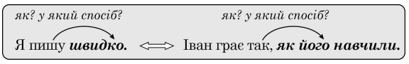
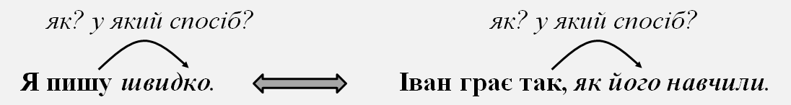

# Другорядні члени речення

1.6. Синтаксис. Пунктуація · 73 завдань · [джерело](https://zno.osvita.ua/ukrmova/tag-drugoryadni_chleni_rechennya_1/)

## Завдання 1

Однорідними означеннями ускладнено речення (*розділові знаки пропущено*)

- **А** Невеликі карі очі блищали з-під чорних брів.
- **Б** Бурхливе вранішнє море хлюпало в сонний берег.
- **В** Обережні приглушені кроки наполохали сарну.
- **Г** Легка синювата пара здіймалася над розігрітою землею.

**Відповідь: В**

Пояснення

**ТЕМА: Синтаксис. Розділові знаки в простому ускладненому реченні.**

Речення перевіряє ваше вміння правильно розставляти розділові знаки в простому ускладненому реченні, зокрема в **реченні з однорідними членами речення**, а саме означеннями.

**Однорідні означення** – це означення, що характеризують предмет за однією ознакою (кольором, розміром, настроєм тощо).

Серед запропонованих у завданні такими є слова ***обережні** (стримані, ті, що не ризикують)* та ***приглушені** (стримані, ослаблені, затамовані).*

**Відповідь – В.**

## Завдання 2

**Прочитайте текст і виконайте завдання**

(1) Тисячі дітей, *не/збайдужілих* до літератури, знають Івана Малковича – доброго дядечка-казкаря. (2) Після закінчення університету, незважаючи на різноманітні **пропозиції**, юнак, ще *не/відомий* нікому, починає вчителювати в сільській школі під Києвом. (3) Хто міг уявити тоді, що саме цей хлопець стане […] найкращого в Україні дитячого **видавництва** і, якщо треба буде, не залишатиме **друкарні** по дві доби? (4) Створені тут **книги** «Снігова королева», «Абетка», «Аліса в Дивокраї», «Тореадори з Васюківки», «Вінні-Пух» – справжні *не/перевершені* ніким витвори поліграфічного мистецтва. (5) В одному з *не/давніх* рейтингів «50 найкращих сучасних поетів» його прізвище посідає п’яте місце. (6) Вражає й такий рекорд: «А-БА-БА-ГА-ЛА-МА-ГА» за двадцять років випустила понад п’ять мільйонів книжок.

Пунктуаційну помилку допущено в реченні

- **А** першому
- **Б** другому
- **В** третьому
- **Г** четвертому

**Відповідь: Г**

Пояснення

**ТЕМА: Синтаксис. Розділові знаки в простому ускладненому реченні.**

Це завдання перевіряє ваше вміння розпізнавати види другорядних членів речення, правильно розставляти розділові знаки **між однорідними членами речення**, а саме між однорідними означеннями.

Виконуючи це завдання, обов’язково звертайтеся до мікротексту.

У четвертому реченні означення до слова *витвори* однорідні, бо спочатку є непоширене означення, а потім поширене *(справжні, не перевершені ніким).* Тому між ними потрібно поставити кому, якої в тексті немає. Отже, це пунктуаційна помилка.

**Відповідь – Г.**

## Завдання 3

З’ясуйте, яким членом речення є виділений фрагмент.

*Член речення*

- **1** підмет
- **2** іменна частина складеного присудка
- **3** означення
- **4** додаток

*Приклад речення*

- **А** Життєвий успіх людини часто пов’язаний з умінням ***спілкуватися***.
- **Б** Мовлення – надзвичайно важливий ***чинник*** порозуміння між людьми.
- **В** Умовою успішного спілкування є ***знання*** правил мовного етикету.
- **Г** Той самий комунікативний ***намір*** можна здійснити по-різному.
- **Д** Конфлікти можуть виникати ***через*** невдалий ***добір*** мовних засобів.

**Відповідь: 1 – В, 2 – Б, 3 – А, 4 – Г**

Пояснення

**ТЕМА: Синтаксис. Головні та другорядні члени речення.**

Завдання перевіряє ваше вміння визначати головні та другорядні члени речення.

Проаналізуймо запропоноване речення.

До слова *знання* можна поставити питання *хто?,* *що?,* також воно означає поняття, про яке йдеться в реченні. Отже, це **підмет**, виражений іменником.

Слово *чинник* пояснює підмет, до нього можна поставити питання *що* *є підмет?* Отже, це частина складеного іменного **присудка**, виражена іменником.

Слово *спілкуватися* розташоване біля додатка, пояснює його, можна поставити питання *який?* Отже, це неузгоджене **означення**, виражене іменником.

До сполуки *через добір* можна поставити питання від присудка *з якої причини?* Отже, це **обставина** причини, виражена іменником з прийменником.

До слова *намір* можна поставити питання *кого?, що?.* Отже, це **додаток**.

**Відповідь –ВБАГ.**

## Завдання 4

З’ясуйте, якими однорідними членами ускладнено речення.

*Однорідні члени речення*

- **1** підмети
- **2** присудки
- **3** обставини
- **4** додатки

*Приклад речення*

- **А** Джордано Бруно, видатний філософ та поет епохи Відродження, походив з незаможної італійської родини.
- **Б** У дитинстві його віддали в монастир, але хлопець утік і подорожував Європою, пізніше видавав книги та проповідував.
- **В** У його вченні цікаво поєднані наука і магія, обґрунтування нескінченності Всесвіту й віра з переселення душ.
- **Г** Один венеційський аристократ написав донос до інквізиції, бо не хотів платити філософу за поради й консультації.
- **Д** Постраждав Джордано не через свою філософію, а через принципове протистояння здирництву монастирів

**Відповідь: 1 – В, 2 – Б, 3 – Д, 4 – Г**

Пояснення

**ТЕМА: Синтаксис. Головні та другорядні члени речення. Однорідні члени речення**

Завдання перевіряє ваше вміння визначати головні та другорядні члени речення, знаходити певні однорідні член речення.

У реченні *Джорджано Бруно, видатний **філософ** та **поет** епохи Відродження, походив з незаможної італійської родини* однорідні члени речення виражені іменниками і дають предмету другу назву. Отже, це однорідні прикладки.

У реченні *У дитинстві його віддали в монастир, але хлопець **утік** і **подорожував** Європою, пізніше **видав** книги та **проповідував*** до виділених слів можна поставити питання *що робив підмет?* Отже, це однорідні присудки *утік, подорожував, видавав, проповідував.*

У реченні *У його вченні цікаво поєднані **наука** і **магія**, **обґрунтування** нескінченності Всесвіту й **віра** в переселення душ* до виділених слів можна поставити питання *хто?, що?* Отже, це однорідні підмети.

У реченні *Один венеційський аристократ написав донос до інквізиції, бо не хотів платити філософу **за поради** й **консультації*** до виділених слів ставимо питання *за кого, за що?* Отже, це однорідні додатки.

У реченні *Постраждав Джорджано **не через свою філософію**, а **через** **принципове протистояння** здирництву монастирів* до виділених слів ставимо питання *з якої причини?* Отже, це однорідні обставини.

**Відповідь: 1 – В, 2 – Б, 3 – Д, 4 – Г.**

## Завдання 5

Однорідними додатками ускладнено речення

- **А** Софійка попросила нас прийти раніше й підготувати сюрприз для іменинника.
- **Б** Любомир хотів зупинитися, заспокоїтися, розчинитися в далекому безмежжі.
- **В** Ярослав мав давню мрію – потанцювати й поговорити з однокласницею.
- **Г** Олесина й Оксанина квартири розміщені праворуч від ліфта, біля сходів.
- **Д** Назар бере наплічник і вирушає вишукувати й купувати раритетні книги.

**Відповідь: А**

Пояснення

**ТЕМА: Синтаксис. Головні та другорядні члени речення. Однорідні члени речення**

Завдання перевіряє ваше вміння визначати головні та другорядні члени речення, знаходити в реченні однорідні члени речення.

Проаналізуймо запропоновані речення.

У реченні *Любомир хотів зупинитися, заспокоїтися, розчинитися в далекому безмежжі* однорідні члени речення є частинами складеного дієслівного присудку. Вони приєднані за допомогою модального дієслова *хотів* і характеризують дію підмета.

У реченні *Ярослав мав давню мрію – потанцювати й поговорити з однокласницею* однорідні члени речення є неузгодженими означеннями, вони відповідають на питання яку?

У реченні *Олесина й Оксанина квартири розміщені праворуч від ліфта, біля сходів* теж є однорідні означення, але вони є узгодженими.

У реченні *Назар бере наплічник і вирушає вишукувати й купувати раритетні книги* є однорідні обставини, адже присудок у цьому реченні виражений руховим дієсловом. Від такого присудка ставимо питання *з якою метою? (вирушає, щоб відшукати й купити).*

А однорідні додатки є в реченні *Софійка попросила нас прийти раніше й підготувати сюрприз для іменинника.*

*Софійка* (підмет) просить нас *що? прийти й допомогти*.

**Відповідь – А.**

## Завдання 6

З’ясуйте, яким членом речення є виділені слова (*цифра позначає наступне слово*).

(1)***Звичай*** (2)***плести*** навесні вінки (3)***з давніх-давен*** (4)***поширений*** у багатьох народів світу.

- **А** підмет
- **Б** присудок
- **В** означення
- **Г** додаток
- **Д** обставина

**Відповідь: 1 – А, 2 – В, 3 – Д, 4 – Б**

Пояснення

**ТЕМА: Синтаксис. Головні та другорядні члени речення.**

Завдання перевіряє ваше вміння визначати головні та другорядні члени речення.

Проаналізуймо запропоноване речення.

До слова *звичай* можна поставити питання *що?,* також воно означає поняття, про яке йдеться в реченні. Отже, це **підмет**, виражений іменником.

Слово *поширений* пояснює підмет, до нього можна поставити питання *який є підмет?* Отже, це **присудок** (складений іменний), виражений особливою формою дієслова – дієприкметником.

Слово *плести* розташоване біля підмета, пояснює його, можна поставити питання *який?* Отже, це неузгоджене **означення**, виражене неозначеною формою дієслова.

До сполуки *з давніх-давен* можна поставити питання від присудка *як довго?, з якого часу?.* Отже, це **обставина** часу, виражена прислівником.

**Відповідь – АВДБ.**

## Завдання 7

З’ясуйте, які однорідні члени є в кожному реченні.

*Члени речення*

- **1** підмети
- **2** присудки
- **3** додатки
- **4** означення

*Приклад речення*

- **А** Дивитися й питати – це складна наука.
- **Б** Пробачай помилки іншим, але не собі.
- **В** Робота була копітка, складна, але цікава.
- **Г** Не снідавши, не обідавши, побігли працювати.
- **Д** Від власної праці отримаєш плід солодкий, смачний.

**Відповідь: 1 – А, 2 – В, 3 – Б, 4 – Д**

Пояснення

**ТЕМА: Синтаксис. Головні та другорядні члени речення.**

Завдання перевіряє ваше вміння визначати головні та другорядні члени речення.

Проаналізуймо запропоновані речення.

До слів *не снідавши, не обідавши* можна поставити питання як?*,* слова вказують на спосіб дії. Отже, це однорідні обставини, виражені особливою формою дієслова – дієприслівниками.

До слів *дивитися* та *питати* можна постави питання що?, хто?, також можна уявно замінити словами *дії* та *питання.* Отже, це однорідні підмети.

До слів *іншим, а не собі* можна поставити питання чому?, кому?, слова означають предмети, на які переходить дія підмета. Отже, це однорідні додатки.

Слова *копітка, складна, але цікава* характеризують підмет, до них можна поставити питання який є підмет? Отже, це однорідні іменні частини складеного іменного присудка.

Слова *солодкий, смачний* відповідають на питання який? і вказують на ознаку предмета (підмета). Це однорідні означення.

**Відповідь: АВБД.**

## Завдання 8

**Прочитайте** **текст** **і** **виконайте** **завдання**

**(1)** ***Як/**би*** хто хотів почути голос самого вітру, то мусив би піти йому ***на**/**зустріч***, і зупинитися посеред степу. (2) Тут, безумовно, ніщо не приєднається до його голосу, ніщо не стане на заваді. (3) А хто бажав би ще й перевірити вітер ***на**/**силу***, то мав би глянути на тополю, яку той нагинає ***до**/**долу***. (4) А ще краще – на віковічного дуба, адже нахиляти коренастого велетня – справді неабияка [...]. (5) Вітер – це ілюзія руху, і тому на місці можемо насолоджуватися швидкістю, летом, окриленням.

Однорідними додатками ускладнено речення

- **А** друге
- **Б** третє
- **В** четверте
- **Г** п’яте

**Відповідь: Г**

Пояснення

**ТЕМА:** **Синтаксис.** **Головні та другорядні** **члени** **речення. Додаток.**

Виконуючи це завдання, обов’язково звертайтеся до мікротексту.

Вам потрібно продемонструвати свої знання про головні та другорядні члени речення та вміння визначати їх у реченні.

Додаток – це другорядний член речення, який відповідає на питання непрямих відмінків; найчастіше він називає предмет, рідше – дію.

Проаналізуймо запропоновані приклади.

У п’ятому реченні, визначивши граматичні основи, можемо поставити такі питання: *насолоджуватися* ким?, чим? *швидкістю, летом, окриленням.* Це і є однорідні додатки.

**Відповідь – Г.**

## Завдання 9

З’ясуйте, яким членом речення є виділене слово.

*Член речення*

- **1** підмет
- **2** додаток
- **3** означення
- **4** обставина

*Приклад речення*

- **А** Як кажуть в народі, життя прожити – не поле ***перейти***.
- **Б** Перед виходом з дому Орест затримався ***перевірити*** квитки на потяг.
- **В** Як виховує людину сама можливість ***зробити*** добро!
- **Г** Батьки повинні навчити дитину ***долати*** життєві перешкоди.
- **Д** ***Відчувати*** радість за успіхи ближнього – ознака альтруїзму.

**Відповідь: 1 – Д, 2 – Г, 3 – В, 4 – Б**

Пояснення

**ТЕМА: Синтаксис. Головні та другорядні члени речення**

Завдання перевіряє ваше вміння визначати головні та другорядні члени речення.

Проаналізуймо запропоновані речення.

До слова *перейти* в реченні *Як кажуть у народі, життя прожити – не поле перейти* можна поставити питання *що робити?* Отже, це присудок, виражений інфінітивом.

У реченні *Перед виходом з дому Орест затримався перевірити квитки на потяг* до виділеного слова *перевірити* можна поставити питання *з якою метою?.* Отже, це обставина.

У реченні *Як виховує людину сама можливість зробити добро!* до виділеного слова *зробити* можна поставити питання *яка?* Отже, це означення (неузгоджене).

У реченні *Батьки повинні навчити дитину долати життєві перешкоди* до виділеного слова *долати* можна поставити питання *чого? – подоланню.* Отже, це додаток.

У реченні *Відчувати радість за успіхи ближнього – ознака альтруїзму* до виділеного слова *відчувати* можна поставити питання *хто?, що?* Отже, це підмет.

**Відповідь: ДГВБ.**

## Завдання 10

Позначте речення, у якому другорядним членом виступає обставина способу дії:

- **А** Заходить до хати зоря-зоряниця, і гомін стихає кругом (М. Сом).
- **Б** Ходить вітер яром та горою, плачуть трави, тужать під косою (М. Рильський).
- **В** Прісною прохолодою повіяло з лісу (М. Стельмах).
- **Г** За півкілометра річка розпливалася великим плесом трохи меншого, широкого й чистого ставу (Ю. Смолич).
- **Д** Ну, словом, листя розпустили всі назустріч живодайному дощеві(М. Рильський).

**Відповідь: Г**

Пояснення

**ТЕМА: Синтаксис. Члени речення**

Завдання перевіряє вміння визначати члени речення.

Зверніть увагу, що **обставина** – це другорядний член речення, який указує на місце, час, спосіб, мету, умову, причину дії і відповідає на питання *де? коли? які для чого? за якої умови? чому?* та ін.

Обставини **способу дії** вказують на спосіб дії чи ознаки і відповідають на питання *як? яким способом?*. Така обставина є в реченні *За півкілометра річка розпливалася* (як? яким способом?) *великим* *плесом* *трохи меншого, широкого й чистого ставу.*

**Відповідь – Г.**

## Завдання 11

Позначте речення, у яких перед словом *як* ставиться кома (розділові знаки пропущено):

- **1** Мелашка була потрібна в господі як робітниця (І. Нечуй-Левицький).
- **2** Дівчина сяяла як кущ калини (І. Нечуй-Левицький).
- **3** Прокіп підходив спокійний і діловий як завжди (М. Коцюбинський).
- **4** Промені як вії сонячних очей (П. Тичина).
- **5** І. Франко знав і любив народну пісню як учений, демократ, патріот(М. Рильський).
- **6** Хмара як лебідь пливе над лісами (П. Осадчук).
- **7** Весь світ знає Довженка як великого кінорежисера.

**Відповідь: 2, 3, 6**

Пояснення

**ТЕМА: Синтаксис. Розділові знаки в реченнях**

Це завдання перевіряє ваше вміння добирати потрібний правильний розділовий знак у реченнях.

Зверніть увагу, що ставиться кома*:*

- перед зворотами *як завжди, як і раніше, як звичайно, як правило, як виняток, як навмисне, як один: Прокіп підходив спокійний і діловий, як завжди* (М. Коцюбинський).

- перед порівняльними зворотами: *Дівчина сяяла, як кущ калини* (І. Нечуй-Левицький). *Хмара, як лебідь пливе над лісами* (П. Осадчук).

**Відповідь: 2, 3, 6.**

## Завдання 12

Позначте речення, у якому НЕ ПОТРІБНО виділяти комами поширене означення:

- **А** Місячним сяйвом залиті мріють сади.
- **Б** Гудуть з вітрами до світання дощем оплакані сади.
- **В** Степ оповитий тишею дихав пахощами росяних трав.
- **Г** Я небесами пійманий тремчу.
- **Д** Налита сонцем і вітрами хлюпоче веслами весна.

**Відповідь: Б**

Пояснення

**ТЕМА:** **Синтаксис. Розділові знаки при відокремлених членах**

Це завдання перевіряє ваше вміння добирати потрібний правильний розділовий знак при відокремлених членах речення.

Поширене означення **не відокремлюємо** в реченні *«Гудуть з вітрами до світання* *дощем оплакані* *сади**»,* адже тут дієприкметниковий зворот стоїть перед означуваним словом.

**Відповідь – Б.**

## Завдання 13

Позначте речення, у якому перед *як* ПОТРІБНО поставити кому (розділові знаки пропущено):

- **А** Сосюра як справжній лірик різноманітний у своїх переживаннях.
- **Б** Діти як квіти поливай то ростимуть.
- **В** Весь світ знає Довженка як великого кінорежисера.
- **Г** Палаючий Будапешт був перед нами як на долоні.
- **Д** Уночі хоч як тріщить а вдень проти сонечка плющить.

**Відповідь: А**

Пояснення

**ТЕМА: Синтаксис. Розділові знаки в різних видах речень**

Це завдання перевіряє ваше вміння добирати потрібний правильний розділовий знак у реченнях з прикладками.

Кому перед ***як*** треба поставити в реченні: *«Сосюра, як справжній лірик, різноманітний у своїх переживаннях»*. Зверніть увагу, що комою в цьому реченні відокремлюємо прикладку, яка має відтінок причини.

**Відповідь – А.**

## Завдання 14

Обставина причини є в реченні

- **А** Брат навчився керувати автомобілем.
- **Б** Читаючи підручник, робіть нотатки.
- **В** Шляхи засипаючи, завиває лютнева хуртовина.
- **Г** Поранений солдат побілів від болю.
- **Д** Мандрівники були вже дуже далеко від домівки.

**Відповідь: Г**

Пояснення

**ТЕМА: Синтаксис. Члени речення**

Завдання перевіряє вміння визначати члени речення.

Обставина причини є в реченні*: Поранений солдат побілів (*чому?, з якої причини?) *від болю*.

**Відповідь – Г.**

## Завдання 15

**Прочитайте текст (**цифри в дужках позначають номери речень**) і виконайте завдання**

(1) Які тут, на крутому схилі гори, зеленіли дерева! (2) Чия буйна фантазія позбирала їх із *усіх-усюд* до цього товариського гурту, й тепер вони створили мальовничу строкату сім’ю! (3) Простір між стовбурами, пронизаний світлом літнього сонця, *без упину* манив загадковим затишком. (4) Батько *рано-вранці* йшов від дерева до дерева й перед кожним зупинявся на коротку мить наче здибався зі знайомою людиною. (5) Цей сад на схилі гори творили не тільки розлогі яблуні, а й посаджені ще *позаторік* зовсім молоденькі яблуньки.

Пунктуаційну помилку допущено в реченні

- **А** першому
- **Б** другому
- **В** третьому
- **Г** четвертому

**Відповідь: Г**

Пояснення

**ТЕМА: Синтаксис. Розділові знаки в реченні**

Завдання перевіряє вміння правильно розставляти розділові знаки в реченнях.

Пунктуаційну помилку допущено в четвертому реченні: потрібно відокремити порівняльний зворот: *«**Батько рано-вранці йшов від дерева до дерева й перед кожним зупинявся на коротку мить, наче здибався зі знайомою людиною**»*.

**Відповідь – Г.**

## Завдання 16

**Прочитайте текст і виконайте завдання**

(1)*Щороку* під кінець травня земля набирається сили і її живлющі соки *до схочу* напоюють зело. (2)Саме під цю пору на Поліссі починає густо цвісти азалія. (3)Її жовтий цвіт мовби велетенське мереживо свічок, виготовлених із ярого воску, освітлює найтемніші закутки лісових хащ. (4)Душа від того яскравого суцвіття наповнюється бадьорим настроєм, веселішає, усе *довкола* набирає особливої урочистості. (5)Великі з жовтим відблиском пелюстки густо вигойдуються на тендітних ниточках, бутончики нагадують підвішену *догори* парасолю.

Пунктуаційну помилку допущено в реченні

- **А** першому
- **Б** третьому
- **В** четвертому
- **Г** п’ятому

**Відповідь: Б**

Пояснення

**ТЕМА: Синтаксис. Розділові знаки в реченні**

Завдання перевіряє вміння правильно розставляти розділові знаки в реченнях.

Пунктуаційну помилку допущено в третьому реченні: потрібно відокремити порівняльний зворот: *«Її жовтий цвіт,*** *мовби велетенське мереживо свічок,*** *виготовлених із ярого воску, освітлює найтемніші закутки лісових хащ»*.

**Відповідь – Б.**

## Завдання 17

До кожного рядка, позначеного ЦИФРОЮ, доберіть відповідник, позначений БУКВОЮ.

*Відокремлений член речення*

- **1** означення
- **2** прикладка (різновид означення)
- **3** обставина
- **4** додаток

*Приклади*

- **А** Сам Лисенко, бездоганний лицар української пісні, прекрасний композитор і піаніст, зостався в моїй пам\'яті як найчарівніша людина.
- **Б** Он хмарки бредуть повільно одна за одною над самим обрієм, схожі на білих лебедів.
- **В** Не чути ніякого голосу, крім вівчарської трембіти, десь на далекій полонині.
- **Г** Ви щасливі, високії зорі, все на світі вам видно звисока.
- **Д** Троянди, гріючись на сонці нескупім, нам серце радують відродженням своїм.

**Відповідь: 1 – Б, 2 – А, 3 – Д, 4 – В**

Пояснення

**ТЕМА:** **Синтаксис. Відокремлені члени речення**

Це завдання перевіряє ваше вміння правильно й комунікативно доцільно використовувати речення з відокремленими членами.

Проаналізуймо запропоновані речення.

Відокремлене **означення** є в реченні ***Б***. Згадаймо, що прикметниковий зворот, який стоїть після означуваного слова, на письмі виділяють комою: *«Он хмарки бредуть повільно одна за одною над самим обрієм,* ***схожі на білих лебедів»*.

Відокремлена поширена **прикладка** *«бездоганний лицар української пісні, прекрасний композитор і піаніст»* є в реченні в рядку ***А*.**

Відокремлена **обставина** є в рядку ***Д***. У реченні відокремлюється дієприслівниковий зворот *«Троянди,* ***гріючись на сонці нескупім, нам серце радують відродженням своїм».*

Відокремлений **додаток** є в рядку ***В***. Зверніть увагу: відокремлюються додатки, що мають значення виключення або включення і починаються словами *крім, окрім, опріч, особливо, за винятком, на відміну від*: *«**Не чути ніякого голосу,* ***крім вівчарської трембіти, десь на далекій полонині»*.

**Відповідь: 1–Б, 2–А, 3–Д, 4–В.**

## Завдання 18

З’ясуйте, яким членом речення є виділені слова

- **1** підмет
- **2** присудок
- **3** означення
- **4** обставина

- **А** Молодість ***здатна творити*** несподіване й неймовірне.
- **Б** Як розбещує людину сама можливість ***принижувати*** інших!
- **В** Не дивиться їм грізно в очі ***«завтра»***.
- **Г** А він стоїть ***наперекір усім***.
- **Д** Народ шукає ***в геніях*** себе.

**Відповідь: 1 – В, 2 – А, 3 – Б, 4 – Г**

Пояснення

**ТЕМА:** **Синтаксис. Головні та другорядні члени речення**

Завдання перевіряє ваше вміння визначати головні та другорядні члени речення.

Проаналізуймо запропоновані речення.

**Підметом** є виділене слово в реченні *«**Не дивиться їм грізно в очі **«завтра»***, до нього можна поставити питання *що?.*

Складеним дієслівним **присудком** є виділені слова в реченні *«**Молодість **здатна творити** несподіване й неймовірне**»*. Пригадаймо, що складений дієслівний присудок містить допоміжне дієслово, яке своїми граматичними ознаками узгоджується з підметом, вказує на час та спосіб дії, на початок, тривалість, кінець, бажаність чи можливість дії, і неозначену форму дієслова, що виражає саму суть дії.

Неузгодженим **означенням**, вираженим інфінітивом, є виділене слово *(можливість **яка?*** *творити)* в реченні *«Як розбещує людину сама можливість **принижувати** інших!».*

У реченні *«**А він стоїть **наперекір** **усім**»* до виділених слів можна поставити запитання *незважаючи на що?* Отже, це **обставина**.

**Відповідь: 1–В, 2–А, 3–Б, 4–Г.**

## Завдання 19

Складнопідрядне речення утвориться, якщо серед варіантів продовження речення «Спадала безмісячна ніч...» обрати

- **А** якось журливо ставало на душі.
- **Б** неначе занурюючи все в темряву.
- **В** однак на ґанку ще точилася розмова.
- **Г** так що все птаство затихло.
- **Д** насувався лячний присмерк.

**Відповідь: Г**

Пояснення

**ТЕМА:** **Синтаксис. Складнопідрядне речення, його будова**

Завдання перевіряє вміння розпізнавати види складнопідрядних речень.

**Складнопідрядне речення** – це складне речення, у якому одне просте речення є головним, а інше (підрядне) граматично залежить від головного і з'єднується з ним за допомогою підрядного сполучника або сполучного слова.

Складнопідрядне речення з **підрядним наслідку** утвориться, якщо серед варіантів продовження речення *«**Спадала безмісячна ніч...**»* вибрати *«**так що все птаство затихло**»* (речення має дві граматичні основи, частини поєднані сполучником ***так що***).

**Відповідь: Г.**

## Завдання 20

З’ясуйте синтаксичну роль виділених слів (цифра позначає наступне слово).

Мова (1)***Гоголя*** — це своєрідний український (2)***«говір»*** за мелодикою, синтаксисом, словником, тому важко рівнопотужно перекласти (3)***Гоголя*** українською: втрачається (4)***неповторний*** аромат українськості.

- **1** Гоголя
- **2** «говір»
- **3** Гоголя
- **4** неповторний

- **А** іменна частина присудка
- **Б** прямий додаток
- **В** непрямий додаток
- **Г** узгоджене означення
- **Д** неузгоджене означення

**Відповідь: 1 – Д, 2 – А, 3 – Б, 4 – Г**

Пояснення

**ТЕМА:** **Синтаксис. Головні та другорядні члени речення**

Завдання перевіряє ваше вміння визначати головні та другорядні члени речення.

Проаналізуймо запропоноване речення.

До слова *Гоголя* можна поставити питання *чия?.* Отже, це **неузгоджене означення**, виражене іменником.

Іменник *«говір»* є частиною **складеного іменного присудка**. Дієслово-зв'язка *бути* в теперішньому часі тут має нульову форму.

До слова *Гоголя* можна поставити питання *кого? чого?.* Отже, це **прямий додаток**, виражений іменником у Р. в. Зауважмо, що прямий додаток називає предмети, процеси, стани, на які безпосередньо переходить дія. Найчастіше виражається іменником у знахідному відмінку (без прийменника), що сполучається з перехідними дієсловами. Прямий додаток іноді вживається у формі родового відмінка без прийменника: коли дія переходить лише на частину предмета, наприклад: *перекласти Гоголя*.

До слова *неповторний* можна поставити питання *який?.* Отже, це **узгоджене означення**, виражене прикметником.

**Відповідь: 1–Д, 2–А, 3–Б, 4–Г.**

## Завдання 21

З’ясуйте, який відокремлений член речення є в кожному прикладі.

*Відокремлений член речення*

- **1** означення
- **2** прикладка (різновид означення)
- **3** додаток
- **4** обставина

*Приклад*

- **А** А воно, могутнє світило, усе більше виповнювало собою світ.
- **Б** Від квітів, особливо пальм й аспарагусів, одразу повіяло життям.
- **В** Цвіте липа так буйно й розкішно, що все місто плаває в задумливому мареві.
- **Г** Обабіч шляху лежали незнайомі поля, перекраяні вузькими довгими нивами.
- **Д** Виблискуючи проти молодого місяця мокрим днищем, серединою ріки повільно плив за течією перекинутий човен.

**Відповідь: 1 – Г, 2 – А, 3 – Б, 4 – Д**

Пояснення

**ТЕМА:** **Синтаксис. Відокремлені члени речення**

Це завдання перевіряє ваше вміння правильно й комунікативно доцільно використовувати речення з відокремленими членами.

Проаналізуймо запропоновані речення.

Відокремлене означення є в реченні **Г**. Згадаймо, що дієприкметниковий зворот, який стоїть після означуваного слова, на письмі виділяють комою: *«**Обабіч шляху лежали незнайомі поля, **перекраяні вузькими довгими нивами**»*.

Відокремлена прикладка *«могутнє світило»* є в реченні в рядку **А.**

Відокремлений додаток є в рядку **Б**. Зверніть увагу: відокремлюються додатки, що мають значення виключен­ня або включення і починаються словами *крім, окрім, опріч, особливо, за винятком, на відміну від*: *«**Від квітів, **особливо пальм й аспарагусів**, одразу повіяло життям»*.

Відокремлена обставина є в рядку **Д**. У реченні відокремлюється дієприслівниковий зворот *«Виблискуючи проти молодого місяця мокрим днищем».*

**Відповідь: 1–Г, 2–А, 3–Б, 4–Д.**

## Завдання 22

Кому перед *як* треба поставити в реченні

- **А** Пам’ятаю ці події як сьогодні.
- **Б** Затримався не більше як на годину.
- **В** Вивчаємо звук як одиницю мовлення.
- **Г** Дощ полив як із відра.
- **Д** Роса посипалась як дощ.

**Відповідь: Д**

Пояснення

**ТЕМА: Синтаксис. Просте речення. Розділові знаки в простому реченні.**

Це завдання перевіряє ваше вміння правильно розставляти розділові знаки, пояснювати їх.

Кому перед ***ЯК*** не ставимо в таких випадках:

- при фразеологічних зворотах (*як з відра – сильно, дуже*) та перед фразеологізованими виразами типу *як сьогодні*;

- якщо це прикладка, що має значення «у ролі кого чи чого» (звук як одиниця мовлення);

- у конструкціях *не більше як, не раніше як, не довше ніж, як слід, як треба (не більш як на годину).*

Кому перед ***ЯК*** ставимо, якщо це порівняльний зворот (*роса посипалась, як дощ,* тобто вона *опадала так, як падає дощ*).

**Відповідь – Д.**

## Завдання 23

Установіть, якими однорідними членами ускладнено кожне речення.

*Однорідні члени речення*

- **1** підмети
- **2** присудки
- **3** додатки
- **4** означення

*Приклад*

- **А** Звичністю, буденністю позначено тут життя.
- **Б** Пливуть переді мною сині води, білі піски.
- **В** Світ здається чарівною казкою, нерозгаданим плетивом мрій.
- **Г** Тихо опадає цвіт яблунь і груш.
- **Д** Під моїм вікном густо, медово пахне акація.

**Відповідь: 1 – Б, 2 – В, 3 – А, 4 – Г**

Пояснення

**ТЕМА:** **Синтаксис. Речення з однорідними членами**

Це завдання перевіряє ваше вміння правильно розпізнавати однорідні члени в реченні.

Проаналізуймо запропоновані речення.

Однорідними підметами *води, піски* **(що?)** ускладнено речення в рядку **Б**.

Однорідними присудками *здається казкою, плетивом* **(що робить?)** ускладнено речення в рядку **В**.

Однорідними додатками *звичністю, буденністю* **(чим?)** ускладнено речення в рядку **А**.

Однорідними неузгодженими означеннями *цвіт* **(який?)** *яблунь, груш* ускладнено речення в рядку **Г**.

Речення *Під моїм вікном густо, медово пахне акація* ускладнено однорідними обставинами.

**Відповідь: 1–Б, 2–В, 3–А, 4–Г.**

## Завдання 24

З’ясуйте, яким членом речення є виділені слова.

*Член речення*

- **1** підмет
- **2** присудок
- **3** означення
- **4** обставина

*Приклад*

- **А** Я лиш ***син*** народу.
- **Б** Весна захлиналася буйним цвітом ***вишень***.
- **В** ***Писати*** вірші — жить непросто.
- **Г** І гнеться дерево ***від плоду***.
- **Д** Русявий день гаптує ***сни*** світанню.

**Відповідь: 1 – В, 2 – А, 3 – Б, 4 – Г**

Пояснення

**ТЕМА:** **Синтаксис. Головні та другорядні члени речення**

Завдання перевіряє ваше вміння визначати головні та другорядні члени речення.

Проаналізуймо запропоновані речення.

До слова *син* у реченні *«**Я лиш син народу»* можна поставити питання ***який він є?*** Отже, це частина складеного іменного присудка, вираженого іменником, дієслово-зв’язка тут опущена.

Неузгодженим означенням є виділене слово (*цвітом* ***яким?*** *вишень*) в реченні *«Весна захлиналася буйним цвітом вишень».*

У реченні *«П**исати* *вірші – жить непросто»* виділений інфінітив є підметом.

У реченні *«**І гнеться дерево* *від плоду»* до виділеного слова можна поставити запитання ***через що?*** Отже, це обставина.

У реченні *«**Русявий день гаптує сни світанню»* до виділеного слова можна поставити питання ***кого? що?*** Отже, це додаток.

**Відповідь: 1–В, 2–А, 3–Б, 4–Г.**

## Завдання 25

З’ясуйте синтаксичну роль виділених у реченні слів (цифра позначає наступне слово).

Українській класичній *(1)**прозі** (2)**завжди*** була *(3)**властива*** яскрава *(4)**поетичність***.

- **1** прозі
- **2** завжди
- **3** властива
- **4** поетичність

- **А** підмет
- **Б** присудок
- **В** означення
- **Г** додаток
- **Д** обставина

**Відповідь: 1 – Г, 2 – Д, 3 – Б, 4 – А**

Пояснення

**ТЕМА:** **Синтаксис. Головні та другорядні члени речення**

Завдання перевіряє ваше вміння визначати головні та другорядні члени речення.

Проаналізуймо запропоноване речення.

До слова *поетичність* можна поставити питання *хто? що?.* Отже, це **підмет**, виражений іменником.

До слова *властива* можна поставити питання *яка вона є?.* Отже, це частина **складеного іменного присудка**, який виражений дієсловом-зв’язкою та прикметником.

До слова *завжди* можна поставити питання *коли?.* Отже, це **обставина часу**, виражена прислівником.

До слова *прозі* можна поставити питання *кому? чому?.* Отже, це **додаток**, виражений іменником.

**Відповідь: 1-Г, 2-Д, 3-Б, 4-А.**

## Завдання 26

Визначте синтаксичну роль виділеного дієслова в реченнях

- **1** підмет
- **2** компонент складеного дієслівного присудка
- **3** обставина
- **4** додаток

- **А** Звичай ***робити*** писанки виник в Україні ще з дохристиянських часів.
- **Б** Поет не міг ***написати*** рядка без вогненного перевтілення в образи.
- **В** Він мені казав ***вивчити*** напам’ять про Каїна та Авеля.
- **Г** На колишній Гетьманщині на Водохреще парубоцтво сходилося на лід ***помірятися*** силами.
- **Д** ***Співати*** - це обов’язково, як дихати.

**Відповідь: 1 – Д, 2 – Б, 3 – Г, 4 – В**

Пояснення

**ТЕМА: Синтаксис. Головні та другорядні члени речення.**

Завдання перевіряє ваше вміння визначати головні та другорядні члени речення.

Проаналізуймо запропоновані речення.

До слова *написати* в реченні *Поет не міг написати рядка без вогненного перевтілення в образи* можна поставити питання *що зробити?* Отже, це частина **складеного дієслівного присудка**, виражена інфінітивом.

У реченні *Звичай робити писанки виник в Україні ще з дохристиянських часів* до виділеного слова можна поставити питання *який?* Отже, це **неузгоджене означення**.

У реченні *Він мені казав вивчити напам**’**ять про Каїна та Авеля* до виділеного слова можна поставити питання *кого?що?.* Отже, це **додаток**.

У реченні *На колишній Гетьманщині на Водохреще парубоцтво сходилося на лід помірятися силами* до виділеного слова можна поставити від дієслова на позначення руху питання *з якою метою?.* Отже, це **обставина**.

У реченні *Співати – це обов**’**язкого, як дихати* до виділеного слова можна поставити питання *хто?що?* Отже, це **підмет**.

**Відповідь – 1–Д, 2–Б, 3–Г, 4–В.**

## Завдання 27

Складнопідрядне речення з підрядним мети утвориться, якщо до речення *«На початку травня ми поїхали до Криму …»* додати

- **А** незважаючи на погану погоду.
- **Б** щоб відвідати ботанічний сад.
- **В** тому що були вихідні дні.
- **Г** через задушливі дні в Києві.
- **Д** так що відпочинок був цікавий.

**Відповідь: Б**

Пояснення

**ТЕМА: Синтаксис. Будова складнопідрядного речення. Види підрядних речень**

Завдання перевіряє ваше вміння утворювати складнопідрядні речення, визначати види складнопідрядних речень.

Якщо до речення *На початку травня ми поїхали до Криму* додати частину, запропоновану в рядку **А**, утвориться просте ускладнене речення. Також просте речення утвориться при додаванні частинки з рядка **Г**.

Від частини *На початку травня ми поїхали до Криму* до частини в рядку **Б** можна поставити питання *з якої причини?* Отже, при додаванні утвориться складнопідрядне речення з підрядним обставинним причини.

Від частини *На початку травня ми поїхали до Криму* до частини в рядку **Д** можна поставити питання *який з цього наслідок?* Отже, утвориться складнопідрядне речення з підрядним обставинним наслідку.

Від головної частини до частини, запропонованої в рядку **Б**, можна поставити питання *навіщо?, з якою метою?* Отже, тут утвориться складнопідрядне речення з підрядним обставинним мети.

**Відповідь – Б.**

## Завдання 28

Доберіть приклад до кожного випадку вживання тире.

*Випадок уживання тире*

- **1** тире в неповному реченні
- **2** тире при відокремленій прикладці
- **3** тире при однорідних членах речення
- **4** тире між підметом і присудком

*Приклад*

- **А** Найбільше у світі любив він осінь — природи солодку зрілість.
- **Б** Дівчина внесла оберемок майористих квітів — до цього похмура кімната враз ожила.
- **В** Зацвіла тендітно-біла конвалія в гаю, а сонячні кульбабки — біля ставу.
- **Г** Класична пластика, і контур строгий, і логіки залізна течія — це справжньої поезії дороги.
- **Д** Зображення флори і фауни: квітів, дерев, тварин — свідчать про обожнення природи нашими предками.

**Відповідь: 1 – В, 2 – А, 3 – Д, 4 – Г**

Пояснення

**ТЕМА: Синтаксис. Тире в різних видах речень**

Завдання перевіряє ваші знання з пунктуації та вміння правильно розставляти розділові знаки в різних видах речень.

Проаналізуймо запропоновані речення.

Речення в рядку **А –** це просте речення, ускладнене відокремленою поширеною прикладкою *природи солодку зрілість.* Перед нею потрібно поставити тире, бо прикладка стоїть у кінці речення.

Речення в рядку **Б** – це речення складне безсполучникове, частини якого пов’язані причиново-наслідковим зв’язком. У такому випадку ставимо тире.

Речення в рядку **В** – це складносурядне речення. У другій його частині ( це неповне речення) тире стоїть на місці пропущеного присудка *(сонячні кульбабки **зацвіли** біля ставку).*

Речення в рядку **Г** – це речення, у якому тире стоїть між однорідними підметами та присудком. Підмети і присудок виражені іменниками. А також перед присудком стоїть частка *це.* Тире тут обов’язкове.

Речення в рядку **Д** – це теж просте речення, ускладнене однорідними членами речення з узагальнювальним словом, яке стоїть перед ними. Але однорідні члени стоять не в абсолютному кінці речення. У таких випадках після узагальнювального слова ставимо двокрапку, а після однорідних членів речення – тире.

**Відповідь – ВАДГ.**

## Завдання 29

**Прочитайте текст і виконайте завдання**

(1) Прилинули не/зліченні теплі молдавські ***вітри***, насунуло з півдня велике жовте одноманіття. (2) Наставали дедалі кращі й леткі наче мильні бульбашки дні, і ***кожний*** видавався так до краю шляхетним, що всяка ***хвиля*** тривання була чудом надмірним і ще не/звіданим. (3) У тиші глибоких і гарних днів змінювалась не/помітно тканина листків. (4) Аж певного дня дерева постали в солом’яному вогні цілком здематеріалізованого листя, у красі легкій, як відцвілі пелюстки, як прекрасні пави й фенікси, котрі мусять лишень схитнутись і затріпотіти, щоб струсити те злиняле та не/потрібне ***пір’я**.*

Роль підмета виконують слова, виділені в усіх рядках, ОКРІМ

- **А** молдавські *вітри*
- **Б** *кожний* видавався
- **В** *хвиля* тривання
- **Г** не/потрібне *пір’я*

**Відповідь: Г**

Пояснення

**ТЕМА: Синтаксис. Підмет і присудок як головні члени двоскладного речення**

Виконуючи це завдання, обов’язково звертайтеся до мікротексту.

Вам потрібно продемонструвати свої знання про головні члени речення та вміння визначати їх у реченні.

Проаналізуймо запропоновані приклади.

Виконуючи це завдання, необхідно обов’язково ставити подвійне відмінкове питання.

*Молдавські вітри.* *Прилинули* хто?, що? *вітри* – підмет.

*Кожний видавався.* Хто?,що? *кожний* що робив? *видавався*. Слово *кожний* відповідає на питання називного відмінка. Отже, це теж підмет.

*Хвиля тривання була чудом.* Хто?, що?*хвиля*. Отже, це теж підмет.

А слово *пір**’**я* відповідає на питання кого?, що? (*струсити* кого?, що? *пір’я*). Отже, це не підмет, а додаток.

**Відповідь – Г.**

## Завдання 30

**Прочитайте текст і виконайте завдання**

(1) Прилинули не/зліченні теплі молдавські ***вітри***, насунуло з півдня велике жовте одноманіття. (2) Наставали дедалі кращі й леткі наче мильні бульбашки дні, і ***кожний*** видавався так до краю шляхетним, що всяка ***хвиля*** тривання була чудом надмірним і ще не/звіданим. (3) У тиші глибоких і гарних днів змінювалась не/помітно тканина листків. (4) Аж певного дня дерева постали в солом’яному вогні цілком здематеріалізованого листя, у красі легкій, як відцвілі пелюстки, як прекрасні пави й фенікси, котрі мусять лишень схитнутись і затріпотіти, щоб струсити те злиняле та не/потрібне ***пір’я**.*

Пунктуаційну помилку допущено в реченні

- **А** першому
- **Б** другому
- **В** третьому
- **Г** четвертому

**Відповідь: Б**

Пояснення

**ТЕМА: Синтаксис. Розділові знаки в ускладненому речення**

Це завдання перевіряє ваше вміння розпізнавати види другорядних членів речення, правильно розставляти розділові знаки, зокрема виділяти порівняльний зворот.

Порівняльний зворот, порівнюючи одні предмети з іншими, образно характеризує їх. Порівняльні звороти вводяться в речення за допомогою слів *як, мов, немов, наче, неначе, неначебто, ніби* тощо. На письмі порівняльні звороти виділяють комами. Отже, у тексті порівняльний зворот *наче мильні бульбашки* необхідно виділити комами

**Відповідь – Б.**

## Завдання 31

З'ясуйте синтаксичну роль виділених слів (цифра позначає наступне слово).

Ніколи не треба забувати про своє призначення й *(1)**завжди*** пам'ятати, що *(2)**митці*** покликані народом для того, аби показувати *(3)**світові*** насамперед, що життя *(4)**прекрасне***, що само по собі воно є найбільшим і найвеличнішим з усіх мистецьких благ.

- **1** завжди
- **2** митці
- **3** світові
- **4** прекрасне

- **А** обставина
- **Б** підмет
- **В** додаток
- **Г** іменна частина присудка
- **Д** означення

**Відповідь: 1 – А, 2 – Б, 3 – В, 4 – Г**

Пояснення

**ТЕМА: Синтаксис. Головні та другорядні члени речення**

Завдання перевіряє ваше вміння визначати головні та другорядні члени речення.

Проаналізуймо запропоновані речення.

До слова *завжди* можна поставити питання *коли?,* слово вказує на час дії. Отже, це обставина, виражена прислівником.

До слова *митці* можна постави питання *хто?*, слово означає основного діяча в реченні. Отже, це підмет.

До слова *світові* можна поставити питання *чому?*, слово означає предмет, на який переходить дія підмета. Отже, це додаток.

Слово *прекрасне* характеризує підмет, до нього можна поставити питання *який є підмет?.* Отже, це іменна частина складеного іменного присудка.

**Відповідь: АБВГ.**

## Завдання 32

З’ясуйте, яким членом речення є виділені слова.

- **1** підмет
- **2** присудок
- **3** означення
- **4** обставина

- **А** Щирі друзі ***глечика не поб’ють***.
- **Б** ***Учорашнє*** ніби сон, що випурхнув з очей.
- **В** На десерт подали сік ***із полуниць***.
- **Г** Перехожі ***з подивом*** поглядали на дівчину.
- **Д** Ніч осіння ***на дощ і туман*** багата.

**Відповідь: 1 – Б, 2 – А, 3 – В, 4 – Г**

Пояснення

**ТЕМА: Синтаксис. Головні та другорядні члени речення.**

Завдання перевіряє ваше вміння визначати головні та другорядні члени речення.

Проаналізуймо запропоновані речення.

До слова *учорашнє* в реченні *Учорашнє ніби сон, що випурхнув з очей* можна поставити питання *хто? що?* Отже, це підмет, виражений субстантивованим прикметником.

У реченні *Щирі друзі глечика не поб**’**ють* до виділених слів можна поставити питання *що зроблять?* Фразеологізм *не побити глечика* має значення *не посваритися.* Отже, це присудок, виражений фразеологізмом.

У реченні *На десерт подали сік з полуниць* до виділеного слова можна поставити питання *який?,* а також замінити на слово *полуничний.* Отже, це означення (неузгоджене).

У реченні *Перехожі з подивом поглядали на дівчину* до виділеного слова можна поставити питання *як? з подивом (здивовано).* Отже, це обставина.

У реченні *Ніч осіння на дощ і туман багата* до виділеного слова можна поставити питання *кого? що?* Отже, це додаток.

**Відповідь: БАВГ.**

## Завдання 33

Прочитайте речення.

*Як рожеві птахи (1) зашуміли (2) заспівали примороззю підкучерявлені очерети (3) і їхній пух полетів у святешну далечінь (4) де злегка поскрипував мороз (5) чи земля і на добрий сон вкладалося село.*

Кому треба ставити на місці всіх цифр, ОКРІМ

- **А** 1
- **Б** 2
- **В** З
- **Г** 4
- **Д** 5

**Відповідь: Д**

Пояснення

**ТЕМА:** **Синтаксис. Розділові знаки в різних видах речень.**

Це завдання перевіряє ваше вміння правильно розставляти розділові знаки, пояснювати їх.

Проаналізуймо запропоноване речення.

Перша кома виділяє порівняльний зворот *як рожеві птахи,* друга кома стоїть між однорідними присудками *зашуміли, заспівали.* Третя кома стоїть на межі частин складносурядного речення, а четверта – на початку підрядного означального речення.

А якщо поставити кому на місці цифри 5, то вона розділить однорідні члени речення, пов’язані неповторюваним сполучником *чи*. Отже, цієї коми ставити не треба.

**Відповідь – Д.**

## Завдання 34

Відокремленим додатком ускладнено речення

- **А** Напевно, це був інший світ – чудовий невідомий храм.
- **Б** Щасливий і веселий, я дивився на високе бездонне небо.
- **В** Тихі конвалії, білі і ніжні, скоро розплющать срібні повіки.
- **Г** Там, замість житечка, у теплеє літечко враз терен зацвів.
- **Д** Вітру на морі не було, проте клекотав сильний прибій.

**Відповідь: Г**

Пояснення

**ТЕМА: Синтаксис. Відокремлені члени речення.**

Завдання перевіряє ваше вміння розпізнавати речення з різноманітними відокремленими членами речення та складні речення.

У рядку **А** подано просте речення, ускладнене вставним словом *напевно*, яке виражає невпевненість.

У рядку **Б** речення ускладнено відокремленими однорідними означеннями, які стоять перед особовим займенником.

Речення у рядку **В** теж ускладнено відокремленими однорідними означеннями, які стоять після означувального слова.

Речення в рядку **Г** ускладнено відокремленим додатком *замість житечка.*

Додатки, які починаються словами *окрім, опріч, замість, за винятком* тощо, відокремлюються.

Речення в рядку **Д** – це складне речення.

**Відповідь – Г.**

## Завдання 35

Установіть, яким членом речення є кожне зі слів, позначених цифрами (цифра стоїть перед словом, яке вона позначає).

У кого *(1)**серце*** мудрістю *(2)**багате***, *(3)**тому*** глибини *(4)**всякі*** перейти.

- **1** серце
- **2** багате
- **3** тому
- **4** всякі

- **А** додаток
- **Б** означення
- **В** обставина
- **Г** підмет
- **Д** присудок

**Відповідь: 1 – Г, 2 – Д, 3 – А, 4 – Б**

Пояснення

**ТЕМА: Синтаксис. Головні та другорядні члени речення.**

Завдання перевіряє ваше вміння визначати головні та другорядні члени речення.

Слово *серце* відповідає на питання *хто?, що?.* Отже, це підмет.

Від підмета *серце* можна поставити питання *який є підмет?* до слова *багате.*** Отже, це іменна частина складеного іменного присудка.

До слова *тому* можна поставити питання *кому?* Отже, це додаток, тому що цей другорядний член речення відповідає на питання непрямих відмінків.

До слова *всякі* можна поставити питання *які?* Отже, це означення.

**Відповідь: 1Г, 2Д, 3А, 4Б.**

## Завдання 36

**Прочитайте текст і виконайте завдання**

(1) Бувало, у найтемнішу ніч, коли темрява билась у вікна, як хвилі безмежного моря, під вікном несподівано закрутиться веремія, у шибках процвіте цілий рій синіх, сірих, карих очей. (2) Здається, що підпливали вони на чорних хвилях як черідка цікавих рибок до самотнього в морі темряви вогника у вікні. (З) Нашумлять, наговорять і знову в темряву одлинуть. (4) Випаде сніг - зіб'є бучу: їхати на санях; гуртом їдемо в сусіднє село до старого вчителя в гості. (5) Метелиця, гребні, а з нами мов мара якась весела починає загравати: вигукуємо, сміємося, співаємо, підскакуємо на кожному гребні й, хапаючись одне за одного, перекидаємося в сніг. (6) Дядько чухає голову: невпокійна це й клопітна справа - од села до села перевезти в хуртовину хуру реготу. (7) Навмисне ми ніколи не шукали собі веселощів, ми їх одкладали на далі, «на колись».

**Пунктуаційна помилка є в реченні**

- **А** першому
- **Б** другому
- **В** п’ятому
- **Г** шостому

**Відповідь: Б**

Пояснення

**ТЕМА:** **Синтаксис. Порівняльний зворот**

Виконуючи це завдання, треба обов’язково звертатися до мікротексту.

Перегляньте ще раз згадані в завданні речення та зверніть увагу на розділові знаки в них.

*Бувало, у найтемнішу ніч, коли темрява билась у вікна, як хвилі безмежного моря, під вікном несподівано закрутиться веремія, у шибках процвіте цілий рій синіх, сірих, карих очей* (кома при вставному слові, кома між частинами складнопідрядного речення, коми при порівняльному звороті, кома між частинами безсполучникового складного речення, коми між однорідними означеннями).

*Здається, що підпливали вони на чорних хвилях як черідка цікавих рибок до самотнього в морі темряви вогника у вікні* (кома між частинами складнопідрядного речення, бракує ком при порівняльному звороті).

*Метелиця, гребні, а з нами мов мара якась весела починає загравати: вигукуємо, сміємося, співаємо, підскакуємо на кожному гребні й, хапаючись одне за одного, перекидаємося в сніг* (кома між частинами безсполучникового складного речення, кома між частинами складносурядного речення, двокрапка між частинами безсполучникового складного речення, коми між однорідними присудками, коми при відокремленій обставині).

*Дядько чухає голову: невпокійна це й клопітна справа – од села до села перевезти в хуртовину хуру реготу* (двокрапка між частинами безсполучникового складного речення, тире між підметом і присудком).

Таким чином, пунктуаційну помилку допущено в другому реченні.

**Відповідь – Б.**

## Завдання 37

З’ясуйте, яким членом речення є виділені слова в прикладах.

*Член речення*

- **1** підмет
- **2** присудок
- **3** додаток
- **4** означення

*Приклад*

- **А** Забування вичищає ***авгієві стайні*** пам\'яті.
- **Б** Хвилина - це наче й ***мало***.
- **В** Глечики ***з глини*** прикрашали невеликий мисник.
- **Г** Андрій раптом зупинився ***подумати***.
- **Д** ***Вибиватися в люди*** - справа зовсім не проста.

**Відповідь: 1 – Д, 2 – Б, 3 – А, 4 – В**

Пояснення

**ТЕМА:** **Синтаксис. Речення. Члени речення**

Завдання вимагає визначити члени речення в запропонованих прикладах.

Зверніть увагу, що члени речення в цих варіантах виражені нетиповими засобами. Тому треба зважати насамперед на семантику (значення) слова й правильно ставити до нього питання.

*Забування вичищає* ***авгієві стайні*** пам'яті (*авгієві стайні* – додаток, виражений фразеологізмом).

*Хвилина – це наче й* ***мало*** (*мало* – присудок, виражений прислівником).

*Глечики* ***з глини*** *прикрашали невеликий мисник* (*з глини* – неузгоджене означення, виражене прийменниково-іменниковою сполукою).

*Андрій раптом зупинився* ***подумати*** (*подумати* – обставина мети, виражена дієсловом).

***Вибиватися в люди*** – *справа зовсім не проста* (*вибиватися в люди* – підмет, виражений фразеологізмом).

**Відповідь: 1–Д, 2–Б, 3–А, 4–В.**

## Завдання 38

З’ясуйте, який відокремлений член речення є в кожному прикладі.

*Відокремлений член речення*

- **1** означення
- **2** обставина
- **3** прикладка
- **4** додаток

*Приклад*

- **А** Бо коли, закохані в минуле, прокуняєм свій великий час, наша лінь ніколи не розлучить.
- **Б** Буду, мамо горда і вродлива, з тебе дивуватися повік.
- **В** Там, у степу, схрестилися дороги, немов у герці дикому мечі.
- **Г** Не шкодуй добра мені, людині, щастя не жалій моїм літам.
- **Д** Чи винні ми щось комусь у житті, окрім наших батьків?

**Відповідь: 1 – А, 2 – В, 3 – Г, 4 – Д**

Пояснення

**ТЕМА: Синтаксис. Речення. Речення з відокремленими членами**

Завдання вимагає визначити різновиди простого ускладненого речення. Проаналізуймо наведені приклади.

*Бо коли, закохані в минуле, прокуняєм свій великий час, наша лінь нікого не розчулить* (речення з відокремленим означенням «закохані в минуле»).

*Буду, мамо горда і вродлива, з тебе дивуватися повік* (речення зі звертанням «мамо горда і вродлива», зайве серед варіантів відповіді).

*Там, у степу, схрестилися дороги, немов у герці дикому мечі* (речення з відокремленою обставиною «у степу»).

*Не шкодуй добра мені, людині, щастя не жалій моїм літам* (речення з відокремленою прикладкою «людині»).

*Чи винні ми щось комусь у житті, окрім наших батьків?* (речення з відокремленим додатком «окрім наших батьків»).

**Відповідь: 1-А, 2-В, 3-Г, 4-Д.**

## Завдання 39

**Прочитайте текст і виконайте завдання**

(1) Картина відкривалася справді чудова: з високої гори видно було все місто. (2) Церкви підняли високо ***в/гору*** свої зелені, мов травою вкриті голови; біліли білі боки, мов із крейди вистругані. (3) Річка блищала, звивалася змією по жовтому пісочку, пускаючи легенький димок туману із себе. (4) ***Не/далеко*** від гори велика стіна обвивала кругом розкішний садок, здоровенну пустку-будинок. (5) ***У/далині*** […] степ, тонув у своїй зеленій траві то здіймаючись, то опадаючи. (6) Гарно всюди, красиво так, не налюбувався б! (7) ***На/багато*** років уперед я був зачарований красою рідного краю!

**Прикладка є в реченні**

- **А** другому
- **Б** третьому
- **В** четвертому
- **Г** п’ятому

**Відповідь: В**

Пояснення

**ТЕМА:** **Синтаксис. Другорядні члени речення.**

Виконуючи це завдання, обов’язково звертайтеся до мікротексту.

Вам потрібно продемонструвати свої знання про члени речення та вміння визначати їх у реченні.

Проаналізуймо пропоновані приклади.

*Церкви підняли високо в/гору свої зелені, мов травою вкриті голови; біліли білі боки, мов із крейди вистругані.*

*Річка блищала, звивалася змією по жовтому пісочку, пускаючи легенький димок туману із себе.*

*Не/далеко від гори велика стіна обвивала кругом розкішний садок, здоровенну пустку-будинок.*

*У/далині […] степ, тонув у своїй зеленій траві то здіймаючись, то опадаючи.*

Як відомо, прикладка – це різновид означення, яке, указуючи на ознаку предмета, дає йому іншу назву, виражається іменником і відповідає на питання *який? яка? яке? які?*

Бачимо, що таким умовам відповідає другорядний член у реченні *Не/далеко від гори велика стіна обвивала кругом розкішний садок, здоровенну **пустку-будинок** (*слово *пустка* є іменником, указує на ознаку, відповідає на питання *який? – будинок* (який?) *пустка).*

**Відповідь – В.**

## Завдання 40

**Прочитайте текст і виконайте завдання**

(1) Картина відкривалася справді чудова: з високої гори видно було все місто. (2) Церкви підняли високо ***в/гору*** свої зелені, мов травою вкриті голови; біліли білі боки, мов із крейди вистругані. (3) Річка блищала, звивалася змією по жовтому пісочку, пускаючи легенький димок туману із себе. (4) ***Не/далеко*** від гори велика стіна обвивала кругом розкішний садок, здоровенну пустку-будинок. (5) ***У/далині*** […] степ, тонув у своїй зеленій траві то здіймаючись, то опадаючи. (6) Гарно всюди, красиво так, не налюбувався б! (7) ***На/багато*** років уперед я був зачарований красою рідного краю!

**Пунктуаційну помилку допущено в реченні**

- **А** першому
- **Б** другому
- **В** третьому
- **Г** четвертому

**Відповідь: Б**

Пояснення

**ТЕМА:** **Синтаксис. Порівняльний зворот.**

Щоб виконати це тестове завдання, треба обов’язково ще раз переглянути пропонований мікротекст.

Прочитайте речення, про які йдеться у варіантах відповіді. Поміркуйте, чи правильно вжиті в них розділові знаки.

*Картина відкривалася справді чудова: з високої гори видно було все місто* (двокрапка між частинами безсполучникового складного речення – помилок немає).

*Церкви підняли високо в/гору свої зелені, мов травою вкриті голови; біліли білі боки, мов із крейди вистругані* (кома перед порівняльним зворотом; бракує коми після порівняльного звороту; крапка з комою між частинами безсполучникового складного речення, кожна з яких має розділові знаки; ще одна кома перед порівняльним зворотом). Отже, правильна пунктуація цього речення має бути такою: *Церкви підняли високо в/гору свої зелені, мов травою вкриті, голови; біліли білі боки, мов із крейди вистругані.*

*Річка блищала, звивалася змією по жовтому пісочку, пускаючи легенький димок туману із себе* (кома між однорідними членами речення, кома перед відокремленою обставиною – помилок немає).

*Не/далеко від гори велика стіна обвивала кругом розкішний садок, здоровенну пустку-будинок* (кома між однорідними членами речення).

**Відповідь – Б.**

## Завдання 41

Доберіть приклад до кожного виду однорідних членів речення.

*Однорідні члени речення*

- **1** підмети
- **2** присудки
- **3** додатки
- **4** означення

*Приклад*

- **А** Поміж замком і ставом розкинулося передмістя.
- **Б** Чулося гудіння медоносних бджіл, волохатих джмелів.
- **В** Згори видно скошені жита й залитий водою луг.
- **Г** У траві палали степові маки й жовті ліхтарики тюльпанів.
- **Д** Наймилішою й найдорожчою для людини є її рідна мова.

**Відповідь: 1 – Г, 2 – Д, 3 – В, 4 – Б**

Пояснення

**ТЕМА:** **Синтаксис. Речення. Речення з однорідними членами.**

Завдання перевіряє знання про члени речення, уміння знаходити в реченні однорідні члени та правильно будувати такі речення.

Проаналізуймо запропоновані приклади.

***Поміж замком і ставом*** *розкинулося передмістя* (речення з однорідними обставинами, зайвий варіант у цьому завданні).

*Чулося гудіння медоносних **бджіл**, волохатих **джмелів*** (речення з однорідними означеннями).

*Згори видно скошені **жита** й залитий водою **луг*** (речення з однорідними додатками).

*У траві палали степові **маки** й жовті **ліхтарики** тюльпанів* (речення з однорідними підметами).

***Наймилішою*** *й **найдорожчою** для людини є її рідна мова* (речення з однорідними присудками).

**Відповідь: 1-Г, 2-Д, 3-В, 4-Б.**

## Завдання 42

З’ясуйте, який відокремлений член речення є в кожному прикладі.

*Відокремлений член речення*

- **1** означення
- **2** прикладка (різновид означення)
- **3** обставина
- **4** додаток

*Приклад*

- **А** Киваючи рясною головою, зелений ліс до сонця засміявся.
- **Б** Зіткана сонцем з добра і любові пісня – зажура моя чорноброва.
- **В** На лівобережжі, замість верб і чагарників, видно смуги темені.
- **Г** Заспівай, як кажуть, наостанку, щоб цвіла мелодія в устах.
- **Д** Умитий сонцем, ген над берегами калиновим багаттям жеврів схід.

**Відповідь: 1 – Д, 2 – Б, 3 – А, 4 – В**

Пояснення

**ТЕМА: Синтаксис. Просте речення. Відокремлені члени речення.**

Завдання перевіряє ваше вміння розпізнавати просте ускладнене речення з однорідними членами, звертанням, вставними конструкціями, відокремленими членами речення.

Рядок **А** ускладнено відокремленою обставиною, вираженою дієприслівниковим зворотом *(киваючи рясною головою).*

Рядок **Б** ускладнено відокремленою прикладкою *(зажура моя чорнобрива),* яка стоїть у кінці речення.

Рядок **В** ускладнено відокремленим додатком *(замість верб і чагарників).*

Рядок **Г** ускладнено вставною конструкцією *як кажуть*, яка вказує на джерело повідомлення.

Рядок **Д** ускладнено відокремленим означенням, вираженим дієприкметниковим зворотом *(**умитий сонцем).*

**Відповідь – 1Д, 2Б, 3А, 4В.**

## Завдання 43

Виділене слово можна замінити порівняльним зворотом у реченні

- **А** Підняв тоді дід свої очі на мене й ***вороном*** глянув.
- **Б** Серця людей добрих завжди сповнені ***щастям***.
- **В** А чого ж ти, хлопче, своєю ***головою*** не подумав?
- **Г** До складного іспиту я готувалася цілими ***днями***.
- **Д** Аматорським ***хором*** нашого класу керувала Марина.

**Відповідь: А**

Пояснення

**ТЕМА: Синтаксис. Порівняльний зворот.**

Це завдання перевіряє ваше вміння розпізнавати види другорядних членів речення, правильно й комунікативно доцільно використовувати виражальні можливості другорядних членів речення в мовленні.

Порівняльний зворот, порівнюючи одні предмети з іншими, образно характеризує їх. Порівняльні звороти вводяться в речення за допомогою слів *як, мов, немов, наче, неначе, неначебто, ніби* тощо.

Заміна виділено слова на порівняльний зворот можлива в реченні *Підняв тоді дід свої очі на мене й **вороном** глянув – Підняв тоді дід свої очі на мене і, **як ворон**, глянув.*

В інших реченнях цього зробити не можна.

**Відповідь – А.**

## Завдання 44

З’ясуйте, яким членом речення є виділений фрагмент.

*Член речення*

- **1** підмет
- **2** присудок
- **3** означення
- **4** обставина

*Речення*

- **А** Щирі друзі ***глечики не поб’ють***.
- **Б** ***Учорашнє*** ніби сон, що випурхнув з очей.
- **В** На десерт подали кисіль ***з вишень***.
- **Г** Перехожі ***з подивом*** поглядали на дівчину.
- **Д** Русявий день гаптує ***сни*** світанню.

**Відповідь: 1 – Б, 2 – А, 3 – В, 4 – Г**

Пояснення

**ТЕМА: Синтаксис. Головні та другорядні члени речення.**

Завдання перевіряє ваше вміння визначати головні та другорядні члени речення.

Проаналізуймо запропоновані речення.

До слова *учорашнє* в реченні *Учорашнє ніби сон, що випурхнув з очей* можна поставити питання *хто?що?.*Отже, це підмет, виражений субстантивованим прикметником.

У реченні *Щирі друзі глечика не поб**’**ють* до виділених слів можна поставити питання *що зроблять?* Фразеологізм *не побити глечика* має значення *не посваритися.* Отже, це присудок, виражений фразеологізмом.

У реченні *На десерт подали кисіль з вишень* до виділеного слова можна поставити питання *який?,* а також замінити на слово *вишневий.* Отже, це означення (неузгоджене).

У реченні *Перехожі з подивом поглядали на дівчину* до виділеного слова можна поставити питання *як? – з подивом (здивовано).* Отже, це обставина.

У реченні *Русявий день гаптує сни світанню* до виділеного слова можна поставити питання *кого?що?* Отже, це додаток.

**Відповідь: 1–Б, 2–А, 3–В, 4–Г.**

## Завдання 45

З’ясуйте, яким членом речення є виділений фрагмент.

*Член речення*

- **1** підмет
- **2** присудок
- **3** додаток
- **4** означення

*Приклад речення*

- **А** Жити на повну, без обмежень і страху – ось ***мета*** успішної особистості.
- **Б** У європейських школах елементом форми для дівчат є спідниця ***в клітинку***.
- **В** Скасовано всілякі ***заборони*** – і волі дух зривається в простір.
- **Г** Циферблат наріжного годинника ***хуртовина*** снігом замела.
- **Д** Крізь високий густий очерет біліла широкою срібною ***стрічкою*** Рось.

**Відповідь: 1 – Г, 2 – А, 3 – В, 4 – Б**

Пояснення

**ТЕМА: Синтаксис. Головні та другорядні члени речення**

Завдання перевіряє ваше вміння визначати головні та другорядні члени речення.

Проаналізуймо запропоновані речення.

До слова *мета* в реченні *Жити на повну, без обмежень і страху – ось **мета** успішної особистості* можна поставити питання *що є?* Отже, це частина складеного іменного присудка, виражена іменником. Також перед словом *мета* стоїть частка *ось*, яка зазвичай стоїть перед присудком.

У реченні *У європейських школах елементом форми для дівчат є спідниця **в** **клітинку*** до виділених слів можна поставити питання *яка?,* а також підібрати синонім *картата.* Отже, це неузгоджене означення.

У реченні *Скасовано всілякі **заборони** – і волі дух зривається в простір* до виділеного слова можна поставити питання *кого? що?.* Отже, це додаток.

У реченні *Крізь високий густий очерет біліла широкою срібною **стрічкою** Рось* до виділеного слова можна поставити питання *як?* Отже, це обставина.

У реченні *Циферблат наріжного годинника **хуртовина** снігом замела* до виділеного слова можна поставити питання *хто? що?* Отже, це підмет.

**Відповідь: ГАВБ.**

## Завдання 46

**Прочитайте текст і виконайте завдання**

(1)Леся Українка завжди прагнула не/звичайної ***краси*** та спокою ***душі*** й шукала їх не лише в рідній Україні, а й у Грузії. (2)До речі цей край вона _______ завдяки грузинському студентові Нестору, який квартирував у будинку Косачів у Києві. (З)Леся навчала його французької та ***любові*** до України, а він її – грузинської та любові до Грузії. (4)Життєвий шлях Лесі Українки нагадує не/суцільне тло, а різнокольорові ***шматочки*** скла - новоград-волинський, київський, грузинський, італійський, єгипетський. (5)Це сходинки до творчої вершини й до не/оборотної вічності, що скріплені ниткою одного не/повторного життя.

У ролі означення в тексті виступає іменник

- **А** краси
- **Б** душі
- **В** любові
- **Г** шматочки

**Відповідь: Б**

Пояснення

**ТЕМА: Синтаксис. Головні та другорядні члени речення. Означення**

Виконуючи це завдання, обов’язково звертайтеся до мікротексту.

Вам потрібно продемонструвати свої знання про головні й другорядні члени речення та вміння визначати їх у реченні.

Проаналізуймо запропоновані приклади.

Слова *краси, любові, шматочки* – це додатки, адже відповідають на питання непрямих відмінків і означають предмети, на які переходить дія.

Слово *душі* – це неузгоджене означення, адже відповідає на питання *чийого?* Також його можна замінити на узгоджене означення *прагнула душевного спокою.*

**Відповідь – Б.**

## Завдання 47

З’ясуйте, яким членом речення є виділені слова (*цифра позначає наступне слово*).

*Речення*

- **1** Знов (1)***зозулі*** голос
- **2** чути (2)***в лісі***,
- **3** Ластівки (3)***гніздечко*** звили в стрісі.
- **4** А вівчар жене отару плаєм, Тьохнув пісню (4)***соловей*** за гаєм.

*Член речення*

- **А** присудок
- **Б** підмет
- **В** означення
- **Г** додаток
- **Д** обставина

**Відповідь: 1 – В, 2 – Д, 3 – Г, 4 – Б**

Пояснення

**ТЕМА: Синтаксис. Головні та другорядні члени речення.**

Завдання перевіряє ваше вміння визначати головні та другорядні члени речення.

Проаналізуймо запропоновані слова.

До слова *зозулі* від слова *голос* ставимо питання *чий?* Отже, це неузгоджене **означення** (можна замінити на *зозулин голос).*

До сполуки *в лісі* ставимо питання від присудка *де?*. Це **обставина** місця.

До слова *гніздечко* від присудка *звили* ставимо питання *кого?, що?.* Це **додаток**.

А до слова *соловей* ставимо питання *хто?, що?* Це **підмет**.

**Відповідь – ВДГБ.**

## Завдання 48

Увідповідніть за подібністю синтаксичного значення підкреслені фрагменти простих і складних речень. Логіку такого поєднання показано на схемі.

***Просте речення***

- **1** *Десь із рік тому я поїхав до Старобільська <u>навчатися</u> комп’ютерного дизайну.*
- **2** *<u>Незважаючи на труднощі</u>, намагався опанувати складний матеріал.*
- **3** *<u>Через пандемію</u> COVID-19 продовжив навчання самостійно.*
- **4** *Як відомо, <u>за розуміння</u> основ предмета опановувати щось самостійно доволі легко.*

***Складне речення***

- **А** *Я постійно намагаюся підвищувати власну майстерність, <u>аби не пасти задніх у своїй галузі</u>.*
- **Б** *<u>Хай як інформаційні технології роблять інакшим наше життя</u>, замінити ними живе спілкування під час навчання неможливо.*
- **В** *Іноді найбільші прориви в дослідженні будь-чого стаються несподівано, <u>адже ніколи не передбачиш сприятливого для цього збігу обставин</u>.*
- **Г** *<u>Якщо брати до уваги лише позитивні результати власної діяльності</u>, можна не боятися труднощів на шляху до мети.*
- **Д** *Закономірно не знати того, <u>що тобі раніше не траплялося</u>.*

**Відповідь: 1 – А, 2 – Б, 3 – В, 4 – Г**

Пояснення

**ТЕМА: Синтаксис. Просте речення та складне речення.**

Завдання перевіряє ваше вміння розрізняти прості ускладнені речення та складні речення різних типів.

Ви маєте увідповіднити фрагменти простого та складного речення за подібністю їхнього синтаксичного значення.

До фрагмента в простому реченні **1** ставимо питання *навіщо?, з якою метою?* На таке ж питання відповідає фрагмент в реченні **А**: *Я постійно намагаюся підвищувати славну майстерність,* (навіщо?, з якою метою?) *<u>аби не пасти задніх у своїй галузі.</u>*

До фрагмента в простому реченні **2** ставимо питання *незважаючи на що?* Аналогічне питання ставимо до виділеної частини в реченні **Б**: *<u>Хай як інформаційні технології роблять інакшим наше життя</u>*, (незважаючи на що?) *замінити ними живе спілкування під час навчання неможливо.*

До фрагмента в простому реченні **3** ставимо питання *з якої причини?* На таке ж питання відповідає фрагмент у реченні **В**: *Іноді найбільші прориви в дослідженні будь-чого стаються несподівано,* (з якої причини?) *<u>адже ніколи не передбачиш сприятливого для цього збігу обставин.</u>*

До фрагмента в простому реченні **4** ставимо питання *за якої умови*? На таке ж питання відповідає фрагмент в реченні **Г**: *<u>Якщо брати до уваги лише позитивні результати власної діяльності</u>,* (за якої умови?) *можна не боятися труднощів на шляху* *до мети.*

**Відповідь – АБВГ.**

## Завдання 49

**Проаналізуйте текст і виконайте завдання до нього.**

(1) Картина відкривалася справді чудова: з високої гори видно було все місто. (2) Церкви підняли високо ***в/гору*** свої зелені, мов травою вкриті голови; біліли білі боки, мов із крейди вистругані. (3) Річка блищала, звивалася змією по жовтому пісочку, пускаючи легенький димок туману із себе. (4) ***Не/далеко*** від гори велика стіна обвивала кругом розкішний садок, здоровенну пустку-будинок. (5) ***У/далині* […]** степ, тонув у своїй зеленій траві то здіймаючись, то опадаючи. (6) Гарно всюди, красиво так, не налюбувався б! (7) ***На/багато*** років уперед я був зачарований красою рідного краю!

Прикладка є в реченні

- **А** другому
- **Б** третьому
- **В** четвертому
- **Г** п’ятому

**Відповідь: В**

Пояснення

**ТЕМА: Синтаксис. Другорядні члени речення.**

Виконуючи це завдання, обов’язково звертайтеся до мікротексту.

Вам потрібно продемонструвати свої знання про **члени речення** та вміння визначати їх у реченні.

Проаналізуймо запропоновані приклади.

Як відомо, **прикладка** – це різновид означення, що, указуючи на ознаку предмета, дає йому іншу назву, виражене іменником і відповідає на питання *який? яка? яке? які?*

Бачимо, що такі ознаки має другорядний член у реченні *Не/далеко від гори велика стіна обвивала кругом розкішний садок, здоровенну пустку-будинок* (слово *будинок* є іменником, указує на ознаку – *пустка* (яка?) *будинок, пустка у вигляді будинку*).

**Відповідь – В.**

## Завдання 50

Увідповідніть за подібністю синтаксичного значення виділені фрагменти простих і складних речень. Зразок такого поєднання показано на схемі.

***Просте речення***

- **1** Формат виступів «науковий слем» походить від конкурсів молодих поетів «поетичний слем», ***започаткованих свого часу в американських барах.***
- **2** ***Через некомерційність*** таких заходів знайти майданчик для показу наукових досягнень складно.
- **3** А ***після популяризації*** такого формату його авдиторія сягнула кількох тисяч глядачів і вже не в барах, а в концертних залах.
- **4** Багато хто з прихильників наукового слему приходить сюди ***дізнатися*** про щось нове, подане в цікавій формі.

***Складне речення***

- **А** Науковий слем – своєрідний розважальний жанр у вигляді виступу, ***під час якого вчені з гумором розповідають про свою роботу як дослідників.***
- **Б** ***Як тільки участь у науковому слемі підтверджено***, треба надіслати організаторам докладну презентацію виступу, збагачену цікавинками й спецефектами.
- **В** Під час виступу треба зосередитися на об’єктах і методах дослідницької роботи, ***оскільки в науково-популярних лекціях найважливішим є пояснити суть проблеми.***
- **Г** Автори обов’язково мають додати до виступу кілька жартів, ***щоб легше було сприймати інколи складну наукову інформацію.***
- **Д** ***Хоча учасники наукового слему розповідають кожен про своє***, переможцями стають ті, кого обрали глядачі гучністю оплесків.

**Відповідь: 1 – А, 2 – В, 3 – Б, 4 – Г**

Пояснення

**ТЕМА: Синтаксис. Просте речення та складне речення.**

Завдання перевіряє ваше вміння розрізняти прості ускладнені речення та складні речення різних типів. Це завдання також перевіряє ваше вміння встановлювати синонімічні зв’язки між простим і складним реченням, порівнювати структури таких речень.

Ви маєте **увідповіднити фрагменти простого та складного речення** за подібністю їхнього синтаксичного значення.

До фрагмента в простому реченні **1** ставимо питання *яких?* На таке ж питання відповідає фрагмент у реченні **А**: *Науковий слем – своєрідний розважальний жанр у вигляді виступу, (якого?) під час якого вчені з гумором розповідають про свою роботу як дослідників.*

До фрагмента в простому реченні **2** ставимо питання *з якої причини?* Аналогічне питання ставимо до виділеної частини в реченні **В**: *Під час виступу треба зосередитися на об’єктах і методах дослідницької роботи,(з якої причини?) оскільки в науково-популярних лекціях найважливішим є пояснити суть проблеми.*

До фрагмента в простому реченні **3** ставимо питання *коли?* На таке ж питання відповідає фрагмент в реченні **Б**: *Як тільки участь у науковому слемі підтверджено, (коли?) треба надіслати організаторам докладну презентацію виступу, збагачену цікавинками й спецефектами.*

До фрагмента в простому реченні **4** ставимо питання *з якою метою*? На таке ж питання відповідає фрагмент в реченні **Г**: *Автори обов’язково мають додати до виступу кілька жартів,(з якою метою?) щоб легше було сприймати інколи складну наукову інформацію.*

**Відповідь – АВБГ.**

## Завдання 51

З’ясуйте, яким членом речення є виділений фрагмент.

***Член речення***

- **1** підмет
- **2** присудок
- **3** додаток
- **4** означення

***Приклад речення***

- **А** Жити на повну, без обмежень і страху – ось ***мета*** успішної особистості.
- **Б** У європейських школах елементом форми для дівчат є спідниця ***в клітинку***.
- **В** Скасовано всілякі ***заборони*** – і волі дух зривається в простір.
- **Г** Циферблат наріжного годинника ***хуртовина*** снігом замела.
- **Д** Крізь високий густий очерет біліла широкою срібною ***стрічкою*** Рось.

**Відповідь: 1 – Г, 2 – А, 3 – В, 4 – Б**

Пояснення

**ТЕМА: Синтаксис. Головні та другорядні члени речення.**

Завдання перевіряє ваше вміння визначати головні та другорядні члени речення.

Проаналізуймо запропоновані речення.

До слова *мета* в реченні *Жити на повну, без обмежень і страху – ось **мета** успішної особистості* можна поставити питання *є що?* Отже, це **частина складеного іменного присудка**, виражена іменником. Також перед словом *мета* стоїть частка *ось*, яка зазвичай стоїть перед присудком.

У реченні *У європейських школах елементом форми для дівчат є спідниця **в** **клітинку*** до виділених слів можна поставити питання *яка?,* а також підібрати синонім *картата.* Отже, це **неузгоджене означення**.

У реченні *Скасовано всілякі **заборони** – і волі дух зривається в простір* до виділеного слова можна поставити питання *кого? що?.* Отже, це **додаток**.

У реченні *Крізь високий густий очерет біліла широкою срібною **стрічкою** Рось* до виділеного слова можна поставити питання *як?* Отже, це **обставина**.

У реченні *Циферблат наріжного годинника **хуртовина** снігом замела* до виділеного слова можна поставити питання *хто? що?* Отже, це **підмет**.

**Відповідь – ГАВБ.**

## Завдання 52

**Прочитайте текст і виконайте завдання до нього.**

(1) Основний принцип методу «дама з крильцями» – прибирати дім не повністю за один раз, а частково, не більше 15-30 хвилин щодня. (2) Цей ***процес*** має асоціюватися у вас із легкістю та ненав’язливістю: краще щодня потроху, аніж цілий день на порядкування. (3) Поділіть своє помешкання на зони й складіть план прибирання кожної. (4) Якщо сьогодні ви причепурили кухню, не докоряйте собі за невеликий ***безлад*** у ванній: на все свій час! (5) Генеральне прибирання робимо впродовж години раз на тиждень: опорядковуємо все помешкання, але поверхово. (6) Ідеальний ***порядок*** у кожній зоні наводимо за щоденним 15-хвилинним графіком. (7) І ще одне добре правило: за 10-15 хвилин назбирайте в пакет 27 непотрібних речей, які муляють очі й рішуче викиньте цей ***мотлох*** (не перекладайте на інше місце, а винесіть геть)!

Прикладка є в реченні

- **А** першому
- **Б** другому
- **В** четвертому
- **Г** п’ятому

**Відповідь: А**

Пояснення

**ТЕМА: Синтаксис. Прикладка.**

Завдання скеровано на перевірку вміння розпізнавати прикладки в реченні.

**Прикладка** – **різновид означення** – є в першому реченні. Вона називає ознаку предмета й водночас, будучи вираженою іменником, дає йому нову назву: *методу **(якого?)*** *«дама з крильцями».*

**Відповідь: А.**

## Завдання 53

Поєднайте виділені фрагменти простих (1–4) і складних (А – Д) речень за подібністю синтаксичного значення. Зразок такого поєднання показано на схемі.

*Просте речення*

- **1** Журналісти BBC підготували велику статтю про двох блогерів – ***дезінформатора та правдошукача.***
- **2** Один регулярно продукує численні фейки ***заради власного збагачення.***
- **3** Інший, навпаки, ***щодня*** розвінчує маніпулятивну й неправдиву інформацію.
- **4** Автори статті закликають не поширювати ***новини***, попередньо не переконавшись у достовірності повідомлення.

*Складне речення*

- **А** ***Скільки б нас не просили перевіряти всю інформацію, шукати першоджерела,*** ми продовжуємо вірити у вигадки й навіть поширювати їх.
- **Б** Дописувач з нечистим сумлінням використовує це, ***щоб змінити громадську думку щодо певного явища чи події.***
- **В** Зазвичай маніпулятор робить короткі записи в соцмережах, потім відслідковує, ***скільки читачів уподобає та поширить його дезінформацію.***
- **Г** І саме тоді, ***коли люди заходять на його сторінки, переглядають скандальні (а насправді брехливі) новини,*** він заробляє гроші завдяки рекламному сервісу Гугл.
- **Д** Зрештою настає час, ***коли маніпулятор повністю присвячує себе цьому й живе, уводячи в оману легковірних читачів.***

**Відповідь: 1 – Д, 2 – Б, 3 – Г, 4 – В**

Пояснення

**ТЕМА:** **Синтаксис. Типи речень**

Завдання перевіряє вміння поєднувати виділені фрагменти простих і складних речень за подібністю синтаксичного значення.

Виконуючи це завдання, поставте запитання до виділених фрагментів.

У реченні «*Журналісти BBC підготували велику статтю про двох блогерів – **дезінформатора та правдошукача»*** до виділеного фрагмента ставимо запитання ***яких?***. Йому відповідає складнопідрядне означальне речення *«Зрештою настає час, **коли маніпулятор повністю присвячує себе цьому й живе, уводячи в оману легковірних читачів***», від головної частини якого до залежної ставимо запитання ***який?***

У реченні «*Один регулярно продукує численні фейки **заради** власного збагачення**»*** до виділеного фрагмента ставимо запитання ***з якою метою?***. Йому відповідає складнопідрядне речення мети *«Дописувач з нечистим сумлінням використовує це, **щоб змінити громадську думку щодо певного явища чи події***», від головної частини якого до залежної ставимо запитання ***з якою метою?***

У реченні «*Інший, навпаки, **щодня** розвінчує маніпулятивну й неправдиву інформацію**»*** до виділеного фрагмента ставимо запитання ***коли?***. Йому відповідає складнопідрядне речення *часу «І саме тоді, **коли люди заходять на його сторінки, переглядають скандальні (а насправді брехливі) новини**, він заробляє гроші завдяки рекламному сервісу Гугл*», від головної частини якого до залежної ставимо запитання ***коли?***

У реченні «*Автори статті закликають не поширювати **новини**, попередньо не переконавшись у достовірності повідомлення**»*** до виділеного фрагмента ставимо запитання ***що?***. Йому відповідає складнопідрядне з’ясувальне речення *«Зазвичай маніпулятор робить короткі записи в соцмережах, потім відслідковує, **скільки читачів уподобає та поширить його дезінформацію***», від головної частини якого до залежної ставимо запитання ***що?***

**Відповідь: 1***–***Д, 2***–***Б, 3***–***Г, 4***–***В.**

## Завдання 54

Потребує редагування речення

- **А** Наші спортсмени набувають досвіду в іноземних клубах та успішно виступають за українську збірну.
- **Б** Тренери й спортсмени дають інтерв’ю, де інформують про перебіг підготовки до змагань.
- **В** Національні збірні підготуються до товариських матчів і проведуть їх за узгодженим графіком.
- **Г** Тренування не лише виявляють особливості індивідуального стилю окремого гравця, а й сприяють злагодженій командній грі.
- **Д** На офіційному сайті нашого клубу ви можете стежити та вболівати за наших спортсменів на світових чемпіонатах.

**Відповідь: Д**

Пояснення

**ТЕМА:** **Синтаксис. Граматична помилка**

Це завдання перевіряє знання граматичних норм української мови.

Зауважмо, не можна вживати один додаток, який стосується кількох однорідних присудків, якщо вони вимагають від нього різних відмінкових закінчень.

У реченні *«На офіційному сайті нашого клубу ви можете стежити та вболівати за наших спортсменів на світових чемпіонатах»* присудок *можете стежити* вимагає додатка в *орудному відмінку (за ким?)*, а присудок *вболівати* – додатка в *родовому відмінку (за кого?)*.

**Відповідь: Д.**

## Завдання 55

Поєднайте виділені фрагменти простих (1–4) і складних (А – Д) речень за подібністю синтаксичного значення. Зразок такого поєднання показано на схемі.

*Просте речення*

- **1** «Мавка. Лісова пісня» – повнометражний мультфільм української студії Animagrad, ***створений за мотивами п’єси Лесі Українки.***
- **2** На майданчику студії FILM.UA ***спеціально для зйомок*** стрічки «Захар Беркут» було створено декорації великої гірської ущелини.
- **3** Фільм «Заборонений» розповідає ***про життя і загадкову*** смерть відомого поета-дисидента Василя Стуса.
- **4** ***Попри значний успіх*** серіалу «Спіймати Кайдаша» автори не планують створювати другий сезон.

*Складне речення*

- **А** Сюжет історичної мелодрами «Віддана» побудовано точнісінько так, ***як розгортаються події в романі Софії Андрухович «Фелікс Австрія».***
- **Б** Батальні сцени, ***яких у фільмі «Тарас Бульба» аж п’ять***, знімали переважно в Кам’янці-Подільському та Хотині.
- **В** Історичний фільм-екшн українського режисера Олексія Шапарєва показує, ***як відбувався бій під Крутами взимку 1918 року.***
- **Г** ***Незважаючи на те що режисер Олег Сенцов під час зйомок був політичним в’язнем Кремля***, прем’єра його фільму «Номери» відбулася 2020 року на Берлінському кінофестивалі.
- **Д** «Мої думки тихі» – кіноісторія про звукорежисера-невдаху, який вирушає на Закарпаття, ***аби на вимогу замовника записати голоси рідкісних представників фауни.***

**Відповідь: 1 – Б, 2 – Д, 3 – В, 4 – Г**

Пояснення

**ТЕМА:** **Синтаксис. Типи речень**

Завдання перевіряє вміння поєднувати виділені фрагменти простих і складних речень за подібністю синтаксичного значення.

Виконуючи це завдання, поставте запитання до виділених фрагментів.

У реченні «*«Мавка. Лісова пісня» – повнометражний мультфільм української студії Animagrad, **створений за мотивами п’єси Лесі Українки»*** до виділеного фрагмента ставимо запитання ***який?***. Йому відповідає складнопідрядне означальне речення *«Батальні сцени, **яких у фільмі «Тарас Бульба» аж п’ять**, знімали переважно в Кам’янці-Подільському та Хотині*», від головної частини якого до залежної ставимо запитання ***які?***

У реченні «*На майданчику студії FILM.UA **спеціально для зйомок** стрічки «Захар Беркут» було створено декорації великої гірської ущелини**»*** до виділеного фрагмента ставимо запитання ***для чого? з якою метою?***. Йому відповідає складнопідрядне речення мети *««Мої думки тихі» – кіноісторія про звукорежисера-невдаху, який вирушає на Закарпаття, **аби на вимогу замовника записати голоси рідкісних представників фауни***», від головної частини якого до залежної ставимо запитання ***з якою метою?***

У реченні «*Фільм «Заборонений» розповідає **про життя і загадкову смерть** відомого поета-дисидента Василя Стуса**»*** до виділеного фрагмента ставимо запитання ***про що?***. Йому відповідає складнопідрядне з’ясувальне речення *«Історичний фільм-екшн українського режисера Олексія Шапарєва показує, **як відбувався бій під Крутами взимку 1918 року***», від головної частини якого до залежної ставимо запитання ***що?***

У реченні «***Попри значний успіх*** *серіалу «Спіймати Кайдаша» автори не планують створювати другий сезон**»*** до виділеного фрагмента ставимо запитання ***незважаючи на що?***. Йому відповідає складнопідрядне допустове речення *«**Незважаючи на те що режисер Олег Сенцов під час зйомок був політичним в’язнем Кремля**, прем’єра його фільму «Номери» відбулася 2020 року на Берлінському кінофестивалі*», від головної частини якого до залежної ставимо запитання ***незважаючи на що?***

**Відповідь:** **1–Б, 2–Д, 3–В, 4–Г.**

## Завдання 56

*На практичних заняттях студенти опанували ________ вимови ________.*

- **А** правила, важкими французькими звуками
- **Б** правилами, важким французьким звукам
- **В** правил, важкими французькими звуками
- **Г** правилами, важких французьких звуків
- **Д** правила, важких французьких звуків

**Відповідь: Д**

Пояснення

**ТЕМА. Морфологія. Синтаксис. Відмінювання іменників. Узгодження присудка з додатком**

Завдання перевіряє ваше вміння правильно відмінювати іменники, визначати відмінки іменників, узгоджувати присудок з підметом.

Від слова *вимови* ставимо питання *кого?, чого?* Отже, обираємо варіант *важких французьких звуків.*

Від присудка *опанували* ставимо питання *кого?, що?* Отже, обираємо варіант *правила.*

**Відповідь: Д.**

## Завдання 57

 Визначаючись з інвестуванням, зважають на незалежність вартості вибраного об’єкта від політичної ситуації в державі, захищеність від ***утручання*** третіх сторін у ***процес*** володіння та розпорядження ним тощо.

 Таку ситуацію пояснюють нестабільністю курсів, тому громадяни прагнуть вкладати ***кошти*** в іноземну валюту, коштовні речі, нерухомість та дорогоцінні метали.

 Отже, цифрова валюта стає популярною в деяких країнах, відтак формують інфраструктуру її продажу через ***термінали***, розширюють мережу комерційних і виробничих структур, які уможливлюють розрахунок електронними грішми.

 Останнім часом дехто вважає, що бажаним критеріям відповідає новий інструмент фінансового ринку – електронні гроші, основними перевагами яких є конфіденційність, незалежність від держави, відсутність територіальних і часових обмежень у трансакціях, низька вартість обслуговування.

 У ***період*** поглиблення кризових явищ у світовій економіці, люди в багатьох країнах часто уникають заощаджень у національних грошових одиницях.

Прикладка є в реченні, позначеному

- **А** 
- **Б** 
- **В** 
- **Г** 
- **Д** 

**Відповідь: Г**

Пояснення

**ТЕМА: Синтаксис. Розділові знаки в ускладненому реченні. Відокремлені члени речення**

Завдання перевіряє ваше вміння розпізнавати прості ускладнені речення з відокремленими членами, правильно розставляти розділові знаки.

**Прикладка** – другорядний член речення, вид означення, що виражене іменником і дає предмету другу назву. У кінці речення прикладку зазвичай виділяють за допомогою тире.

Відокремлена прикладка є в реченні, позначеному трапецією (*електронні гроші)*.

**Відповідь – Г.**

## Завдання 58

ПОТРЕБУЄ РЕДАГУВАННЯ речення

- **А** Французьке слово «mascotte» перекладають як «талісман», воно позначає атрибут, що може сприяти успіху.
- **Б** Маскот є елементом брендингу, як логотип чи слоган, тож підвищує впізнаваність фірмового стилю та вирізняє компанію з-поміж конкурентів.
- **В** З 1968 року талісман є обов'язковим олімпійським атрибутом, а його функція – приносити удачу спортсменам і посилювати святкову атмосферу.
- **Г** Кожний новий олімпійський маскот обов'язково повинен відрізнятися й віддзеркалювати самобутність події чи місця проведення змагань.
- **Д** На думку французів, фригійські ковпаки – талісман Олімпіади-2024 в Парижі – утілюють національний дух і символізують прагнення до свободи.

**Відповідь: Г**

Пояснення

**ТЕМА: Синтаксис. Граматична помилка.**

Завдання перевіряє знання граматичних норм української мови.

Не можна вживати один додаток, який стосується кількох однорідних присудків, якщо вони вимагають від нього різних відмінкових закінчень.

У реченні *Кожний новий олімпійський маскот обов'язково повинен відрізнятися й віддзеркалювати самобутність події чи місця проведення змагань* присудок *повинен відрізнятися* вимагає додатка в *родовому відмінку (від кого? чого?)*, а присудок *віддзеркалювати* – додатка в *знахідному відмінку (кого? що?)*.

Отже, граматично правильно це речення треба побудувати так: *Кожний новий олімпійський маскот обов'язково повинен відрізнятися від попереднього й віддзеркалювати самобутність події чи місця проведення змагань*

**Правильна відповідь: Г.**

## Завдання 59

З'ясуйте, яким членом речення (А – Д) є виділені в реченні слова (1–4) (*цифра* *позначає наступне слово*).

Як кажуть, ***(1)освічений (2)німий (З)цінніший*** *за балакучого* ***(4)невігласа.***

*Слово в реченні*

- **1** освічений
- **2** німий
- **3** цінніший
- **4** невігласа

*Член речення*

- **А** підмет
- **Б** присудок
- **В** означення
- **Г** обставина
- **Д** додаток

**Відповідь: 1 – В, 2 – А, 3 – Б, 4 – Д**

Пояснення

**ТЕМА: Синтаксис. Головні та другорядні члени речення.**

Завдання перевіряє вміння визначати головні та другорядні члени речення.

У реченні до слова ***німий*** можна поставити питання *хто? що?.* Отже, це **підмет**, виражений субстантивованим словом (прикметник, який перейшов у розряд іменників і вживається в значенні назви предмета чи особи, відповідаючи на питання *хто?* або *що?*).

Слово ***цінніший*** – **іменна частина складеного присудка** (виражає основне лексичне значення: *хто* чи *що* це є).

До виділеного слова ***освічений*** можна поставити питання *який?.* Отже, це узгоджене **означення**, виражене прикметником.

До виділеного слова ***невігласа*** можна поставити питання *кого? чого?.* Отже, це **додаток**.

**Правильна відповідь: 1 – В, 2 – А, 3 – Б, 4 – Д.**

## Завдання 60

З’ясуйте, якими членами речення (1–4) є виділені в реченні слова (А – Д) (*цифра* *позначає наступне слово*).

*Член речення*

- **1** підмет
- **2** іменна частина складеного присудка
- **3** означення
- **4** додаток

*Приклад*

- **А** Життєвий успіх людини часто пов’язаний з умінням ***спілкуватися***.
- **Б** Мова – найважливіший ***засіб*** порозуміння між людьми.
- **В** Умовою успішного спілкування є ***знання*** правил мовного етикету.
- **Г** Той самий комунікативний ***намір*** можна здійснити по-різному.
- **Д** Конфлікти можуть виникати ***через добір*** невдалих мовних засобів.

**Відповідь: 1 – В, 2 – Б, 3 – А, 4 – Г**

Пояснення

**ТЕМА: Синтаксис. Головні та другорядні члени речення**

Завдання перевіряє вміння визначати головні та другорядні члени речення.

Проаналізуймо запропоновані речення.

До слова ***знання*** в реченні *Умовою успішного спілкування є* ***знання*** *правил мовного етикету* можна поставити питання *хто? що?.* Отже, це підмет, виражений іменником.

У реченні *Мова – найважливіший* ***засіб*** *порозуміння між людьми* виділене слово є іменною частиною складеного присудка (виражає основне лексичне значення: *хто* або *що* це є). На місці пропущеної дієслівної зв'язки стоїть тире.

У реченні *Життєвий успіх людини часто пов’язаний з умінням* ***спілкуватися*** до виділеного слова можна поставити питання *яким?.* Отже, це неузгоджене означення, виражене інфінітивом.

У реченні *Той самий комунікативний* ***намір*** *можна здійснити по-різному* до виділеного слова можна поставити питання *кого? що?* Отже, це додаток.

Зверніть увагу, що виділене слово в реченні *Конфлікти можуть виникати* ***через добір*** *невдалих мовних засобів* є обставиною (відповідає на питання *чому? з якої причини?*).

**Правильна відповідь: 1 – В, 2 – Б, 3 – А, 4 – Г.**

## Завдання 61

Для виділеного слова (**1**–**4**) з'ясуйте, яким членом речення (**А** – **Д**) воно є.

*Знов **(1)зозулі** голос чути **(2)в лісі**,*

*Ластівки **(3)гніздечко** звили в стрісі,*

*А вівчар жене отару плаєм,*

*Тьохнув пісню **(4)соловей** за гаєм.*

*Слово в реченні*

- **1** зозулі
- **2** в лісі
- **3** гніздечко
- **4** соловей

*Член речення*

- **А** присудок
- **Б** підмет
- **В** означення
- **Г** додаток
- **Д** обставина

**Відповідь: 1 – В, 2 – Д, 3 – Г, 4 – Б**

Пояснення

**ТЕМА: Синтаксис. Головні та другорядні члени речення.**

Завдання перевіряє вміння визначати головні та другорядні члени речення.

Проаналізуймо запропоноване речення.

До ***зозулі*** можна поставити питання *чий?.* Отже, це **неузгоджене означення, виражене іменником**.

До ***в лісі*** можна поставити питання *де?* Отже, це **обставина**.

До ***гніздечко*** можна поставити питання *кого? що?* Отже, це **додаток**.

До ***соловей*** можна поставити питання *хто? що?.* Отже, це **підмет**.

**Правильна відповідь: 1 – В, 2 –Д, 3 – Г, 4 – Б.**

## Завдання 62

З'ясуйте, яким членом речення (1–4) є виділений фрагмент у прикладі (А – Д).

- **1** підмет
- **2** присудок
- **3** додаток
- **4** означення

- **А** Забування відіграє важливу роль: воно вичищає ***авгієві стайні*** пам'яті.
- **Б** Одна хвилина – це наче ***кіт наплакав***, але така важлива кожна мить.
- **В** Звичка ***співати з чужого голосу*** руйнує індивідуальність будь-кого.
- **Г** Ми заїхали на АЗС не лише заправити авто, а й ***заморити черв'ячка***.
- **Д** Як відомо, ***вибиватися в люди*** – справа зовсім не проста.

**Відповідь: 1 – Д, 2 – Б, 3 – А, 4 – В**

Пояснення

**ТЕМА: Синтаксис. Головні та другорядні члени речення.**

Завдання перевіряє ваше вміння визначати головні та другорядні члени речення.

Проаналізуймо запропоновані речення та фразеологізми.

До фразеологізму *авгієві стайні* від слова *вичищає* ставимо питання *кого?*, *що?* Отже, це додаток.

До фразеологізму *співати з чужого голосу* від слова *звичка* ставимо питання *яка?* Отже, це неузгоджене означення.

До фразеологізму *вибиватися в люди* ставимо питання *що?*. Це підмет.

До фразеологізму *кіт наплакав* ставимо від підмета *хвилина* питання *яка вона є?.* Це присудок.

А до фразеологізму *заморити черв’ячка* від присудка *заїхали* ставимо питання *з якою метою?*. Це обставина мети.

**Відповідь: 1–Д, 2–Б, 3–А 4–В.**

## Завдання 63

⏢ Історичні джерела свідчать, що далекого 1395 року родоначальник династії князів Вишневецьких Дмитро Корибут на правому березі річки Горинь заклав **замок**, який витримав не одну облогу татар.

□ З появою нового замку **Вишнівець** на кілька століть став гніздом великого й славного, знакового в українській і польській історії, роду князів Вишневецьких.

△ Окрасою і перлиною давнього містечка Вишнівця, що розкинулося на берегах річки Горинь, є розкішний палац – **пам'ятка** архітектури національного значення.

○ Аби твердиня стала недоступною для ворогів, 1494 року, на стрімкій горі на лівобережжі річки **Горинь** він зводить нову оборонну споруду.

◇ Та спустошення Вишнівця змусило князя Михайла Васильовича Вишневецького перенести замок і **поселення** в надійнішу місцевість.

Відокремлена прикладка є в реченні, позначеному

- **А** 
- **Б** 
- **В** 
- **Г** 
- **Д** 

**Відповідь: В**

Пояснення

**ТЕМА: Синтаксис. Прикладка.**

Завдання перевіряє вміння розпізнавати прикладку в реченні та правильно визначати випадки її відокремлення.

**Прикладка** – це різновид означення, виражений іменником, який дає предметові іншу, конкретнішу назву.

У реченні, позначеному **трикутником**, поширену **прикладку** *пам'ятка архітектури національного значення* відокремлюємо **тире**, бо вона стоїть у кінці речення і перед нею можна поставити *а саме*.

**Правильна відповідь: В.**

## Завдання 64

⏢ Історичні джерела свідчать, що далекого 1395 року родоначальник династії князів Вишневецьких Дмитро Корибут на правому березі річки Горинь заклав **замок**, який витримав не одну облогу татар.

□ З появою нового замку **Вишнівець** на кілька століть став гніздом великого й славного, знакового в українській і польській історії, роду князів Вишневецьких.

△ Окрасою і перлиною давнього містечка Вишнівця, що розкинулося на берегах річки Горинь, є розкішний палац – **пам'ятка** архітектури національного значення.

○ Аби твердиня стала недоступною для ворогів, 1494 року, на стрімкій горі на лівобережжі річки **Горинь** він зводить нову оборонну споруду.

◇ Та спустошення Вишнівця змусило князя Михайла Васильовича Вишневецького перенести замок і **поселення** в надійнішу місцевість.

Пунктуаційна помилка є в реченні, позначеному

- **А** 
- **Б** 
- **В** 
- **Г** 
- **Д** 

**Відповідь: Г**

Пояснення

**ТЕМА: Синтаксис. Розділові знаки в простому реченні.**

Завдання перевіряє вміння добирати потрібні розділові знаки в реченні та пояснювати вживання їх.

**Пунктуаційна** помилка в реченні, позначеному **колом**: коми не треба ставити між обставинами, адже вони різні за значенням:

- *1494 року* – обставина часу,

- *на стрімкій горі на лівобережжі річки Горинь* – обставина місця.

**Правильна відповідь: Г.**

## Завдання 65

З’ясуйте, яким членом речення (А – Д) є виділені в реченні слова (1–4) *(цифра позначає наступне слово).*

*Як кажуть, **(1)освічений (2)німий (3)цінніший** за балакучого **(4)невігласа.***

*Слово*

- **1** ***освічений***
- **2** ***німий***
- **3** ***цінніший***
- **4** ***невігласа***

*Член речення*

- **А** підмет
- **Б** присудок
- **В** означення
- **Г** обставина
- **Д** додаток

**Відповідь: 1 – В, 2 – А, 3 – Б, 4 – Д**

Пояснення

**ТЕМА: Синтаксис. Головні та другорядні члени речення.**

Завдання перевіряє вміння визначати головні та другорядні члени речення.

Проаналізуймо запропоноване речення.

До слова ***освічений*** можна поставити питання *хто? що?.* Отже, це **підмет**.

До виділеного слова ***німий*** можна поставити питання *який?.* Отже, це узгоджене **означення**, виражене прикметником.

До виділеного слова ***цінніший*** можна поставити питання *який він є?* Отже, це частина складеного іменного **присудка**.

До виділеного слова ***невігласа*** можна поставити питання *кого? чого?.* Отже, це **додаток**.

**Правильна відповідь: 1** *–* **В, 2** *–* **А, 3** *–* **Б, 4** *–* **Д.**

## Завдання 66

⏢ *Глобальне **потепління** призводить до танення льодовиків і крижаних щитів, що змінює розподіл маси планети й уповільнює її обертання.*

□ *Це **явище** спричинене глобальним потеплінням та діями людини, і може призвести до порушень роботи систем зв'язку та космічної навігації.*

△ *За словами науковців, якщо така **тенденція** збережеться, то до кінця століття вплив клімату на тривалість доби може перевищити гравітаційну дію Місяця.*

○ *Доба на Землі стає довшою через людську діяльність, яка впливає на **клімат**.*

◇ ***Науковці** з'ясували, що тривалість доби на Землі щостоліття зростає на 1,33 мілісекунди.*

Роль додатка виконує виділене в тексті слово

- **А** науковці
- **Б** явище
- **В** клімат
- **Г** потепління
- **Д** тенденція

**Відповідь: В**

Пояснення

**ТЕМА: Синтаксис. Головні й другорядні члени речення.**

Завдання перевіряє вміння визначати головні та другорядні члени речення.

**Додаток** – це другорядний член речення, що залежить від дієслова, прикметника або іменника й відповідає на питання непрямих відмінків (*кого? чого? кому? що? на що? про що?* тощо).

Щоб знайти правильну відповідь, дивимося, яке з виділених слів у тексті **є залежним від дієслова і виступає об’єктом дії**.

Перевірка:

- **потепління** – підмет (що призводить?)

- **явище** – підмет (що спричинене?)

- **тенденція** – підмет (що збережеться?)

- **клімат** – додаток (впливає на що?)

- **науковці** – підмет (хто з’ясували?)

Отже, **додатком** є слово **клімат**, бо воно залежить від дієслова *впливає* і відповідає на питання *на що?*.

**Правильна відповідь: В.**

## Завдання 67

Визначте для виділеного в реченні фразеологізму (1–4) його синтаксичну роль (А – Д).

*Приклад*

- **1** Ми поїхали на АЗС не тільки заправитися, а й ***заморити черв’ячка.***
- **2** Необхідно прибрати ***авгієві стайні*** в нашому суспільстві, щоб побудувати краще майбутнє.
- **3** Обіцяна допомога – це ***наче кіт наплакав***.
- **4** Вона мала мрію ***вибитися в люди***.

*Синтаксична роль*

- **А** підмет
- **Б** присудок
- **В** обставина
- **Г** додаток
- **Д** означення

**Відповідь: 1 – В, 2 – Г, 3 – Б, 4 – Д**

Пояснення

**ТЕМА: Синтаксис. Головні та другорядні члени речення.**

Завдання перевіряє вміння визначати головні та другорядні члени речення.

Фразеологізм завжди є одним членом речення.

До виділеного фразеологізму ***заморити черв’ячка*** можна поставити питання *з якою метою?* Отже, це **обставина**.

До виділеного фразеологізму ***авгієві стайні*** можна поставити питання *кого? що?* Отже, це **додаток**.

До фразеологізму ***наче кіт наплакав*** можна поставити питання *що воно таке?.* Отже, це складений іменний **присудок**.

До виділеного фразеологізму ***вибитися в люди*** можна поставити питання *яку?.* Отже, це неузгоджене **означення**.

**Правильна відповідь: 1** *–* **В, 2** *–* **Г, 3** *–* **Б, 4** *–* **Д.**

## Завдання 68

До типу (1–4) відокремленого члена речення доберіть приклад (А – Д).

*Відокремлений член речення*

- **1** додаток
- **2** обставина
- **3** означення
- **4** прикладка (різновид означення)

*Приклад*

- **А** Заварюємо зелений чай, проціджуємо його в невелику посудину, накриваємо та ставимо на вогонь.
- **Б** У чай додаємо спеції, зокрема кардамон, тертий імбир, гвоздику, і тримаємо на слабкому вогні хвилин двадцять.
- **В** Наприкінці додаємо для аромату лимонний чи апельсиновий сік, вичавлений незадовго до вживання.
- **Г** Далі чай знімаємо з вогню й удруге проціджуємо, даючи напоєві охолонути.
- **Д** Чай краще пити гарячим, хоч і холодним він не втратить свого шарму – легкого східного смаку.

**Відповідь: 1 – Б, 2 – Г, 3 – В, 4 – Д**

Пояснення

**ТЕМА: Синтаксис. Відокремлені члени речення.**

Відокремлені члени речення – це другорядні члени (означення, прикладки, обставини, додатки), які виділяють за змістом та інтонацією для підсилення їхньої ролі, надаючи відтінку додаткового повідомлення.

Найчастіше відокремлюємо додатки з прийменниками *крім*, *опріч*, *за винятком*, *особливо*, *замість*: *У чай додаємо спеції,* ***зокрема кардамон, тертий імбир, гвоздику, і тримаємо на слабкому вогні хвилин двадцять.*

Обставину, виражену дієприслівниковим зворотом, відокремлено в реченні: *Далі чай знімаємо з вогню й удруге проціджуємо,* ***даючи напоєві охолонути.*

Означення, виражене дієприкметниковим зворотом, що стоїть після означуваного слова, відокремлюємо в реченні: *Наприкінці додаємо для аромату лимонний чи апельсиновий сік,* ***вичавлений незадовго до вживання.*

Прикладку відокремлюємо тире, бо вона має відтінок уточнення і стоїть наприкінці речення: *Чай краще пити гарячим, хоч і холодним він не втратить свого шарму –* ***легкого східного смаку.*

**Правильна відповідь: 1 – Б, 2 – Г, 3 – В, 4 – Д.**

## Завдання 69

⏢ *Під час розкопок курганів, було знайдено срібні **бляшки** VI ст., на яких зображено чоловіків у вишиванках.*

□ ***Орнамент*** *на них схожий на той, що вишитий на народному костюмі XVIII ст.*

△ ***Вишивання*** *споконвіку було одним із найулюбленіших видів декоративно-прикладного мистецтва українців.*

○ *Перші **згадки** про вишитий одяг скіфів, які жили на землях нинішньої України, трапляються ще у свідченнях Геродота, датованих до VIII ст. до н.* *е.*

◇ *Протягом століть **зміст** вишитих символів поступово втрачався, однак найпоширеніші зразки геометричного та рослинного орнаменту використовують і сьогодні.*

Роль додатка виконує виділене в тексті слово

- **А** бляшки
- **Б** орнамент
- **В** вишивання
- **Г** згадки
- **Д** зміст

**Відповідь: А**

Пояснення

**ТЕМА: Синтаксис. Головні й другорядні члени речення.**

Завдання перевіряє вміння визначати головні і другорядні члени речення.

Пригадаймо, додаток – це другорядний член речення, що означає предмет, на який спрямована дія або щодо якого ця дія відбувається. Додаток відповідає на запитання непрямих відмінків.

Щоб відрізнити **підмет** від **додатка**, треба визначити головну дійову особу в реченні: підмет завжди **виконує дію** або є тим, про кого йдеться, і відповідає на питання називного відмінка, тоді як додаток **зазнає дії** і відповідає на запитання всіх відмінків, окрім називного й кличного.

Роль підмета виконує виділене в тексті слово ***бляшки***.

**Відповідь – А.**

## Завдання 70

З'ясуйте, яким членом речення (1–4) є виділений фрагмент (А – Д).

*Член речення*

- **1** підмет
- **2** іменна частина складеного присудка
- **3** означення
- **4** додаток

*Приклад речення*

- **А** Бажання ***вчитися*** супроводжувало його протягом усього життя.
- **Б** Комп’ютерні технології ***давно*** стали невіддільною частиною сучасного світу.
- **В** Успішна комунікація – це передусім ***уміння*** слухати співрозмовника.
- **Г** Старанну студентку викладач попросив ***прокоментувати*** розвʼязання задачі.
- **Д** Шляхом до порозуміння між колегами є ***повага*** до чужої думки.

**Відповідь: 1 – Д, 2 – В, 3 – А, 4 – Г**

Пояснення

**ТЕМА: Синтаксис. Головні та другорядні члени речення.**

Завдання перевіряє вміння визначати головні та другорядні члени речення.

До виділеного слова в реченні **А** можна поставити питання *яке?.* Отже, це **означення**.

Виділене слово в реченні **В** є іменною частиною складеного **присудка** (зв'язка *це* + іменник у називному відмінку).

**Підметом** є виділене слово в реченні **Д**, воно відповідає на питання *що?*.

**Додатком** є виділене слово в реченні **Г**, це інфінітив, що позначає дію, на яку спрямовано іншу дію, а виконавці дій різні. Відповідає на питання *що?*

У реченні **Б** виділено обставину **давно**. Це зайвий варант відповіді.

**Правильна відповідь: 1 – Д, 2 – В, 3 – А, 4 – Г.**

## Завдання 71

Потребує редагування речення

- **А** Українські майстри та майстрині досліджують і відтворюють традиції давнього мистецтва – бісероплетіння.
- **Б** Народні умільці віддавна створювали неповторні візерунки та втілювали їх у ґерданах, силянках, котильйонах та інших виробах.
- **В** Котильйони – це невеликі бісерні п’ятикутнички з петелькою вгорі, які дівчата плели та дарували січовим стрільцям і воїнам УПА.
- **Г** Останніми десятиліттями ХХ ст. призабута техніка плетіння ґерданів з маленьких скляних намистин поширилася й відродилася теренами України
- **Д** Силянка – це подібна до стрічки шийна прикраса з бісеру, що не лише доповнювала óбраз, а й слугувала оберегом для свого власника.

**Відповідь: Г**

Пояснення

**ТЕМА: Синтаксис. Граматична помилка.**

Завдання перевіряє знання граматичних норм української мови.

Зауважмо, не можна вживати один додаток, який стосується кількох однорідних присудків, якщо вони вимагають від нього різних відмінкових закінчень.

У реченні *Останніми десятиліттями ХХ ст. призабута техніка плетіння ґерданів з маленьких скляних намистин поширилася й відродилася теренами України* присудок *поширилася* вимагає додатка в *орудному відмінку (ким? чим?)*, а присудок *відродилася* – додатка в *родовому відмінку (на кому? чому?)*.

Отже, граматично правильно це речення побудувати так: *Останніми десятиліттями XX ст. призабута техніка плетіння ґерданів з маленьких скляних намистин поширилася Україною й відродилася на її теренах*.

**Правильна відповідь: Г.**

## Завдання 72

Доберіть приклад (А – Д) до кожного типу відокремленого члена речення (1–4).

- **1** означення
- **2** прикладка *(різновид означення)*
- **3** обставина
- **4** додаток

- **А** Кирилівська церква в Києві, зведена ще в середині ХІІ століття, – видатна пам’ятка архітектури та монументального живопису.
- **Б** За майже дев’ять століть цей храм пережив періоди розквіту і занепаду, перебудов і реставрацій.
- **В** У 1929 р., зважаючи на виняткову історичну й художню цінність Кирилівської церкви, на її території відкрили музей-заповідник.
- **Г** Тут поховано Святослава Всеволодовича – прототипа одного з головних героїв давньоруської поеми «Слово про похід Ігорів».
- **Д** На стінах Кирилівської церкви можемо побачити справжні художні скарби, зокрема фрески ХІІ століття, олійний стінопис ХІХ століття.

**Відповідь: 1 – А, 2 – Г, 3 – В, 4 – Д**

Пояснення

**ТЕМА: Синтаксис. Відокремлені члени речення.**

Відокремлені члени речення – це другорядні члени (означення, прикладки, обставини, додатки), які виділяються за змістом та інтонацією для підсилення їхньої ролі, набуваючи відтінку додаткового повідомлення.

Означення, виражене дієприкметниковим зворотом, що стоїть після означуваного слова, відокремлюємо в реченні: *Кирилівська церква в Києві,* ***зведена ще в середині XII століття, – видатна пам’ятка архітектури та монументального живопису.*

Прикладку відокремлюємо тире, бо вона має відтінок уточнення та стоїть наприкінці речення: *Тут поховано Святослава Всеволодовича –* ***прототипа одного з головних героїв давньоруської поеми «Слово про похід Ігорів»***.

Обставину, виражену дієприслівниковим зворотом, відокремлено в реченні: *У 1929 р.,* ***зважаючи на виняткову історичну й художню цінність Кирилівської церкви, на її території відкрили музей-заповідник.*

Найчастіше відокремлюємо додатки з прийменниками *крім*, *опріч*, *за винятком*, *зокрема*, *особливо*, *замість*: *На стінах Кирилівської церкви можемо побачити справжні художні скарби,* ***зокрема фрески XII століття, олійний стінопис ХІХ століття.*

**Правильна відповідь: 1 – А, 2 – Г, 3 – В, 4 – Д.**

## Завдання 73

⏢ Способи, що допомогли б зарадити появі інтернет-задирак, якраз і ***покликана*** забезпечувати гуманітарна освіта: наприклад, читання художньої літератури дає змогу формувати різне ставлення до нової інформації.

□ Інакше кажучи, ці коментатори анітрохи не відчувають потреби в осмисленні тексту й не намагаються на основі пізнаного створити значущі особистісні сенси, що є ***відповідними*** умовам інтелектуальної діяльності.

△ Спостерігаючи за соціальними мережами чи інформаційними ресурсами, де можливість ***коментувати*** відкрита всім помічаємо, як зростає критична маса людей, які воліли б писати під вигаданими іменами з позиції таких собі всезнайок.

◇ Відмова від такого моделювання картини світу й принагідних способів дій призводить до нівелювання відповідальної особистості й дедалі частіше стимулює ***застосовувати*** знання суто для конкретної ситуації.

○ Їхні зауваги грубі й надто емоційні: це зверхні й провокаційні репліки осіб, які ***не здатні*** до дискусії, адже цілковито не готові зрозуміти чиюсь думку й завжди говорять наперекір.

Роль означення виконує слово

- **А** покликана
- **Б** відповідними
- **В** коментувати
- **Г** застосовувати
- **Д** не здатні

**Відповідь: В**

Пояснення

**ТЕМА: Синтаксис. другорядні члени речення.**

Завдання перевіряє вміння визначати другорядні члени речення.

**Означення** – це другорядний член речення, який вказує на ознаку предмета й відповідає на запитання *який?*, *чий?*, *котрий?*.

Означення, яке стоїть у тому самому роді, числі й відмінку, що й означуване слово, є **узгодженим**.

Означення, яке пов'язано з означуваним словом за допомогою зв'язку керування або прилягання, є н**еузгодженим**. Воно не змінює своєї форми в разі зміни форми означуваного слова.

Неузгоджене означення, виражене інфінітивом *коментувати*, міститься в реченні, позначеному **трикутником**.

**Правильна відповідь: В.**

