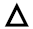

# Ускладнене речення: звертання, вставні слова, словосполучення, речення

1.6. Синтаксис. Пунктуація · 64 завдань · [джерело](https://zno.osvita.ua/ukrmova/tag-uskladnene_rechennya_zvertannya_vstavni_slovahennya/)

## Завдання 1

Вставним словосполученням ускладнено речення *(розділові знаки пропущено)*

- **А** За теорією Ч. Дарвіна було знято кілька цікавих науково-популярних фільмів.
- **Б** За теорією Ч. Дарвіна тривалий час уважно слідкували науковці в Кембриджі.
- **В** За теорією Ч. Дарвіна головною рушійною силою еволюції є природний добір.
- **Г** За теорією Ч. Дарвіна з’явилися й інші пояснення чинників еволюції видів.

**Відповідь: В**

Пояснення

**ТЕМА: Синтаксис. Розділові знаки в ускладненому реченні. Вставні слова.**

Завдання перевіряє ваше вміння розпізнавати прості ускладнені речення із вставними словами.

Вставні слова передають особисте ставлення мовця до свого повідомлення. Вони не є членами речення. Вставні слова можуть виражати оцінку повідомлюваного (*буває, сподіваюся*)*,* упевненість або невпевненість (*мабуть*), джерело повідомлення (*кажуть*) тощо.

У реченні рядка **В** слова *за теорією Ч. Дарвіна* указують на джерело повідомлення, від них не можна поставити питання до інших слів. Отже, ці слова є вставними. У решті речень аналогічні слова є членами речення, адже до них можна поставити питання.

**Відповідь – В.**

## Завдання 2

Вставного слова НЕМАЄ в реченні (*розділові знаки пропущено*)

- **А** Невідомий автор вислову «Швидкий як електровіник» либонь уважав цей прилад витвором багатої фантазії.
- **Б** Для інженерів-мрійників уявіть немає нічого неможливого тому в ХХІ столітті всі охочі можуть узяти до рук електровіник!
- **В** Продумана конструкція дає змогу підмітати навіть упритул до стін а півгодинного заряду акумулятора з надлишком вистачить для швидкого прибирання.
- **Г** Телескопічне руків’я цього приладу дає змогу під час прибирання дістатися до всіх куточків скажімо під ліжком чи далеко під столом.
- **Д** До речі потрібний електровіник і в боротьбі з шерстю домашніх улюбленців бо має для цього спеціальну щітку.

**Відповідь: В**

Пояснення

**ТЕМА: Синтаксис. Вставні слова.**

Завдання перевіряє ваше вміння розпізнавати прості ускладнені речення зі вставними словами.

Вставні слова передають особисте ставлення мовця до свого повідомлення. Вони не є членами речення. Вставні слова можуть виражати оцінку повідомлюваного *(буває, сподіваюся),* упевненість або невпевненість *(мабуть)*, джерело повідомлення *(кажуть)* тощо.

Отже, у реченні **А** – це слово *либонь (невпевненість),* у реченні **Б** – *уявіть (привертання уваги),* у реченні **Г** – *скажімо (джерело повідомлення),* у реченні **Д** – *до речі (послідовність викладу думок).*

**Відповідь – В.**

## Завдання 3

Прочитайте речення (цифра позначає попередній розділовий знак).

*Аж тут підвівся Орфей і,(1) ударивши по золотих струнах своєї кіфари,(2) заспівав: то була пісня,(3) що її найдужче любила його мати,(4) прекрасна муза Калліопа,(5) і,(6) можливо,(7) саме згадка про неї надала Орфеєвому голосу ще більшої сили,(8) щирості,(9) влади.*

НЕПРАВИЛЬНО обґрунтовано вживання розділових знаків, запропоноване в рядку

- **А** коми 1 і 2 – при відокремленій обставині
- **Б** кома 3 – перед сурядною частиною складного речення
- **В** коми 4 і 5 – при відокремленій прикладці
- **Г** коми 6 і 7 – при вставному слові
- **Д** кома 8 і 9 – при однорідних членах речення

**Відповідь: Б**

Пояснення

**ТЕМА: Синтаксис. Складне речення. Розділові знаки в складному реченні.**

Це завдання перевіряє ваше вміння правильно розставляти розділові знаки, пояснювати їх.

Кома ***(3)*** обґрунтована як кома перед сурядною частиною складного речення. Це пояснення хибне, адже це підрядна означальна частина складного речення з різними видами зв’язку, до неї можна поставити питання *яка?*

Решта обґрунтувань правильні.

**Відповідь – Б.**

## Завдання 4

**Прочитайте текст і виконайте завдання**

(1) Веселка, виграваючи розмаїттям кольорів, завжди викликала радість і захоплення в усіх народів. (2) Її називали дугою, аркою та обожнювали, як сонце, і ***(З,з)емлю***, і трави. (3) Древні ***(І,і)ндійці*** вважали райдугу величним луком ***(Б,б)ога*** Індри за допомогою якого він пускав стріли, уражаючи злих **демонів**, що ховалися в чорні хмари. (4) За давнім повір’ям, ця дуга піднімає вгору воду з озер, рік, а потім повертає її у вигляді дощу. (5) У народі кажуть: «Веселка воду бере». (6) Українці вірили: райдуга – це труба, що сягає одним кінцем неба, а інший опускає в криницю, з якої п’є ***(Б,б)огородиця***.

Вставним словосполученням ускладнено речення

- **А** перше
- **Б** друге
- **В** четверте
- **Г** шосте

**Відповідь: В**

Пояснення

**ТЕМА: Синтаксис. Розділові знаки в ускладненому реченні. Вставні слова**

Завдання перевіряє ваше вміння розпізнавати прості ускладнені речення із вставними словами.

Вставні слова виражають особисте ставлення мовця до свого повідомлення. Вони не є членами речення. Вставні слова можуть виражати оцінку повідомлюваного *(буває, сподіваюся),* упевненість або невпевненість *(мабуть)*, джерело повідомлення *(кажуть)* тощо.

У четвертому реченні слова *за давнім повір**’**ям* указують на джерело повідомлення, від них не можна поставити питання до інших слів. Отже, ці слова є вставними.

**Відповідь – В.**

## Завдання 5

Прочитайте речення (цифра позначає попередній розділовий знак).

***Аж тут підвівся Орфей і,( 1) ударивши по золотих струнах своєї кіфари,(2) заспівав на весь голос: то була пісня,(3) що їі найдужче любила його мати,(4) прекрасна муза Калліопа,(5) і,(6) може,(7) саме згадка про неї надала Орфеєвому голосу ще більшої сили,(8) щирості,(9) влади.***

НЕПРАВИЛЬНИМ є обґрунтування пунктуації, запропоноване в рядку

- **А** коми 1 і 2 — при відокремленій обставині
- **Б** кома 3 — між частинами складносурядного речення
- **В** коми 4 і 5 – при відокремленій прикладці
- **Г** коми 6 і 7 — при вставному слові
- **Д** кома 8 і 9 – при однорідних членах речення

**Відповідь: Б**

Пояснення

**ТЕМА: Синтаксис. Складне речення. Розділові знаки в складному реченні**

Це завдання перевіряє ваше вміння правильно розставляти розділові знаки, пояснювати їх.

У варіанті **Б** кома ***(3)*** обґрунтована як кома між частинами складносурядного речення.

Але складносурядне речення – це речення, яке має рівноправні частини, поєднані сполучниками сурядності (єднальними, протиставними чи розділовими). У запропонованому реченні кома (3) справді стоїть на межі частин складного речення. Але ці частими не є рівноправними. Від одної до іншої можна поставити питання *яка?* Отже, кома (3) – це кома на межі частин складного речення, які пов’язані підрядним зв’язком.

**Відповідь – Б.**

## Завдання 6

Позначте речення, у якому вставне слово (словосполучення) дає емоційну оцінку повідомлюваному:

- **А** Мабуть, людині не можна відриватися від рідного берега (Ю. Мушкетик).
- **Б** Сумління людське, виявляється, схоже на вулик, його теж можна розтривожити (О. Гончар).
- **В** Досі дні стояли теплі, сонячні, а сьогодні, мов на гріх, задощило (О. Гуріненко).
- **Г** Доброго, кажуть, дожидати треба, а лихе – само прийде (Панас Мирний).
- **Д** А хлібам колосистим, здається, немає кінця (Д. Луценко).

**Відповідь: В**

Пояснення

**ТЕМА: Синтаксис. Вставні слова**

Завдання перевіряє вміння розпізнавати вставні слова за значенням.

Згадаймо, що **вставні** **слова** **та словосполучення** можуть виражати:

- упевненість, непевність, сумнів тощо;

- емоційну оцінку повідомлюваного (радість, задоволення, жаль, здивування тощо);

- вказівку на зв'язок думок, послідовність викладення;

- вказівку на джерело повідомлення;

- активізацію уваги слухача.

**Емоційну** **оцінку** повідомлюваному дає вставне словосполучення *мов на гріх* у реченні рядка ***В***.

**Відповідь – В.**

## Завдання 7

**Прочитайте текст і виконайте завдання**

(1)У *життєвому* круговороті народжуються неповторні людські світи. (2)Вдивляючись щороку в очі юнаків і дівчат, яких *проводжаю* в самостійну дорогу життя, я не можу бути спокійним. (3)Що ж є найголовнішим у людині яку ми творимо? (4)У ту коротку червневу ніч, коли разом з ними ми виходимо в поле зустрічати перше *сонце* їх нового життя, в моє серце стукають болючі питання: де, в чому людська *сердцевина*? (5)Як її, зрештою, створити?

Пунктуаційна помилка допущена в реченні

- **А** першому
- **Б** другому
- **В** третьому
- **Г** п’ятому

**Відповідь: В**

Пояснення

**ТЕМА: Синтаксис. Розділові знаки в реченні**

Завдання перевіряє вміння правильно розставляти розділові знаки в реченнях.

Пунктуаційну помилку допущено в третьому реченні: потрібно поставити кому між частинами складнопідрядного означального речення: *«**Що ж є найголовнішим у людині,*** *яку ми творимо?**»*.

**Відповідь – В.**

## Завдання 8

**Прочитайте текст і виконайте завдання**

(1)У *життєвому* круговороті народжуються неповторні людські світи. (2)Вдивляючись щороку в очі юнаків і дівчат, яких *проводжаю* в самостійну дорогу життя, я не можу бути спокійним. (3)Що ж є найголовнішим у людині яку ми творимо? (4)У ту коротку червневу ніч, коли разом з ними ми виходимо в поле зустрічати перше *сонце* їх нового життя, в моє серце стукають болючі питання: де, в чому людська *сердцевина*? (5)Як її, зрештою, створити?

Вставним словом ускладнене речення

- **А** перше
- **Б** друге
- **В** третє
- **Г** п’яте

**Відповідь: Г**

Пояснення

**ТЕМА: Синтаксис. Вставні слова**

Завдання перевіряє ваше вміння розпізнавати вставні слова в реченні.

**Вставні** **слова** – це слова, які граматично не є членами речення й існують у реченні для вираження певного ставлення спікера, оформлення думки та інших додаткових цілей.

Слово *«зрештою»* є вставним у п’ятому реченні, оскільки воно не відповідає на запитання й не є членом речення, вказує на послідовність і зв’язок думок.

**Відповідь – Г.**

## Завдання 9

Вставне слово, що вказує на послідовність і зв’язок думок, ужито в реченні

- **А** Отже, сполучники поділяємо на сурядні й підрядні.
- **Б** Кожна наукова теза, безперечно, вимагає доказів.
- **В** Такі експерименти, очевидно, необхідно продовжувати.
- **Г** Зміст цього поняття, на мою думку, треба уточнити.
- **Д** Вирішити проблему допоміг би, мабуть, такий експеримент.

**Відповідь: А**

Пояснення

**ТЕМА:** **Синтаксис. Вставні слова**

Завдання перевіряє ваше вміння розпізнавати вставні слова в реченні.

**Вставні слова** – це слова, які граматично не є членами речення та існують у реченні для вираження певного ставлення мовця, оформлення думки та інших додаткових цілей.

Слово *«отже»* є вставним у першому реченні, оскільки воно не відповідає на питання й не є членом речення, вказує на послідовність і зв’язок думок.

**Відповідь – А.**

## Завдання 10

**Прочитайте текст і виконайте завдання**

(1)Здавна люди налічували в дощовій веселці сім кольорів червоний, **жовто-гарячий**, жовтий, зелений, голубий, синій і фіолетовий. (2)Можливо, у цій сімці наші предки вбачали щось **таємничо-магічне**. (3)**Недарма** ж тиждень складався з семи днів, а на небі налічували тоді сім планет. (4)Придивляючись до веселки уважніше, не можна **не помітити** різні відтінки, що поступово переходять один в один. (5)Цих відтінків безліч.

Вставне слово є в реченні

- **А** першому
- **Б** другому
- **В** третьому
- **Г** п\'ятому

**Відповідь: Б**

Пояснення

**ТЕМА: Синтаксис. Вставні слова**

Завдання перевіряє ваше вміння розпізнавати вставні слова в реченні.

**Вставні** **слова** – це слова, які граматично не є членами речення, та існують у реченні для вираження певного ставлення спікера, оформлення думки та інших додаткових цілей.

Слово *«можливо»* є вставним у другому реченні, оскільки воно не відповідає на питання й не є членом речення, виражає невпевненість, сумнів.

**Відповідь – Б.**

## Завдання 11

**Прочитайте текст і виконайте завдання**

(1)Постукала весна в прозорий кришталь вікон, торкнулася серця лоскітливим подихом травня й невтримно поманила в *замріянний* гай. (2)А в гаю синіми вогниками коливаються на тонких стебельцях проліски. (3)Схожі вони на бірюзові намистинки розгублені чиєюсь невинною рукою між вузеньких листочків боязкої травиці. (4)Може, то *безжурний* жайвір бризнув на галявину іскри *невичерпного* натхнення чи соромлива синичка розсипала зерна свого *пестливого* співу?

Вставне слово є в реченні

- **А** першому
- **Б** другому
- **В** третьому
- **Г** четвертому

**Відповідь: Г**

Пояснення

**ТЕМА: Синтаксис. Вставні слова**

Завдання перевіряє ваше вміння розпізнавати вставні слова в реченні.

**Вставні** **слова** – це слова, які граматично не є членами речення, та існують у реченні для вираження певного ставлення мовця, оформлення думки та інших додаткових цілей.

Слово *«може»* є вставним у четвертому реченні, оскільки воно не відповідає на питання й не є членом речення, виражає невпевненість, сумнів.

**Відповідь – Г.**

## Завдання 12

**Прочитайте текст і виконайте завдання**

(1) Пахне луг… (2) Вечірній туманець благеньким напиналом напнувся над усеньким лугом, а отам, коло лісу, начебто завис густіший і темніший морок. (3) А де лелеки, що прилетіли *на/зустріч* з вечірньою казкою? (4) Мабуть, поки вечеряв, то познімались і полетіли на лісові озера. (5) Вдивляєшся поміж кущів, поміж осоки — ніде не видно, тільки сумують вечірні сутінки. (6) А луг пахне *де/далі* сильніше, і груди не можуть умістити, увібрати всю його терпку свіжість бо *за/малі*. (7) Дихаєш і наче оновлюєшся, *в/друге* на світ народжуєшся.

Вставне слово вжито в реченні

- **А** другому
- **Б** четвертому
- **В** *п\'ятому*
- **Г** шостому

**Відповідь: Б**

Пояснення

**ТЕМА: Синтаксис. Вставні слова**

Завдання перевіряє ваше вміння розпізнавати вставні слова в реченні.

**Вставні** **слова** – це слова, які граматично не є членами речення та існують у реченні для вираження певного ставлення мовця, оформлення думки та інших додаткових цілей.

Слово *«мабуть»* є вставним у четвертому реченні, оскільки воно не відповідає на питання й не є членом речення, виражає невпевненість, сумнів.

**Відповідь – Б.**

## Завдання 13

**Прочитайте текст і виконайте завдання**

(1) Пахне луг… (2) Вечірній туманець благеньким напиналом напнувся над усеньким лугом, а отам, коло лісу, начебто завис густіший і темніший морок. (3) А де лелеки, що прилетіли *на/зустріч* з вечірньою казкою? (4) Мабуть, поки вечеряв, то познімались і полетіли на лісові озера. (5) Вдивляєшся поміж кущів, поміж осоки — ніде не видно, тільки сумують вечірні сутінки. (6) А луг пахне *де/далі* сильніше, і груди не можуть умістити, увібрати всю його терпку свіжість бо *за/малі*. (7) Дихаєш і наче оновлюєшся, *в/друге* на світ народжуєшся.

Пунктуаційну помилку допущено в реченні

- **А** другому
- **Б** третьому
- **В** шостому
- **Г** сьомому

**Відповідь: В**

Пояснення

**ТЕМА: Синтаксис. Розділові знаки в реченні**

Завдання перевіряє вміння правильно розставляти розділові знаки в реченнях.

Пунктуаційну помилку допущено в шостому реченні: потрібно поставити кому між частинами складнопідрядного речення причини: *«А луг пахне де/далі сильніше, і груди не можуть умістити, увібрати всю його терпку свіжість, бо за/малі»*.

**Відповідь – В.**

## Завдання 14

**Прочитайте текст і виконайте завдання**

(1) У моїй батьківщині на/світанні колишуться польовими доріжками навантажені хлібом вози. (2) Удосвіта часом кукурікають півні, вечорами линуть до/гори сині димочки. (3) У моїй батьківщині осінь по/тихеньку ступає в червоних чобітках заквітчана в соняшники й китиці винограду. (4) Вечірні тумани заступають хороводи русалок, і зорі, на диво, сяють близько над землею, що/б можна було говорити до них. (5) У моїй батьківщині сонце ходить босоніж, підперезане бабиним літом, з червоною калиною в русявому волоссі.

Вставне слово є в реченні

- **А** другому
- **Б** третьому
- **В** четвертому
- **Г** п’ятому

**Відповідь: В**

Пояснення

**ТЕМА: Синтаксис. Вставні слова**

Завдання перевіряє ваше вміння розпізнавати вставні слова в реченні.

**Вставні** **слова** – це слова, які граматично не є членами речення та існують у реченні для вираження певного ставлення спікера, оформлення думки та інших додаткових цілей.

Слово *«на диво»* є вставним у четвертому реченні, оскільки воно не відповідає на питання й не є членом речення, виражає емоційну оцінку повідомлюваного.

**Відповідь – В.**

## Завдання 15

Звертання є в реченні

- **А** Усе, чим я щасливий і багатий, я мушу рідним словом оспівати.
- **Б** Запалай, мій вогнику крилатий, полум’ям привітним і незлим.
- **В** Я люблю твоє майво зелене, і Донбас, і Каховку ясну.
- **Г** На берегах Дніпра крутих, весь помережений садами, стоїть у сяйві днів нових наш рідний Київ перед нами.
- **Д** «Роби добро, — мені казала мати, — і чисту совість не віддай за шмати!».

**Відповідь: Б**

Пояснення

**ТЕМА: Синтаксис. Звертання**

Завдання перевіряє ваше вміння розпізнавати звертання в реченні.

**Звертанням** називають слово в реченні, що означає назву особи чи предмета, до якого звернена мова: *З**апалай,* ***мій вогнику крилатий, полум’ям привітним і незлим.*

Зверніть увагу, що звертання не є членами речення, не відповідають на жодне питання, не пов’язуються сурядним чи підрядним зв’язком з головними чи другорядними членами речення.

**Відповідь – Б.**

## Завдання 16

Доберіть приклад до кожного випадку вживання розділового знака на місці крапок.

*Розділовий знак*

- **1** кома
- **2** двокрапка
- **3** тире
- **4** знак оклику

*Приклад*

- **А** О ні … Являйся, зіронько, мені хоч в сні.
- **Б** Така терпка, така остання … правда, закута в мармур майже римських строф.
- **В** Щасливиця … я маю трохи неба і дві сосни в туманному вікні.
- **Г** Я з тобою все життя поділю … хліб і сіль і краплину щастя.
- **Д** Страшно впасти у кайдани, умирать в неволі, а ще гірше … спати, спати і спати на волі.

**Відповідь: 1 – В, 2 – Г, 3 – Д, 4 – А**

Пояснення

**ТЕМА:** **Синтаксис. Розділові знаки в різних видах речень**

Це завдання перевіряє ваше вміння добирати потрібний правильний розділовий знак у простому та складному реченнях.

**Комою** потрібно відокремити прикладку в реченні *«**Щасливиця, я маю трохи неба і дві сосни в туманному вікні**».*

**Двокрапку** потрібно поставити в безсполучниковому реченні, друга частина якого розкриває зміст першої: *«**Я з тобою все життя поділю: хліб і сіль і краплину щастя**».*

**Тире** між підметом і присудком уживаємо в реченні *«**Страшно впасти у кайдани, умирать в неволі, а ще гірше – спати, спати і спати на волі**»*.

**Знак оклику** ставимо після вигуку, що є еквівалентом речення: *«О* *ні! Являйся, зіронько, мені хоч в сні**».*

**Відповідь: 1–В, 2–Г, 3–Д, 4–А.**

## Завдання 17

**Прочитайте текст і виконайте завдання**

(1) Усе починається з дитинства, з колискової, з голосу материнської душі над колискою. (2) Уже в/перше звучання почутої мелодії на/вічно вплітається для маленької дитини багатоголосся душі та світу. (3) Від/тепер відкривається шлях її радощам, смуткові й веселості, тривогам, і сподіванням. (4) І, на/певно, головному — взаємності з життям, зі світом. (5) Колискова — це не/наче душа, яка ходить навшпиньках.

Вставне слово вжито в реченні

- **А** першому
- **Б** третьому
- **В** четвертому
- **Г** п’ятому

**Відповідь: В**

Пояснення

**ТЕМА: Синтаксис. Вставні слова**

Завдання перевіряє ваше вміння розпізнавати вставні слова в реченні.

**Вставні слова** – це слова, які граматично не є членами речення, та існують у реченні для вираження певного ставлення спікера, оформлення думки та інших додаткових цілей.

Слово *«напевно»* є вставним у **четвертому реченні**, оскільки воно **не відповідає на питання й не є членом речення, виражає невпевненість, сумнів.**

**Відповідь: В.**

## Завдання 18

**Прочитайте текст і виконайте завдання**

(1) Гордий птах змахнув крильми і злетів *на/зустріч* новим пригодам. (2) Він уважно приглядався до всього, що було внизу. (3) Птах мав (…) зір і добре бачив, як люди збивалися з ніг, поралися по городах, згрібаючи на купи сухе картоплиння та спалюючи його разом із зів’ялим листям. (4) Дим від вогнищ тягнуло в долину, але він не стелився пасмами, а зразу ж піднімався *до/гори* підфарбовуючи все *не/баченою* досі прозоро-блакитною аквареллю. (5) А небо, навпаки, залишалося високим і чистим, і в тій височині розкошланими клаптями вати плавали *не/великі* хмарки.

Вставне слово є в реченні

- **А** першому
- **Б** другому
- **В** третьому
- **Г** п\'ятому

**Відповідь: Г**

Пояснення

**ТЕМА: Синтаксис. Вставні слова**

Завдання перевіряє ваше вміння розпізнавати вставні слова в реченні.

**Вставні слова** – це слова, які граматично не є членами речення й існують у реченні для вираження певного ставлення мовника, оформлення думки та інших додаткових цілей.

Слово *«навпаки»* є вставним у **п’ятому реченні**, оскільки воно **не відповідає на питання й не є членом речення.**

**Відповідь: Г.**

## Завдання 19

**Прочитайте текст і виконайте завдання**

(1) Гордий птах змахнув крильми і злетів *на/зустріч* новим пригодам. (2) Він уважно приглядався до всього, що було внизу. (3) Птах мав (…) зір і добре бачив, як люди збивалися з ніг, поралися по городах, згрібаючи на купи сухе картоплиння та спалюючи його разом із зів’ялим листям. (4) Дим від вогнищ тягнуло в долину, але він не стелився пасмами, а зразу ж піднімався *до/гори* підфарбовуючи все *не/баченою* досі прозоро-блакитною аквареллю. (5) А небо, навпаки, залишалося високим і чистим, і в тій височині розкошланими клаптями вати плавали *не/великі* хмарки.

Пунктуаційну помилку допущено в реченні

- **А** другому
- **Б** третьому
- **В** четвертому
- **Г** п\'ятому

**Відповідь: В**

Пояснення

**ТЕМА:** **Синтаксис. Розділові знаки в реченні**

Завдання перевіряє вміння правильно розставляти розділові знаки в реченнях.

Пунктуаційну помилку допущено **в четвертому реченні:** потрібно відокремити комою **дієприслівниковий зворот «***підфарбовуючи все не баченою досі прозоро-блакитною аквареллю***»**.

**Відповідь: В.**

## Завдання 20

Розділові знаки при звертанні правильно вжито в реченні

- **А** *Зійди дощику, дрібнесенький, Скропи травицю-муравицю, Нехай я вийду на вулицю.*
- **Б** *Пусти мене, мати погуляти, Бо вже челядоньки не видати.*
- **В** *Ой куди ви, голубоньки, та й полетите, Куди моє дівування та й занесете?*
- **Г** *Прочини господарю, ворота, Занесем тобі віночка з золота.*
- **Д** *Зеленая, дібровонько, Чого так рано спустошена, Трава на сіно покошена?*

**Відповідь: В**

Пояснення

**ТЕМА: Синтаксис. Просте ускладнене речення. Речення зі звертаннями**

Завдання перевіряє вміння правильно й комунікативно доцільно використовувати звертання в реченні, правильно розставляти розділові знаки в них.

Згадайте, що звертання, оскільки воно граматично не пов’язане з членами речення, в усному мовленні виділяється паузами, а на письмі – розділовими знаками – комою або знаком оклику.

Отже, розділові знаки при звертанні правильно вжито в реченні *«Ой куди ви, **голубоньки**, та й полетите, / Куди моє дівування та й занесете?*».

**Відповідь: В.**

## Завдання 21

Неправильно вжито тире в реченні

- **А** Писати просто — це найбільша майстерність і якість справжнього таланту.
- **Б** Привчав мене батько трудитись до поту, а мати — любити пісні.
- **В** У будь-яку погоду: у дощ, у туман, у шторм — виходять рибалки на промисел.
- **Г** Збагачуйте життя своєю щедрістю — тоді добрим словом вас згадуватимуть люди.
- **Д** Ясна річ — пісні Марусі Чурай співали не тільки дівчата, а й козаки.

**Відповідь: Д**

Пояснення

**ТЕМА:** **Синтаксис. Розділові знаки в простому та складному реченнях**

Це завдання перевіряє ваше вміння добирати потрібний правильний розділовий знак у простому та складному реченнях.

Тире **між підметом і присудком** уживаємо в реченні *«Писати просто – це найбільша майстерність і якість справжнього таланту»*.

Тире **після однорідних членів речення** *«У будь-яку погоду: у дощ, у туман, у шторм – виходять рибалки на промисел»*.

Тире ставимо **в неповному реченні** *«Привчав мене батько трудитись до поту, а мати – любити пісні»*.

Безсполучниковим є речення *«Збагачуйте життя своєю щедрістю – тоді добрим словом вас згадуватимуть люди»*. Друга частина **виражає наслідок того, про що йдеться в першій**, тому ставимо тире.

У рядку **Д** в реченні є **вставне слово *ясна річ*,** яке треба відокремити комою, тире тут не потрібно ставити.

**Відповідь: Д.**

## Завдання 22

З’ясуйте, яким компонентом ускладнено просте речення.

*Речення (розділові знаки пропущено)*

- **1** Знала я дочко за ними принаймні три чесноти.
- **2** Зовні однак ніщо не віщувало рясної травневої грози.
- **3** Під вечір годині о сьомій самотній блукав я в саду.
- **4** Де він там зачепився старий бурлака.

*Ускладнювальний компонент*

- **А** уточнювальна обставина
- **Б** звертання
- **В** вставне слово
- **Г** однорідні означення
- **Д** відокремлена прикладка

**Відповідь: 1 – Б, 2 – В, 3 – А, 4 – Д**

Пояснення

**ТЕМА:** **Синтаксис. Види речень за наявністю ускладнювальних засобів**

Завдання перевіряє ваше вміння визначати ускладнювальні засоби в реченні.

Проаналізуймо запропоновані речення.

У реченні в рядку **1** є **звертання** *«дочко».*

У реченні в рядку **2** є **вставне слово** *«однак».*

У реченні в рядку **3** є **уточнювальна обставина** часу *«годині о сьомій».*

У реченні в рядку **4** є **відокремлена прикладка** *«старий бурлака».*

**Відповідь: 1–Б, 2–В, 3–А, 4–Д.**

## Завдання 23

Слово *«здавалося»* є вставним (окремі розділові знаки пропущено) у реченні

- **А** Усе довколишнє *здавалося* їй перевитим піснями, веселими чи сумними, як буває пройнятий сяєвом сонця простір.
- **Б** Багатьом *здавалося* що й увесь півострів зараз палає в пожежах, адже куди не глянь — звідусіль шугає вогонь, тріщить, гуде в деревах, жаркий, агресивний.
- **В** Кущ *здавалося* і зимою зеленіє, бо коли танули сніги, то на світ пробивалося його цупке зелене листя, не змучене холодом, не скалічене морозом.
- **Г** Широкі промені вдарялися об кам’яні плити, курилися золотим димом, від чого *здавалося* що все тут пливе, рухається, злітає в просторі.
- **Д** Уже придивилася до його очей і побачила: те, що *здавалося* байдужістю, насправді було мудрістю й глибоко захованим стражданням.

**Відповідь: В**

Пояснення

**ТЕМА: Синтаксис. Вставні слова**

Завдання перевіряє ваше вміння розпізнавати вставні слова в реченні.

**Вставні слова** – це слова, які граматично не є членами речення та існують у реченні для вираження певного ставлення спікера, оформлення думки та інших додаткових цілей.

Слово *здавалося* є вставним у рядку **В**, оскільки воно **не відповідає на питання й не є членом речення.**

**Відповідь: В.**

## Завдання 24

**Прочитайте текст і виконайте завдання**

**(1)** Ще над/вечір землю оповив холодний туман. **(2)** Значить, чекай на ніч морозну. **(3)** І ранній завчасний морозенко таки добре [...] протягом ночі: настелив трави, побілив памороззю засохлі дерева. **(4)** У/ранці листя без/упину опадало на землю, лягало покорченими долоньками до/гори наче все ще просило хоч краплиночку тепла. **(5)** Не було ні вітру, ні жодного поруху. **(6)** А листя падало й падало, зривалося з верховіття. **(7)** Здавалося, що проливається чорно-зелений сумний водограй.

Вставне слово є в реченні

- **А** другому
- **Б** четвертому
- **В** п’ятому
- **Г** сьомому

**Відповідь: А**

Пояснення

**ТЕМА: Синтаксис. Речення зі вставними словами, словосполученнями, реченнями, їх значення.**

Завдання перевіряє ваше вміння розпізнавати значення вставних слів.

**Вставні слова** виражають особисте ставлення мовця до свого повідомлення. Вони не є членами речення.

Є різні групи вставних слів, а саме: вказівка на джерело повідомлення, зв’язок з попередньою думкою, невпевненість, припущення, емоційне ставлення до змісту висловленого.

Вставне слово *значить* пов’язує речення в тексті, передає зв’язок між ними.

**Відповідь – А.**

## Завдання 25

**Прочитайте текст і виконайте завдання**

(1) На календарі вже весна. (2) Хоча снігу не/має, про/те надворі *мороз пробирає по спині*… (3) Простую собі лісом, *опустивши голову до/долу* і лише зрідка оглядаючись навкруги. (4) Аж ось поміж деревами щось, схоже, забіліло… (5) Це підсніжники перші провидці весни, що не побоялися холоду. (6) Вони підняли свої голівки, неначе мовчки сповіщаючи: як/би не лютувала зима, весна *не за горами*. (7) І так мені радісно стало на серці, *мов на світ народився*, кудись зникли і холод, і мороз.

Вставне слово є в реченні

- **А** другому
- **Б** третьому
- **В** четвертому
- **Г** п’ятому

**Відповідь: В**

Пояснення

**ТЕМА: Синтаксис. Розділові знаки в ускладненому реченні. Вставні слова**

Завдання перевіряє ваше вміння розпізнавати прості ускладнені речення із вставними словами.

Виконуючи це завдання, обов’язково звертайтеся до мікротексту.

Вставні слова виражають особисте ставлення мовця до свого повідомлення. Вони не є членами речення. Вставні слова можуть виражати оцінку повідомлюваного *(буває, сподіваюся),* упевненість або невпевненість *(мабуть)*, джерело повідомлення (*кажуть*).

У **четвертому** реченні слово *схоже* передає невпевненість, від нього не можна поставити питання до інших слів. Отже, це слово є вставним, тому його виділено комами.

**Відповідь – В.**

## Завдання 26

Доберіть приклад до кожної з груп вставних слів за значенням.

*Група вставних слів за значенням*

- **1** вказівка на джерело повідомлення
- **2** зв’язок з попередньою думкою
- **3** невпевненість, припущення
- **4** емоційне ставлення до змісту висловленого

*Приклад*

- **А** Весна, на диво, була рання.
- **Б** Навпаки, у рухах спортсмена почувається впевненість.
- **В** Тихі води, кажуть, найглибші.
- **Г** Погодьтесь, вам зробили слушне зауваження.
- **Д** Здається, сама ця тиша ночі повинна врівноважувати душу.

**Відповідь: 1 – В, 2 – Б, 3 – Д, 4 – А**

Пояснення

**ТЕМА: Синтаксис Речення зі вставними словами, словосполученнями, реченнями, їх значення.**

Завдання перевіряє ваше вміння розпізнавати значення вставних слів.

Вставні слова виражають особисте ставлення мовця до свого повідомлення. Вони не є членами речення.

Вказівка на джерело повідомлення – *кажуть.*

Зв’язок з попередньою думкою – *навпаки.*

Невпевненість, припущення – *здається.*

Емоційне ставлення до змісту висловленого – *на диво.*

Вставне слово *погодьтесь* (речення **Б**) належить до групи вставних конструкцій на позначення привертання уваги співрозмовника.

**Відповідь – ВБДА.**

## Завдання 27

Вставне слово, що вказує на послідовність і зв’язок думок, ужито в реченні

- **А** Отже, сполучники поділяємо на сурядні й підрядні.
- **Б** Кожна наукова теза, безперечно, вимагає доказів.
- **В** Такі експерименти, очевидно, необхідно продовжувати.
- **Г** Зміст цього поняття, на мою думку, треба уточнити.
- **Д** Розв\'язати проблему допоміг би, мабуть, такий експеримент.

**Відповідь: А**

Пояснення

**ТЕМА: Синтаксис. Речення зі вставними словами, словосполученнями, реченнями, їх значення**

Завдання перевіряє ваше вміння розпізнавати значення вставних слів.

Вставні слова виражають особисте ставлення мовця до свого повідомлення. Вони не є членами речення.

Вказівка на джерело повідомлення – *на мою думку.*

Зв’язок з попередньою думкою – *отже.*

Невпевненість, упевненість – *мабуть, очевидно, безперечно.*

**Відповідь – А.**

## Завдання 28

**Прочитайте текст і виконайте завдання**

***(1)*** На картинах неаполітанської *школи* без кінця старіється післяполудень, немов побачений крізь темну пляшку. ***(2)*** Потемніле сонце, здається, в'яне на очах у тих пропащих краєвидах, мов у переддень космічної *катастрофи*. ***(3)*** Старечі *світанки*, жовті, як пергамент, солодкі від мудрості, як пізні вечори! ***(4)*** Передполудні усміхаються хитро, як пожовклі старі книги. ***(5)*** День осінній, той старий пройдисвіт бібліотекар, який лазить у вицвілому халаті по драбинах, і куштує *конфітюри* всіх віків і культур!

Вставне слово є в реченні

- **А** другому
- **Б** третьому
- **В** четвертому
- **Г** п’ятому

**Відповідь: А**

Пояснення

**ТЕМА:** **Синтаксис. Речення зі вставними словами, словосполученнями,** **реченнями, їхнє значення.**

Завдання перевіряє ваше вміння розпізнавати прості ускладнені речення із вставними словами.

Вставні слова виражають особисте ставлення мовця до свого повідомлення. Вони не є членами речення. Вставні слова можуть виражати оцінку повідомлюваного *(буває, сподіваюся),* упевненість або невпевненість *(мабуть)*, джерело повідомлення *(кажуть)*.

У другому реченні слово *здається* передає невпевненість, від нього не можна поставити питання до інших слів. Отже, це слово є вставним.

**Відповідь – А.**

## Завдання 29

Вставного слова НЕМАЄ в реченні (розділові знаки пропущено)

- **А** Буває часом перебіжить дорогу листя.
- **Б** Завтра поїдемо мабуть твоїм човном.
- **В** Кажуть легше повалити ніж збудувати.
- **Г** Наша мандрівка сподіваюсь буде цікавою.
- **Д** Становище здавалося не таким скрутним.

**Відповідь: Д**

Пояснення

**ТЕМА: Синтаксис. Вставні слова.**

Завдання перевіряє ваше вміння розпізнавати прості ускладнені речення із вставними словами.

Вставні слова виражають особисте ставлення мовця до свого повідомлення. Вони не є членами речення. Вставні слова можуть виражати оцінку повідомлюваного *(**буває, сподіваюся**),* упевненість або невпевненість (***мабуть***), джерело повідомлення (***кажуть***).

У рядку **Д** слово ***здавалося***, яке може бути вставним та виражати невпевненість, виконує функцію присудка, тобто є членом речення.

**Відповідь – Д.**

## Завдання 30

Відокремленим додатком ускладнено речення

- **А** Напевно, це був інший світ – чудовий невідомий храм.
- **Б** Щасливий і веселий, я дивився на високе бездонне небо.
- **В** Тихі конвалії, білі і ніжні, скоро розплющать срібні повіки.
- **Г** Там, замість житечка, у теплеє літечко враз терен зацвів.
- **Д** Вітру на морі не було, проте клекотав сильний прибій.

**Відповідь: Г**

Пояснення

**ТЕМА: Синтаксис. Відокремлені члени речення.**

Завдання перевіряє ваше вміння розпізнавати речення з різноманітними відокремленими членами речення та складні речення.

У рядку **А** подано просте речення, ускладнене вставним словом *напевно*, яке виражає невпевненість.

У рядку **Б** речення ускладнено відокремленими однорідними означеннями, які стоять перед особовим займенником.

Речення у рядку **В** теж ускладнено відокремленими однорідними означеннями, які стоять після означувального слова.

Речення в рядку **Г** ускладнено відокремленим додатком *замість житечка.*

Додатки, які починаються словами *окрім, опріч, замість, за винятком* тощо, відокремлюються.

Речення в рядку **Д** – це складне речення.

**Відповідь – Г.**

## Завдання 31

З’ясуйте, який розділовий знак треба поставити на місці крапок.

*Розділовий знак*

- **1** кома
- **2** тире
- **3** двокрапка
- **4** дужки

*Приклад*

- **А** В житті мені весь вік тужити … не жити.
- **Б** Схилився вечір до землі і срібним сяйвом ріки стелить ... Б.-І. Антонич...
- **В** Вона прийшла ... заквітчана і мила... і руки лагідно до мене простягла.
- **Г** І розкажім собі обіймами... про тишину над оболонями.
- **Д** Бо така вже природа агави ... вона цвіте, щоб умерти, й умирає, щоб цвісти.

**Відповідь: 1 – В, 2 – А, 3 – Д, 4 – Б**

Пояснення

**ТЕМА: Синтаксис. Розділові знаки в простому та складному реченнях.**

Це завдання перевіряє ваше вміння добирати потрібний правильний розділовий знак у простому та складному реченнях.

У реченні в рядку **А** необхідно поставити тире, бо це безсполучникове складне, між частинами якого різке протиставлення.

У реченні в рядку **Б** необхідно поставити дужки, бо це вставлена конструкція, автор цитати *(Б.-І.Антонич).*

У реченні в рядку **В** потрібно поставити коми, бо в реченні є відокремлені однорідні означення *заквітчана і мила.*

У реченні в рядку **Г** розділові знаки непотрібні. Це просте неускладнене речення.

У реченні в рядку **Д** потрібно поставити двокрапку, бо друга частина речення пояснює, уточнює, конкретизує першу.

**Відповідь: 1В, 2А, 3Д, 4Б.**

## Завдання 32

З’ясуйте, яким компонентом ускладнено речення.

*Речення (розділові знаки пропущено)*

- **1** Щирий людський сміх кажуть віку додає.
- **2** Тихо курілися луки переливаючись барвами.
- **3** Народи явлені у Слові достойно жити можуть на землі.
- **4** І нехай в’януть білі й рожеві червоні й блакитні троянди.

*Ускладнювальний компонент*

- **А** вставне слово
- **Б** однорідні члени речення
- **В** відокремлене означення
- **Г** відокремлений додаток
- **Д** відокремлена обставина

**Відповідь: 1 – А, 2 – Д, 3 – В, 4 – Б**

Пояснення

**ТЕМА: Синтаксис. Просте ускладнене речення.**

Завдання перевіряє ваше вміння розпізнавати просте ускладнене речення з однорідними членами, звертанням, вставними конструкціями, відокремленими членами речення.

У першому рядку слово *кажуть* указує на джерело повідомлення. Отже, це речення ускладнено вставним словом.

У другому реченні є дієприслівниковий зворот *переливаючись барвами.*** Отже, це речення ускладнено відокремленою обставиною.

У третьому реченні є дієприкметниковий зворот *явлені у Слові.* Отже, це речення ускладнено відокремленим означенням.

У четвертому реченні означення *білі, рожеві, червоні, блакитні* стосуються одного слова та відповідають на одне питання. Отже, це речення ускладнено однорідними членами речення ( означеннями).

**Відповідь: 1А, 2Д, 3В, 4Б.**

## Завдання 33

**Прочитайте текст і виконайте завдання**

(1) Бувало, у найтемнішу ніч, коли темрява билась у вікна, як хвилі безмежного моря, під вікном несподівано закрутиться веремія, у шибках процвіте цілий рій синіх, сірих, карих очей. (2) Здається, що підпливали вони на чорних хвилях як черідка цікавих рибок до самотнього в морі темряви вогника у вікні. (З) Нашумлять, наговорять і знову в темряву одлинуть. (4) Випаде сніг - зіб'є бучу: їхати на санях; гуртом їдемо в сусіднє село до старого вчителя в гості. (5) Метелиця, гребні, а з нами мов мара якась весела починає загравати: вигукуємо, сміємося, співаємо, підскакуємо на кожному гребні й, хапаючись одне за одного, перекидаємося в сніг. (6) Дядько чухає голову: невпокійна це й клопітна справа - од села до села перевезти в хуртовину хуру реготу. (7) Навмисне ми ніколи не шукали собі веселощів, ми їх одкладали на далі, «на колись».

**Пунктуаційна помилка є в реченні**

- **А** першому
- **Б** другому
- **В** п’ятому
- **Г** шостому

**Відповідь: Б**

Пояснення

**ТЕМА:** **Синтаксис. Порівняльний зворот**

Виконуючи це завдання, треба обов’язково звертатися до мікротексту.

Перегляньте ще раз згадані в завданні речення та зверніть увагу на розділові знаки в них.

*Бувало, у найтемнішу ніч, коли темрява билась у вікна, як хвилі безмежного моря, під вікном несподівано закрутиться веремія, у шибках процвіте цілий рій синіх, сірих, карих очей* (кома при вставному слові, кома між частинами складнопідрядного речення, коми при порівняльному звороті, кома між частинами безсполучникового складного речення, коми між однорідними означеннями).

*Здається, що підпливали вони на чорних хвилях як черідка цікавих рибок до самотнього в морі темряви вогника у вікні* (кома між частинами складнопідрядного речення, бракує ком при порівняльному звороті).

*Метелиця, гребні, а з нами мов мара якась весела починає загравати: вигукуємо, сміємося, співаємо, підскакуємо на кожному гребні й, хапаючись одне за одного, перекидаємося в сніг* (кома між частинами безсполучникового складного речення, кома між частинами складносурядного речення, двокрапка між частинами безсполучникового складного речення, коми між однорідними присудками, коми при відокремленій обставині).

*Дядько чухає голову: невпокійна це й клопітна справа – од села до села перевезти в хуртовину хуру реготу* (двокрапка між частинами безсполучникового складного речення, тире між підметом і присудком).

Таким чином, пунктуаційну помилку допущено в другому реченні.

**Відповідь – Б.**

## Завдання 34

**Прочитайте текст і виконайте завдання**

(1) Бувало, у найтемнішу ніч, коли темрява билась у вікна, як хвилі безмежного моря, під вікном несподівано закрутиться веремія, у шибках процвіте цілий рій синіх, сірих, карих очей. (2) Здається, що підпливали вони на чорних хвилях як черідка цікавих рибок до самотнього в морі темряви вогника у вікні. (З) Нашумлять, наговорять і знову в темряву одлинуть. (4) Випаде сніг - зіб'є бучу: їхати на санях; гуртом їдемо в сусіднє село до старого вчителя в гості. (5) Метелиця, гребні, а з нами мов мара якась весела починає загравати: вигукуємо, сміємося, співаємо, підскакуємо на кожному гребні й, хапаючись одне за одного, перекидаємося в сніг. (6) Дядько чухає голову: невпокійна це й клопітна справа - од села до села перевезти в хуртовину хуру реготу. (7) Навмисне ми ніколи не шукали собі веселощів, ми їх одкладали на далі, «на колись».

**Вставне слово є в реченні**

- **А** першому
- **Б** третьому
- **В** четвертому
- **Г** сьомому

**Відповідь: А**

Пояснення

**ТЕМА:** **Синтаксис. Речення зі вставними словами**

Зверніться ще раз до згаданих у завданні речень мікротексту. З’ясуйте, у якому з них є вставне слово (це нескладно зробити, переглянувши розділові знаки й усвідомивши причину їхнього вживання).

У першому реченні бачимо вставне слово «*бувало*», яке слугує для вказівки на порядок думок.

У третьому реченні є однорідні члени, але немає вставних слів.

У четвертому реченні багато різних розділових знаків між частинами безсполучникового складного речення, але немає вставних слів.

У сьомому реченні є однорідні члени й частини безсполучникового складного речення, але немає вставних слів.

**Відповідь – А.**

## Завдання 35

Слово ***здавалося*** є вставним у реченні (окремі розділові знаки пропущено)

- **А** Усе довколишнє ***здавалося*** їй перевитим піснями, веселими чи сумними, як буває пройнятий сяєвом сонця простір.
- **Б** Багатьом ***здавалося*** що й увесь півострів зараз палає в пожежах, адже куди не глянь – звідусіль шугає вогонь, тріщить, гуде в деревах, жаркий, агресивний.
- **В** Кущ ***здавалося*** і зимою зеленіє, бо коли танули сніги, то на світ пробивалося його цупке зелене листя, не змучене холодом, не скалічене морозом.
- **Г** Широкі промені вдарялись об кам’яні плити, курилися золотим димом, від чого ***здавалося*** що все тут пливе, рухається, злітає в просторі.
- **Д** Уже придивилася до його очей і побачила: те, що ***здавалося*** байдужістю, насправді було мудрістю й глибоко захованим стражданням.

**Відповідь: В**

Пояснення

**ТЕМА:** **Синтаксис. Речення. Речення зі вставними словами.**

Пропоноване завдання вимагає розрізнення дієслова-присудка та вставного слова.

Уважно розглянувши наведені речення, доходимо висновку, що у варіантах **А, Б, Г, Д** слово *здавалося* виступає присудком.

У реченні *Кущ**, здавалося,** і зимою зеленіє, бо коли танули сніги, то на світ пробивалося його цупке зелене листя, не змучене холодом, не скалічене морозом* треба поставити пропущені коми. Саме тут слово *здавалося* є вставним.

**Відповідь – В.**

## Завдання 36

Вставним словом ускладнено речення *(розділові знаки пропущено)*

- **А** Наш тренер може перепливти Дніпро.
- **Б** Час для роботи вже може й настав?
- **В** Мріяти про велике може кожен.
- **Г** Чи може орел здійнятись над хмари?

**Відповідь: Б**

Пояснення

**ТЕМА:** **Синтаксис. Речення зі вставними словами, словосполученнями,** **реченнями, їхнє значення**

Завдання перевіряє ваше вміння розпізнавати прості ускладнені речення із вставними словами.

Вставні слова виражають особисте ставлення мовця до свого повідомлення. Вони не є членами речення. Вставні слова можуть виражати оцінку повідомлюваного *(буває, сподіваюся),* упевненість або невпевненість *(мабуть)*, джерело повідомлення *(кажуть)*. Є слова, які в одних реченнях можуть бути членами речення, а в інших – вставними словами.

У реченнях у рядках **А, В, Г** слово *може* виконує роль присудка *(тренер може перепливти, кожен може мріяти, орел може здійнятись)*, а от у реченні *Час для роботи вже, може, й настав?* це слово передає невпевненість автора, тобто є вставним, його необхідно виділити комами.

**Відповідь – Б.**

## Завдання 37

**Прочитайте текст і виконайте завдання**

Київський Музей-квартира Павла Тичини відкриває завсідникам унікальні, нікому не/відомі ***шедеври*** живопису з приватної колекції геніального українського митця. (2) Тут також упорядковано неабиякі експонати: рукописи, картини, особисті речі, пов’язані з поетом, зокрема музичні інструменти. (3) ***Хранителі*** закладу кажуть, що як/би доля повернула автора «Сонячних кларнетів» у якесь інше русло, то він став би, можливо чудовим художником. (4) Життя ж вирішило інакше, то/ж ми маємо геніального поета, про/те живопис супроводжував письменника постійно. (5) У його квартирі на вулиці Терещенківській зібрані не тільки унікальні ***автографи*** та книжки, а й ***малюнки*** самого поета.

Пунктуаційну помилку допущено в реченні

- **А** першому
- **Б** другому
- **В** третьому
- **Г** п\'ятому

**Відповідь: В**

Пояснення

**ТЕМА: Синтаксис. Розділові знаки в ускладненому реченні. Вставні слова**

Завдання перевіряє ваше вміння розпізнавати прості ускладнені речення із вставними словами.

Виконуючи це завдання, обов’язково звертайтеся до мікротексту.

У третьому реченні знаходимо слово *можливо*, яке є вставним і виражає невпевненість у тому, що повідомляється.

Вставні конструкції, які стоять усередині речення, з двох боків виділяються комами. У тексті кома **лише одна** (перед вставним словом).

**Відповідь – В.**

## Завдання 38

Прочитайте речення.

***Мотоцикл і я(1) це окрема тема(2) тиждень ремонтую(3) аби 20 хвилин проїхати іноді(4) навіть(5) із вітерцем перед обуреними сусідками.***

Кóму треба ставити на місці цифри

- **А** 1
- **Б** 2
- **В** 3
- **Г** 4
- **Д** 5

**Відповідь: В**

Пояснення

**ТЕМА: Синтаксис. Складне речення**

Завдання перевіряє ваше вміння розрізняти складні речення різних типів, правильно розставляти розділові знаки та пояснювати їх.

Проаналізуймо запропоноване речення.

На місці цифри **(1)** потрібно поставити тире, адже це тире між підметом і присудком *(мотоцикл – це тема)*, на місці цифри **(2)** необхідно поставити двокрапку, тому що тут поєднано безсполучниковим зв’язком дві частини складного речення, де друга частина пояснює першу (чому *мотоцикл – це окрема тема*)*.*

Цифра **(3)** вказує на початок підрядного речення (*ремонтую* з якою метою? *аби проїхати).* Саме тут потрібно поставити кому на межі частин складного речення, які пов’язані підрядним зв’язком.

На місці цифр **(4)** та **(5)** не потрібно ставити нічого, адже слово *навіть* ніколи не буває вставним.

**Відповідь – В.**

## Завдання 39

**Прочитайте текст і виконайте завдання**

(1)Леся Українка завжди прагнула не/звичайної ***краси*** та спокою ***душі*** й шукала їх не лише в рідній Україні, а й у Грузії. (2)До речі цей край вона _______ завдяки грузинському студентові Нестору, який квартирував у будинку Косачів у Києві. (З)Леся навчала його французької та ***любові*** до України, а він її – грузинської та любові до Грузії. (4)Життєвий шлях Лесі Українки нагадує не/суцільне тло, а різнокольорові ***шматочки*** скла - новоград-волинський, київський, грузинський, італійський, єгипетський. (5)Це сходинки до творчої вершини й до не/оборотної вічності, що скріплені ниткою одного не/повторного життя.

Пунктуаційну помилку допущено в реченні

- **А** першому
- **Б** другому
- **В** четвертому
- **Г** п\'ятому

**Відповідь: Б**

Пояснення

**ТЕМА: Синтаксис. Розділові знаки в ускладненому реченні. Вставні слова**

Завдання перевіряє ваше вміння розпізнавати прості ускладнені речення із вставними словами.

Вставні слова виражають особисте ставлення мовця до свого повідомлення. Вони не є членами речення. Вставні слова можуть виражати оцінку повідомлюваного *(буває, сподіваюся),* упевненість або невпевненість (*мабуть*), джерело повідомлення (*кажуть*).

У **другому** реченні слова *до речі* оформлюють думку, пов’язують її з іншими реченнями, від них не можна поставити питання до інших слів. Отже, ці слова є вставним, тому повинні виділятися комою, якої в тексті немає. Інші розділові знаки правильні.

**Відповідь – Б.**

## Завдання 40

Прочитайте речення.

***Як ви знаєте(1) перпетуум-мобіле – це вічний двигун(2) над винаходом якого(3) людство довго билося(4) аж доки не усвідомило неможливість такого пристрою(5) зважаючи хоча б на тертя та закони механіки.***

Кóму треба ставити на місці всіх цифр, ОКРІМ

- **А** 1
- **Б** 2
- **В** 3
- **Г** 4
- **Д** 5

**Відповідь: В**

Пояснення

**ТЕМА: Синтаксис. Розділові знаки в складному реченні**

Це завдання перевіряє ваше вміння правильно розставляти розділові знаки, пояснювати їх.

Проаналізуймо запропоноване речення.

Кому *(1)* потрібно ставити, тому що вона виділяє вставну конструкцію, що вказує на джерело повідомлення.

Коми *(2)* та *(4)* стоять на початку підрядних частин складного речення, кома *(5)* виділяє відокремлену обставину, виражену дієприслівниковим зворотом.

Кому *(3)* ставити не треба.

**Відповідь – В.**

## Завдання 41

**Проаналізуйте текст і виконайте завдання до нього.**

(1) У 1924 році на радіо вперше пролунали звуки точного часу: із Гринвіцької обсерваторії, заснованої ще в XVII столітті, їх передала британська компанія BBC. (2) А вже 1925 було запроваджено Всесвітній **час**, тож людство почало йти в ногу, тобто «в секунду». (3) От тільки для одного подружжя цей **сигнал** означав **початок** […]. (4) Виявляється діяла в Лондоні одна парочка, яка продавала час! (5) Сімейство Белвілів щодня їздило до Гринвіча, аби звіряти свій **хронометр**, а потім ці спритники збували інформацію понад **200** клієнтам, зокрема й годинникарям.

Пунктуаційну помилку допущено в реченні

- **А** першому
- **Б** другому
- **В** третьому
- **Г** четвертому

**Відповідь: Г**

Пояснення

**ТЕМА: Синтаксис. Розділові знаки в ускладненому реченні. Вставні слова.**

Завдання перевіряє ваше вміння розпізнавати прості ускладнені речення зі вставними словами.

Виконуючи це завдання, обов’язково звертайтеся до мікротексту.

У четвертому реченні знаходимо слово *виявляється*, яке є вставним і вживається для оформлення думки. Вставні конструкції виділяють комами. У тексті її немає.

**Відповідь – Г.**

## Завдання 42

Прочитайте речення (*цифра позначає попередній розділовий знак*).

***Усі знайомі Катерини Білокур зауважують,(1) що мисткиня була мовчазною,(2) секретами майстерності не ділилася,(3) свою творчу лабораторію приховувала від стороннього ока:(4) певно,(5) десь інтуїтивно відчувала,(6) що їй дано бачення природи,(7) не підвладне нікому іншому.***

НЕПРАВИЛЬНО обґрунтовано вживання розділових знаків, запропоноване в рядку

- **А** коми 1, 6 – перед підрядними частинами складного речення
- **Б** коми 2, 3 – при однорідних членах речення
- **В** двокрапка 4 – при узагальнювальному слові
- **Г** кома 5 – при вставному слові
- **Д** кома 7 – при відокремленому означенні

**Відповідь: В**

Пояснення

**ТЕМА: Синтаксис. Складне речення.**

Завдання перевіряє ваше вміння розрізняти складні речення різних типів, правильно розставляти розділові знаки та пояснювати їх.

Проаналізуймо запропоноване речення.

*Усі знайомі Катерини Білокур зауважують,(1) що мисткиня була*

*мовчазною,(2) секретами майстерності не ділилася,(3) свою творчу*

*лабораторію приховувала від стороннього ока:(4) певно,(5) десь інтуї-*

*тивно відчувала,(6) що їй дано бачення природи,(7) не підвладне нікому*

*іншому.*

На місці цифри ***(1)*** потрібно поставити кому, адже це кома між двома частинами складного речення, що пов’язані підрядним зв’язком; на місці цифр ***(2)*** та ***(3)*** необхідно поставити коми, тому що це розділові знаки між однорідними членами речення(присудками). На місці цифри ***(4)*** потрібно поставити двокрапку: тут поєднано безсполучниковим зв’язком дві частини складного речення , де друга частина пояснює першу(ця двокрапка в завданні пояснена як знак при узагальнювальному слові). Кома ***(5)*** виділяє вставне слово, а кома ***(6)*** стоїть перед відокремленим означенням (дієприкметниковим зворотом).

**Відповідь – В.**

## Завдання 43

Прочитайте речення (*цифра позначає попередній розділовий знак*).

***Хочеш протидіяти забуванню –(1) споруджуй так звані «палаци пам’яті» за мнемонічною технікою,(2)що її,(3) за легендою,(4) розробив давньогрецький поет Симонід Кеоський,(5) а в наш час популяризував Бенедикт Камбербетч –(6) Шерлок Голмс із британського телесеріалу.***

НЕПРАВИЛЬНИМ є обґрунтування вживання розділових знаків, запропоноване в рядку

- **А** тире 1 – перед частиною безсполучникового речення
- **Б** кома 2 – перед підрядною частиною складного речення
- **В** коми 3, 4 – при вставних словах
- **Г** кома 5 – перед сурядною частиною складного речення
- **Д** тире 6 – між підметом і присудком

**Відповідь: Д**

Пояснення

**ТЕМА: Синтаксис. Складне речення.**

Завдання перевіряє ваше вміння розрізняти складні речення різних типів, правильно розставляти розділові знаки та пояснювати їх.

Проаналізуймо запропоноване речення.

На місці цифри ***(1)*** потрібно поставити тире, адже це тире між частинами складного речення, що пов’язані безсполучниковим зв’язком (причиново-наслідковий); цифра ***(2)*** – це кома перед підрядною частиною складного речення (відповідає на питання *якою?*, підрядне означальне); коми ***(3)*** і ***(4)*** виділяють вставні слова, що вказують на джерело повідомлення, кома ***(5)*** поєднує частини складного речення, які пов’язані сурядним зв’язком (протиставний сполучник сурядності *а*).

Тире (цифра ***6***) – це розділовий знак, що відокремлює прикладку, яка стоїть у кінці речення.

**Відповідь – Д.**

## Завдання 44

**Завдання стосується речень, що первісно, в іншій послідовності, становили зв'язний текст. Прочитайте речення й виконайте завдання до них.**

△ Коли нас так усамітнили, це виявилося руйнівною силою, і саме тому всі знову почали телефонувати одне одному, щоб соціалізуватися.

○ Такий стан якому немає альтернативи, – це своєрідне ув’язнення в одиночній камері, адже бути людиною можна тільки в громаді.

◇ Ізоляція – жахливе явище, що руйнує нашу ідентичність, індивідуальність, але в умовах пандемії людство повинно було до цього вдатися.

□ Лише перебуваючи в ній, ми стаємо собою справжніми, хоча кожен має право на неповторність, унікальність.

⏢ Погодьмося, це є цілком природно: людина прагне до суспільства, хоче бодай якось вийти з ізоляції або принаймні зменшити її тягар хоча б за допомогою телефона.

Вставним словом ускладнено речення, позначене

- **А** 
- **Б** 
- **В** 
- **Г** 
- **Д** 

**Відповідь: Д**

Пояснення

**ТЕМА: Синтаксис. Розділові знаки в ускладненому реченні. Вставні слова.**

Завдання перевіряє ваше вміння розпізнавати прості ускладнені речення із вставними словами.

**Вставні** **слова** виражають особисте ставлення мовця до свого повідомлення. Вони не є членами речення. Вставні слова можуть виражати оцінку повідомлюваного *(буває, сподіваюся),* упевненість або невпевненість (*мабуть*), джерело повідомлення (*кажуть*).

Встане слово на позначення **активізації уваги співрозмовника** є в реченні, позначеному символом .

**Відповідь – Д.**

## Завдання 45

**Завдання стосується речень, що первісно, в іншій послідовності, становили зв'язний текст. Прочитайте речення й виконайте завдання до них.**

△ Кожен охочий може взяти собі такий пакетик і посіяти його вміст біля своєї домівки, а завдяки цьому вдасться виростити 36 000 польових рослин, які, приваблюючи метеликів, сприятимуть збереженню популяції.

○ Навіть такий незвичний спосіб підтримки комах має насправді величезне значення, оскільки від диких запилювачів залежить як сільське господарство Великої Британії, так й екосистема Британських островів загалом.

◇ Ці постери, кожен з яких має 3 000 відривних пакетиків з насінням польових рослин, розмістили в різних районах Лондона.

□ Щоб хоч якось зарадити цій небезпеці, один з косметичних брендів, як повідомляє видання «The Drum», створив оригінальні рекламні постери з насінням.

⏢ Після потужних весняних штормів, у Великій Британії майже двадцять відсотків видів метеликів опинилися під загрозою зникнення.

Вставна конструкція є в реченні, позначеному

- **А** 
- **Б** 
- **В** 
- **Г** 
- **Д** 

**Відповідь: Г**

Пояснення

**ТЕМА: Синтаксис. Розділові знаки в ускладненому реченні. Вставні слова**

Завдання перевіряє ваше вміння розпізнавати прості ускладнені речення зі вставними словами.

Вставні слова виражають особисте ставлення мовця до свого повідомлення. Вони не є членами речення. Вставні слова можуть виражати оцінку повідомлюваного *(буває, сподіваюся),* упевненість або невпевненість (*мабуть*), джерело повідомлення (*кажуть*).

Вставна конструкція *як повідомляє…* є в реченні, позначеному квадратом.

**Відповідь – Г.**

## Завдання 46

З'ясуйте, який відокремлений член речення є в кожному прикладі.

***Відокремлений член речення***

- **1** додаток
- **2** означення
- **3** обставина
- **4** прикладка *(різновид означення)*

***Приклад***

- **А** Бо коли, закохані в минуле, прокуняєм свій великий час, наша лінь нікого не розчулить.
- **Б** Буду, мамо горда і вродлива, з тебе дивуватися повік.
- **В** Там, у степу, схрестилися дороги, немов у герці дикому мечі.
- **Г** Не шкодуй добра мені, людині, щастя не жалій моїм рокам.
- **Д** Чи винні ми щось комусь у житті, окрім наших батьків?

**Відповідь: 1 – Д, 2 – А, 3 – В, 4 – Г**

Пояснення

**ТЕМА: Синтаксис. Просте речення. Відокремлені члени речення.**

Завдання перевіряє ваше вміння розпізнавати просте ускладнене речення з однорідними членами, звертанням, вставними конструкціями, відокремленими членами речення.

Рядок ***А*** ускладнено **відокремленим** **означенням**, вираженим дієприкметниковим зворотом (*закохані в минуле*).

Рядок ***Б*** ускладнено **звертанням** (*мамо горда і вродлива).*

Рядок ***В*** ускладнено **уточнювальною** **обставиною** **(***у степу).*

Рядок ***Г*** ускладнено **відокремленою** **прикладкою** (*людині),* яка дає предмету другу назву.

Рядок ***Д*** ускладнено **відокремленим** **додатком** (*окрім наших батьків).*

**Відповідь – ДАВГ.**

## Завдання 47

**Завдання стосується речень, що первісно, в іншій послідовності, становили зв'язний текст. Прочитайте речення й виконайте завдання до них.**

△ Однак чиста вода в Україні таки є: скуштувати її можна на Полтавщині, де майже всю її беруть з підземних джерел.

○ Оскільки *очисні* **споруди** розраховано на **І** і **ІІ класи** забруднення, то 80 % проб питної води не відповідають вимогам стандарту.

◇ Вода, як відомо, відіграє найважливішу **роль** у житті людини, проте нині 80 % українців змушені споживати неякісну воду, тому що беруть її з поверхневих джерел, *екологічний* **стан** яких щороку погіршується.

□ *Далека* від нормативних вимог і вода з Дніпра, яку використовує майже 75 % населення України.

⏢ Це відбувається через *погане* **очищення** стічних побутових і промислових вод, наслідком якого стає *надмірне* насичення водойм органікою і наближення їх до ІІІ класу забруднення.

Вставна конструкція є в реченні, позначеному

- **А** 
- **Б** 
- **В** 
- **Г** 
- **Д** 

**Відповідь: В**

Пояснення

**ТЕМА: Синтаксис. Розділові знаки в ускладненому реченні. Вставні слова.**

Завдання перевіряє ваше вміння розпізнавати прості ускладнені речення зі вставними словами.

Вставні слова виражають особисте ставлення мовця до свого повідомлення. Вони не є членами речення.

Вставні слова можуть виражати оцінку повідомлюваного *(буває, сподіваюся),* упевненість або невпевненість (*мабуть*), джерело повідомлення (*кажуть*).

Вставна конструкція *як відомо* є в реченні, позначеному ромбом.

**Відповідь – В.**

## Завдання 48

**Прочитайте текст і виконайте завдання до нього.**

(1) За багато століть люди звикли охороняти та прикрашати ***<u>джерела</u>***, наділяючи їх цілющими й магічними властивостями. (2) Особливо відзначилися в цьому італійці. (3) Узагалі Італія справедливо заслуговує називатися країною криниць і водограїв. (4) Чимало з них має багатовікову історію, а тому їх уважають національними пам’ятками, яких не оминають увагою туристи. (5) Це тому, що навіть ті з них, які призначені для суто побутових потреб, зроблені вигадливо та майстерно. (6) Наприклад у Венеції ***<u>криниці</u>*** були споруджені в готичному ***<u>стилі</u>***, а в Римі доба бароко залишила нам славнозвісний фонтан Треві. (7) Таке ж шанобливе ставлення до джерел виплекали ***<u>покоління</u>*** в Середній Азії, де криниці в буквальному розумінні «давали» життя людським поселенням, сприяли нормальному функціонуванню господарства.

Пунктуаційну помилку допущено в реченні

- **А** першому
- **Б** четвертому
- **В** п'ятому
- **Г** шостому

**Відповідь: Г**

Пояснення

**ТЕМА:** **Синтаксис. Речення. Розділові знаки в різних видах речень.**

Це завдання перевіряє ваше вміння правильно розставляти розділові знаки в простому ускладненому та складному реченнях.

Перше речення ускладнене **відокремленою обставиною** *наділяючи їх цілющими й магічними властивостями,* вираженою дієприслівниковим зворотом. Тому в цьому реченні стоїть кома: *За багато століть люди звикли охороняти та прикрашати джерела, наділяючи їх цілющими й магічними властивостями.* Отже, помилок тут немає.

У четвертому реченні помилок немає, коми стоять на межі частин складного речення.

У п’ятому реченні помилок немає, коми стоять на межі частин складного речення.

У шостому реченні є вставне слово ***наприклад***, що вказує на зв’язок між думками. Вставні слова ми виділяємо комами. У тексті цієї коми немає.

**Відповідь – Г.**

## Завдання 49

Прочитайте речення *(цифра позначає попередній розділовий знак).*

*Як стверджують філософи й соціологи,(1)*** *цивілізованість світу вимірюють* *книжками,(2)*** *саме вони є беззаперечними символами мудрості й честі:(3)*** *президенти країн,(4)*** *присягаючи нації,(5)*** *кладуть руку саме на книгу,(6)*** *а не* *на пощерблену в битвах древню шаблю.*

НЕПРАВИЛЬНО обґрунтовано вживання розділових знаків у рядку

- **А** кома 1 – між частинами складного речення, що поєднані підрядним зв’язком
- **Б** кома 2 – між частинами складного речення, що поєднані безсполучниковим зв’язком
- **В** двокрапка 3 – між частинами складного речення, що поєднані безсполучниковим зв’язком
- **Г** коми 4, 5 – при відокремленій обставині
- **Д** кома 6 – при однорідних членах речення

**Відповідь: А**

Пояснення

**ТЕМА:** **Синтаксис. Розділові знаки в реченні**

Це завдання перевіряє ваше вміння добирати потрібні розділові знаки в реченні та пояснювати їх уживання.

Неправильно обґрунтовано вживання розділових знаків у рядку **А.**

У цьому реченні відокремлюється комами вставна конструкція, яка вказує на джерело інформації: *Як стверджують філософи й соціологи …* .

**Відповідь: А.**

## Завдання 50

△ Але згадаймо, що в дитинстві творчими були всі, однак з плином часу й зміною обставин розчарувалися у своїх здібностях.

○ А от сучасні вчені стверджують, що не варто зневірюватись: у кожного з нас є вартісні ідеї, а креативність подібна до м’язів: що частіше її застосовуєш, то краще розвиваєш.

◇ Інноваційність і творчість – виразні рушії успіху в діловому світі та чи не найцінніші якості лідерів сьогодення.

□ Тож до науковців варто дослухатися: може, і не кожен із нас митець, але, якщо є бажання, усі однозначно здатні бути по-справжньому творчими юристами, лікарями, маркетологами чи керівниками.

⏢ Більшість із нас схильна наділяти цими рисами тих, кого традиційно вважають творчими людьми, а саме фахових художників, скульпторів, дизайнерів тощо.

Вставне слово є в реченні, позначеному

- **А** 
- **Б** 
- **В** 
- **Г** 
- **Д** 

**Відповідь: Г**

Пояснення

**ТЕМА:** **Синтаксис. Вставні слова**

Це завдання перевіряє ваше вміння знаходити в реченні вставні слова.

**Вставне слово** – це слово (або словосполучення), що входить до складу речення, але не є членом речення. Як правило, виражає ставлення мовця до висловлювання, його оцінку, дає відомості про джерело повідомлення або зв'язок з контекстом та невпевненість.

Вставне слово, яке виражає **впевненість або невпевненість**, є в реченні: **«***Тож до науковців варто дослухатися: **може**, і не кожен із нас митець, але, якщо є бажання, усі однозначно здатні бути по-справжньому творчими юристами, лікарями, маркетологами чи керівниками»*.

**Відповідь: Г.**

## Завдання 51

△ Однак, чиста вода в Україні є: скуштувати таку можна на Полтавщині, де майже всю її беруть з підземних джерел.

○ Оскільки ***очисні*** споруди розраховано на І і ІІ класи забруднення, то 80 % проб питної води не відповідають вимогам стандарту.

◇ Вода, як відомо, відіграє найважливішу роль у житті людини, проте нині 80 % українців змушені споживати неякісну воду, тому що беруть її з поверхневих джерел, ***екологічний*** стан яких щороку стає гіршим.

□ ***Далека*** від нормативних вимог і вода з Дніпра, яку використовує майже 75 % населення України.

⏢ Це відбувається через ***погане*** очищення стічних побутових і промислових вод, наслідком якого є ***надмірне*** насичення водойм органікою і наближення їх до ІІІ класу забруднення.

Вставна конструкція є в реченні, позначеному

- **А** 
- **Б** 
- **В** 
- **Г** 
- **Д** 

**Відповідь: В**

Пояснення

**ТЕМА: Синтаксис. Розділові знаки в ускладненому реченні. Вставні слова**

Завдання перевіряє ваше вміння розпізнавати прості ускладнені речення зі вставними словами.

Вставні слова виражають особисте ставлення мовця до свого повідомлення. Вони не є членами речення.

Вставні слова можуть виражати оцінку повідомлюваного *(буває, сподіваюся),* упевненість або невпевненість (*мабуть*), джерело повідомлення (*кажуть*).

Вставна конструкція *як відомо* є в реченні, позначеному **ромбом**.

**Відповідь: В.**

## Завдання 52

Прочитайте речення *(цифра позначає попередній розділовий знак)*.

*Архітектура Києва **–(1)** справжнє диво**,(2)** яке зачаровувало й**,(3)** мабуть**,(4)** не перестане захоплювати всіх**,(5)** хто по-справжньому цінує прекрасне**,(6)** не розгублене у віках мистецтво**,(7)** але ж краса столиці України не лише в спорудженні та художньому оздобленні будівель.*

НЕПРАВИЛЬНО обґрунтовано вживання розділових знаків у рядку

- **А** тире 1 – між підметом і присудком
- **Б** коми 2, 5 – між частинами складного речення, що поєднані підрядним зв’язком
- **В** коми 3, 4 – при вставному слові
- **Г** кома 6 – при відокремленому означенні
- **Д** кома 7 – між частинами складного речення, що поєднані сурядним зв’язком

**Відповідь: Г**

Пояснення

**ТЕМА: Синтаксис. Складне речення**

Завдання перевіряє ваше вміння розрізняти складні речення різних типів, правильно розставляти розділові знаки та пояснювати їх.

Проаналізуймо запропоноване речення.

Кома ***(6)*** обґрунтована як розділовий знак при відокремленому означенні. Правильне обґрунтування – кома при однорідних означеннях, адже непоширене означення та поширене, які стоять у речення поруч, є однорідними (*прекрасне, не розгублене у віках мистецтво).*

**Відповідь – Г.**

## Завдання 53

Прочитайте речення (*цифра позначає попередній розділовий знак*).

*Як стверджують філософи й соціологи**,(1)** цивілізованість світу вимірюють* *книжками**,(2)** саме вони є беззаперечними символами мудрості й честі**:(3)*** *президенти країн**,(4)** присягаючи нації**,(5)** кладуть руку саме на книгу**,(6)** а не* *на пощерблену в битвах древню шаблю.*

НЕПРАВИЛЬНО обґрунтовано вживання розділових знаків у рядку

- **А** кома 1 – між частинами складного речення, що поєднані підрядним зв’язком
- **Б** кома 2 – між частинами складного речення, що поєднані безсполучниковим зв’язком
- **В** двокрапка 3 – між частинами складного речення, що поєднані безсполучниковим зв’язком
- **Г** коми 4, 5 – при відокремленій обставині
- **Д** кома 6 – при однорідних членах речення

**Відповідь: А**

Пояснення

**ТЕМА: Синтаксис. Розділові знаки в реченні.**

Завдання перевіряє вміння визначати, який саме розділовий знак ужито й чому, та знаходити помилкове обґрунтування пунктуації.

Неправильно обґрунтовано вживання розділових знаків у рядку **А**. У цьому реченні відокремлено комами **вставну конструкцію, яка вказує на джерело інформації**: *Як стверджують філософи й соціологи, ...*

**Відповідь: А.**

## Завдання 54

△ А далі взагалі маємо парадокс: виявляється, ***гіперпокликання*** не завжди переадресовує навіть на зовсім «свіжу» вебсторінку, створену лише кілька років тому...

○ Відома фраза «***інтернет*** пам'ятає все» створила ілюзію, що за потреби миттєво можемо відновити тексти, музику чи відео.

◇ Навіть якщо він уже не працюватиме ***роки*** не стануть на заваді: текст міг зберегтися на сервері, однак багаторічна практика свідчить зовсім про інше.

□ Якщо гіперпокликанню понад десять років, то, як запевняють досвідчені користувачі, ***шанси*** знайти дані, розміщені колись на вже не доступній сторінці, просто мізерні.

⏢ Це хибне уявлення сформувало в нас наївне переконання, що будь-коли можна знайти необхідні ***відомості*** на сайті, де їх було розміщено дуже давно.

Вставне слово є в реченні, позначеному

- **А** 
- **Б** 
- **В** 
- **Г** 
- **Д** 

**Відповідь: А**

Пояснення

**ТЕМА: Синтаксис. Розділові знаки в ускладненому реченні. Вставні слова.**

Перегляньте ще раз речення.

У реченні, позначеному трикутником, бачимо слово *виявляється*.

Слово *виявляється* вказує на послідовність викладу думок, від нього не можна поставити питання, воно не є членом речення. Отже, це вставне слово.

**Відповідь – А.**

## Завдання 55

□ Вони не мають матеріальних благ, їх не турбують соціальний ***статус*** чи рівень та якість існування, а для радості вистачає можливості любити весь світ.

⏢ Любов до життя і є нашим дитячим секретом щастя, але ми, подорослішавши, чомусь утрачаємо цей особливий ***дар***.

○ Парадокс полягає в тому, що з народження будь-хто може отримувати цілковите ***задоволення*** від життя і це яскраво демонструють діти.

△ На думку науковця, кожна людина понад усе прагне досягти повноти ***існування*** й насолоджуватися цим відчуттям.

◇ Фінський учений Тимо Айраксинен від початку кар'єри досліджував теорію ***щастя*** й узагальнив свої міркування в монографії.

Вставна конструкція є в реченні, позначеному

- **А** 
- **Б** 
- **В** 
- **Г** 
- **Д** 

**Відповідь: Г**

Пояснення

**ТЕМА: Синтаксис. Вставні конструкції. Розділові знаки в ускладненому реченні**

Завдання перевіряє ваше вміння розпізнавати прості ускладнені речення із вставними конструкціями, правильно розставляти розділові знаки.

Вставні слова виражають особисте ставлення мовця до свого повідомлення. Вони не є членами речення. Вставні слова можуть виражати оцінку повідомлюваного (*буває, сподіваюся*), упевненість або невпевненість (*мабуть*), джерело повідомлення (*кажуть*).

Вставна конструкція *на думку науковця* є в реченні, що позначене трикутником, вона вказує на джерело повідомлення.

**Відповідь – Г.**

## Завдання 56

⏢ У виборі способу **пересування** головним критерієм теж не має бути швидкість.

□ Сьогодні мандрівники все частіше обирають **усвідомленість** і сповільненість у подорожах, а не намагання побачити всю країну, за кілька днів.

△ Те саме стосується й **харчування**: замість поспіху й фастфуду краще обрати локальні продукти, сімейні **ресторани**, страви, які розповідають історію місця, а не лише дають енергію.

○ Наприклад, **потяг**, а не літак дозволяє побачити зміну пейзажів та ознайомитися з місцевими ландшафтами.

◇ Хоч локації можуть бути різними: як непримітні села в горах або біля моря, так і великі туристичні міста, головна умова – вони не повинні змінювати одна одну щогодини.

Вставне слово є в реченні, позначеному

- **А** 
- **Б** 
- **В** 
- **Г** 
- **Д** 

**Відповідь: Г**

Пояснення

**ТЕМА: Синтаксис. Вставні слова.**

Завдання перевіряє вміння розпізнавати й правильно вживати вставні слова в реченні.

**Вставне слово** – це слово або словосполучення, що входить до складу речення, але **не є** його членом. Зазвичай виражає ставлення мовця до висловлювання, його оцінку, дає відомості про джерело повідомлення або зв'язок із контекстом і невпевненість.

Вставне слово *наприклад* виражає зв'язок між думками в реченні, позначеному **колом**.

**Відповідь: Г.**

## Завдання 57

⏢ Гауеллс, навіть, пропонував міській владі за велику суму провести **розкопки** на сміттєзвалищі й організувати пошуки твердого диска, але йому відмовили.

□ На його твердому диску зберігалося понад 7500 біткоїнів.

△ Тобто **він** власноруч позбувся кількох сотень мільйонів доларів.

○ Британець викинув твердий **диск**, а коли Джеймс зрозумів помилку, знайти **накопичувач** уже було неможливо.

◇ Джеймс Гауеллс, чоловік із Ньюпорта, – безвідповідальний **тримач** криптовалюти.

Пунктуаційна помилка є в реченні, позначеному

- **А** 
- **Б** 
- **В** 
- **Г** 
- **Д** 

**Відповідь: А**

Пояснення

**ТЕМА: Синтаксис. Розділові знаки в реченні.**

Завдання перевіряє вміння правильно розставляти розділові знаки в реченнях зі словами, які помилково сприймають як вставні.

Пунктуаційну помилку допущено в реченні *Гауеллс, навіть, пропонував міській владі за велику суму провести* ***розкопки*** *на сміттєзвалищі й організувати пошуки твердого диска, але йому відмовили*. У цьому реченні **не треба** відокремлювати комами слово *навіть*, адже воно ніколи не буває вставним.

**Правильна відповідь: А.**

## Завдання 58

⏢ Однак напрямок на «екологічність» поширився й на інші **сфери**.

□ Екопродукція – це загальна **назва** товарів, вироблених з екологічно чистої сировини, без використання хімічних барвників та інших речовин створених штучно.

△ Наприклад, у моду входить **одяг** із натуральних тканин (льону або бавовни) без штучних барвників, перероблений океанський пластик використовують для виробництва корпусів побутової техніки й електроніки, кріпильних елементів, оздоблювальних матеріалів тощо.

○ Найчастіше під цим терміном розуміють харчові **продукти**, вирощені натуральним способом, із застосуванням лише органічних добрив і кормів.

◇ Широку **популярність** завойовують також різноманітні засоби побутової хімії та гігієнічні засоби, екологічність яких дає змогу уникнути алергії на активні складники.

Вставне слово є в реченні, позначеному

- **А** 
- **Б** 
- **В** 
- **Г** 
- **Д** 

**Відповідь: В**

Пояснення

**ТЕМА: Синтаксис. Вставні слова.**

Завдання перевіряє вміння розпізнавати вставні слова в контексті речення, визначати їхнє значення (зокрема логічний зв'язок між думками за допомогою слова *наприклад*) і відрізняти їх від членів речення.

Вставне слово – це слово (або словосполучення), що входить до складу речення, але не є членом речення. Зазвичай вставне слово виражає ставлення мовця до висловлювання, його оцінку, дає відомості про джерело повідомлення або зв'язок із контекстом і невпевненість.

**Вставне слово** *наприклад* (виражає зв'язок між думками) маємо в реченні, позначеному **трикутником**.

**Правильна відповідь: В.**

## Завдання 59

⏢ Самокеровані автомобілі, високотехнологічна робототехніка, керування дорожнім рухом за допомогою ШІ, обслуговування інтелектуальних мереж та багато іншого – ось лише кілька прикладів, які натякають на **роль** штучного інтелекту.

□ Наприклад, багато постачальників навігаційних послуг застосовують штучний інтелект для аналізу даних і надання інформації, яка полегшує людям навігацію та надає **оновлення** про дорожню ситуацію в реальному часі, роблячи поїздки ефективнішими.

△ У світі штучний **інтелект** став широко використовуваним терміном у багатьох технологічних дискусіях.

○ Ще однією сферою, де штучний інтелект стає все більш значущим у нашому побуті, є банки, які дають змогу здійснювати фінансові **операції** з мобільних пристроїв.

◇ Попри поодинокі **новини** про розробки в цій галузі варто зазначити, що ШІ вже міцно вкоренився в нашому повсякденному житті.

Вставне слово є в реченні, позначеному

- **А** 
- **Б** 
- **В** 
- **Г** 
- **Д** 

**Відповідь: Б**

Пояснення

**ТЕМА: Синтаксис. Вставні слова.**

Завдання перевіряє вміння знаходити вставні слова в реченні та визначати їхню роль у висловлюванні – зокрема, встановлювати, що вони передають зв’язок між думками, оцінку мовця чи джерело повідомлення.

**Вставне слово** – це слово (або словосполучення), що входить до складу речення, але не є членом речення. Зазвичай виражає ставлення мовця до висловлювання, його оцінку, дає відомості про джерело повідомлення або зв'язок із контекстом і невпевненість.

У реченні, позначеному **квадратом**, є вставне слово ***наприклад***, яке передає **зв’язок між думками**.

**Правильна відповідь: Б.**

## Завдання 60

⏢ *Глобальне **потепління** призводить до танення льодовиків і крижаних щитів, що змінює розподіл маси планети й уповільнює її обертання.*

□ *Це **явище** спричинене глобальним потеплінням та діями людини, і може призвести до порушень роботи систем зв'язку та космічної навігації.*

△ *За словами науковців, якщо така **тенденція** збережеться, то до кінця століття вплив клімату на тривалість доби може перевищити гравітаційну дію Місяця.*

○ *Доба на Землі стає довшою через людську діяльність, яка впливає на **клімат**.*

◇ ***Науковці*** *з'ясували, що тривалість доби на Землі щостоліття зростає на 1,33 мілісекунди.*

Вставна конструкція є в реченні, позначеному

- **А** 
- **Б** 
- **В** 
- **Г** 
- **Д** 

**Відповідь: В**

Пояснення

**ТЕМА: Синтаксис. Вставні слова.**

Завдання перевіряє вміння розпізнавати вставні конструкції в реченні, з'ясовувати їхнє значення (зокрема джерело повідомлення), відрізняти вставні слова від членів речення.

**Вставна** **конструкція** – це слово (або словосполучення), що входить до складу речення, але не є його членом. Зазвичай виражає ставлення мовця до висловлювання, його оцінку, дає відомості про джерело повідомлення або зв'язок із контекстом та невпевненість.

**Вставна конструкція** *за словами науковців* (виражає джерело повідомлення) є в реченні, позначеному **трикутником.**

**Правильна відповідь: В.**

## Завдання 61

Вставним словосполученням ускладнено речення *(розділові знаки пропущено)*

- **А** За прогнозами науковців пильно стежили всі провідні медіа країни.
- **Б** За прогнозами науковців цього року літо в Європі буде аномально спекотним.
- **В** Багато фермерів звикли планувати посівну кампанію винятково за прогнозами науковців.
- **Г** Довіра суспільства до застережень кліматологів зазвичай зростає за прогнозами науковців.
- **Д** У звіті міністерства було зроблено кілька важливих поправок за прогнозами науковців.

**Відповідь: Б**

Пояснення

**ТЕМА: Синтаксис. Вставні слова.**

Завдання перевіряє вміння відрізняти вставні слова від членів речення.

Залежно від змісту речення, деякі слова можуть виконувати в ньому різні функції – бути членами речення або вставними словами. Якщо до слова в реченні можна поставити запитання від інших слів, то воно не вставне й виділяти комами його не треба.

**Наприклад:**

*За прогнозами науковців* (за чим?) *пильно стежили всі провідні медіа країни.*

*Багато фермерів звикли планувати посівну кампанію* (як? у який спосіб?) *винятково за прогнозами науковців.*

*Довіра суспільства до застережень кліматологів зазвичай зростає* (як?) *за прогнозами науковців.*

*У звіті міністерства було зроблено кілька важливих поправок* (за чиїми прогнозами?) *за прогнозами науковців.*

Зверніть увагу, що в реченні *За прогнозами науковців цього року літо в Європі буде аномально спекотним* словосполучення *за прогнозами науковців* можна вилучити, і речення не втратить первинного змісту. Отже, це речення ускладнено вставним словосполученням.

**Правильна відповідь: Б.**

## Завдання 62

⏢ Чоловік удень працював листоношею, а ночами при світлі **лампи** будував свою споруду, натхненням для якої стали поштові листівки.

□ Згодом він почав щодня збирати **каміння** під час своїх маршрутів: спочатку носив його в кишенях, потім у кошиках, а згодом перевозив у тачці.

△ **Історія** почалася 1879 року, коли Шеваль, розносячи пошту, випадково натрапив на незвичайний камінь.

○ Французький листоноша Фердинанд Шеваль 33 роки будував незвичайний **палац**, який уважають архітектурною пам’яткою Франції та одним із найбільш відомих зразків наївної архітектури.

◇ Як наслідок будівля поєднала **елементи** різних архітектурних стилів – від індуїстських храмів і середньовічних замків до швейцарських шале й арабських мечетей.

Пунктуаційна помилка є в реченні, позначеному

- **А** 
- **Б** 
- **В** 
- **Г** 
- **Д** 

**Відповідь: Д**

Пояснення

**ТЕМА: Синтаксис. Розділові знаки в реченні**

Завдання перевіряє вміння розпізнавати вставні слова й правильно відокремлювати їх комами в структурі простого й складного речення.

Пунктуаційну помилку допущено в реченні *Як наслідок, будівля поєднала елементи різних архітектурних стилів – від індуїстських храмів і середньовічних замків до швейцарських шале й арабських мечетей*. Зверніть увагу, що в цьому реченні конструкція *як наслідок* виступає **вставним** словом, що підсумовує думку, тому її треба відокремити комою.

**Правильна відповідь: Д.**

## Завдання 63

⏢ Орієнтація на задоволення підліткових потреб призводить до появи «людей-щурів»: так називають себе китайські ***безробітні*** зумери і викладають у соцмережі фото цілоденного перебування в ліжку, протестуючи в такий спосіб проти емоційного вигорання на роботі.

□ Але питання не в якості навчальних програм – воно в масовій культурі, що націлена насамперед на інтереси підлітків, а ще в цьому винні й ***сучасні*** родини, які, на жаль, не змогли виробити в дітей елементарних побутових навичок.

△ Виявляється, ***головна*** проблема людства полягає в тому, що воно не вміє старшати: у світі масово організовують курси «дорослішання», де молодь навчається прати, складати бюджет чи орієнтуватися в супермаркеті не гуглячи «що таке ріпа?» чи «як зварити борщ?».

◇ Ясна річ, усі мають по-своєму дорослішати, знімати рожеві окуляри, бодай зрідка виходити з онлайну й пробувати розібратися в складнощах сучасного світу без допомоги ШІ – і питання лише в тому, чи ми ще на це ***спроможні***.

○ Цікаво, що зумери у своїй безпорадності звинувачують освіту: мовляв, їх і не вчать дорослішати, натомість школа «забиває» в голови ***непотрібні*** факти – тобто викладання «просідає» не в теоретичному плані – воно «недопрацьовує» в практичному.

НЕМАЄ вставного слова (конструкції) в реченні, позначеному

- **А** 
- **Б** 
- **В** 
- **Г** 
- **Д** 

**Відповідь: А**

Пояснення

**ТЕМА: Синтаксис. Вставні слова.**

Завдання перевіряє вміння розпізнавати вставні слова й словосполучення.

Згадаймо, вставне слово – це слово (або словосполучення), що входить до складу речення, але не є членом речення. Зазвичай виражає ставлення мовця до висловлювання, його оцінку, надає відомості про джерело повідомлення або зв'язок із контекстом і невпевненість.

НЕМАЄ вставного слова (конструкції) у реченні, позначеному **А**.

В інших реченнях є вставні слова (конструкції):

- *на жаль* (виражає емоційну оцінку);

- *виявляється* (виражає послідовність викладення думок);

- *ясна річ* (виражає впевненість);

- *мовляв* (вказує на джерело повідомлення).

**Правильна відповідь: А.**

## Завдання 64

⏢ Способи, що допомогли б зарадити появі інтернет-задирак, якраз і ***покликана*** забезпечувати гуманітарна освіта: наприклад, читання художньої літератури дає змогу формувати різне ставлення до нової інформації.

□ Інакше кажучи, ці коментатори анітрохи не відчувають потреби в осмисленні тексту й не намагаються на основі пізнаного створити значущі особистісні сенси, що є ***відповідними*** умовам інтелектуальної діяльності.

△ Спостерігаючи за соціальними мережами чи інформаційними ресурсами, де можливість ***коментувати*** відкрита всім помічаємо, як зростає критична маса людей, які воліли б писати під вигаданими іменами з позиції таких собі всезнайок.

◇ Відмова від такого моделювання картини світу й принагідних способів дій призводить до нівелювання відповідальної особистості й дедалі частіше стимулює ***застосовувати*** знання суто для конкретної ситуації.

○ Їхні зауваги грубі й надто емоційні: це зверхні й провокаційні репліки осіб, які ***не здатні*** до дискусії, адже цілковито не готові зрозуміти чиюсь думку й завжди говорять наперекір.

Вставне слово (конструкція) є в обох реченнях, позначених

- **А** 
- **Б** 
- **В** 
- **Г** 
- **Д** 

**Відповідь: А**

Пояснення

**ТЕМА: Синтаксис. Вставні слова.**

Завдання перевіряє вміння розпізнавати вставні слова й вставні конструкції та визначати їхню роль у реченні.

Згадаймо, вставне слово – це слово (або словосполучення), що входить до складу речення, але не є його членом. Зазвичай виражає ставлення мовця до висловлювання, його оцінку, надає відомості про джерело повідомлення або зв'язок із контекстом і невпевненість.

Вставне слово (конструкція) у реченнях, позначених **трапецією** (тут вставне слово *наприклад* виражає послідовність викладення думок) і **квадратом** (тут вставна конструкція *інакше кажучи*).

**Правильна відповідь: А.**

