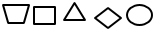
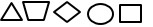
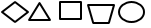
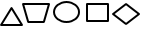
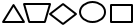
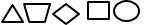
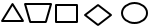
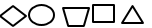

# Засоби міжфразової єдності

1.6. Синтаксис. Пунктуація · 28 завдань · [джерело](https://zno.osvita.ua/ukrmova/tag-zasobi_mizhfrazovoyi_yednosti/)

## Завдання 1

**Завдання стосується речень, що первісно, в іншій послідовності, становили зв'язний текст. Прочитайте речення й виконайте завдання до них.**

△ Саме завдяки такому всеохопному підходу жодна українська дитина не відчуватиме себе вилученою із соціуму - і це головне завдання реалізації інклюзивної освітньої політики на державному рівні.

○ В Україні найчастіше відповідне навчання розуміють вузько, а саме як такий спосіб здобуття освіти, коли учні або студенти з особливими потребами перебувають у загальному освітньому просторі за місцем свого проживання, що є альтернативою інтернатній системі або домашньому чи індивідуальному навчанню.

◇ ЮНЕСКО визначає інклюзивне навчання як «процес звернення і відповіді на різноманітні потреби учнів, щоб забезпечити їхню участь в освітньому процесі, культурних заходах і житті громади».

□ Іншими словами, утвердження в Україні принципів дійсно інклюзивної віти передбачає створення однакових можливостей щодо всіх категорій дітей зокрема й для 18 546 школярів з особливими потребами (станом на 2018 рік).

⏢ Питання інклюзії, безсумнівно, варто розглядати ширше, а не лише як створення доступного освітнього простору для дітей з особливими потребами.

Зміст первісного тексту буде відновлено, якщо речення розташувати в послідовності, запропонованій у рядку

- **А** 
- **Б** 
- **В** 
- **Г** 
- **Д** 

**Відповідь: Д**

Пояснення

**ТЕМА:Розвиток мовлення. Текст. Основні ознаки тексту. Логічна послідовність. Зв’язність і точність мовлення.**

Завдання перевіряє ваше вміння читати, усвідомлювати й запам’ятовувати зміст прочитаного, диференціюючи в ньому головне та другорядне, критично оцінювати прочитане, логічно мислити.

Обов’язково звертайтеся до тексту, виконуючи це завдання. Потрібно проаналізувати, які засоби міжфразового зв’язку використано в тексті (займенники, лексичний повтор, прислівники, граматичні засоби, вставні слова тощо).

Проаналізуймо запропоновані рядки.

Речення, позначене ромбом, є початковим реченням запропонованого деформованого тексту. Це визначення інклюзивного навчання. Наступні речення мають поглиблювати цю інформацію, розширювати чи конкретизувати її.

Саме це є в реченні з символом «кружечок»**,** де пояснюють, що такий процес в Україні зазвичай розуміють як навчання дітей чи студентів з особливими потребами.

Подальшу конкретизацію поняття «інклюзія» знаходимо в реченні з призмою, де стверджують, що це значно ширший процес (ужито вставне слово «безсумнівно»).

Речення з квадратом тлумачить цю думку більш детально, для зв’язку з попереднім реченням вжито вставну конструкцію «іншими словами».

А останнє речення (трикутник) – це своєрідний підсумок, висновок щодо поданої інформації.

**Відповідь – Д.**

## Завдання 2

**Завдання стосується речень, що первісно, в іншій послідовності, становили зв'язний текст. Прочитайте речення й виконайте завдання до них.**

△ Коли нас так усамітнили, це виявилося руйнівною силою, і саме тому всі знову почали телефонувати одне одному, щоб соціалізуватися.

○ Такий стан якому немає альтернативи, – це своєрідне ув’язнення в одиночній камері, адже бути людиною можна тільки в громаді.

◇ Ізоляція – жахливе явище, що руйнує нашу ідентичність, індивідуальність, але в умовах пандемії людство повинно було до цього вдатися.

□ Лише перебуваючи в ній, ми стаємо собою справжніми, хоча кожен має право на неповторність, унікальність.

⏢ Погодьмося, це є цілком природно: людина прагне до суспільства, хоче бодай якось вийти з ізоляції або принаймні зменшити її тягар хоча б за допомогою телефона.

Зміст первісного тексту буде відновлено, якщо речення розташувати в такій послідовності

- **А** 
- **Б** 
- **В** 
- **Г** 
- **Д** 

**Відповідь: В**

Пояснення

**ТЕМА: Розвиток мовлення. Текст. Основні ознаки тексту. Логічна послідовність. Зв’язність і точність мовлення.**

Це робота з так званим деформованим текстом, яка перевіряє ваше вміння читати, усвідомлювати й запам’ятовувати зміст прочитаного, диференціювати в ньому головне та другорядне, критично оцінювати, логічно мислити, установлювати зв’язки між фактами й думками, відновлювати початкову послідовність і далі працювати з таким текстом, досліджувати його.

Обов’язково звертайтеся до тексту, виконуючи це завдання.

Потрібно проаналізувати, які **засоби міжфразового зв’язку** використано в тексті (займенники, лексичний повтор, прислівники, граматичні засоби, вставні слова тощо).

Проаналізуймо запропоновані рядки.

Речення з позначкою-ромбом  є початковим реченням запропонованого деформованого тексту. Це визначення поняття «ізоляція».

Наступні речення мають поглиблювати цю інформацію, розширювати чи конкретизувати її. Речення із символом-кружечком  буде другим у тексті, адже продовжує думку, що ізоляція – це захід, який не має альтернативи, та стверджує, що людині необхідна громада.

Наступним є речення, позначене символом-квадратом  : воно пояснює, конкретизує почуття тих, хто усамітнений, їхню необхідність перебувати в спільноті.

Відсутність громади руйнує людину – і вона починає боротися із самотністю, телефонуючи друзям. Про це йдеться в реченні, позначеному символом-трикутником .

Речення, позначене символом-трапецією , є своєрідним висновком: автор тексту продовжує попередню думку, апелює до уявного співрозмовника, стверджуючи, що навіть така телефонна розмова – це певний засіб протидії наслідкам ізоляції.

**Відповідь – В.**

## Завдання 3

**Завдання стосується речень, що первісно, в іншій послідовності, становили зв'язний текст. Прочитайте речення й виконайте завдання до них.**

△ Кожен охочий може взяти собі такий пакетик і посіяти його вміст біля своєї домівки, а завдяки цьому вдасться виростити 36 000 польових рослин, які, приваблюючи метеликів, сприятимуть збереженню популяції.

○ Навіть такий незвичний спосіб підтримки комах має насправді величезне значення, оскільки від диких запилювачів залежить як сільське господарство Великої Британії, так й екосистема Британських островів загалом.

◇ Ці постери, кожен з яких має 3 000 відривних пакетиків з насінням польових рослин, розмістили в різних районах Лондона.

□ Щоб хоч якось зарадити цій небезпеці, один з косметичних брендів, як повідомляє видання «The Drum», створив оригінальні рекламні постери з насінням.

⏢ Після потужних весняних штормів, у Великій Британії майже двадцять відсотків видів метеликів опинилися під загрозою зникнення.

Зміст первісного тексту буде відновлено, якщо речення розмістити в такій послідовності

- **А** 
- **Б** 
- **В** 
- **Г** 
- **Д** 

**Відповідь: Б**

Пояснення

**ТЕМА: Розвиток мовлення. Текст. Основні ознаки тексту. Логічна послідовність. Зв’язність і точність мовлення**

Це робота з так званим деформованим текстом, що перевіряє ваше вміння читати, усвідомлювати й запам’ятовувати зміст прочитаного, диференціювати в ньому головне та другорядне, критично оцінювати, логічно мислити, установлювати зв’язки між фактами й думками, відновлювати початкову послідовність і далі працювати з таким текстом, досліджувати його.

Обов’язково звертайтеся до тексту, виконуючи це завдання. Потрібно проаналізувати, які засоби міжфразового зв’язку використано в ньому (займенники, лексичний повтор, прислівники, граматичні засоби, вставні слова тощо).

Проаналізуймо запропоновані рядки.

Речення із символом-трапецією повідомляє, що метелики перебувають під загрозою. Потрібно їх якось рятувати.

Саме про певну форму допомоги йдеться в рядку з символом-квадратом.

Щоб таку допомогу могли надати, постери розташовують у різних районах Лондона. Отже, далі доречно поставити речення із символом-ромбом.

Пакетиками може скористатися кожен, про це читаємо в реченні з символом-трикутником.

А речення з символом-колом робить своєрідний висновок: навіть такий незвичний спосіб допоможе.

**Відповідь – Б.**

## Завдання 4

**Завдання стосується речень, що первісно, в іншій послідовності, становили зв'язний текст. Прочитайте речення й виконайте завдання до них.**

△ Однак чиста вода в Україні таки є: скуштувати її можна на Полтавщині, де майже всю її беруть з підземних джерел.

○ Оскільки *очисні* **споруди** розраховано на **І** і **ІІ класи** забруднення, то 80 % проб питної води не відповідають вимогам стандарту.

◇ Вода, як відомо, відіграє найважливішу **роль** у житті людини, проте нині 80 % українців змушені споживати неякісну воду, тому що беруть її з поверхневих джерел, *екологічний* **стан** яких щороку погіршується.

□ *Далека* від нормативних вимог і вода з Дніпра, яку використовує майже 75 % населення України.

⏢ Це відбувається через *погане* **очищення** стічних побутових і промислових вод, наслідком якого стає *надмірне* насичення водойм органікою і наближення їх до ІІІ класу забруднення.

Зміст первісного тексту буде відновлено, якщо речення розмістити в такій послідовності

- **А** 
- **Б** 
- **В** 
- **Г** 
- **Д** 

**Відповідь: Д**

Пояснення

**ТЕМА: Розвиток мовлення. Текст. Основні ознаки тексту. Логічна послідовність. Зв’язність і точність мовлення.**

Це робота з **деформованим текстом**, яка перевіряє ваше вміння читати, усвідомлювати й запам’ятовувати зміст прочитаного, диференціювати в ньому головне та другорядне, критично оцінювати, логічно мислити, установлювати зв’язки між фактами й думками, відновлювати початкову послідовність і далі працювати з таким текстом, досліджувати його.

Обов’язково звертайтеся до тексту, виконуючи це завдання. Потрібно проаналізувати, які засоби міжфразового зв’язку використано в тексті (займенники, лексичний повтор, прислівники, граматичні засоби, вставні слова тощо).

Проаналізуймо запропоновані рядки.

Речення з позначкою-ромбом є початковим реченням запропонованого деформованого тексту. У цьому реченні визначено важливе значення води в житті людини та зазначено те, що її стан погіршується щороку.

Речення із символом-трапецією буде другим у тексті, адже розкриває причину цього погіршення та пояснює, як відбувається очищення води.

Наступним є речення, позначене колом: воно пояснює, через що виникають проблеми з очищенням.

Далі йде коментар про якість води в Україні і в Дніпрі. Отже, це речення із символом-квадратом.

І останнім має бути речення, позначене трикутником, адже воно вказує, де все ж таки можна скуштувати чисту воду.

**Відповідь – Д.**

## Завдання 5

◇ Ось так роздумуючи, він раптом пригадав ***слова*** свого приятеля про те що добре було б завжди мати напохваті мішок для сміття.

△ Тоді Василюк просто загорівся ідеєю про одноразові ***торбинки,*** запропонував виготовляти їх з поліетилену, а за кілька місяців без цих побутових реалій не уявляли свого ***життя*** вже десятки тисяч людей.

○ Це здається неймовірним, але мішками для сміття люди почали користуватися лише 1950 року.

⏢ Спочатку наш земляк розмірковував над приладом, що працював би за принципом пилотяга й засмоктував би непотріб до ***машини.***

□ ***Мерія*** канадського міста Вінніпега звернулася до Гаррі Василюка, інженера українського походження, з проханням вирішити проблему випадання сміття під час завантаження контейнерів.

Первісний текст буде відновлено, якщо речення розташувати в послідовності, запропонованій у рядку

- **А** 
- **Б** 
- **В** 
- **Г** 
- **Д** 

**Відповідь: Д**

Пояснення

**ТЕМА: Зміст і будова тексту**

Зверніть увагу, що текст є складною структурною цілісністю, яку утворюють окремі речення, що в той чи той спосіб взаємопов’язані. Тож, виконуючи це завдання, звертайте увагу на зв’язок структурних елементів між собою.

Щоб окремі речення утворили мовну й змістову цілісність, тобто текст, вони мають бути пов’язані між собою: кожне наступне пов’язане з попереднім за допомогою певного смислового компонента, що послідовно продовжує, розгортає сказане вище.

Зауважмо, що зв’язність тексту забезпечують **засоби міжфразового зв’язку**, які є маркерами (сигналами) пов’язаності попереднього речення чи фрагмента з наступним. Засобами зв’язку між реченнями, які, безперечно, пов’язані при цьому змістовно й логічно, слугують різноманітні мовні елементи (лексичні, морфологічні й синтаксичні) й ритмомелодика. Уміння бачити ці засоби зв’язку допоможе «розкодовувати» написане іншими.

Зміст первісного тексту буде відновлено, якщо речення розмістити в послідовності, позначеній у варіанті **Д**.

**Відповідь: Д.**

## Завдання 6

△ Але згадаймо, що в дитинстві творчими були всі, однак з плином часу й зміною обставин розчарувалися у своїх здібностях.

○ А от сучасні вчені стверджують, що не варто зневірюватись: у кожного з нас є вартісні ідеї, а креативність подібна до м’язів: що частіше її застосовуєш, то краще розвиваєш.

◇ Інноваційність і творчість – виразні рушії успіху в діловому світі та чи не найцінніші якості лідерів сьогодення.

□ Тож до науковців варто дослухатися: може, і не кожен із нас митець, але, якщо є бажання, усі однозначно здатні бути по-справжньому творчими юристами, лікарями, маркетологами чи керівниками.

⏢ Більшість із нас схильна наділяти цими рисами тих, кого традиційно вважають творчими людьми, а саме фахових художників, скульпторів, дизайнерів тощо.

Первісний текст буде відновлено, якщо речення розташувати в послідовності, запропонованій у рядку

- **А** 
- **Б** 
- **В** 
- **Г** 
- **Д** 

**Відповідь: В**

Пояснення

**ТЕМА: Зміст і будова тексту**

Зверніть увагу, що текст є складною структурною цілісністю, яку утворюють окремі речення, що в той чи той спосіб взаємопов’язані. Тож, виконуючи це завдання, звертайте увагу на зв’язок структурних елементів між собою.

Щоб окремі речення утворили мовну й змістову цілісність, тобто текст, вони мають бути пов’язані між собою: кожне наступне пов’язане з попереднім за допомогою певного смислового компонента, що послідовно продовжує, розгортає сказане вище.

Зауважмо, що зв’язність тексту забезпечують **засоби міжфразового зв’язку**, які є маркерами (сигналами) пов’язаності попереднього речення чи фрагмента з наступним. Засобами зв’язку між реченнями, які, безперечно, пов’язані при цьому змістовно й логічно, слугують різноманітні мовні елементи (лексичні, морфологічні й синтаксичні) й ритмомелодика. Уміння бачити ці засоби зв’язку допоможе «розкодовувати» написане іншими.

Зміст первісного тексту буде відновлено, якщо речення розмістити в послідовності, позначеній у варіанті **В**.

**Відповідь: В.**

## Завдання 7

△ Однак, чиста вода в Україні є: скуштувати таку можна на Полтавщині, де майже всю її беруть з підземних джерел.

○ Оскільки ***очисні*** споруди розраховано на І і ІІ класи забруднення, то 80 % проб питної води не відповідають вимогам стандарту.

◇ Вода, як відомо, відіграє найважливішу роль у житті людини, проте нині 80 % українців змушені споживати неякісну воду, тому що беруть її з поверхневих джерел, ***екологічний*** стан яких щороку стає гіршим.

□ ***Далека*** від нормативних вимог і вода з Дніпра, яку використовує майже 75 % населення України.

⏢ Це відбувається через ***погане*** очищення стічних побутових і промислових вод, наслідком якого є ***надмірне*** насичення водойм органікою і наближення їх до ІІІ класу забруднення.

Первісний текст буде відновлено, якщо речення розташувати в послідовності, запропонованій у рядку

- **А** 
- **Б** 
- **В** 
- **Г** 
- **Д** 

**Відповідь: Б**

Пояснення

**ТЕМА: Розвиток мовлення. Текст. Основні ознаки тексту. Логічна послідовність. Зв’язність і точність мовлення**

Це робота з **деформованим текстом**, яка перевіряє ваше вміння читати, усвідомлювати й запам’ятовувати зміст прочитаного, диференціювати в ньому головне та другорядне, критично оцінювати, логічно мислити, установлювати зв’язки між фактами й думками, відновлювати початкову послідовність і далі працювати з таким текстом, досліджувати його.

Обов’язково звертайтеся до тексту, виконуючи це завдання.

Потрібно проаналізувати, які засоби міжфразового зв’язку використано в тексті (займенники, лексичний повтор, прислівники, граматичні засоби, вставні слова тощо).

Проаналізуймо запропоновані рядки.

Речення з позначкою-**ромбом** є початковим реченням запропонованого деформованого тексту. У цьому реченні визначено важливе значення води в житті людини та зазначено те, що її стан погіршується щороку.

Речення із символом-**трапецією** буде другим у тексті, адже розкриває причину цього погіршення та пояснює, як відбувається очищення води.

Наступним є речення, позначене **колом**: воно пояснює, через що виникають проблеми з очищенням.

Далі йде коментар про якість води в Україні і в Дніпрі. Отже, це речення із символом-**квадратом**.

І останнім має бути речення, позначене **трикутником**, адже воно вказує, де все ж таки можна скуштувати чисту воду.

**Відповідь: Б.**

## Завдання 8

◇ Визначаючись з інвестуванням, зважають на незалежність вартості вибраного об’єкта від політичної ситуації в державі, захищеність від ***утручання*** третіх сторін у ***процес*** володіння та розпорядження ним тощо.

□ Таку ситуацію пояснюють нестабільністю курсів, тому громадяни прагнуть вкладати ***кошти*** в іноземну валюту, коштовні речі, нерухомість та дорогоцінні метали.

○ Отже, цифрова валюта стає популярною в деяких країнах, відтак формують інфраструктуру її продажу через ***термінали***, розширюють мережу комерційних і виробничих структур, які уможливлюють розрахунок електронними грішми.

⏢ Останнім часом дехто вважає, що бажаним критеріям відповідає новий інструмент фінансового ринку – електронні гроші, основними перевагами яких є конфіденційність, незалежність від держави, відсутність територіальних і часових обмежень у трансакціях, низька вартість обслуговування.

△ У ***період*** поглиблення кризових явищ у світовій економіці, люди в багатьох країнах часто уникають заощаджень у національних грошових одиницях.

Первісний текст буде відновлено, якщо речення розташувати в послідовності, запропонованій у рядку

- **А** 
- **Б** 
- **В** 
- **Г** 
- **Д** 

**Відповідь: А**

Пояснення

**ТЕМА:Розвиток мовлення. Текст. Основні ознаки тексту. Логічна послідовність. Зв’язність і точність мовлення**

Це робота з так званим деформованим текстом, яка перевіряє ваше вміння читати, усвідомлювати й запам’ятовувати зміст прочитаного, диференціювати в ньому головне та другорядне, критично оцінювати, логічно мислити, установлювати зв’язки між фактами й думками, відновлювати початкову послідовність і далі працювати з таким текстом, досліджувати його.

Обов’язково звертайтеся до тексту, виконуючи це завдання. Потрібно проаналізувати, які засоби міжфразового зв’язку використано в ньому (займенники, лексичний повтор, прислівники, граматичні засоби, вставні слова тощо).

Проаналізуймо запропоновані рядки.

Речення з позначкою-трикутником є початковим реченням запропонованого деформованого тексту.

Речення із символом-квадратом буде другим, адже в ньому пояснено, чому саме люди уникають заощадження в національних грошових одиницях і прагнуть вкладати кошти в більш надійні речі.

Наступним є речення, позначене символом-ромбом: у ньому перелічено фактори, що впливають на вибір саме таких альтернативних варіантів заощаджень.

Далі логічно поставити речення із символом-трапецією, бо тут указано незвичний, ще доволі новий спосіб збереження коштів.

І останнім має бути речення, позначене символом-колом, це висновок до запропонованого повідомлення (вставне слово *отже*).

**Відповідь – А.**

## Завдання 9

◇ ***Представники*** комітету зазначили, що вона почала свій шлях боротьби ще 2014 року на Донбасі й захищаючи Україну від російської агресії, за весь цей час продемонструвала надзвичайну фізичну та моральну стійкість.

□ Це завжди ***жінки***, які виявили лідерство, мужність, винахідливість і готовність жертвувати заради інших.

△ До речі, це не перша нагорода мужньої жінки: наприкінці 2022 року Юлія Паєвська отримала премію Станіслава Вінценза «За гуманістичне служіння та внесок у розвиток регіонів» та присвятила її дитячому письменнику Володимирові Вакуленку, якого вбили російські ***окупанти***.

⏢ Міжнародна ***премія*** IWOC («Найхоробріша жінка світу»), заснована 2007 року, – це американська відзнака, яку Державний департамент США щороку вручає представницям різних країн.

○ У 2023 році лауреатками IWOC стали ***поборниці*** з 11 держав, серед них була й українка Юлія Паєвська – парамедикиня і волонтерка, відома всім під позивним Тайра.

Первісний текст буде відновлено, якщо речення розташувати в послідовності, запропонованій у рядку

- **А** 
- **Б** 
- **В** 
- **Г** 
- **Д** 

**Відповідь: Д**

Пояснення

**ТЕМА: Розвиток мовлення. Текст. Основні ознаки тексту. Логічна послідовність. Зв’язність і точність мовлення**

Це робота з так званим деформованим текстом, яка перевіряє ваше вміння читати, усвідомлювати й запам’ятовувати зміст прочитаного, диференціювати в ньому головне та другорядне, критично оцінювати, логічно мислити, установлювати зв’язки між фактами й думками, відновлювати початкову послідовність і далі працювати з таким текстом, досліджувати його.

Обов’язково звертайтеся до тексту, виконуючи це завдання.

Потрібно проаналізувати, які засоби міжфразового зв’язку використано в тексті (займенники, лексичний повтор, прислівники, граматичні засоби, вставні слова тощо).

Проаналізуймо запропоновані рядки.

Речення з позначкою-трапецією є початковим реченням запропонованого деформованого тексту.

Речення із символом-квадратом буде другим, адже в ньому пояснено, ким є представниці різних країн, яким вручають нагороду *«Найхоробріша жінка світу».*

Наступним є речення, позначене символом-колом: у ньому йдеться про вже конкретний рік (2023) та про конкретну лауреатку – українку Юлію Паєвську.

Далі логічно пояснити, чому саме її було обрано для нагородження. Отже, це речення із символом-ромбом.

І останнім має бути речення, позначене символом-трикутником, це додаткова заувага до основного повідомлення (вставна конструкція *до речі*).

**Відповідь – Д.**

## Завдання 10

△ А далі взагалі маємо парадокс: виявляється, ***гіперпокликання*** не завжди переадресовує навіть на зовсім «свіжу» вебсторінку, створену лише кілька років тому...

○ Відома фраза «***інтернет*** пам'ятає все» створила ілюзію, що за потреби миттєво можемо відновити тексти, музику чи відео.

◇ Навіть якщо він уже не працюватиме ***роки*** не стануть на заваді: текст міг зберегтися на сервері, однак багаторічна практика свідчить зовсім про інше.

□ Якщо гіперпокликанню понад десять років, то, як запевняють досвідчені користувачі, ***шанси*** знайти дані, розміщені колись на вже не доступній сторінці, просто мізерні.

⏢ Це хибне уявлення сформувало в нас наївне переконання, що будь-коли можна знайти необхідні ***відомості*** на сайті, де їх було розміщено дуже давно.

Первинний текст буде відновлено, якщо речення розташувати в послідовності, запропонованій у рядку

- **А** 
- **Б** 
- **В** 
- **Г** 
- **Д** 

**Відповідь: А**

Пояснення

**ТЕМА: Розвиток мовлення. Текст. Основні ознаки тексту. Логічна послідовність. Зв’язність і точність мовлення.**

Це робота з деформованим текстом, яка перевіряє ваше вміння відновлювати початкову послідовність і далі працювати з таким текстом, досліджувати його.

Обов’язково звертайтеся до тексту, виконуючи це завдання. Потрібно проаналізувати, які засоби міжфразового зв’язку використано в ньому (займенники, лексичний повтор, прислівники, граматичні засоби, вставні слова тощо).

Проаналізуймо запропоновані рядки.

Речення з позначкою-кружечком є початковим у запропонованому деформованому тексті, бо воно має найбільш загальний зміст, розпочинає судження.

Речення із символом-трапецією буде другим, адже в ньому вказано, який наслідок має ілюзія щодо всеохопної пам’яті інтернету.

Наступним є речення, позначене ромбом: у ньому пояснено, що такі надії є марними.

Далі логічно поставити речення із символом-квадратом, бо тут ще детальніше указано причини, чому пам’ять усемережі не вічна.

І останнім має бути речення, позначене трикутником, це, по суті, висновок до запропонованого повідомлення.

**Відповідь – А.**

## Завдання 11

□ Вони не мають матеріальних благ, їх не турбують соціальний ***статус*** чи рівень та якість існування, а для радості вистачає можливості любити весь світ.

⏢ Любов до життя і є нашим дитячим секретом щастя, але ми, подорослішавши, чомусь утрачаємо цей особливий ***дар***.

○ Парадокс полягає в тому, що з народження будь-хто може отримувати цілковите ***задоволення*** від життя і це яскраво демонструють діти.

△ На думку науковця, кожна людина понад усе прагне досягти повноти ***існування*** й насолоджуватися цим відчуттям.

◇ Фінський учений Тимо Айраксинен від початку кар'єри досліджував теорію ***щастя*** й узагальнив свої міркування в монографії.

Первинний текст буде відновлено, якщо речення розташувати в послідовності, запропонованій у рядку

- **А** 
- **Б** 
- **В** 
- **Г** 
- **Д** 

**Відповідь: В**

Пояснення

**ТЕМА:Розвиток мовлення. Текст. Основні ознаки тексту. Логічна послідовність. Зв’язність і точність мовлення**

Це робота з деформованим текстом, яка перевіряє ваше вміння відновлювати початкову послідовність і далі працювати з таким текстом, досліджувати його.

Обов’язково звертайтеся до тексту, виконуючи це завдання. Потрібно проаналізувати, які засоби міжфразового зв’язку тут використано (займенники, лексичний повтор, прислівники, граматичні засоби, вставні слова тощо).

Проаналізуймо запропоновані рядки.

Речення з позначкою-ромбом є початковим реченням запропонованого деформованого тексту.

Речення із символом-трикутником буде другим, адже в ньому пояснено міркування Тимо Айраксинена, а також ім’я та прізвище ученого замінено на слово «науковець».

Наступним є речення, позначене символом-кружечком: тут займенник «цим» замінено на іменник «задоволення», а також прокоментовано парадокс попереднього твердження.

Далі наведено кілька аргументів, чому діти здатні відчувати щастя завжди. Отже, речення із символом-квадратом буде наступним.

І останнє речення-висновок – це речення, позначене символом-трапецією.

**Відповідь – В.**

## Завдання 12

⏢ У виборі способу **пересування** головним критерієм теж не має бути швидкість.

□ Сьогодні мандрівники все частіше обирають **усвідомленість** і сповільненість у подорожах, а не намагання побачити всю країну, за кілька днів.

△ Те саме стосується й **харчування**: замість поспіху й фастфуду краще обрати локальні продукти, сімейні **ресторани**, страви, які розповідають історію місця, а не лише дають енергію.

○ Наприклад, **потяг**, а не літак дозволяє побачити зміну пейзажів та ознайомитися з місцевими ландшафтами.

◇ Хоч локації можуть бути різними: як непримітні села в горах або біля моря, так і великі туристичні міста, головна умова – вони не повинні змінювати одна одну щогодини.

Первинний текст буде відновлено, якщо речення розташувати в послідовності, запропонованій у рядку

- **А** 
- **Б** 
- **В** 
- **Г** 
- **Д** 

**Відповідь: Г**

Пояснення

**ТЕМА: Розвиток мовлення. Текст. Основні ознаки тексту. Логічна послідовність. Зв’язність і точність мовлення.**

Завдання перевіряє вміння опрацьовувати деформований текст.

Це робота з **деформованим текстом**, яка перевіряє вміння виявляти зв’язки між фактами й думками, відновлювати початкову послідовність і після цього працювати з таким текстом, досліджувати його.

Обов’язково звертайтеся до тексту, виконуючи завдання. Треба проаналізувати **засоби міжфразового зв’язку** (займенники, лексичний повтор, прислівники, граматичні засоби, вставні слова тощо), які використано в тексті*.*

Проаналізуймо запропоновані рядки. Речення з позначкою**-квадратом** є **початковим** реченням цього деформованого тексту. У реченні йдеться про те, **яким** подорожам віддають перевагу сучасні мандрівники.

Речення із символом**-ромбом** розповідає про **головну умову** усвідомленого подорожування.

Наступним є речення, позначене **трапецією**: тут наведено **головний критерій** способу пересування.

Після цього має бути речення із символом**-колом**, на це вказує і вставне слово *наприклад*. У реченні розповідається, чому краще вибирати потяги, а не літаки для мандрів.

І останнім має бути речення, позначене **трикутником**, тут ідеться про те, які продукти, ресторани чи страви вибирати під час відвідування різних місць.

**Відповідь: Г.**

## Завдання 13

⏢ Японська **компанія**1981 року створювала гру, яка мала врятувати її від фінансового краху.

□ Однак, уже 1983 року Маріо перетворили на сантехніка, оскільки нові рівні включали **труби**, які згодом стали культовим елеметом у франшизі.

△ **Розробники** планували використати персонажів із відомого мультфільму, але через проблеми з ліцензією художник вирішив створити нових героїв.

○ Спочатку він працював теслею, адже **дія** гри відбувалася на будівельному майданчику*.*

◇ Так з’явився Маріо – чоловік, який мав простий вигляд через технічні обмеження: **кепка** приховувала складності в анімації волосся, а вуса дали змогу уникнути промальовування рота.

Первинний текст буде відновлено, якщо речення розташувати в послідовності, запропонованій у рядку

- **А** 
- **Б** 
- **В** 
- **Г** 
- **Д** 

**Відповідь: В**

Пояснення

**ТЕМА: Розвиток мовлення. Текст. Основні ознаки тексту. Логічна послідовність. Зв’язність і точність мовлення.**

Завдання перевіряє вміння визначати логічну послідовність речень у деформованому тексті та визначати засоби міжфразового зв’язку для відновлення його зв’язності й цілісності.

Треба проаналізувати, які засоби міжфразового зв’язку використано в тексті (займенники, лексичний повтор, прислівники, граматичні засоби, вставні слова тощо).

Речення з позначкою**-трапецією** є початковим реченням запропонованого деформованого тексту. У цьому реченні йдеться про задум створення комп’ютерної гри японською компанією.

Речення із символом**-трикутником** розповідає про те, яких персонажів планували використати розробники.

Наступним є речення, позначене **ромбом**: тут ідеться про головного героя гри – Маріо.

Далі йде речення із символом**-колом**, на це вказує займенник *він*, адже в реченні продовжено розповідь про Маріо.

І останнім має бути речення, позначене **квадратом**, тут ідеться про те, яку професію врешті-решт отримав культовий герой гри.

**Відповідь: В.**

## Завдання 14

⏢ Спочатку **перегони** проводили на дорогах загального користування, вони були більше випробуванням надійності та швидкості техніки, ніж спортивним заходом.

□ Формула-1 стала найпрестижнішою серією автоперегонів у світі, збираючи найкращих перегонників і **команди** з усього світу.

△ Історія автоспорту почалася з винаходу автомобілів наприкінці ХІХ **століття**.

○ Перші спеціалізовані перегонові траси, як-от Індіанаполіс і Ле-Ман стали місцем **проведення** знаменитих перегонів.

◇ Однак із розвитком автомобільної індустрії та появою спеціалізованих трас **автоспорт** став набувати все більшої популярності.

Первинний текст буде відновлено, якщо речення розташувати в послідовності, запропонованій у рядку

- **А** 
- **Б** 
- **В** 
- **Г** 
- **Д** 

**Відповідь: Д**

Пояснення

**ТЕМА: Розвиток мовлення. Текст. Основні ознаки тексту. Логічна послідовність. Зв’язність і точність мовлення.**

Завдання перевіряє вміння працювати з деформованим текстом, виявляти зв’язки між фактами й думками, відновлювати початкову послідовність і далі працювати з таким текстом, досліджувати його.

Обов’язково треба звертатися до тексту, виконуючи завдання, з'ясувати, які засоби міжфразового зв’язку використано в тексті (*займенники*, *лексичний повтор*, *прислівники*, *граматичні засоби*, *вставні слова* тощо)*.*

Речення з позначкою**-трикутником** є початковим реченням деформованого тексту. Тут зазначено, із чого розпочалася історія автоспорту.

Речення із символом**-трапецією** розповідає про те, на яких дорогах проводили перші перегони.

Наступним є речення, позначене **ромбом**: тут ідеться про те, коли автоспорт став набувати все більшої популярності.

Далі йде речення із символом**-колом**, у ньому розповідається про перші спеціалізовані перегонові траси.

І останнім має бути речення, позначене **квадратом**, тут названо найпрестижнішу серію автоперегонів у світі.

**Правильна відповідь: Д.**

## Завдання 15

⏢ Гауеллс, навіть, пропонував міській владі за велику суму провести **розкопки** на сміттєзвалищі й організувати пошуки твердого диска, але йому відмовили.

□ На його твердому диску зберігалося понад 7500 біткоїнів.

△ Тобто **він** власноруч позбувся кількох сотень мільйонів доларів.

○ Британець викинув твердий **диск**, а коли Джеймс зрозумів помилку, знайти **накопичувач** уже було неможливо.

◇ Джеймс Гауеллс, чоловік із Ньюпорта, – безвідповідальний **тримач** криптовалюти.

Первинний текст буде відновлено, якщо речення розташувати в послідовності, запропонованій у рядку

- **А** 
- **Б** 
- **В** 
- **Г** 
- **Д** 

**Відповідь: А**

Пояснення

**ТЕМА: Розвиток мовлення. Текст. Основні ознаки тексту. Логічна послідовність. Зв’язність і точність мовлення.**

Завдання перевіряє вміння працювати з деформованим текстом: виявляти логічні зв’язки між фактами й думками, відновлювати початкову послідовність речень й аналізувати зміст і структуру відновленого тексту.

Обов’язково звертайтеся до тексту, виконуючи це завдання. Треба з'ясувати, які засоби міжфразового зв’язку використано в тексті – займенники, лексичний повтор, прислівники, граматичні засоби, вставні слова тощо*.*

Речення з позначкою**-ромбом** є початковим у запропонованому деформованому тексті. Тут зазначено, хто такий Джеймс Гауеллс.

Речення із символом**-квадратом** розповідає про те, скільки біткоїнів було на рахунку тримача криптовалюти.

Наступним є речення, позначене **колом**: тут ідеться про те, що чоловік випадково викинув твердий диск із криптовалютними накопиченнями.

Наступне – речення із символом**-трикутником**, на це вказує сполучник *тобто*, який розкриває зміст попереднього речення.

І останнім має бути речення, позначене **трапецією**, тут розповідається, чим завершилися пошуки диска з біткоїнами.

**Правильна відповідь: А.**

## Завдання 16

⏢ Однак напрямок на «екологічність» поширився й на інші **сфери**.

□ Екопродукція – це загальна **назва** товарів, вироблених з екологічно чистої сировини, без використання хімічних барвників та інших речовин створених штучно.

△ Наприклад, у моду входить **одяг** із натуральних тканин (льону або бавовни) без штучних барвників, перероблений океанський пластик використовують для виробництва корпусів побутової техніки й електроніки, кріпильних елементів, оздоблювальних матеріалів тощо.

○ Найчастіше під цим терміном розуміють харчові **продукти**, які були вирощені натуральним способом, із застосуванням лише органічних добрив і кормів.

◇ Широку **популярність** завойовують також різноманітні засоби побутової хімії та гігієнічні засоби, екологічність яких дає змогу уникнути алергії на активні складники.

Первинний текст буде відновлено, якщо речення розташувати в послідовності, запропонованій у рядку

- **А** 
- **Б** 
- **В** 
- **Г** 
- **Д** 

**Відповідь: Г**

Пояснення

**ТЕМА: Розвиток мовлення. Текст. Основні ознаки тексту. Логічна послідовність. Зв’язність і точність мовлення.**

Завдання перевіряє вміння опрацьовувати деформований текст, виявляти зв’язки між фактами й думками, відновлювати початкову послідовність і далі працювати з таким текстом, досліджувати його.

Обов’язково звертайтеся до тексту, виконуючи це завдання. Треба з'ясувати, які засоби міжфразового зв’язку використано в тексті (*займенники*, *лексичний повтор*, *прислівники*, *граматичні засоби*, *вставні слова тощо*)*.*

Проаналізуймо запропоновані рядки.

Речення з позначкою**-квадратом** є початковим реченням запропонованого деформованого тексту. Тут зазначено, що таке екопродукція.

Наступне речення із символом**-колом** розповідає, які харчові продукти розуміють під цим терміном.

Речення, позначене **трапецією**, продовжує розповідь про те, що напрямок на «екологічність» поширився й на інші сфери.

Далі йде речення із символом**-трикутником**, на це вказує і вставне слово *наприклад*. Тут деталізовано галузі використання екопродукції.

І останнім має бути речення, позначене **ромбом**, воно розповідає про різні екологічні засоби, що стають дедалі популярнішими.

**Правильна відповідь: Г.**

## Завдання 17

⏢ Історичні джерела свідчать, що далекого 1395 року родоначальник династії князів Вишневецьких Дмитро Корибут на правому березі річки Горинь заклав **замок**, який витримав не одну облогу татар.

□ З появою нового замку **Вишнівець** на кілька століть став гніздом великого й славного, знакового в українській і польській історії, роду князів Вишневецьких.

△ Окрасою і перлиною давнього містечка Вишнівця, що розкинулося на берегах річки Горинь, є розкішний палац – **пам'ятка** архітектури національного значення.

○ Аби твердиня стала недоступною для ворогів, 1494 року, на стрімкій горі на лівобережжі річки **Горинь** він зводить нову оборонну споруду.

◇ Та спустошення Вишнівця змусило князя Михайла Васильовича Вишневецького перенести замок і **поселення** в надійнішу місцевість.

Первинний текст буде відновлено, якщо речення розташувати в послідовності, запропонованій у рядку

- **А** 
- **Б** 
- **В** 
- **Г** 
- **Д** 

**Відповідь: А**

Пояснення

**ТЕМА: Розвиток мовлення. Текст. Основні ознаки тексту. Логічна послідовність. Зв’язність і точність мовлення.**

Завдання передбачає роботу з **деформованим текстом** і перевіряє вміння виявляти зв’язки між фактами та думками, відновлювати початкову послідовність і надалі працювати з таким текстом, досліджувати його.

Обов’язково звертайтеся до тексту, виконуючи це завдання. Треба з'ясувати, які засоби міжфразового зв’язку використано в тексті (*займенники*, *лексичний повтор*, *прислівники*, *граматичні засоби*, *вставні слова тощо).*

Проаналізуймо запропоновані рядки.

Речення з позначкою**-трикутником** є **початковим** реченням запропонованого деформованого тексту. Тут зазначено, що розкішний палац – окраса і перлина давнього містечка Вишнівець.

Наступне речення із символом**-трапецією** розповідає, хто й коли на правому березі річки Горинь заклав цей замок.

Речення, позначене **ромбом**, продовжує розповідь про те, що змусило князя Михайла Васильовича Вишневецького перенести замок.

Далі треба поставити речення із символом**-колом**, на це вказують і сполучник *аби*, і займенник *він*. Тут зазначено, чому князь зводить нову оборонну споруду на стрімкій горі річки Горинь.

І останнім має бути речення, позначене **квадратом**, воно розповідає, що з появою нового замку Вишнівець на кілька століть став гніздом роду князів Вишневецьких.

**Правильна відповідь: А.**

## Завдання 18

⏢ Зараз найвідоміші **компанії** розробляють власні, віртуальні світи.

□ Сьогодні метавсесвіт здається багатьом чимось далеким, незрозумілим і непотрібним, проте все вказує на те, що насправді – це **початок** нової цифрової ери, яку прогнозують експерти.

△ Метавсесвіт – це майбутній **рівень** взаємодії людей із брендами та іншими людьми з різних країн, який став доступним уже сьогодні.

○ Метавсесвіт – цифровий **світ**, що не має ні фізичних, ні часових, ні просторових кордонів.

◇ Завдяки йому кожен із нас, залишаючись удома, може бути скрізь і робити що завгодно: знайомитися з новими колекціями брендів, проводити презентації, відвідувати **концерти** та виставки тощо.

Первинний текст буде відновлено, якщо речення розташувати в послідовності, запропонованій у рядку

- **А** 
- **Б** 
- **В** 
- **Г** 
- **Д** 

**Відповідь: Г**

Пояснення

**ТЕМА: Розвиток мовлення. Текст. Основні ознаки тексту. Логічна послідовність. Зв’язність і точність мовлення.**

Завдання передбачає роботу з **деформованим текстом** і перевіряє вміння виявляти зв’язки між фактами й думками, відновлювати початкову послідовність частин тексту, а також аналізувати й досліджувати його зміст.

Речення з позначкою**-колом** – початкове у запропонованому деформованому тексті. Тут зазначено, що таке метавсесвіт.

Наступне речення із символом**-ромбом** розповідає, що можна робити завдяки метавсесвіту.

Речення, позначене **трапецією**, продовжує розповідь про те, що найвідоміші **компанії** розробляють власні віртуальні світи.

У реченні із символом**-трикутником** зазначено, що цифровий світ – це майбутній **рівень** взаємодії людей із брендами та іншими людьми з різних країн, який став доступним уже сьогодні.

І останнім має бути речення, позначене **квадратом**, воно розповідає, що з появою метавсесвіту **починається** нова цифрова ера, яку прогнозують експерти.

**Правильна відповідь: Г.**

## Завдання 19

⏢ Самокеровані автомобілі, високотехнологічна робототехніка, керування дорожнім рухом за допомогою ШІ, обслуговування інтелектуальних мереж та багато іншого – ось лише кілька прикладів, які натякають на **роль** штучного інтелекту.

□ Наприклад, багато постачальників навігаційних послуг застосовують штучний інтелект для аналізу даних і надання інформації, яка полегшує людям навігацію та надає **оновлення** про дорожню ситуацію в реальному часі, роблячи поїздки ефективнішими.

△ У світі штучний **інтелект** став широко використовуваним терміном у багатьох технологічних дискусіях.

○ Ще однією сферою, де штучний інтелект стає все більш значущим у нашому побуті, є банки, які надають змогу здійснювати фінансові **операції** з мобільних пристроїв.

◇ Попри поодинокі **новини** про розробки в цій галузі варто зазначити, що ШІ вже міцно вкоренився в нашому повсякденному житті.

Первинний текст буде відновлено, якщо речення розташувати в послідовності, запропонованій у рядку

- **А** 
- **Б** 
- **В** 
- **Г** 
- **Д** 

**Відповідь: В**

Пояснення

**ТЕМА: Розвиток мовлення. Текст. Основні ознаки тексту. Логічна послідовність. Зв’язність і точність мовлення.**

Завдання передбачає роботу з **деформованим текстом** і перевіряє вміння виявляти зв’язки між фактами й думками, відновлювати початкову послідовність і далі працювати з таким текстом, досліджувати його.

Обов’язково звертайтеся до тексту, виконуючи це завдання. Треба з'ясувати, які засоби міжфразового зв’язку використано в тексті (*займенники*, *лексичний повтор*, *прислівники*, *граматичні засоби*, *вставні слова тощо*).

Проаналізуймо запропоновані рядки.

Речення з позначкою**-трикутником** – початкове в запропонованому деформованому тексті. Тут зазначено, що термін *штучний* ***інтелект*** став широко використовуваним у багатьох технологічних дискусіях.

У наступному реченні із символом**-трапецією** наведено приклади, які натякають на **роль** штучного інтелекту.

Речення, позначене **ромбом**, продовжує розповідь про те, що ШІ вже міцно вкоренився в нашому повсякденні.

Наступне речення – із символом**-квадратом**. На це вказує і вставне слово *наприклад*. Тут зазначено, навіщо постачальники навігаційних послуг застосовують штучний інтелект.

І останнім має бути речення, позначене **колом**, воно розповідає про ще одну сферу, де штучний інтелект стає все більш значущим у нашому побуті.

**Правильна відповідь: В.**

## Завдання 20

⏢ *Глобальне **потепління** призводить до танення льодовиків і крижаних щитів, що змінює розподіл маси планети й уповільнює її обертання.*

□ *Це **явище** спричинене глобальним потеплінням та діями людини, і може призвести до порушень роботи систем зв'язку та космічної навігації.*

△ *За словами науковців, якщо така **тенденція** збережеться, то до кінця століття вплив клімату на тривалість доби може перевищити гравітаційну дію Місяця.*

○ *Доба на Землі стає довшою через людську діяльність, яка впливає на **клімат**.*

◇ ***Науковці** з'ясували, що тривалість доби на Землі щостоліття зростає на 1,33 мілісекунди.*

Первинний текст буде відновлено, якщо речення розташувати в послідовності, запропонованій у рядку

- **А** 
- **Б** 
- **В** 
- **Г** 
- **Д** 

**Відповідь: Б**

Пояснення

**ТЕМА: Розвиток мовлення. Текст. Основні ознаки тексту. Логічна послідовність. Зв’язність і точність мовлення.**

Завдання передбачає роботу з деформованим текстом і перевіряє вміння виявляти зв’язки між фактами й думками, відновлювати початкову послідовність і далі працювати з таким текстом, досліджувати його.

Обов’язково звертайтеся до тексту, виконуючи це завдання. Треба проаналізувати, які засоби міжфразового зв’язку використано в тексті (*займенники*, *лексичний повтор*, *прислівники*, *граматичні засоби*, *вставні слова тощо*).

Проаналізуймо запропоновані рядки.

Речення з позначкою**-ромбом** початкове в запропонованому деформованому тексті. Тут зазначено, наскільки зростає тривалість доби.

Наступне речення із символом**-квадратом** розповідає, чим спричинене це явище.

Речення, позначене **колом**, продовжує розповідь про те, чому доба на Землі стає довшою.

Далі йде речення із символом**-трапецією**. Тут зазначено, до чого призводить глобальне потепління.

І останнім має бути речення, позначене **трикутником**, воно розповідає, що, на думку науковців, станеться з тривалістю доби, якщо така тенденція збережеться до кінця століття.

**Правильна відповідь: Б**.

## Завдання 21

⏢ *Ініціативу започаткували 2022 року для відзначення місць із особливим історичним і символічним значенням для світового **кіно**.*

□ *Відповідне **рішення** ухвалила Європейська кіноакадемія та в такий спосіб визнала студію одним з найважливіших центрів кіновиробництва Східної Європи.*

△ *Включення до переліку Європейської кіноакадемії підкреслює значення українського кіно, як частини ширшого європейського культурного простору, це також акцентує необхідність **збереження** таких об’єктів для майбутніх поколінь.*

○ *Національну кіностудію художніх фільмів імені Олександра Довженка офіційно включили до переліку «**Скарби** європейської кінокультури».*

◇ *До оновленого списку також увійшли кінотеатри та знімальні **майданчики** з Берліна, Стокгольма, Риги та Таллінна.*

Первинний текст буде відновлено, якщо речення розташувати в послідовності, запропонованій у рядку

- **А** 
- **Б** 
- **В** 
- **Г** 
- **Д** 

**Відповідь: А**

Пояснення

**ТЕМА: Розвиток мовлення. Текст. Основні ознаки тексту. Логічна послідовність. Зв’язність і точність мовлення.**

Завдання перевіряє вміння встановлювати логічну послідовність речень у деформованому тексті.

Це робота з **деформованим текстом**, яка перевіряє вміння виявляти зв’язки між фактами й думками, відновлювати початкову послідовність і далі працювати з таким текстом, досліджувати його.

Обов’язково звертайтеся до тексту, виконуючи завдання. Треба проаналізувати, які засоби міжфразового зв’язку використано в тексті (*займенники*, *лексичний повтор*, *прислівники*, *граматичні засоби*, *вставні слова тощо*).

Проаналізуймо запропоновані рядки.

Речення з позначкою**-колом** є початковим у запропонованому деформованому тексті. Тут зазначено, що кіностудію імені Олександра Довженка включили до переліку «**Скарби** європейської кінокультури».

Наступне речення із символом**-квадратом** розповідає, хто саме ухвалив це рішення.

Речення, позначене **трапецією**, продовжує розповідь про те, коли започаткували цю ініціативу.

Далі йде речення із символом**-ромбом**. Тут зазначено, кінотеатри та знімальні **майданчики** яких міст увійшли до оновленого списку.

І останнім має бути речення, позначене **трикутником**, воно розповідає, яке значення для українського кіно має включення студії до переліку Європейської кіноакадемії.

**Правильна відповідь: А.**

## Завдання 22

⏢ *Ідея конкурсу виникла в письменника і телевізійника С. Пульєзе, а пропозицію підтримав директор Швейцарського товариства радіомовлення й **телебачення** М. Безансон у січні 1955 року, під час зустрічі країн Європейської мовної спілки в Монако.*

□ *Щороку фестиваль розвивався і набував популярності, за всю історію «Євробачення» його скасовували лише 2020 року через пандемію, спричинену коронавірусом.*

△ *Відтоді **конкурс** розширився по всій Європі та за її межами, зокрема його учасниками стали Ізраїль та Австралія.*

○ *Головною метою **створення** конкурсу стало збереження миру, адже «Євробачення» засновано в час, коли Європа відновлювалася після Другої світової війни.*

◇ *Пісенний конкурс «Євробачення» було започатковано як технічний **експеримент** у телебаченні: одночасне транснаціональне мовлення в прямому ефірі в 1950-х було новаторством.*

Первинний текст буде відновлено, якщо речення розташувати в послідовності, запропонованій у рядку

- **А** 
- **Б** 
- **В** 
- **Г** 
- **Д** 

**Відповідь: В**

Пояснення

**ТЕМА: Розвиток мовлення. Текст. Основні ознаки тексту. Логічна послідовність. Зв’язність і точність мовлення.**

Завдання перевіряє вміння виявляти зв’язки між фактами й думками в деформованому тексті та відновлювати його логічну послідовність.

Це робота з **деформованим текстом**, яка перевіряє вміння виявляти зв’язки між фактами й думками, відновлювати початкову послідовність і далі працювати з таким текстом, досліджувати його.

Обов’язково звертайтеся до тексту, виконуючи це завдання. Треба проаналізувати, які засоби міжфразового зв’язку використано в тексті (*займенники*, *лексичний повтор*, *прислівники*, *граматичні засоби*, *вставні слова тощо*).

Проаналізуймо запропоновані рядки.

Речення з позначкою**-ромбом** є початковим реченням запропонованого деформованого тексту. Тут зазначено, коли започаткували пісенний конкурс «Євробачення».

Наступне речення із символом**-трапецією** розповідає, кому належить ідея конкурсу та хто підтримав цю пропозицію.

Речення, позначене **колом**, продовжує розповідь про те, що головною метою створення конкурсу стало збереження миру.

Далі йде речення із символом**-трикутником**. Тут зазначено, як розширився конкурс по всій Європі та за її межами.

І останнім має бути речення, позначене **квадратом**, воно розповідає про розвиток і популярність «Євробачення» та причину його скасування 2020 року.

**Правильна відповідь: В.**

## Завдання 23

⏢ ***Асортимент*** *змінювали кілька разів, поки брати МакДональди не дійшли висновку, що він повинен бути стандартним і містити лише ті страви, які мають попит.*

□ *Завдяки цій системі, клієнтів обслуговували дуже швидко і **водночас** якісно.*

△ *Так у **меню** залишилися тільки знамениті гамбургери, картопля фрі, безалкогольні напої, чизбургери.*

○ *МакДональдз став першим в історії закладом громадського **харчування**, де використовували конвеєрний спосіб для приготування та подавання страв.*

◇ *Ще однією відмінною рисою закладу було те, що клієнтам не було потрібне столове **приладдя**, адже їжу зручно запаковували.*

Первинний текст буде відновлено, якщо речення розташувати в послідовності, запропонованій у рядку

- **А** 
- **Б** 
- **В** 
- **Г** 
- **Д** 

**Відповідь: Б**

Пояснення

**ТЕМА: Розвиток мовлення. Текст. Основні ознаки тексту. Логічна послідовність. Зв’язність і точність мовлення.**

Це робота з **деформованим текстом**, яка перевіряє вміння виявляти зв’язки між фактами й думками, відновлювати початкову послідовність і далі працювати з таким текстом, досліджувати його.

Обов’язково звертайтеся до тексту, виконуючи це завдання. Треба проаналізувати, які засоби міжфразового зв’язку використано в тексті (*займенники*, *лексичний повтор*, *прислівники*, *граматичні засоби*, *вставні слова тощо*).

Проаналізуймо запропоновані рядки.

Речення з позначкою**-колом** є початковим реченням запропонованого деформованого тексту. Тут зазначено, у чому унікальність МакДональдзу.

Наступним має бути речення із символом**-квадратом**, на що вказує займенник *цей*. У реченні зазначено, що конвеєрний спосіб обслуговування клієнтів є дуже швидким і водночас якісним.

Речення, позначене **ромбом**, продовжує розповідь про те, що клієнтам не було потрібне столове приладдя, адже їжу зручно запаковували.

Далі йде речення із символом**-трапецією**. Тут зазначено, як змінювався асортимент страв у закладі.

І останнім має бути речення, позначене **трикутником**, воно розповідає про остаточне меню МакДональдзу.

**Правильна відповідь: Б.**

## Завдання 24

⏢ *Під час розкопок курганів, було знайдено срібні **бляшки** VI ст., на яких зображено чоловіків у вишиванках.*

□ ***Орнамент*** *на них схожий на той, що вишитий на народному костюмі XVIII ст.*

△ ***Вишивання*** *споконвіку було одним із найулюбленіших видів декоративно-прикладного мистецтва українців.*

○ *Перші **згадки** про вишитий одяг скіфів, які жили на землях нинішньої України, трапляються ще у свідченнях Геродота, датованих до VIII ст. до н.* *е.*

◇ *Протягом століть **зміст** вишитих символів поступово втрачався, однак найпоширеніші зразки геометричного та рослинного орнаменту використовують і сьогодні.*

Первинний текст буде відновлено, якщо речення розташувати в послідовності, запропонованій у рядку

- **А** 
- **Б** 
- **В** 
- **Г** 
- **Д** 

**Відповідь: В**

Пояснення

**ТЕМА: Розвиток мовлення. Текст. Основні ознаки тексту. Логічна послідовність. Зв’язність і точність мовлення.**

Завдання перевіряє вміння виявляти зв’язки між фактами й думками, відновлювати початкову послідовність речень у деформованому тексті, опрацьовувати й досліджувати його.

Обов’язково звертайтеся до тексту, виконуючи це завдання. Треба проаналізувати засоби міжфразового зв’язку (*займенники*, *лексичний повтор*, *прислівники*, *граматичні засоби*, *вставні слова тощо*), які використано в тексті*.*

Проаналізуймо запропоновані рядки.

Речення з позначкою**-колом** є початковим у деформованому тексті. Тут зазначено, коли й де з'явилися перші згадки про вишитий одяг скіфів.

Наступним має бути речення із символом**-трапецією**. У реченні згадано, яке зображення було знайдено під час розкопок курганів.

Речення, позначене **квадратом**, продовжує розповідь про те, яка вишивка була на одязі чоловіків, яких зображено на срібних бляшках.

Далі йде речення із символом **трикутником.** Тут зазначено, що вишивання споконвіку було одним із найулюбленіших видів декоративно-прикладного мистецтва українців.

І останнім має бути речення, позначене **ромбом**, воно розповідає про те, які вишиті символи використовують і сьогодні.

**Відповідь – В.**

## Завдання 25

⏢ *Верхні ноти – це найбільш леткі компоненти, які формують перше **враження**.*

□ *Умовно **аромат** складається з трьох рівнів: верхніх нот, нот серця та базових нот.*

△ *Сучасна парфумерія, крім ефірних олій, часто використовує їхні очищені синтетичні аналоги, які є стабільнішими, дешевшими, безпечнішими та мають прогнозовану **якість**.*

○ *Створення парфуму – це не романтичне змішування квіткових олій у красивій лабораторії, а складний процес, що поєднує органічну хімію, аналітичні методи, та **мистецтво** композиції.*

◇ *Ноти серця – це основна частина аромату, яка розкривається після зникнення перших компонентів, а ноти серця проявляються за 10–30 хвилин після **нанесення**.*

Первинний текст буде відновлено, якщо речення розташувати в послідовності, запропонованій у рядку

- **А** 
- **Б** 
- **В** 
- **Г** 
- **Д** 

**Відповідь: А**

Пояснення

**ТЕМА: Розвиток мовлення. Текст. Основні ознаки тексту. Логічна послідовність. Зв’язність і точність мовлення.**

Завдання перевіряє вміння виявляти зв’язки між фактами й думками, відновлювати початкову послідовність речень у деформованому тексті, працювати з ним, досліджувати його.

Обов’язково звертайтеся до тексту, виконуючи це завдання. Треба проаналізувати, які засоби міжфразового зв’язку використано в тексті (*займенники, лексичний повтор, прислівники, граматичні засоби, вставні слова тощо*)*.*

Речення з позначкою**-колом** є початковим реченням запропонованого деформованого тексту. Воно розповідає про процес створення парфумів.

Наступним має бути речення із символом**-квадратом**. У реченні згадано, зі скількох рівнів складається аромат.

Речення, позначене **трапецією**, продовжує розповідь про те, що верхні ноти аромату формують перше враження.

Далі йде речення із символом **ромбом.** Тут зазначено, коли з’являються ноти серця.

І останнім має бути речення, позначене **трикутником**, воно розповідає про те, які складники використовує сучасна парфумерія.

**Відповідь – А.**

## Завдання 26

⏢ Чоловік удень працював листоношею, а ночами при світлі **лампи** будував свою споруду, натхненням для якої стали поштові листівки.

□ Згодом він почав щодня збирати **каміння** під час своїх маршрутів: спочатку носив його в кишенях, потім у кошиках, а згодом перевозив у тачці.

△ **Історія** почалася 1879 року, коли Шеваль, розносячи пошту, випадково натрапив на незвичайний камінь.

○ Французький листоноша Фердинанд Шеваль 33 роки будував незвичайний **палац**, який уважають архітектурною пам’яткою Франції та одним із найбільш відомих зразків наївної архітектури.

◇ Як наслідок будівля поєднала **елементи** різних архітектурних стилів – від індуїстських храмів і середньовічних замків до швейцарських шале й арабських мечетей.

Первинний текст буде відновлено, якщо речення розташувати в послідовності, запропонованій у рядку

- **А** 
- **Б** 
- **В** 
- **Г** 
- **Д** 

**Відповідь: Д**

Пояснення

**ТЕМА: Розвиток мовлення. Текст. Основні ознаки тексту. Логічна послідовність. Зв’язність і точність мовлення.**

Завдання передбачає роботу з деформованим текстом і перевіряє вміння виявляти зв’язки між фактами й думками, відновлювати початкову послідовність і далі працювати з таким текстом, досліджувати його.

Обов’язково звертайтеся до тексту, виконуючи це завдання. Треба проаналізувати засоби міжфразового зв’язку, які використано в тексті (*займенники*, *лексичний повтор*, *прислівники*, *граматичні засоби*, *вставні слова тощо*).

Проаналізуймо запропоновані рядки.

Речення з позначкою-**колом** є початковим реченням запропонованого деформованого тексту. Воно розповідає про незвичайний палац, який побудував французький листоноша Фердинанд Шеваль.

Наступним має бути речення із символом**-трикутником**. У реченні згадано, як виник задум створення цієї архітектурної пам’ятки.

Речення, позначене **квадратом**, продовжує розповідь про те, як чоловік щодня збирав каміння під час своїх маршрутів.

Далі йде речення із символом **трапецією.** Тут зазначено, коли листоноша будував свою споруду, натхненням для якої стали поштові листівки.

І останнім має бути речення, позначене **ромбом**, воно розповідає про те, які архітектурні стилі врешті поєднала будівля.

**Правильна відповідь: Д.**

## Завдання 27

⏢ Орієнтація на задоволення підліткових потреб призводить до появи «людей-щурів»: так називають себе китайські ***безробітні*** зумери і викладають у соцмережі фото цілоденного перебування в ліжку, протестуючи в такий спосіб проти емоційного вигорання на роботі.

□ Але питання не в якості навчальних програм – воно в масовій культурі, що націлена насамперед на інтереси підлітків, а ще в цьому винні й ***сучасні*** родини, які, на жаль, не змогли виробити в дітей елементарних побутових навичок.

△ Виявляється, ***головна*** проблема людства полягає в тому, що воно не вміє старшати: у світі масово організовують курси «дорослішання», де молодь навчається прати, складати бюджет чи орієнтуватися в супермаркеті не гуглячи «що таке ріпа?» чи «як зварити борщ?».

◇ Ясна річ, усі мають по-своєму дорослішати, знімати рожеві окуляри, бодай зрідка виходити з онлайну й пробувати розібратися в складнощах сучасного світу без допомоги ШІ – і питання лише в тому, чи ми ще на це ***спроможні***.

○ Цікаво, що зумери у своїй безпорадності звинувачують освіту: мовляв, їх і не вчать дорослішати, натомість школа «забиває» в голови ***непотрібні*** факти – тобто викладання «просідає» не в теоретичному плані – воно «недопрацьовує» в практичному.

Первинний текст буде відновлено, якщо речення розташувати в послідовності, запропонованій у рядку

- **А** 
- **Б** 
- **В** 
- **Г** 
- **Д** 

**Відповідь: А**

Пояснення

**ТЕМА: Розвиток мовлення. Текст. Основні ознаки тексту. Логічна послідовність. Зв’язність і точність мовлення.**

Завдання передбачає роботу з **деформованим текстом** і перевіряє вміння виявляти зв’язки між фактами й думками, відновлювати початкову послідовність і далі працювати з таким текстом, досліджувати його.

Обов’язково звертайтеся до тексту, виконуючи це завдання. Треба проаналізувати, які засоби міжфразового зв’язку використано в тексті (*займенники*, *лексичний повтор*, *прислівники*, *граматичні засоби*, *вставні слова тощо*).

Проаналізуймо запропоновані рядки.

Речення з позначкою**-трикутником** є початковим реченням деформованого тексту. Тут зазначено, що головною проблемою людства є невміння старшати, а також розповідається про спеціальні курси «дорослішання».

Наступним має бути речення із символом**-колом**. У реченні згадано, що зумери у своїй безпорадності звинувачують освіту.

Речення, позначене **квадратом**, продовжує розповідь про те, що питання не в якості навчальних програм – воно в масовій культурі, що націлена насамперед на інтереси підлітків, а ще в цьому винні й ***сучасні*** родини.

Далі йде речення із символом**-трапецією.** Тут зазначено, що орієнтація на задоволення підліткових потреб призводить до появи «людей-щурів», тобто безробітних зумерів, які перебувають цілими днями в ліжку, протестуючи в такий спосіб проти емоційного вигорання на роботі.

Й останнім має бути речення, позначене **ромбом**, воно стверджує, що всі мають по-своєму дорослішати, знімати рожеві окуляри, бодай зрідка виходити з онлайну й пробувати розібратися в складнощах сучасного світу без допомоги ШІ.

**Правильна відповідь: А.**

## Завдання 28

⏢ Способи, що допомогли б зарадити появі інтернет-задирак, якраз і ***покликана*** забезпечувати гуманітарна освіта: наприклад, читання художньої літератури дає змогу формувати різне ставлення до нової інформації.

□ Інакше кажучи, ці коментатори анітрохи не відчувають потреби в осмисленні тексту й не намагаються на основі пізнаного створити значущі особистісні сенси, що є ***відповідними*** умовам інтелектуальної діяльності.

△ Спостерігаючи за соціальними мережами чи інформаційними ресурсами, де можливість ***коментувати*** відкрита всім помічаємо, як зростає критична маса людей, які воліли б писати під вигаданими іменами з позиції таких собі всезнайок.

◇ Відмова від такого моделювання картини світу й принагідних способів дій призводить до нівелювання відповідальної особистості й дедалі частіше стимулює ***застосовувати*** знання суто для конкретної ситуації.

○ Їхні зауваги грубі й надто емоційні: це зверхні й провокаційні репліки осіб, які ***не здатні*** до дискусії, адже цілковито не готові зрозуміти чиюсь думку й завжди говорять наперекір.

Первинний текст буде відновлено, якщо речення розташувати в послідовності, запропонованій у рядку

- **А** 
- **Б** 
- **В** 
- **Г** 
- **Д** 

**Відповідь: Б**

Пояснення

**ТЕМА: Розвиток мовлення. Текст. Основні ознаки тексту. Логічна послідовність. Зв’язність і точність мовлення.**

Завдання передбачає роботу з деформованим текстом і перевіряє вміння виявляти зв’язки між фактами й думками, відновлювати початкову послідовність і далі працювати з таким текстом, досліджувати його.

Обов’язково звертайтеся до тексту, виконуючи це завдання. Треба проаналізувати, які засоби міжфразового зв’язку використано в тексті (*займенники*, *лексичний повтор*, *прислівники*, *граматичні засоби*, *вставні слова тощо*).

Речення з позначкою**-трикутником** є початковим реченням запропонованого деформованого тексту. Тут зазначено, що в соціальних мережах й інформаційних ресурсах відкрита можливість коментувати всім, тому зростає критична маса людей, які пишуть під вигаданими іменами.

Наступним має бути речення із символом**-колом**. У реченні згадано, що ці всезнайки грубі й надто емоційні, вони не здатні до дискусії й завжди говорять наперекір.

Речення, позначене **трапецією**, продовжує розповідь про те, що гуманітарна освіта покликана зарадити появі інтернет-задирак.

Далі йде речення із символом**-ромбом.** Тут зазначено, що відмова від такого моделювання картини світу призводить до нівелювання відповідальної особистості й частіше стимулює застосовувати знання суто для конкретної ситуації.

Й останнім має бути речення, позначене **квадратом**, воно стверджує, що такі коментатори анітрохи не відчувають потреби в осмисленні тексту й не намагаються створити значущі особистісні сенси.

**Правильна відповідь: Б.**

